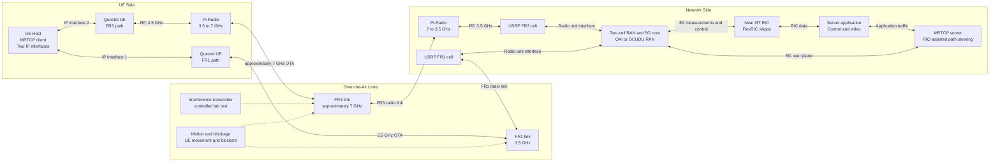
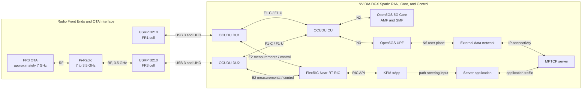

# Falcomm

**Bound KPM application subscriptions, 2026-10-26:** the existing 27-metric/
100 ms identity xApp now accepts app registrations and pushes full matched
link/UE/session/IP reports. The independent dummy saves TXT and timing evidence.
Offline regressions and a paced archived-input/socket/TXT comparison pass. A
subsequent [120-second live test](docs/reports/du27_app_subscription_live_2026-10-26.md)
receives and writes all 2,400 reports, with push p99 2.314 ms and normal unregister.
The planned 30-minute live stability run remains pending. See the
[interface and commands](docs/kpm_app_interface.md),
[implementation record](docs/reports/du27_app_subscription_2026-10-26.md) and
[Plan 2](plans/xapp-kpm-app-subscription.md).

**Dual UE live stability, 2026-10-25:** the
[six-minute 27 KPM experiment report](docs/reports/dual_ue_27kpm_stability_report_2026-10-25.md)
records six completed alternating/concurrent uplink phases, stable 100 ms DU
delivery with 1-second CU identity, and continuous current IP binding after
startup. It includes all 27 measurement line charts and archived source data;
RSRP 0 dBFS readings are retained as normal upper-bound values. Sparse field
consistency observations remain documented follow-up work.

**Dual UE checkpoint, 2026-10-24:** the current automatic-reconnect script
optimization stage is complete. The
[English UE2 / FR3 recovery report](docs/reports/ue2_fr3_recovery_experiment_report_2026-10-24.md)
records two successful TX-gain disturbance/recovery cycles with fresh IPv4
allocations and both source-bound and ordinary ping. This is a functional
checkpoint. Cold-start reproduction, full repeatability and bidirectional
link-loss/recovery are tracked as
[supplemental experiments](docs/development/dual_ue_supplemental_experiments.md),
not current acceptance criteria or merge prerequisites.

**DU console startup:** the [DU1/DU2 launch commands](docs/dual_ue_spark_quick_commands.md#5-start-du1-and-du2-in-separate-terminals-and-keep-both-running)
use the [PTY console launcher](scripts/dual_fr1/run_du_console.sh) to retain
interactive commands and record startup output. After startup, verify `;h;`
in each DU terminal; runtime RX gain changes use semicolon-delimited commands.

**Spark network update, 2026-10-23:** UE1 now uses `ogstun_1 / 10.45.0.1/16`
and UE2 uses `ogstun_2 / 10.46.0.1/16`, both with MTU 1400 and the existing
shared UPF. The migration and independent Spark-side checks passed; fresh
post-split application traffic was subsequently verified in the MPTCP run below.
Cold-boot reproduction is a nonblocking supplemental experiment. See the
[TUN split guide and archived scripts](docs/networking/dual_ue_tun_split.md).

**MPTCP experiment report: [2026-10-23 FR1/FR3 Video and Switching](docs/reports/mptcp_video_experiment_report_2026-10-23.md)**
reconstructs the screenshot's complete session from 9,624 transport records and
948 player reports: 870.269 MB of MPX application data, mean payload goodput
7.228 Mbit/s, seven FR3 down/up cycles, and one 9.819-second rebuffer.
It includes full-session and screenshot-window plots, downloadable CSVs,
original records and reproducible analysis. Both radios used n78 FR1; “FR3”
was the second path's logical demo label.

**Experiment report: [2026-10-13 Dual UE and Dual DU Uplink Experiment](docs/reports/dual_ue_ul_experiment_report_2026-10-13.md)** covers link configurations, concurrent TCP UL, KPM from both DUs, clock correction, throughput and CRC plots, and the scope of path-isolation acceptance.

Falcomm is a 5G/AI-RAN experimental platform based on the NVIDIA DGX Spark. **On 2026-10-13, concurrent TCP uplink delivered receiver UE1 13.8 Mbit/s and UE2 17.3 Mbit/s, both with sender Retr 0 and process exit 0. The xApp received 123 real UE callbacks per DU, including 63/61 complete UL-active five-metric rows, with successful subscription/deletion and normal exit.** The [retained analysis](docs/evidence/2026-10-13_dual_kpm_reports/manifest.json) reconciles the approximately 199.27-second Spark/Laptop clock difference and retains both captures, parsed rows and the throughput/CRC plot. This establishes concurrent UL functionality and two-DU KPM reception; protocol-explicit cross-layer correlation retains its separate scope. Cold-start, full repeatability/comparative UDP and bidirectional disturbance/survivor tests are supplemental experiments, excluded from current acceptance and merging. Earlier single-link checkpoints are retained. The longer-term objective is dual independent radio paths with FlexRIC telemetry, AI channel/rate prediction, and MPTCP video steering.

**Start here: [Full Reproduction Runbook](docs/runbooks/full_reproduction_runbook.md)** — restart the installed Spark infrastructure, configure the RMU500EK/RM500Q on a new Ubuntu laptop, register, establish IPv4 data, configure WWAN, test local traffic and shut down. [Troubleshooting and the 2026-10-05 debug record](docs/troubleshooting/2026-10-05_sa_bringup.md) explain the repaired failures.

For daily operation, use the command booklets: **[Spark quick commands](docs/single_ue/spark_quick_commands.md)** and **[UE laptop quick commands](docs/single_ue/ue_laptop_quick_commands.md)**. They show compact confirmations; the full runbook retains detailed diagnostics. The [2026-10-07 FlexRIC record](docs/troubleshooting/2026-10-07_flexric_bringup.md) records the codec/version repair, successful subscription and actual UE measurements.

For the two-modem setup, use **[Dual UE laptop quick commands](docs/dual_ue_laptop_quick_commands.md)** and **[Dual UE Spark quick commands](docs/dual_ue_spark_quick_commands.md)**. Start the shared core/CU/RIC, both DUs and both iperf servers on Spark first; then prepare UE1 and UE2 in sequence before concurrent UL. The new **[laptop one-shot startup and self-check](docs/dual_ue_automation.md)** automates modem/SIM selection, enable/registration, live serving-cell checks, PDU connection, host IPv4 configuration and both source-bound and ordinary ping. A matching cell skips serial configuration; a mismatch stops with manual instructions. Successful one-shot startup now holds in a blocking wait without further probes; Ctrl+C/SIGTERM on either kind of launcher runs that role's shutdown, deleting bearers and disabling the modem. The [laptop automatic reconnect Quick Start](docs/dual_ue_laptop_reconnect_quick_start.md) covers continuous monitoring and recovery of dropped/stuck PDUs, with `--interval 1` and `--verbose 1|2|3`. Offline tests and two live UE2 recovery cycles passed; the latest recovery report does not establish symmetric UE1 recovery or full repeatability. Each role has its own modem/SIM selection, cell lock, complete host IPv4 reset, policy table and connectivity checks. [The reset helper](scripts/dual_fr1/reset_ue_network.py) discovers current state and needs only the UE role, without any old IP/CIDR/interface or session ledger. The connection scripts and the handbook's [guarded reset blocks](docs/dual_ue_laptop_quick_commands.md#block-wifi-fallback) prevent ordinary ping and traffic to `10.45.0.1` / `10.46.0.1` from falling back to Wi-Fi after reset; rebuilding installs both source and destination lookups. Management Wi-Fi remains available. The operator completed the [two-subnet core migration](docs/networking/dual_ue_subnets.md) for UE2 `internet2 / 10.46.0.1`; both role IPv4/private-ping, individual UL and subsequent concurrent UL/KPM functionality checkpoints passed. Cold-start, full repeatability and bidirectional disturbance testing are follow-up experiments, not prerequisites for current acceptance or merging.

As of **2026-10-13**, [Plan 3](plans/dual-ue-du-fr1-channels.md) uses **UL-only dual-link acceptance**. Underflow remediation is deferred and count/growth alone is nonblocking for this scope. Both B210 DUs are deployed with distinct radio/cell/F1/E2 identities, and both intended SIMs have registration/PDU/private-ping and individual UL checkpoints. The latest concurrent run now passes application UL functionality and real DU-tagged KPM reception. The October 24 Plan 3 revision moves cold-start, full repeatability and bidirectional disturbance/survivor testing to supplemental experiments outside current acceptance and merging. The earlier disconnected-xApp deletion-failure RIC abort path remains unfixed; normal monitor completion is still required. Follow the [DU2 bring-up procedure](docs/runbooks/dual_fr1_runbook.md). The [2026-10-12 daily log](dev_logs/2026-10-12_ruibin.md) and [retained evidence](docs/evidence/2026-10-12_du1_3660mhz/manifest.json) remain the historical single-DU UL result.

For the new cards, follow [SIM Provisioning and Dual-UE Preparation](docs/setup/sim_provisioning_and_dual_ue.md): reader setup, personalization, authentication checks, modem verification, and the remaining Open5GS/dual-link work.

## Verified Single-Link Architecture

```text
Linux laptop application ↔ WWAN ↔ RMU500EK / RM500Q-GL
    ↔ NR SA n78 / 3660 MHz ↔ B210 (3271233) ↔ OCUDU DU1
    ↔ F1 ↔ OCUDU CU ↔ N3 ↔ Open5GS UPF ↔ ogstun_1 ↔ Spark application
```

CU-to-AMF N2 carries access signaling; SMF controls the UPF over N4/PFCP. The tested application endpoints are Spark `10.45.0.1` and the current UE allocation in `10.45.0.0/16`. Management Wi-Fi is separate. The local experiment does not require Internet NAT or changing the laptop's Wi-Fi default route.

The verified telemetry connection is `OCUDU DU1 ↔ E2 ↔ FlexRIC ↔ KPM xApp`. E2 Setup, KPM subscription, actual gNB-DU UE reports and subscription deletion passed.

## Target Architecture

The verified dual-UE deployment uses two subscribers on the same laptop, each with its own SIM, modem and intended DU path:

```text
OC011830 / IMSI 001010000000101 → Quectel #1 → DU1 ─┐
                                                  ├→ shared CU → Open5GS / UPF
OC011831 / IMSI 001010000000102 → Quectel #2 → DU2 ─┘

UE laptop: two independent WWAN interfaces / IP paths → MPTCP primary/backup demo
```

Both cards use PLMN `00101`, but have independent K/OPc pairs. The shared PLMN does not force SIM1 onto DU1 or SIM2 onto DU2; cell selection and the observed serving cell must establish that intended association. Both intended UE/cell paths and concurrent UL/KPM passed functional tests. The October 23 MPTCP video experiment verified primary/backup switching. MPTCP uses the two IP paths without merging their RAN/core subscriber identities. The FR1/FR3 research design below remains the longer-term target.



The future FR1/FR3 diagram uses nominal 3.5 GHz equipment interfaces and an approximately 7 GHz converted OTA path. The verified dual-UE radios operate at **3660 MHz and 3600 MHz**, both within n78. Pi-Radio frequency conversion and RIC/AI-assisted steering remain future work. FlexRIC and the KPM xApps receive actual measurements from both DUs. The working RAN is OCUDU with Open5GS; the OAI label in the concept diagram is an alternative implementation, not part of the current deployment.

### Network-Side Implementation: OCUDU, Open5GS, and FlexRIC

The following diagram expands the planned network-side implementation on the DGX Spark. The FR1 and FR3 radio branches terminate at separate OCUDU DUs. The FR3 Pi-Radio unit downconverts the approximately 7 GHz OTA signal to the 3.5 GHz interface used by the network-side radio chain.



In the target system, E2 carries DU/RAN measurements to FlexRIC, and the xApp provides path-steering input to the server application and MPTCP controller. The diagram describes the future two-path implementation. The single-DU chain has now been verified through SA registration, IPv4 PDU setup and initial application traffic, as described below.

Both DUs' E2 connections and simultaneous actual UE KPM collection are verified, with stable DU/F1AP attribution in the latest capture. The [October 21 identity report](docs/reports/ue_identity_dual_ue_live_2026-10-21.md) verifies experimental CU/DU/Core IP association during simultaneous traffic and bidirectional idle/resume. Explicit serving-DU/context-generation transport and the RIC/AI steering connections remain future work.

## Current Status

Current dual-UE results are the October 13 concurrent UL/KPM checkpoint,
the October 21 identity association trials, the October 23 TUN/MPTCP video
experiment and the October 24 UE2 recovery report linked above. The following
single-link bring-up records retain their original dates.

The reported **2026-10-05** session verified private SSB detection, PRACH/PUSCH with CRC OK and strong uplink SINR, SA registration/authentication, attached packet service, IPv4 PDU/IP allocation, a connected bearer and manually configured WWAN. The first 10-second TCP uplink test reported **6.29 Mbit/s sender, 5.09 Mbit/s receiver, 0 sender retransmissions**. This is a functional user-plane result; throughput and sustained real-time operation are not yet characterized.

Confirmed repairs were NRF serving PLMN `999/70` → `001/01`, provisioning the missing subscriber, reliable NR/SA private-cell selection, subscriber session type 3 (IPv4v6) → type 1 (IPv4) after OCUDU rejection, host performance tuning, and static WWAN configuration. RX gain 40 was validated by successful uplink access. See [Project Progress](docs/project_progress_and_configuration.md) and the [chronological debug record](docs/troubleshooting/2026-10-05_sa_bringup.md).

On **2026-10-07**, FlexRIC `73650812` registered DU1 and the C xApp subscribed to RAN function ID 2, received all five DU metrics for actual gNB-DU UE ID `14`, then deleted the subscription and exited normally. Selected samples show RLC-derived uplink throughput of **14.163–14.675 Mbit/s** and UL PRB usage of **86%**. These are KPM measurements; a new synchronized application throughput benchmark was not recorded. The earlier pinned `1a3903a7` used a modified KPM ASN.1 codec that failed to decode in OCUDU for Format 4. Updating FlexRIC corrected the subscription failure. See the [FlexRIC bring-up record](docs/troubleshooting/2026-10-07_flexric_bringup.md) for units and the invalid indication-latency display.

After installing the [timestamp repair](docs/troubleshooting/2026-10-07_flexric_latency_fix.md), a later actual UE ID `2` run produced **12 `report_age_us` values from 499 to 717 microseconds**, with normal subscription deletion and exit. Selected UL RLC throughput samples were **11.916–11.927 Mbit/s**, with UL PRB usage **88%**. The repaired display measures age relative to the decoded report timestamp, including processing and queuing; it does not establish pure transport latency or application goodput.

Open Cells **OC011830** now holds IMSI `001010000000101` / `OpenCells101`; **OC011831** holds IMSI `001010000000102` / `OpenCells102`. Both passed Milenage authentication at programmer SQN **64**, with a reported HSS reference SQN **96**, and both Quectel USIM applications were ready. SIM2 was also verified in the second physical RM500QGL_VH, IMEI `863305041980706`; the first unit's previously observed IMEI was `863305041978437`. These are SIM/UICC checks, not successful private-network registration. The verified single-link subscriber remains IMSI `001010000000001`.

Authentication secrets stay in local permission-600 files `~/sim_du1_credentials.txt` and `~/sim_du2_credentials.txt`, outside Git. The original preparation sequence was to create or verify the two matching Open5GS subscriber records with SST 1 and IPv4 session type 1, checking Open5GS SQN representation before using the programmer's reference value. The prepared subnet migration keeps UE1 DNN `internet` and changes UE2 to `internet2`, with address pools `10.45.0.0/16` and `10.46.0.0/16`. Then deploy CU + DU1 + DU2, verify each UE's intended cell and registration, establish separate PDU/WWAN/IP paths, and test MPTCP. Extend the already verified DU1 FlexRIC telemetry to per-DU/per-UE monitoring after dual-link reception works.

## Platform and Software Versions

This table records the original single-link platform. Current radio and
software revisions are retained with each dated dual-UE experiment report.

| Component | Recorded configuration |
|---|---|
| Host | NVIDIA DGX Spark, aarch64, Ubuntu 24.04.5 LTS |
| Kernel | NVIDIA `7.0.0-1019-nvidia`, `PREEMPT_DYNAMIC` |
| OCUDU | `release_26_04`, commit `050a2bb`, built with Clang 18 |
| FlexRIC | `br-flexric`, pinned `73650812`; GCC 13.3, Debug, E2AP v3 / KPM v3.00, C xApp, no xApp DB |
| Open5GS | `2.8.0~noble5` |
| MongoDB | Docker image `mongo:7.0-jammy` (arm64) |
| Radio interface | Ettus B210 #1, UHD `4.6.0.0`; ZeroMQ is not used in the current deployment |
| Radio settings | n78, carrier ARFCN 650000 / 3750 MHz, SSB ARFCN 649632, 20 MHz, 30 kHz; 2026-10-05 traffic used TX 80 / RX 40; 2026-10-07 inspected file has TX 70 / RX 40 |
| UE | RMU500EK / RM500QGL_VH, firmware `RM500QGLABR13A03M4G` |
| Private session | PLMN `00101`, TAC 7, SST 1, DNN `internet`, IPv4 only |
| MPTCP | Supported by the NVIDIA kernel; `net.mptcp.enabled = 1` |

Versions and runtime results above are drawn from the deployment records. FlexRIC and the C KPM xApp receive actual UE telemetry; the AI control path and active steering remain pending.

## Document Index

```text
README.md
docs/
├── dual_ue_laptop_quick_commands.md
├── dual_ue_spark_quick_commands.md
├── dual_ue_automation.md
├── dual_ue_laptop_reconnect_quick_start.md
├── project_progress_and_configuration.md
├── setup/
│   ├── software_installation_and_drivers.md
│   └── sim_provisioning_and_dual_ue.md
├── runbooks/
│   ├── full_reproduction_runbook.md
│   ├── dual_fr1_runbook.md
│   └── dual_ue_laptop_reconnect_reference.md
├── networking/
│   ├── dual_ue_subnets.md
│   └── dual_ue_tun_split.md
├── development/
│   ├── development_handoff.md
│   └── ue_identity_xapp.md
├── single_ue/
│   ├── spark_quick_commands.md
│   └── ue_laptop_quick_commands.md
├── reports/
├── evidence/
├── figures/
└── troubleshooting/
    ├── 2026-10-05_sa_bringup.md
    ├── 2026-10-07_flexric_bringup.md
    └── 2026-10-07_flexric_latency_fix.md
```

| Document | Purpose |
|---|---|
| [Dual UE laptop quick commands](docs/dual_ue_laptop_quick_commands.md) | IMEI/SIM selection, SA locks, actual IPv4 bearers, source/destination policy paths, concurrent UL with automatic current-bearer discovery and complete per-role IPv4 reset without old-session parameters |
| [Dual UE Spark quick commands](docs/dual_ue_spark_quick_commands.md) | Core/CU/RIC/two-DU startup, two server endpoints, DU-tagged KPM capture and shutdown |
| [Laptop one-shot startup and self-check](docs/dual_ue_automation.md) | One startup/self-check, then a passive wait until Ctrl+C shuts down the selected UE; optional batch exit and manual recovery |
| [Laptop automatic reconnect Quick Start](docs/dual_ue_laptop_reconnect_quick_start.md) | Commands and expected results for two reconnect watchers, concurrent iperf and Spark section 7 identity/RF capture |
| [Laptop automatic reconnect full reference](docs/runbooks/dual_ue_laptop_reconnect_reference.md) | Archived detailed instructions: USB/AT mapping, recovery policy, intervals, output levels, logs, troubleshooting and MPX IP adaptation |
| [Project Progress and System Configuration](docs/project_progress_and_configuration.md) | Verified architecture, phase status, configuration values and remaining work |
| [Software Installation, Drivers, and OCUDU Environment](docs/setup/software_installation_and_drivers.md) | Software dependencies, drivers, compiler/build environment and installation issues |
| [SIM Provisioning and Dual-UE Preparation](docs/setup/sim_provisioning_and_dual_ue.md) | Open Cells card programming, protected credentials, Quectel checks, and remaining dual-subscriber/dual-DU validation |
| [Full Reproduction Runbook](docs/runbooks/full_reproduction_runbook.md) | Startup, laptop setup, registration, IPv4 data, traffic and shutdown commands |
| [Spark quick commands](docs/single_ue/spark_quick_commands.md) | Command booklet for core, CU, FlexRIC, DU, xApp, traffic and shutdown with compact checks |
| [UE laptop quick commands](docs/single_ue/ue_laptop_quick_commands.md) | Command booklet for modem selection, SA registration, IPv4 bearer, WWAN and traffic |
| [Dual UE subnet migration](docs/networking/dual_ue_subnets.md) | Prepared two-DNN address pools, Spark service addresses, targeted subscriber change and rollback |
| [Dual UE Spark TUN split](docs/networking/dual_ue_tun_split.md) | Current `ogstun_1` / `ogstun_2` layout, archived migration/configurations, Spark evidence and rollback |
| [5G SA Bring-up Debug Record, 2026-10-05](docs/troubleshooting/2026-10-05_sa_bringup.md) | Dated evidence, confirmed repairs and troubleshooting decision tree/matrix |
| [FlexRIC Bring-up Record, 2026-10-07](docs/troubleshooting/2026-10-07_flexric_bringup.md) | Version/codec repair, E2/KPM lifecycle and actual UE metrics |
| [FlexRIC Timestamp Repair, 2026-10-07](docs/troubleshooting/2026-10-07_flexric_latency_fix.md) | Tested timestamp patch, deployment command and report-age semantics |
| [Development Handoff](docs/development/development_handoff.md) | Working constraints and next steps for continued development |
| [UE identity xApp](docs/development/ue_identity_xapp.md) | Standalone xApp implementation, CU/DU/Core association, build/start commands and validation scope |
| [Dual UE supplemental experiments](docs/development/dual_ue_supplemental_experiments.md) | Cold-start, repeatability/comparative and bidirectional disturbance requirements; excluded from current acceptance and merging |

The five files at the top of `docs/` cover the Laptop/Spark command booklets,
Laptop one-shot automation, Laptop automatic reconnect and project status. Supporting documents are grouped under `setup/` (installation
and SIM preparation), `runbooks/` (full procedures), `networking/` (subnets and
TUN interfaces), `development/` (implementation and handoff), and `single_ue/`
(the earlier single-UE command booklets). Experiment reports, retained evidence,
figures and troubleshooting records keep their own directories.

New members should read the project overview and configuration first, prepare missing software using the installation guide, then follow the runbook. Consult the dated debug record when a stage fails and the handoff document before extending the system. The quick command booklets summarize the canonical runbook for each host; future experiment records use `docs/troubleshooting/YYYY-MM-DD_topic.md`.

## Quick Start

The following reproduces the existing single-link subscriber `001010000000001`. For the new `...101` / `...102` cards, complete the matching subscriber records and dual-UE preparation in the [SIM guide](docs/setup/sim_provisioning_and_dual_ue.md) first. Follow the [Full Reproduction Runbook](docs/runbooks/full_reproduction_runbook.md) one stage at a time:

1. Check B210/USB 3 while DU is stopped; apply and verify the recorded OCUDU performance settings.
2. Start/check MongoDB, verify the exact subscriber is IPv4-only, and align NRF/AMF PLMN.
3. Start the ten required SA services and verify AMF/PFCP and the role's Spark TUN (`ogstun_1` for UE1; `ogstun_2` for UE2).
4. Launch CU with `sudo` and FlexRIC in separate foreground terminals, then launch DU with the base and E2 overlay configs; verify N2, F1, GTP-U and E2.
5. Configure the laptop modem for NR SA/private SSB, establish IPv4 data, and apply the actual active bearer's host settings.
6. Test local private traffic and record RF-error growth. Run the 10-second KPM xApp during UE traffic to validate actual reports.
7. Stop traffic/xApp and the laptop PDU first, then DU, FlexRIC, CU and core.

Before operation, verify that local configuration files and device state match the [Full Reproduction Runbook](docs/runbooks/full_reproduction_runbook.md). The current dual-UE configurations use **3660 MHz for DU1** and **3600 MHz for DU2**. Operate only at an authorized frequency, location, and power level. Do not run UHD probes or benchmarks that access the B210 while the DU is using it.

The current Falcomm over-the-air chain uses **UHD and a USRP B210**. ZeroMQ settings in upstream RIC tutorials describe a software-radio example and are not part of this deployment. FlexRIC validation should enable E2 on the existing UHD/DU configuration.

## Scope and Limitations

- The verified configuration now includes two DUs, two B210s and two RM500Q modems with concurrent 60-second TCP UL functionality. Cold-start/new-laptop reproduction, repeated comparative UL/UDP measurements and bidirectional disturbance/survivor trials remain supplemental experiments, not current acceptance or merge requirements. The October 23 MPTCP video trial passed with one measured rebuffering event.
- Both intended SIM/modem identities, registered IPv4/private-ping paths and concurrent UL/KPM checkpoints are verified. The MPTCP primary/backup video demo and UE2 recovery with changed IPs passed in separate experiments. The complete symmetric disturbance/survivor experiment remains follow-up work, excluded from current acceptance and merging.
- FlexRIC E2 Setup, real two-DU UE KPM, the repaired report-age display and normal subscription/deletion are verified. The October 13 application/KPM timeline retains its approximate retrospective clock correction. Both hosts were synchronized to external NTP before the October 24 recovery trial; this does not recalibrate historical traces. Protocol-explicit identity correlation and sustained stability remain validation tasks.
- The 30.72 MS/s, 20-s UHD benchmark is a radio/USB stress test. The current OCUDU configuration uses a 23.04 MS/s sample rate.
- The NVIDIA kernel, PREEMPT_RT status, and system-default GCC configuration are retained to preserve the reproducible baseline.
- `ocudu_performance` and privileged RAN launch were applied. Recurring RF failures improved; long-duration stability is still open.
- Runtime modem/bearer/AT/QMI/WWAN identifiers and UE IPv4 can change. Query them rather than reusing example IDs or addresses.
- SIM authentication secrets, authentication vectors and derived RAN keys must remain outside Git. INFO logs require sanitization before sharing.
