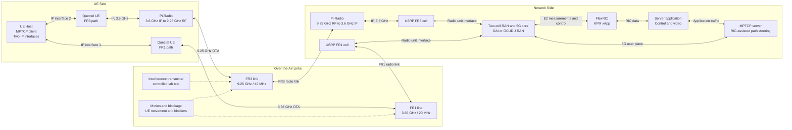
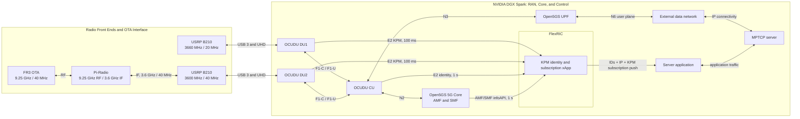

# Falcon

Experiment reports and their selected figures are versioned under
`docs/experiments/reports/`. Detailed evidence, full message captures, logs,
CSV/JSON results and working records remain local and are excluded from Git.
Historical raw-artifact references require that local archive; a fresh clone
includes the reports, figures, instructions, project status, interface examples
and synthetic test fixtures. See the
[archive policy](docs/experiments/README.md#local-archive-policy).

**Current two-link radio profiles, 2026-10-30:** DU1 uses **3660 MHz / 20 MHz / TX 70 / RX 35**;
DU2 uses **9250-MHz FR3 OTA through Pi-Radio / 40 MHz / TX 60 / RX 10**,
with a **3600-MHz logical n78 USRP/modem interface**.
DU2's gains were tuned for the modified FR3 hardware, and 9250 MHz is its
deployment going forward, as confirmed by the operator.
Both UEs connected in the October 29 direct n78 test without Pi-Radio;
that earlier checkpoint used DU2 TX 45 / RX 20. Completed integrated FR3
UE/PDU connectivity and sustained traffic/KPM still require retained run evidence. The
[radio design and validation scope](docs/project_design_and_progress.md) defines
the complete profiles, SSB locks, IP paths and distinction from earlier runs.

**Bound KPM application subscriptions, 2026-10-26:** the existing 27-metric/
100 ms identity xApp now accepts app registrations and pushes full matched
link/UE/session/IP reports. The independent dummy saves TXT and timing evidence.
Offline regressions and a paced archived-input/socket/TXT comparison pass. A
subsequent [120-second live test](docs/experiments/reports/du27_app_subscription_live_2026-10-26.md)
receives and writes all 2,400 reports, with push p99 2.314 ms and normal unregister.
The subsequent [six-minute alternating/concurrent uplink test](docs/experiments/reports/du27_app_subscription_6min_live_2026-10-26.md)
delivers and writes all 7,200 reports, with push p99 3.595 ms, stable 100 ms
per-link cadence, and normal dummy/xApp/E2 cleanup. Its report includes delivery,
traffic, and all 27 metric plots with archived raw data.
The planned 30-minute live stability run remains pending. See the
[interface and commands](docs/interface/README.md#10-service-operation-and-offline-verification),
[MPTCP client interface and working dummy use case](docs/interface/README.md),
[implementation record](docs/experiments/reports/du27_app_subscription_2026-10-26.md) and
[Plan 2](plans/xapp-kpm-app-subscription.md).

**Dual UE live stability, 2026-10-25:** the
[six-minute 27 KPM experiment report](docs/experiments/reports/dual_ue_27kpm_stability_report_2026-10-25.md)
records six completed alternating/concurrent uplink phases, stable 100 ms DU
delivery with 1-second CU identity, and continuous current IP binding after
startup. It includes all 27 measurement line charts and archived source data;
RSRP 0 dBFS readings are retained as normal upper-bound values. Sparse field
consistency observations remain documented follow-up work.

**Dual UE checkpoint, 2026-10-24:** the current automatic-reconnect script
optimization stage is complete. The
[English UE2 / FR3 recovery report](docs/experiments/reports/ue2_fr3_recovery_experiment_report_2026-10-24.md)
records two successful TX-gain disturbance/recovery cycles with fresh IPv4
allocations and both source-bound and ordinary ping. This is a functional
checkpoint. Cold-start reproduction, full repeatability and bidirectional
link-loss/recovery are tracked as
[supplemental experiments](docs/experiments/supplemental_experiments.md),
not current acceptance criteria or merge prerequisites.

**DU console startup:** the [DU1/DU2 launch commands](docs/spark_quick_commands.md#5-start-du1-and-du2-in-separate-terminals-and-keep-both-running)
use the [PTY console launcher](scripts/dual_fr1/run_du_console.sh) to retain
interactive commands and record startup output. After startup, verify `;h;`
in each DU terminal; runtime RX gain changes use semicolon-delimited commands.

**Spark network update, 2026-10-23:** UE1 now uses `ogstun_1 / 10.45.0.1/16`
and UE2 uses `ogstun_2 / 10.46.0.1/16`, both with MTU 1400 and the existing
shared UPF. The migration and independent Spark-side checks passed; fresh
post-split application traffic was subsequently verified in the MPTCP run below.
Cold-boot reproduction is a nonblocking supplemental experiment. See the
[TUN split guide and archived scripts](docs/operations/networking.md).

**MPTCP experiment report: [2026-10-23 FR1/FR3 Video and Switching](docs/experiments/reports/mptcp_video_experiment_report_2026-10-23.md)**
reconstructs the screenshot's complete session from 9,624 transport records and
948 player reports: 870.269 MB of MPX application data, mean payload goodput
7.228 Mbit/s, seven FR3 down/up cycles, and one 9.819-second rebuffer.
It includes full-session and screenshot-window plots, downloadable CSVs,
original records and reproducible analysis. Both radios used n78 FR1; “FR3”
was the second path's logical demo label.

**Experiment report: [2026-10-13 Dual UE and Dual DU Uplink Experiment](docs/experiments/reports/dual_ue_ul_experiment_report_2026-10-13.md)** covers link configurations, concurrent TCP UL, KPM from both DUs, clock correction, throughput and CRC plots, and the scope of path-isolation acceptance.

Falcon is a 5G/AI-RAN experimental platform based on the NVIDIA DGX Spark. **On 2026-10-13, concurrent TCP uplink delivered receiver UE1 13.8 Mbit/s and UE2 17.3 Mbit/s, both with sender Retr 0 and process exit 0. The xApp received 123 real UE callbacks per DU, including 63/61 complete UL-active five-metric rows, with successful subscription/deletion and normal exit.** The [retained analysis](docs/experiments/evidence/2026-10-13_dual_kpm_reports/manifest.json) reconciles the approximately 199.27-second Spark/Laptop clock difference and retains both captures, parsed rows and the throughput/CRC plot. This establishes concurrent UL functionality and two-DU KPM reception; protocol-explicit cross-layer correlation retains its separate scope. Cold-start, full repeatability/comparative UDP and bidirectional disturbance/survivor tests are supplemental experiments, excluded from current acceptance and merging. Earlier single-link checkpoints are retained. The longer-term objective is dual independent radio paths with FlexRIC telemetry, AI channel/rate prediction, and MPTCP video steering.

**Start here: [Project Design and Progress](docs/project_design_and_progress.md)** — current architecture, radio profiles, verified results and next work. Daily operation uses the three quick guides in the document index below. Earlier single-link reproduction and debugging remain historical references.

For daily operation use [Spark quick commands](docs/spark_quick_commands.md),
then choose the [Laptop one-shot](docs/laptop_single_quick_start.md) or
[Laptop reconnect](docs/laptop_reconnect_quick_start.md) guide. Spark prepares the
shared Core/CU/FlexRIC, both DUs and both traffic endpoints before the Laptop
UE sequences. Each role independently selects its modem/SIM and current bearer,
checks its actual serving cell, and owns its policy route and Wi-Fi fallback guard.
The [manual reference](docs/operations/manual_laptop_startup.md) supplies detailed
modem, route, reset and shutdown procedures; [reconnect details](docs/operations/reconnect_reference.md)
explain recovery policy and troubleshooting. Completed experiments and their
remaining scope are summarized in the current design/progress document.

As of **2026-10-13**, [Plan 3](plans/dual-ue-du-fr1-channels.md) uses **UL-only dual-link acceptance**. Underflow remediation is deferred and count/growth alone is nonblocking for this scope. Both B210 DUs are deployed with distinct radio/cell/F1/E2 identities, and both intended SIMs have registration/PDU/private-ping and individual UL checkpoints. The latest concurrent run now passes application UL functionality and real DU-tagged KPM reception. The October 24 Plan 3 revision moves cold-start, full repeatability and bidirectional disturbance/survivor testing to supplemental experiments outside current acceptance and merging. The earlier disconnected-xApp deletion-failure RIC abort path remains unfixed; normal monitor completion is still required. Follow the [DU2 bring-up procedure](docs/spark_quick_commands.md#5-start-du1-and-du2-in-separate-terminals-and-keep-both-running). The [2026-10-12 daily log](dev_logs/2026-10-12_ruibin.md) and [retained evidence](docs/experiments/evidence/2026-10-12_du1_3660mhz/manifest.json) remain the historical single-DU UL result.

For card provisioning or a fresh installation, use [SIM Provisioning and Dual-UE Preparation](docs/operations/setup/sim_provisioning_and_dual_ue.md). Its original preparation checkpoint is historical; current subscriber and radio mappings are in Project Design and Progress.

## Verified Single-Link Architecture

```text
Linux laptop application ↔ WWAN ↔ RMU500EK / RM500Q-GL
    ↔ NR SA n78 / 3660 MHz ↔ B210 (3271233) ↔ OCUDU DU1
    ↔ F1 ↔ OCUDU CU ↔ N3 ↔ Open5GS UPF ↔ ogstun_1 ↔ Spark application
```

CU-to-AMF N2 carries access signaling; SMF controls the UPF over N4/PFCP. The tested application endpoints are Spark `10.45.0.1` and the current UE allocation in `10.45.0.0/16`. Management Wi-Fi is separate. The local experiment does not require Internet NAT or changing the laptop's Wi-Fi default route.

The verified telemetry connection is `OCUDU DU1 ↔ E2 ↔ FlexRIC ↔ KPM xApp`. E2 Setup, KPM subscription, actual gNB-DU UE reports and subscription deletion passed.

## Target Architecture

The verified dual-UE deployment uses two subscribers on the same laptop, each with its own SIM, modem and intended DU path:

```text
OC011830 / IMSI 001010000000101 → Quectel #1 → DU1 ─┐
                                                  ├→ shared CU → Open5GS / UPF
OC011831 / IMSI 001010000000102 → Quectel #2 → DU2 ─┘

UE laptop: two independent WWAN interfaces / IP paths → MPTCP primary/backup demo
```

Both cards use PLMN `00101`, but have independent K/OPc pairs. The shared PLMN does not force SIM1 onto DU1 or SIM2 onto DU2; cell selection and the observed serving cell must establish that intended association. Both intended UE/cell paths and concurrent UL/KPM passed functional tests on their recorded radio profiles. The October 23 MPTCP video experiment verified primary/backup switching. MPTCP uses the two IP paths without merging their RAN/core subscriber identities. The RF branches below describe the current FR1/FR3 deployment; RIC/AI-assisted steering remains a research target.



The current FR3 deployment uses a **3600-MHz USRP/modem interface and a 9250-MHz OTA center through Pi-Radio conversion**. DU2 uses **40 MHz / 46.08 MS/s / TX 60 / RX 10**, tuned for the modified FR3 hardware, while DU1 uses **3660 MHz / 20 MHz / 23.04 MS/s / TX 70 / RX 35**. The operator confirmed license availability for the 9.25-GHz experiment, completed Pi-Radio manual calibration and completed Quectel antenna rewiring. Both OCUDU cells retain logical n78 configurations, and E2/RIC do not automatically learn the external RF conversion. On October 29 both UEs connected in the earlier direct test, with no Pi-Radio installed and DU2 gains then at TX 45 / RX 20. Earlier dual-UE experiment results used DU2 at 20 MHz; those results retain their own configurations and validation scope. See the [current radio design](docs/project_design_and_progress.md). FlexRIC and the KPM xApp receive measurements from both DUs. RIC/AI-assisted steering remains future work. The working RAN is OCUDU with Open5GS; the OAI label in the concept diagram is an alternative implementation.

### Network-Side Implementation: OCUDU, Open5GS, and FlexRIC

The following diagram expands the network-side design on the DGX Spark. The FR1 and FR3 radio branches terminate at separate OCUDU DUs. The FR3 Pi-Radio unit translates between the 9250-MHz OTA signal and the 3600-MHz interface used by the network-side USRP.



E2 carries DU measurements and CU identity to FlexRIC. Its xApp matches these with Core IP context and pushes IDs + IP + KPM to subscribed applications. Subscription delivery is verified by the October 26 direct-radio experiments; MPTCP adaptation and RIC/AI steering retain their own scope. The RF diagram shows the current Pi-Radio branch; the historical October 29 connection test used a direct 3600-MHz UE2 path.

Both DUs' E2 connections and simultaneous actual UE KPM collection are verified, with stable DU/F1AP attribution in the retained captures. The [October 21 identity report](docs/experiments/reports/ue_identity_dual_ue_live_2026-10-21.md) verifies experimental CU/DU/Core IP association during simultaneous traffic and bidirectional idle/resume. Explicit serving-DU scope was subsequently accepted on October 25. Shared lifecycle-generation proof and RIC/AI steering remain follow-up work. These experiments used the earlier direct-radio profiles.

## Current Status

Dual-UE results include the October 13 concurrent UL/KPM checkpoint,
the October 21 identity association trials, the October 23 TUN/MPTCP video
experiment, October 24 UE2 recovery, October 25–26 100-ms/27-KPM subscription
experiments, the October 29 direct-radio 20/40-MHz connection checkpoint,
and the October 30 operator-confirmed 9250-MHz FR3 hardware/gain configuration.
The following single-link bring-up records retain their original dates.

The reported **2026-10-05** session verified private SSB detection, PRACH/PUSCH with CRC OK and strong uplink SINR, SA registration/authentication, attached packet service, IPv4 PDU/IP allocation, a connected bearer and manually configured WWAN. The first 10-second TCP uplink test reported **6.29 Mbit/s sender, 5.09 Mbit/s receiver, 0 sender retransmissions**. This is a functional user-plane result; throughput and sustained real-time operation are not yet characterized.

Confirmed repairs were NRF serving PLMN `999/70` → `001/01`, provisioning the missing subscriber, reliable NR/SA private-cell selection, subscriber session type 3 (IPv4v6) → type 1 (IPv4) after OCUDU rejection, host performance tuning, and static WWAN configuration. RX gain 40 was validated by successful uplink access. See [Project Progress](docs/project_design_and_progress.md#progress-and-validation-status) and the [chronological debug record](docs/experiments/records/bringup/2026-10-05_sa_bringup.md).

On **2026-10-07**, FlexRIC `73650812` registered DU1 and the C xApp subscribed to RAN function ID 2, received all five DU metrics for actual gNB-DU UE ID `14`, then deleted the subscription and exited normally. Selected samples show RLC-derived uplink throughput of **14.163–14.675 Mbit/s** and UL PRB usage of **86%**. These are KPM measurements; a new synchronized application throughput benchmark was not recorded. The earlier pinned `1a3903a7` used a modified KPM ASN.1 codec that failed to decode in OCUDU for Format 4. Updating FlexRIC corrected the subscription failure. See the [FlexRIC bring-up record](docs/experiments/records/bringup/2026-10-07_flexric_bringup.md) for units and the invalid indication-latency display.

After installing the [timestamp repair](docs/experiments/records/bringup/2026-10-07_flexric_latency_fix.md), a later actual UE ID `2` run produced **12 `report_age_us` values from 499 to 717 microseconds**, with normal subscription deletion and exit. Selected UL RLC throughput samples were **11.916–11.927 Mbit/s**, with UL PRB usage **88%**. The repaired display measures age relative to the decoded report timestamp, including processing and queuing; it does not establish pure transport latency or application goodput.

Open Cells **OC011830** now holds IMSI `001010000000101` / `OpenCells101`; **OC011831** holds IMSI `001010000000102` / `OpenCells102`. Both passed Milenage authentication at programmer SQN **64**, with a reported HSS reference SQN **96**, and both Quectel USIM applications were ready. SIM2 was also verified in the second physical RM500QGL_VH, IMEI `863305041980706`; the first unit's previously observed IMEI was `863305041978437`. These are SIM/UICC checks, not successful private-network registration. The verified single-link subscriber remains IMSI `001010000000001`.

Authentication secrets stay in local permission-600 files `~/sim_du1_credentials.txt` and `~/sim_du2_credentials.txt`, outside Git. The original preparation sequence was to create or verify the two matching Open5GS subscriber records with SST 1 and IPv4 session type 1, checking Open5GS SQN representation before using the programmer's reference value. The prepared subnet migration keeps UE1 DNN `internet` and changes UE2 to `internet2`, with address pools `10.45.0.0/16` and `10.46.0.0/16`. Then deploy CU + DU1 + DU2, verify each UE's intended cell and registration, establish separate PDU/WWAN/IP paths, and test MPTCP. Extend the already verified DU1 FlexRIC telemetry to per-DU/per-UE monitoring after dual-link reception works.

## Platform and Software Versions

This table records the original single-link platform. Current radio and
software revisions are retained with each dated dual-UE experiment report.

| Component | Recorded configuration |
|---|---|
| Host | NVIDIA DGX Spark, aarch64, Ubuntu 24.04.5 LTS |
| Kernel | NVIDIA `7.0.0-1019-nvidia`, `PREEMPT_DYNAMIC` |
| OCUDU | `release_26_04`, commit `050a2bb`, built with Clang 18 |
| FlexRIC | `br-flexric`, pinned `73650812`; GCC 13.3, Debug, E2AP v3 / KPM v3.00, C xApp, no xApp DB |
| Open5GS | `2.8.0~noble5` |
| MongoDB | Docker image `mongo:7.0-jammy` (arm64) |
| Radio interface | Ettus B210 #1, UHD `4.6.0.0`; ZeroMQ is not used in the current deployment |
| Radio settings | n78, carrier ARFCN 650000 / 3750 MHz, SSB ARFCN 649632, 20 MHz, 30 kHz; 2026-10-05 traffic used TX 80 / RX 40; 2026-10-07 inspected file has TX 70 / RX 40 |
| UE | RMU500EK / RM500QGL_VH, firmware `RM500QGLABR13A03M4G` |
| Private session | PLMN `00101`, TAC 7, SST 1, DNN `internet`, IPv4 only |
| MPTCP | Supported by the NVIDIA kernel; `net.mptcp.enabled = 1` |

Versions and runtime results above are drawn from the deployment records. FlexRIC and the C KPM xApp receive actual UE telemetry; the AI control path and active steering remain pending.

## Document Index

The four files at the top of `docs/` are the current entry points:

| Document | Use |
| --- | --- |
| [Project Design and Progress](docs/project_design_and_progress.md) | Current architecture, radio/IP profiles, configuration ownership, verified results and open work |
| [Spark quick commands](docs/spark_quick_commands.md) | Core, CU, FlexRIC, both DUs, traffic servers, xApp/dummy experiments and shutdown |
| [Laptop one-shot quick commands](docs/laptop_single_quick_start.md) | Prepare/check one UE, then hold until Ctrl+C |
| [Laptop reconnect quick commands](docs/laptop_reconnect_quick_start.md) | Prepare and continuously monitor both UEs; matched traffic and subscription tests |

```text
docs/
├── laptop_single_quick_start.md
├── laptop_reconnect_quick_start.md
├── spark_quick_commands.md
├── project_design_and_progress.md
├── operations/                  # detailed procedures, setup, networking and recovery
│   └── setup/
├── reference/                   # identity implementation, one KPM contract and figures
│   └── figures/
├── interface/                   # xApp/MPTCP contract, service operation and working dummy
│   └── examples/
└── experiments/                 # dated results and their supporting artifacts
    ├── reports/
    ├── evidence/
    └── records/                 # historical bring-up, KPM reviews and migration records
```

The [interface](docs/interface/README.md) is the single app adaptation and
service guide. [Identity implementation](docs/reference/ue_identity_xapp.md)
and [KPM definitions](docs/reference/kpm_metrics.md) hold technical contracts.
[Manual startup](docs/operations/manual_laptop_startup.md),
[reconnect details](docs/operations/reconnect_reference.md),
[networking](docs/operations/networking.md), and
[setup](docs/operations/setup/software_installation_and_drivers.md) support the quick guides.
The [experiment index](docs/experiments/README.md) separates historical results,
raw evidence, implementation reviews and supplemental experiments.

## Quick Start

1. Read [Project Design and Progress](docs/project_design_and_progress.md) and
   check the current DU1 FR1 / DU2 9.25-GHz FR3 profiles.
2. Use [Spark sections 1–6](docs/spark_quick_commands.md) to prepare
   Core/CU/RIC, both radios/DUs and application endpoints.
3. On the Laptop, choose the [one-shot](docs/laptop_single_quick_start.md) or
   [continuous reconnect](docs/laptop_reconnect_quick_start.md) entry points.
4. Use the matching Spark/Laptop 7c or 7d sections for the one-dummy
   subscription experiment, then follow their shutdown and evidence steps.

DU2's physical OTA center is 9250 MHz through Pi-Radio; its logical USRP/modem
interface and OCUDU startup output remain 3600 MHz / n78. The current gain
settings are DU1 TX/RX 70/35 and DU2 60/10. Hardware preparation, direct-radio
historical tests and completed FR3 integration have distinct validation scope.
The earlier single-link workflow is retained as a
[historical reproduction reference](docs/operations/legacy_single_ue.md).

## Scope and Limitations

- The verified configuration now includes two DUs, two B210s and two RM500Q modems with concurrent 60-second TCP UL functionality. Cold-start/new-laptop reproduction, repeated comparative UL/UDP measurements and bidirectional disturbance/survivor trials remain supplemental experiments, not current acceptance or merge requirements. The October 23 MPTCP video trial passed with one measured rebuffering event.
- Both intended SIM/modem identities, registered IPv4/private-ping paths and concurrent UL/KPM checkpoints are verified. The MPTCP primary/backup video demo and UE2 recovery with changed IPs passed in separate experiments. The complete symmetric disturbance/survivor experiment remains follow-up work, excluded from current acceptance and merging.
- FlexRIC E2 Setup, real two-DU UE KPM, the repaired report-age display and normal subscription/deletion are verified. The October 13 application/KPM timeline retains its approximate retrospective clock correction. Both hosts were synchronized to external NTP before the October 24 recovery trial; this does not recalibrate historical traces. Protocol-explicit identity correlation and sustained stability remain validation tasks.
- The 30.72 MS/s, 20-s UHD benchmark is a historical radio/USB stress test. The current profiles use 23.04 MS/s for DU1 and 46.08 MS/s for DU2; that benchmark does not validate the new DU2 streaming rate.
- The NVIDIA kernel, PREEMPT_RT status, and system-default GCC configuration are retained to preserve the reproducible baseline.
- `ocudu_performance` and privileged RAN launch were applied. Recurring RF failures improved; long-duration stability is still open.
- Runtime modem/bearer/AT/QMI/WWAN identifiers and UE IPv4 can change. Query them rather than reusing example IDs or addresses.
- SIM authentication secrets, authentication vectors and derived RAN keys must remain outside Git. INFO logs require sanitization before sharing.
