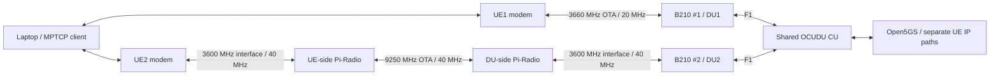

# Dual Link Radio Design and Current Validation

Updated: 2026-10-29.

Falcon uses two independent UE/modem/USRP/DU paths with a shared OCUDU CU,
Open5GS Core and FlexRIC. Link 1 is the direct 3660-MHz FR1 path. Link 2 is
designed for a 9250-MHz FR3 air interface using Pi-Radio converters and
3600-MHz USRP/modem interfaces. OCUDU and the modem retain logical n78
configuration on both paths.

The current validation setup has no Pi-Radio converters: UE2 communicates
directly with its USRP at 3600 MHz. On October 29 the operator confirmed that
both UEs connected with DU1 at 20 MHz and DU2 at 40 MHz. This connection
checkpoint does not establish sustained 40-MHz traffic/KPM performance or
successful operation through the 9250-MHz converted path.

## Current Radio Profiles

| Parameter | Link 1 / UE1 / DU1 / FR1 | Link 2 / UE2 / DU2 / FR3 |
| --- | --- | --- |
| B210 serial | `3271233` | `328B021` |
| OCUDU and USRP carrier | 3660 MHz | 3600 MHz |
| Carrier NR-ARFCN | `644000` | `640000` |
| Logical NR band | n78 | n78 |
| Channel bandwidth | 20 MHz | 40 MHz |
| USRP sample rate | 23.04 MS/s | 46.08 MS/s |
| Antenna configuration | 1T1R | 1T1R |
| Common / SSB SCS | 30 kHz | 30 kHz |
| PCI | `1` | `2` |
| SSB NR-ARFCN | `643680` | `638976` |
| Resource blocks at 30 kHz | 51 | 106 |
| Nominal USRP-side channel | 3650–3670 MHz | 3580–3620 MHz |
| Current direct-test OTA center | 3660 MHz | 3600 MHz |
| Designed OTA center | 3660 MHz | 9250 MHz via Pi-Radio |
| Designed nominal OTA channel | 3650–3670 MHz | 9230–9270 MHz |
| Configured TX / RX gain | 70 / 35 dB | 45 / 20 dB |
| DU ID / sector / NCI | `1` / `0` / `6733824` | `2` / `1` / `6733825` |
| Maintained configuration | [DU1 YAML](../configs/ocudu/dual_fr1/du1_b210_n78_3660mhz.yml) | [DU2 YAML](../configs/ocudu/dual_fr1/du2_b210_n78_40mhz.yml) |

The nominal USRP-side channels have a 30-MHz edge-to-edge gap. Pi-Radio
frequency conversion preserves the intended 40-MHz channel bandwidth; the
converter settings and RF path must support that complete channel at both
ends. Conversion settings and performance are verified separately from the
OCUDU configuration.

The gain values are startup defaults in dB, rather than calibrated output
powers in dBm. Record any runtime console overrides with the run evidence.

## Direct Test and Converted Design

The October 29 direct test uses these two paths:

```text
UE1 modem <-- 3660 MHz / 20 MHz --> B210 #1 <-- USB 3 --> DU1
UE2 modem <-- 3600 MHz / 40 MHz --> B210 #2 <-- USB 3 --> DU2
```

The converted design replaces link 2's direct air interface with matching
converters while preserving its OCUDU and modem settings:



`FR3` remains the application's name for link 2 during direct n78 tests.
That label alone does not establish that Pi-Radio is installed or that a
measurement was taken at 9250 MHz. Record the actual RF arrangement per run.

## Locking and Deployment

OCUDU derives the SSB placement from the carrier, bandwidth and control-channel
configuration. The current DU2 40-MHz profile derives SSB `638976`; its
earlier 20-MHz profile derived `639648`. The two current lock commands are:

```text
UE1: AT+QNWLOCK="common/5g",1,643680,30,78
UE2: AT+QNWLOCK="common/5g",2,638976,30,78
```

Use each command only on its verified modem/AT port. Pi-Radio conversion
does not change these logical n78 lock parameters. Match both converter ends
so that each modem sees the intended logical carrier.

Falcon maintains the YAML templates. The Spark startup procedure copies them
into `/home/nyu/ocudu/configs/`, which the DU launch commands actually read.
Refresh the Laptop script copies after a radio-profile update. The shared
reconnect script checks the saved lock and actual serving cell before PDU
setup; its guarded CME 902 retry is described in the
[reconnect reference](runbooks/dual_ue_laptop_reconnect_reference.md#cme-902-after-a-du-gain-drop).
Existing `dual_fr1` directory names and plan/runbook filenames are retained
for command and link compatibility; they do not describe the converted OTA band.

- [Spark configuration deployment and startup](dual_ue_spark_quick_commands.md)
- [Laptop script update and reconnect](dual_ue_laptop_reconnect_quick_start.md)
- [Manual modem and lock checks](dual_ue_laptop_quick_commands.md)

## Identity and Application Interface

| Attribute | Link 1 | Link 2 |
| --- | --- | --- |
| Modem IMEI | `863305041978437` | `863305041980706` |
| SIM IMSI | `001010000000101` | `001010000000102` |
| DNN | `internet` | `internet2` |
| UE IPv4 pool | `10.45.0.0/16` | `10.46.0.0/16` |
| Spark endpoint / TUN | `10.45.0.1` / `ogstun_1` | `10.46.0.1` / `ogstun_2` |
| Laptop policy table | `151` | `152` |
| Spark iperf3 port | `5201` | `5202` |

Both cells use PLMN `00101`, TAC `7`, and gNB ID `411` with 22 ID bits.
The xApp inside FlexRIC combines E2 CU/DU identity and KPM with Open5GS
AMF/SMF IP context, then pushes **IDs + IP + KPM** to registered applications.
DU reports remain at 100 ms; CU identity and Core polling remain at 1 second.

E2/RIC receive the logical cell information configured in OCUDU. External
Pi-Radio conversion is not automatically reported as a 9250-MHz cell. Treat
physical frequency/path labels as deployment metadata. The version-2
[xApp/MPTCP interface](interface/README.md) retains its existing wire format;
MPTCP associates reports using its current UE IP/path table, rather than an
assumed frequency, DU numbering or historical IP allocation. PRB percentages
must use each cell's current capacity: 51 RBs for DU1 and 106 for DU2.

## Evidence Scope

- October 13–26 experiment reports retain the exact configurations, addresses,
  gains, measurements and outcomes from their own runs. Dual-link reports from
  those runs used a 20-MHz DU2 profile and direct n78 radio paths. Their `FR3`
  labels do not establish converted 9250-MHz operation.
- October 29: the 40-MHz DU2 startup has the expected sample rate and SSB, and
  the operator confirmed successful connection of both UEs in the direct test.
- A new sustained traffic/KPM experiment with DU2 at 40 MHz remains to be
  recorded. Pi-Radio 9250-MHz connection, traffic and KPM correlation require
  separate live validation after the converters are installed.
