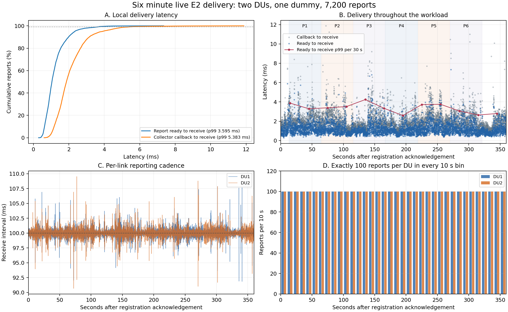
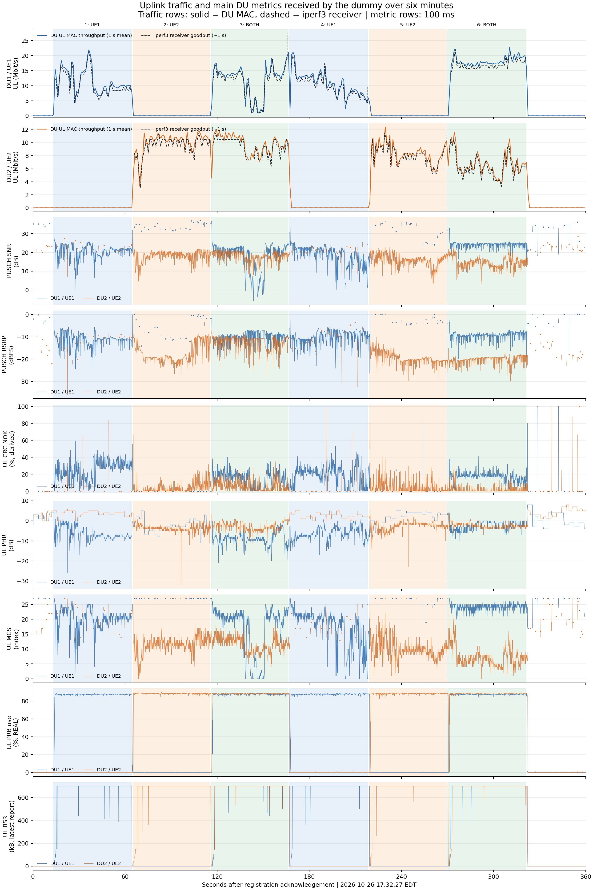
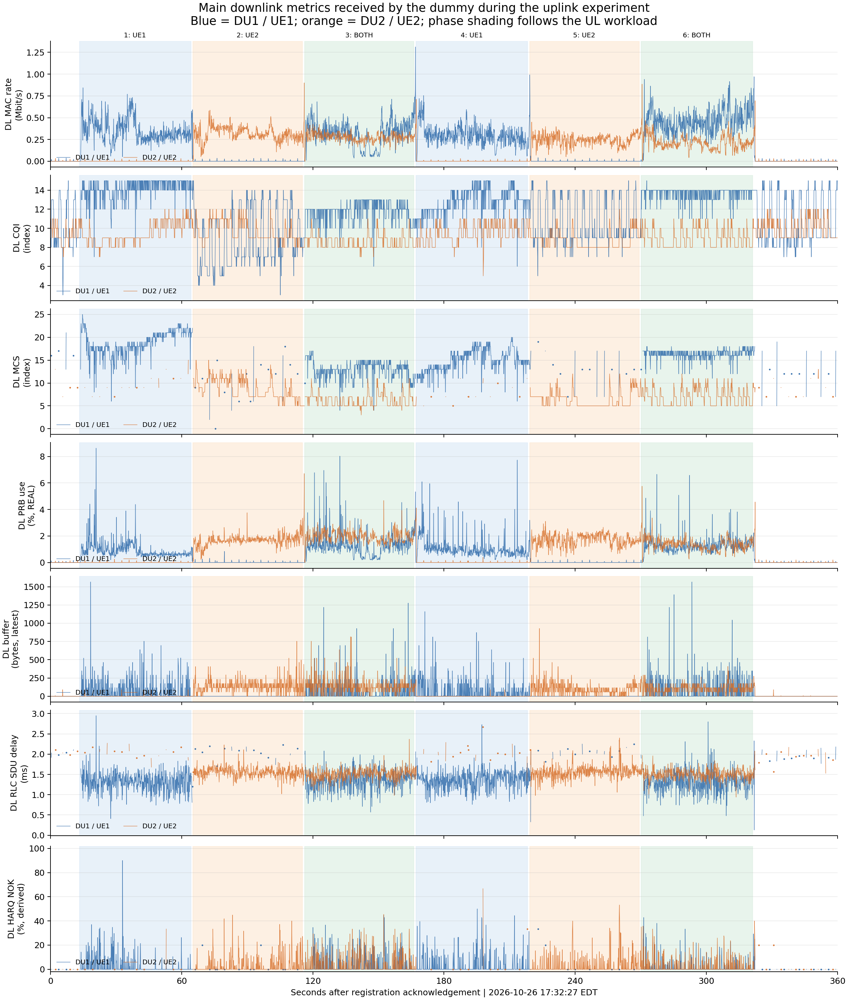
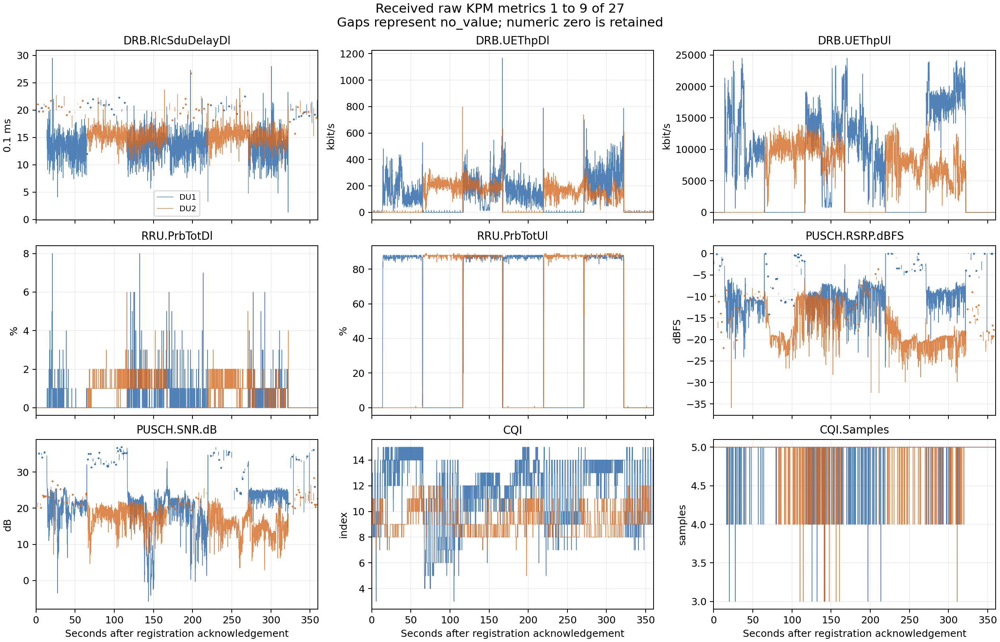
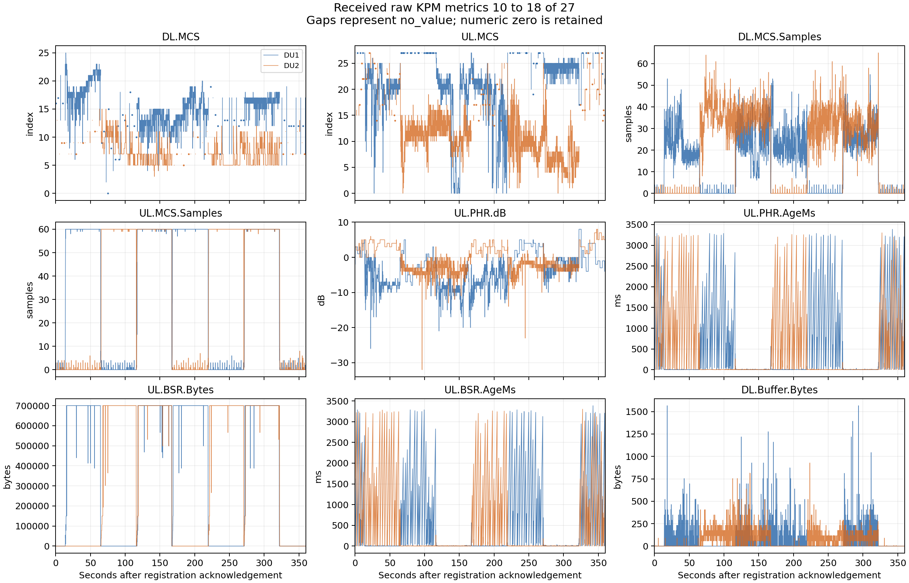
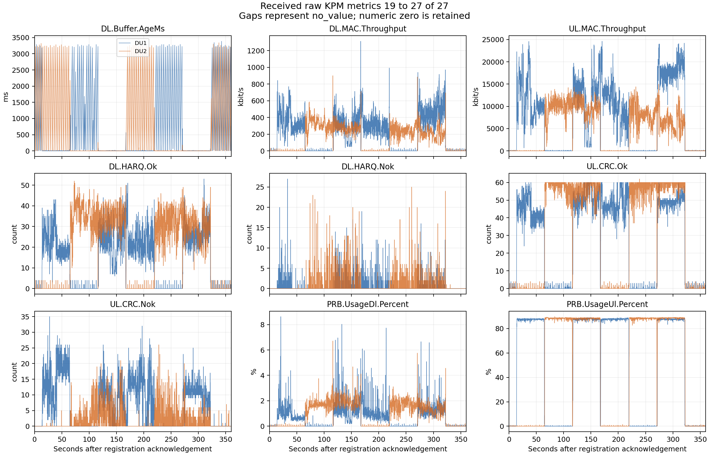

# Six minute live KPM subscription delivery and stability report

> Publication: This report and its selected figures are versioned. Detailed
> captures, logs and per-sample data remain in the local evidence archive.
> References marked `local archive` and captured-data reanalysis commands
> require that archive separately. See the [publication policy](../README.md#local-archive-policy).

> Radio scope: this experiment used direct n78 radio paths with DU2 at
> 20 MHz. Its measurements, gains, lock readbacks and figures retain that
> configuration. See the [current radio design](../../project_design_and_progress.md)
> for the October 29 20/40-MHz profiles and the separately designed Pi-Radio
> 9250-MHz OTA path. This report does not validate either later RF arrangement.

**The xApp successfully delivered every captured DU KPM report to an independent subscribing application throughout this six minute workload.** The dummy received and wrote all 7,200 reports, preserving the UE IP association and all 27 raw metrics. Report readiness to application receipt had a p99 of **3.595 ms** and a maximum of **7.349 ms**. Both links maintained approximately 100 ms receive intervals during alternating and concurrent uplink traffic. Registration, heartbeats, unregistration, and subsequent xApp/E2 shutdown completed successfully.

This establishes successful and stable delivery for the measured 360 second, two-DU, one-subscriber workload on Spark. Longer operation, application/UE reconnection, slow consumers, and integration with the actual MPX/MPTCP client require their own acceptance runs.

## Test window and configuration

The test ran on October 26, 2026. The receiver was a separate dummy process on the same Spark host, connected to the broker over loopback TCP.

| Item | Value |
| --- | --- |
| Registration acknowledgement received | 21:32:27.860337 UTC / 17:32:27.860337 EDT |
| Unregistration acknowledgement received | 21:38:27.868623 UTC / 17:38:27.868623 EDT |
| Elapsed monotonic time between acknowledgements | 360.008286 s |
| Source | Live E2, `data_source=e2` |
| Endpoint and protocol | `127.0.0.1:8765`, version 2, JSON Lines |
| Subscriber and filter | One `dual-ue-dummy`, `all_matched_links` |
| Metric profile | `du27_bound_v1`, 27 raw KPM metrics |
| DU period and granularity | 100 ms |
| CU identity period / Core polling period | 1000 ms / 1000 ms |
| Broker instance | `084a2165-a889-441c-99b6-c37940d887d9` |
| Subscription | `sub-1` |

The observed path was **DU KPM → C collector → Python identity matcher → subscription registry/publisher → TCP → dummy → asynchronous TXT writer**. CU identities arrived through E2; the xApp queried the Open5GS AMF/SMF infoAPI for Core/session/IP context.

The captured revisions were Falcon `3e10f8daa5a65739db30e26364ba4259946740cf`, FlexRIC `d93076eed138079be51c43ca5b57908c67581aab`, and OCUDU `9bbf6398507a30e469df31e4667056577b2af2c5`. All 19 recorded binary/source hashes matched the available run artifacts during analysis; see the build hash verification (local archive: `../evidence/2026-10-26_du27_app_subscription_6min_live/build-hash-verification.json`).

## Report integrity and UE IP association

| Binding field | DU1 / UE1 | DU2 / UE2 |
| --- | --- | --- |
| gNB ID / DU ID | 411 / 1 | 411 / 2 |
| gNB CU UE F1AP ID | 9 | 0 |
| CU UE index | 9 | 11 |
| AMF UE NGAP ID / RAN UE NGAP ID | 23 / 9 | 25 / 11 |
| SUPI | `imsi-001010000000101` | `imsi-001010000000102` |
| PDU session ID | 2 | 2 |
| DNN | `internet` | `internet2` |
| UE IPv4 | `10.45.0.4` | `10.46.0.4` |
| Reports received and written | 3,600 | 3,600 |
| Binding revision | 1 throughout | 1 throughout |

Both bindings used `core_infoapi_cu_e2`, with assurance `cu_reported_du_scope`. Every delivered report was currently `matched`, contained the full 27-name profile, and retained the original node, UE, session, and IP association.

The analysis compared captured collector inputs, xApp source evidence, dummy receipt records, and final TXT output:

| Verification | Result |
| --- | --- |
| Raw DU rows whose callbacks entered during the subscription window | 7,200; every row had a corresponding received report |
| Eligible generated source reports | 7,200; every report received exactly once |
| Complete source/received report object comparisons | 7,200 identical |
| Raw metric field comparisons across input, report, receipt, and TXT | 194,400 passed, including types, values, units, and TXT representation |
| REAL metric IEEE 754 bit comparisons | 84,894 passed |
| Delivery sequence | Consecutive 1–7,200, with no duplicates, gaps, or reordering |
| TXT output | 7,200 complete report blocks, with matching link, UE/Core/session/IP fields and raw metrics |
| Binding freshness at receipt | Every report received before `valid_until_mono_us` |
| Captured CU identity and Core context cross-checks | 7,200 passed against each source's latest available snapshot |
| Collector and publisher ingress drops | 0 observed |

The xApp generated 12,570 matched source reports across its entire lifetime: 3,198 before registration, 7,200 during the subscription window, and 2,172 after the unregistration acknowledgement. These additional source records were outside the application's subscription window.

## Delivery latency

All stages use the same Spark host's `CLOCK_MONOTONIC`. Application receipt is timestamped when a complete frame becomes available, before validation and TXT formatting. Percentiles use the nearest-rank method and independently reproduce every timing value in the dummy summary.

| Stage | p50 ms | p95 ms | p99 ms | Maximum ms |
| --- | ---: | ---: | ---: | ---: |
| Collector callback → report ready | 0.679 | 1.951 | 2.967 | 10.709 |
| Report ready → publish enqueue | 0.709 | 1.736 | 2.846 | 5.978 |
| Publish enqueue → dummy receipt | 0.295 | 1.095 | 1.800 | 3.734 |
| **Report ready → dummy receipt** | **1.046** | **2.334** | **3.595** | **7.349** |
| **Collector callback → dummy receipt** | **1.865** | **3.888** | **5.383** | **11.870** |
| Dummy receipt → TXT write completed | 0.644 | 1.867 | 2.877 | 8.929 |

The principal push measurement means that at least 99% of reports reached the dummy within 3.595 ms after the complete matched report was ready. The callback-to-ready stage includes collector handoff, coordinator work, and matching. Publish enqueue measures admission to the client output queue; TXT completion measures write/flush completion. Stage percentiles cannot be added, and these clocks exclude PHY sampling and E2 transit before the collector callback.

All existing added-delay checks passed: push p95 ≤ 10 ms, p99 ≤ 25 ms, maximum ≤ 100 ms, and callback-to-receipt p99 ≤ 100 ms. The previous [120 second test](du27_app_subscription_live_2026-10-26.md) measured push p99 2.314 ms. This run measured 3.595 ms under a different traffic workload; both meet the same budget.

## Reporting cadence and stability over time

| Per-link receipt measurement | DU1 | DU2 |
| --- | ---: | ---: |
| Reports | 3,600 | 3,600 |
| Interval samples | 3,599 | 3,599 |
| Mean interval ms | 100.003 | 100.003 |
| p50 interval ms | 99.990 | 99.998 |
| p95 interval ms | 101.415 | 101.484 |
| p99 interval ms | 103.142 | 102.931 |
| Minimum interval ms | 91.854 | 90.685 |
| Maximum interval ms | 107.874 | 109.526 |
| Intervals above 150 ms | 0 | 0 |
| Reports in every consecutive 10 s bin | 100 | 100 |

Every consecutive 30 s window contained exactly 600 reports across both links. Push p99 in those windows ranged from 2.587 to 4.245 ms; the final window measured 2.799 ms. These counts and latency distributions show no accumulating delivery backlog in this run. Small receive-interval deviations around 100 ms reflect source and processing jitter; all eligible source reports remain accounted for.

The first reports arrived 23.583 ms after the registration acknowledgement for DU1 and 22.528 ms after it for DU2. Bindings already existed at registration, so these values measure the wait for the next report rather than cold-start identity resolution.



[SVG figure](assets/2026-10-26_du27_app_subscription_6min_live/delivery-stability.svg) · Per-report timing CSV (local archive: `../evidence/2026-10-26_du27_app_subscription_6min_live/delivery-timeseries.csv`)

## Delivery during alternating and concurrent uplink traffic

Spark iperf server logs contain eight completed receiver sessions, matching the six-phase sequence UE1 → UE2 → both → UE1 → UE2 → both. Their source addresses match the IPs carried by the corresponding KPM reports. Each session's reported duration was approximately 50 seconds.

The following windows come from receiver connection/completion timestamps, which have one-second resolution. They approximate the observed traffic phases. Receiver rates are the printed session averages; the push p99 applies to reports received within the indicated approximate window.

| Phase | Active upload | Seconds after registration ACK | UE1 receiver Mbit/s | UE2 receiver Mbit/s | Push p99 ms |
| --- | --- | --- | ---: | ---: | ---: |
| 1 | UE1 | 13.1–64.1 | 10.60 | — | 3.750 |
| 2 | UE2 | 65.1–115.1 | — | 9.54 | 3.541 |
| 3 | UE1 + UE2 | 116.1–166.1 | 11.20 | 9.32 | 4.081 |
| 4 | UE1 | 167.1–218.1 | 9.93 | — | 3.054 |
| 5 | UE2 | 219.1–269.1 | — | 7.99 | 3.850 |
| 6 | UE1 + UE2 | 270.1–321.1 | 17.10 | 6.35 | 3.063 |

For phase 6, the two data connections were logged one second apart; the table uses their combined window. Both concurrent phases maintained low push latency, with no missing reports or receive interval approaching two reporting periods. Radio throughput varied within phases, while application delivery retained its cadence. MAC throughput and iperf receiver throughput measure different layers and use different aggregation intervals.

### Uplink traffic and main metrics



[SVG uplink overview](assets/2026-10-26_du27_app_subscription_6min_live/uplink-overview.svg)

The UL overview follows the row order of the previous [27 KPM experiment](dual_ue_27kpm_stability_report_2026-10-25.md): two separate path throughput rows, then PUSCH SNR, PUSCH RSRP, derived UL CRC NOK percentage, UL PHR, UL MCS, REAL UL PRB utilization, and latest UL BSR. Blue represents DU1 / UE1 and orange represents DU2 / UE2. Throughput rows compare the received DU MAC rate averaged into one-second bins with the Spark iperf receiver intervals. The seven metric rows retain the original 100 ms samples received by the dummy; BSR is displayed in decimal kB.

Blue, orange, and green background shading indicates UE1-only, UE2-only, and concurrent uploads. Phase boundaries come from receiver logs with one-second timestamp resolution. The CRC percentage is `100 × NOK / (OK + NOK)`; zero-denominator windows remain gaps. RSRP 0 dBFS remains a normal numeric upper-bound reading.

### Main downlink metrics during the uplink workload



[SVG downlink overview](assets/2026-10-26_du27_app_subscription_6min_live/downlink-overview.svg)

The separate DL overview shows DL MAC throughput, CQI, DL MCS, REAL DL PRB utilization, latest DL buffer occupancy, DL RLC SDU delay, and derived DL HARQ NOK percentage, using the same colors and phase shading. Every row uses the received 100 ms samples; throughput is converted to Mbit/s and RLC delay from 0.1 ms units to ms. The HARQ percentage uses the same NOK/total rule and leaves zero-denominator windows unavailable. Both derived ratios were independently checked for all 7,200 reports, giving 14,400 comparisons.

The DL figure describes downlink activity accompanying the TCP uploads, including acknowledgement/control traffic. Its shaded phases identify the UL workload; this run does not measure dedicated downlink capacity.

## Measurement availability and freshness

Transport integrity preserves both numeric measurements and explicit `no_value` entries. Selected availability counts were:

| Raw metric | DU1 `no_value` reports | DU2 `no_value` reports |
| --- | ---: | ---: |
| `DRB.RlcSduDelayDl` | 1,487 | 1,491 |
| `PUSCH.RSRP.dBFS` | 1,431 | 1,433 |
| `PUSCH.SNR.dB` | 1,431 | 1,433 |
| `DL.MCS` | 1,482 | 1,472 |
| `UL.MCS` | 1,432 | 1,434 |

PUSCH SNR was numeric in every sample with UL MAC throughput above 1 Mbit/s: 1,992 samples for DU1 and 2,037 for DU2. MCS availability agreed with the corresponding MCS sample count being nonzero. Each DU had one window where RF availability differed from whether `UL.MCS.Samples` was nonzero; RF and MAC getters do not guarantee a synchronized sample set. These source observations were preserved without changing their values or treating absent measurements as zero.

A 100 ms report interval does not imply a new observation of every field every 100 ms. PHR/BSR/Buffer age fields reached approximately 3.39 s. At report readiness, the latest captured Core snapshot age was 34.730–960.641 ms and the latest CU snapshot age was 1.659–918.977 ms. Snapshot age measures elapsed time since receipt, rather than the full discovery delay of a Core or RAN state change. Neither measurement age nor radio HARQ/CRC failures indicate a missing broker message.

## Registration and shutdown

The dummy recorded 7,239 application messages: 1 registration acknowledgement, 2 initial `binding_state` messages with state `receiving`, 7,200 KPM reports, 35 pongs, and 1 unregistration acknowledgement. No intermediate invalid-binding or unavailable-source notification reached the subscriber.

Normal unregistration was followed by `APP_DISCONNECTED` with reason `drained` and zero active registrations. The final publisher summary reported `status=passed`, an empty failures list, 7,239 queued frames, and 7,200 queued reports. Active connections, active registrations, ingress depth, and ingress bytes were all zero. The publisher ingress queue peaked at 2 reports / 42,423 accounted bytes. The dummy writer queue peaked at 2 reports, and maximum receipt-to-write completion delay was 8.929 ms.

After the dummy finished, the operator stopped the xApp with Ctrl+C. All three E2 subscriptions received deletion responses, and both dummy and xApp exited with code 0. The captured xApp runtime log contains no warning/error lines. Build-time executable-stack linker warnings remain a separate existing SDK/plugin observation.

## Acceptance result and scope

| Acceptance item | Result |
| --- | --- |
| Live collector → matcher → broker → independent application delivery | Passed for all 7,200 reports |
| Full UE/link/session/IP association and 27-metric preservation | Passed |
| Six minute connection stability and approximately 100 ms per-link cadence | Passed |
| Added push latency budgets during alternating/concurrent uploads | Passed |
| Normal registration, heartbeat, unregistration, and E2/service cleanup | Passed |
| 30 minute operation, app/UE reconnect, IP change/reuse, slow consumer isolation | Requires separate live workloads |
| Actual MPX/MPTCP client parsing, IP-to-path mapping, and dashboard integration | Requires client integration and testing |

The external application in this experiment was an independent dummy process on Spark. The results verify the broker's subscription and push path over local TCP. Current-run Laptop truth, client phase JSON, and reconnect watcher files were not supplied; the eight Spark receiver summaries corroborate the traffic pattern without establishing Laptop recovery behavior or client exit codes.

## All 27 received raw KPM metrics

The plots below retain every received numeric sample. Gaps denote `no_value`; valid zero and RSRP upper-bound readings are preserved. Statistics for every metric and DU are available in metric-statistics.csv (local archive: `../evidence/2026-10-26_du27_app_subscription_6min_live/metric-statistics.csv`).



[SVG metrics 1–9](assets/2026-10-26_du27_app_subscription_6min_live/metrics-01-09.svg)



[SVG metrics 10–18](assets/2026-10-26_du27_app_subscription_6min_live/metrics-10-18.svg)



[SVG metrics 19–27](assets/2026-10-26_du27_app_subscription_6min_live/metrics-19-27.svg)

## Retained evidence and reproduction

| Artifact | Contents |
| --- | --- |
| analysis.json (local archive: `../evidence/2026-10-26_du27_app_subscription_6min_live/analysis.json`) | Integrity checks, latency/cadence distributions, bindings, phase results, metric statistics, and source hashes |
| dummy-summary.json (local archive: `../evidence/2026-10-26_du27_app_subscription_6min_live/dummy-summary.json`) | Original dummy result |
| publisher-summary.json (local archive: `../evidence/2026-10-26_du27_app_subscription_6min_live/publisher-summary.json`) | Final publisher counters and successful shutdown result |
| xapp.log (local archive: `../evidence/2026-10-26_du27_app_subscription_6min_live/xapp.log`) / dummy.log (local archive: `../evidence/2026-10-26_du27_app_subscription_6min_live/dummy.log`) | Original console logs |
| live-artifacts.tar.gz (local archive: `../evidence/2026-10-26_du27_app_subscription_6min_live/live-artifacts.tar.gz`) | 24 archived files, including full input/source/receipt/TXT data, run configurations, shutdown summaries, source revisions, hashes, and both receiver logs |
| manifest.json (local archive: `../evidence/2026-10-26_du27_app_subscription_6min_live/manifest.json`) | Archive member sizes and SHA256 hashes, source revisions, and generated artifact hashes |
| verification.json (local archive: `../evidence/2026-10-26_du27_app_subscription_6min_live/verification.json`) | Archive extraction/reanalysis, example integrity, and hash verification results |
| UE1 message (local archive: `../evidence/2026-10-26_du27_app_subscription_6min_live/examples/du1-10.45.0.4.kpm_report.json`) / UE2 message (local archive: `../evidence/2026-10-26_du27_app_subscription_6min_live/examples/du2-10.46.0.4.kpm_report.json`) | Complete received wire objects for the first report per DU with UL MAC throughput above 1 Mbit/s; dummy-added observation fields excluded |
| Example provenance (local archive: `../evidence/2026-10-26_du27_app_subscription_6min_live/examples/index.json`) | Original receipt line numbers/hashes and removed dummy timing fields |
| analyze_results.py (local archive: `../evidence/2026-10-26_du27_app_subscription_6min_live/analyze_results.py`) | Reproducible analysis, CSV export, and plotting script |

The original run directories were `/tmp/falcon-dual-subscriptions-6min.DoXemxFa` and `/tmp/falcon-dual-dummy-6min.jnQVdVYj`. The archive retains the records independently of these temporary directories. Binaries are excluded; their recorded hashes and plugin build manifest are retained.

Reproduce from the Falcon root with Python and Matplotlib installed:

```bash
REVIEW_RUN=$(mktemp -d /tmp/falcon-du27-6min-review.XXXXXXXX)
tar -xzf docs/experiments/evidence/2026-10-26_du27_app_subscription_6min_live/live-artifacts.tar.gz \
  -C "$REVIEW_RUN"
python3 docs/experiments/evidence/2026-10-26_du27_app_subscription_6min_live/analyze_results.py \
  --dummy-dir "$REVIEW_RUN/dummy" --service-dir "$REVIEW_RUN/service" \
  --traffic-dir "$REVIEW_RUN/traffic" --output-dir "$REVIEW_RUN/reanalysis"
```
