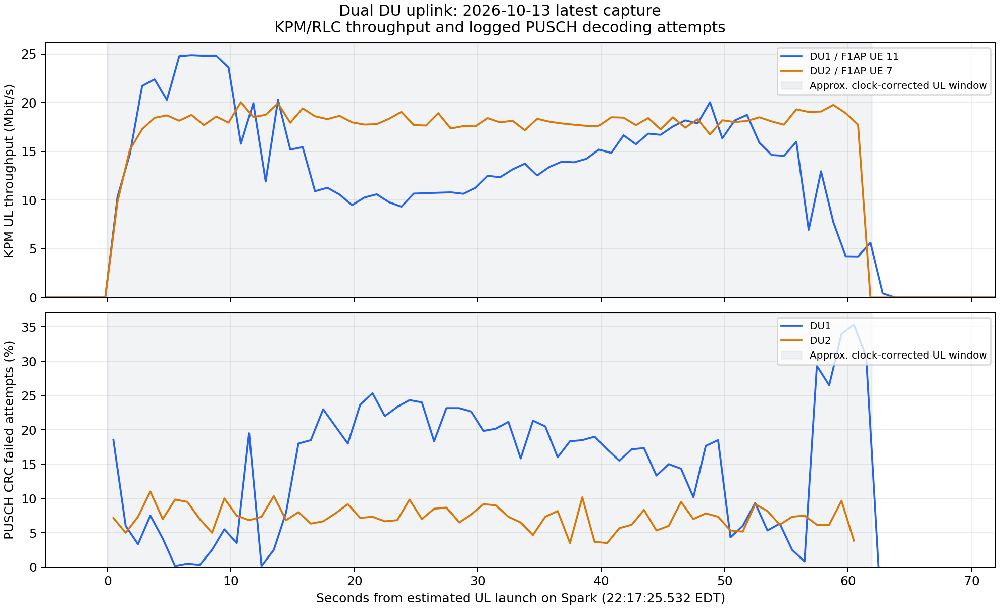

# Dual UE and Dual DU Uplink Experiment Report

> Publication: This report and its selected figures are versioned. Detailed
> captures, logs and per-sample data remain in the local evidence archive.
> References marked `local archive` and captured-data reanalysis commands
> require that archive separately. See the [publication policy](../README.md#local-archive-policy).

> Radio scope: this experiment used direct n78 radio paths with DU2 at
> 20 MHz. Its measurements, gains, lock readbacks and figures retain that
> configuration. See the [current radio design](../../project_design_and_progress.md)
> for the October 29 20/40-MHz profiles and the separately designed Pi-Radio
> 9250-MHz OTA path. This report does not validate either later RF arrangement.

Experiment date: 2026-10-13. Times use America/New_York, EDT, UTC−04:00.

**The basic dual-link setup, concurrent TCP uplink, and reception of KPM reports from both DUs passed verification.** Two Quectel modems used separate SIMs, IPv4 sessions, and WWAN interfaces to upload through two DUs operating at different carrier frequencies to two Spark service addresses. Receiver throughput was **13.8 Mbit/s for UE1 and 17.3 Mbit/s for UE2**. Both clients exited with code 0.

Acceptance for this experiment focuses on UL. The two test flows used separate routes and ran concurrently. Fault isolation, restrictions on access between subnets, and full repeatability acceptance require additional tests. Underflow remediation remains deferred under the current experiment requirements.

## Objectives and topology

The objective was to verify that two modems, two carrier frequencies, two DUs, two IPv4 sessions, and two iperf tests could operate simultaneously, while one RIC and one xApp received actual UE measurements from both DUs.

```text
Laptop
  UE1 Quectel / SIM1 / wwan0 / 10.45.0.6
    → DU1 / B210 / n78 3660 MHz / PCI 1 ─┐
                                        ├→ Shared CU → Open5GS UPF → Spark ogstun
  UE2 Quectel / SIM2 / wwan1 / 10.46.0.5  │    ├→ 10.45.0.1:5201 / iperf server 1
    → DU2 / B210 / n78 3600 MHz / PCI 2 ─┘    └→ 10.46.0.1:5202 / iperf server 2

DU1 / DU2 → E2 → One FlexRIC RIC → One KPM xApp
```

Both radio links used n78, with a 60 MHz separation between carrier frequencies. Each cell was configured for 20 MHz bandwidth, 30 kHz SCS, 1T1R, and 23.04 MS/s. Spark ran both DUs, the shared CU, Open5GS, and FlexRIC. The Laptop connected both Quectel RM500QGL modems simultaneously. The DU startup logs identified OCUDU commit `050a2bb` and UHD 4.6.0; both B210s operated over USB 3.

## Link configuration and identities

The modem, bearer, WWAN, and IP values below belong to this run and must be rediscovered after reconnection. Radio parameters were confirmed by DU startup logs. Modem, SIM, and bearer parameters were recorded by the Laptop launcher.

| Item | Link 1 | Link 2 |
| --- | --- | --- |
| Modem IMEI | `863305041978437` | `863305041980706` |
| SIM IMSI | `001010000000101` | `001010000000102` |
| Modem / SIM / bearer number | 13 / 13 / 9 | 14 / 14 / 10 |
| DU ID / PCI | 1 / 1 | 2 / 2 |
| B210 serial | `3271233` | `328B021` |
| Carrier frequency / NR-ARFCN | 3660 MHz / 644000 | 3600 MHz / 640000 |
| Configured channel bandwidth | 20 MHz | 20 MHz |
| SSB ARFCN | 643680 | 639648 |
| APN / DNN | `internet` | `internet2` |
| UE address pool | `10.45.0.0/16` | `10.46.0.0/16` |
| UE IPv4 / WWAN in this run | `10.45.0.6/30` / `wwan0` | `10.46.0.5/30` / `wwan1` |
| Bearer gateway | `10.45.0.5` | `10.46.0.6` |
| Policy routing table | 151 | 152 |
| Spark iperf endpoint | `10.45.0.1:5201` | `10.46.0.1:5202` |
| CU internal UE / KPM F1AP UE ID | 19 / 11 | 13 / 7 |
| RNTI | `0x460c` | `0x4608` |

Both DUs completed F1-C and E2 connections, and the RIC accepted KPM RAN function 2 from each DU. CU logs confirmed `(DU1, PCI1, F1AP11)` and `(DU2, PCI2, F1AP7)`. KPM reports do not carry IMEI or IMSI. The complete record correlating modem and SIM identities with F1AP identities across layers still needs to be completed.

The two Spark service IPs are on the same `ogstun` interface and share one UPF. The DNN selects the address pool; the modem's cell selection determines which DU provides radio access. Bearer gateways and iperf service addresses are recorded separately. Dedicated host routes on the WWAN interfaces determined the paths to the service addresses in this run.

## Test method and time alignment

The Laptop used the [concurrent UL launcher](../../../scripts/dual_fr1/run_dual_ul.py). It selected the current modem and SIM by IMEI and IMSI, read the uniquely connected bearer for the required APN, and checked the address, prefix, interface, and routing both with a bound source address and with ordinary destination lookup. After both identity and route checks passed, it launched two independent iperf3 clients. Each client used `-B` to bind its actual UE IP, uploaded to its corresponding Spark endpoint for 60 seconds, and recorded its actual process exit code.

Spark ran two iperf3 servers bound to different addresses and ports. The KPM xApp established one subscription per DU and received measurements at a 1000 ms reporting interval. After the requested 120-second capture, it deleted both subscriptions in sequence and exited normally.

| Time record | Start | End |
| --- | --- | --- |
| Original concurrent run on the Laptop clock | 22:14:06.260 | 22:15:08.181 |
| Run converted to the Spark clock | Approximately 22:17:25.532 | Approximately 22:18:27.454 |
| Spark KPM capture corresponding to this iperf run | 22:17:11.334 | 22:19:17.765 |
| Complete UL-active reports from both DUs simultaneously | 22:17:26.339 | 22:18:26.340 |

Clock commands entered manually at the same time returned Spark `22:27:40.980143175` and Laptop `22:24:21.707322626`, giving an estimated **Spark clock lead of 199.272821 seconds**. With this offset applied, the application traffic overlapped the latest KPM window. The correlation coefficient between UE1's first 60 receiver throughput intervals and the corresponding UL-active KPM samples was **0.963**, providing further support for this pairing. This is an approximate correction applied after the experiment; manual input and command execution errors were not calibrated.

An earlier KPM capture that also completed normally is retained in the evidence. It was not paired with the Laptop iperf summary from this run and does not count as a second TCP repetition with verified application results.

## Concurrent TCP uplink results

| Metric | UE1 | UE2 |
| --- | --- | --- |
| Sender duration | 60.00 s | 60.00 s |
| Sender mean throughput | 14.3 Mbit/s | 17.7 Mbit/s |
| Sender TCP Retr | 0 | 0 |
| Receiver duration | 61.02 s | 60.25 s |
| Receiver transfer, as displayed in the terminal | 101 MBytes | 124 MBytes |
| Receiver mean throughput | **13.8 Mbit/s** | **17.3 Mbit/s** |
| Included server receiver summary | Matches the client receiver summary | Matches the client receiver summary |
| `iperf Done` / client exit code | Yes / 0 | Yes / 0 |

The sum of the two receiver mean throughputs was approximately **31.1 Mbit/s**. This adds two independently calculated averages. Because the receiver durations differed, this value describes the combined uplink output of this run and does not establish an exact aggregate throughput over an identical time window. UE1 varied more than UE2. Passing this functional test does not establish peak capacity or stability acceptance.

Laptop results came from terminal output supplied by the operator. Key identities, summaries, and the first 60 server receiver intervals are retained in operator_inputs.json (local archive: `../evidence/2026-10-13_dual_kpm_reports/operator_inputs.json`). The original complete `ue1.log`, `ue2.log`, and `summary.json` are on the Laptop in `/tmp/falcon-dual-ul-iakb3ttb`.

## KPM reception and physical-layer observations

The latest xApp capture received actual UE reports from both DUs, with 123 callbacks per DU. Both subscription responses and both deletion responses succeeded. The xApp exited normally, and the pipeline exit code was 0. The RIC assertion failure did not recur during this capture.

| Latest capture metric | DU1 / F1AP UE 11 | DU2 / F1AP UE 7 |
| --- | --- | --- |
| Total callbacks | 123 | 123 |
| Reports with positive UL throughput and all five metrics present | 63 | 61 |
| Complete UL-active reports within the approximately corrected application window | 62 | 61 |
| Mean UL-active KPM throughput | 14.35 Mbit/s | 18.06 Mbit/s |
| Median UL-active KPM throughput | 14.25 Mbit/s | 18.15 Mbit/s |
| Median PRB usage in UL-active samples | 88% | 86% |
| Median callback interval | Approximately 1.000 s | Approximately 1.000 s |
| Maximum callback interval | 1.000630 s | 1.000722 s |
| Median report age | 517 μs | 647 μs |
| Reports flagged as unreliable | 0 | 0 |

Pairing callbacks from the two DUs when their timestamps differed by no more than 50 ms yielded **61 pairs of simultaneous UL-active reports with all five metrics present**. This exceeds the requirement for at least 30 actual reports per link during UL activity. KPM throughput means use all positive UL samples from each DU, including the brief traffic tail. These measurements come from RLC byte statistics and differ from application receiver results in measurement duration and protocol overhead. Report age includes processing, queuing, and clock effects; it is not the UE-to-server RTT.

Missing `DRB.RlcSduDelayDl` values during idle periods were retained as unreported and were not filled with zeros. The current monitor does not explicitly print every noValue state, so those idle reports were excluded from the samples with all five metrics present. DL measurements are observational; UL is the acceptance target for this experiment.



The gray region marks the application run window after approximate clock correction. DU1 throughput varied substantially between its initial high values, lower middle period, and final traffic tail. DU2 was steadier during its main active period.

| PUSCH log statistic | DU1 | DU2 |
| --- | --- | --- |
| Measurement window, EDT | 22:17:26 to 22:18:29, end exclusive | Same |
| Decode attempts | 36,831 | 36,078 |
| Attempts with CRC failure | 5,572 | 2,636 |
| CRC failure attempt ratio | **15.13%** | **7.31%** |
| Median PUSCH SINR | 22.4 dB | 23.8 dB |

DU1's higher failure attempt ratio is consistent with its greater throughput variation and supports further investigation of DU1 UL quality. This ratio counts recorded PUSCH decode attempts. It is not TCP packet loss or a calibrated first-transmission BLER, and it cannot independently identify interference, channel, or device causes. A TCP Retr count of 0 and PHY CRC failures are observations at different protocol layers.

## Path separation and acceptance status

The two clients bound to `10.45.0.6` and `10.46.0.5`, respectively, used tables 151 and 152 with their own WWAN interfaces, and connected to different Spark service endpoints. Both processes completed concurrently, and both DUs reported UL measurements simultaneously. This verifies separate flow routing and concurrent operation under the tested configuration.

Both service addresses remain on the same Spark host and the same `ogstun` interface. The DUs share the CU, UPF, RIC, and host resources. Different subnets, routing tables, and carrier frequencies alone do not establish restrictions on access between subnets or independence under every failure or radio condition.

| Verification item | Status in this experiment |
| --- | --- |
| Two physical modems, two DUs at different carrier frequencies, and two IPv4 sessions | Basic setup passed |
| Concurrent TCP UL using separate source IPs, WWAN interfaces, routing tables, and server endpoints | Passed |
| One RIC/xApp receiving actual UL KPM from both DUs | Passed |
| DU attribution of callbacks and CU-side PCI/F1AP mapping | Passed |
| Complete modem/SIM/cell/F1AP/bearer correlation record | Pending completion |
| Other link continues when either UE disconnects or either DU stops | Pending test |
| No fallback to Wi-Fi or the other modem after either dedicated route is deleted | Pending test |
| Policy denying access between subnets | Outside this experiment's scope |
| Three rounds of comparable individual/concurrent tests, UDP, and full cold-start recovery | Pending verification |
| Underflow remediation | Deferred under current requirements |

The basic objective of two modems, two carrier frequencies, two DUs, two IPv4 paths, and separate concurrent iperf tests was completed. Further fault-isolation acceptance requires interrupting each link in turn and verifying that the other remains available, then deleting each dedicated route to verify that failures do not cause fallback. Blocking access between subnets requires additional access controls and rejection tests.

FlexRIC previously asserted while processing a subscription deletion failure after an xApp disconnected. The two normally completed captures did not exercise that failure branch, and the code defect remains unfixed. These results form a concurrent UL/KPM functional checkpoint for [Plan 3](../../../plans/dual-ue-du-fr1-channels.md); full Plan 3 acceptance remains in progress.

## Evidence and analysis files

| Contents | File |
| --- | --- |
| Summary, statistical definitions, original directories, and file SHA256 checksums | manifest.json (local archive: `../evidence/2026-10-13_dual_kpm_reports/manifest.json`) |
| Laptop identities, results, and clock readings from simultaneous manual input | operator_inputs.json (local archive: `../evidence/2026-10-13_dual_kpm_reports/operator_inputs.json`) |
| Complete KPM log corresponding to this iperf run and 246 parsed records | KPM log (local archive: `../evidence/2026-10-13_dual_kpm_reports/run-02/kpm.log`), rows.csv (local archive: `../evidence/2026-10-13_dual_kpm_reports/run-02/rows.csv`) |
| Earlier additional KPM capture, with 246 parsed records | KPM log (local archive: `../evidence/2026-10-13_dual_kpm_reports/run-01/kpm.log`), rows.csv (local archive: `../evidence/2026-10-13_dual_kpm_reports/run-01/rows.csv`) |
| Registration of both DUs and two subscription lifecycles at the RIC | ric.log (local archive: `../evidence/2026-10-13_dual_kpm_reports/ric.log`) |
| CU-side DU, PCI, RNTI, and F1AP mappings | CU excerpt (local archive: `../evidence/2026-10-13_dual_kpm_reports/cu_identity_excerpt.log`) |
| Actual radio startup parameters for the latest two DUs | DU1 startup (local archive: `../evidence/2026-10-13_dual_kpm_reports/du1_startup.log`), DU2 startup (local archive: `../evidence/2026-10-13_dual_kpm_reports/du2_startup.log`) |
| PHY statistics per second | phy_per_second.csv (local archive: `../evidence/2026-10-13_dual_kpm_reports/phy_per_second.csv`) |
| Exportable figures | [PNG](assets/2026-10-13_dual_kpm_reports/dual_ul_kpm.png), [SVG](assets/2026-10-13_dual_kpm_reports/dual_ul_kpm.svg) |
| Analysis program for this experiment | analyze.py (local archive: `../evidence/2026-10-13_dual_kpm_reports/analyze.py`) |

For daily operation, continue using the separate [Laptop commands](../../operations/manual_laptop_startup.md) and [Spark commands](../../spark_quick_commands.md).
