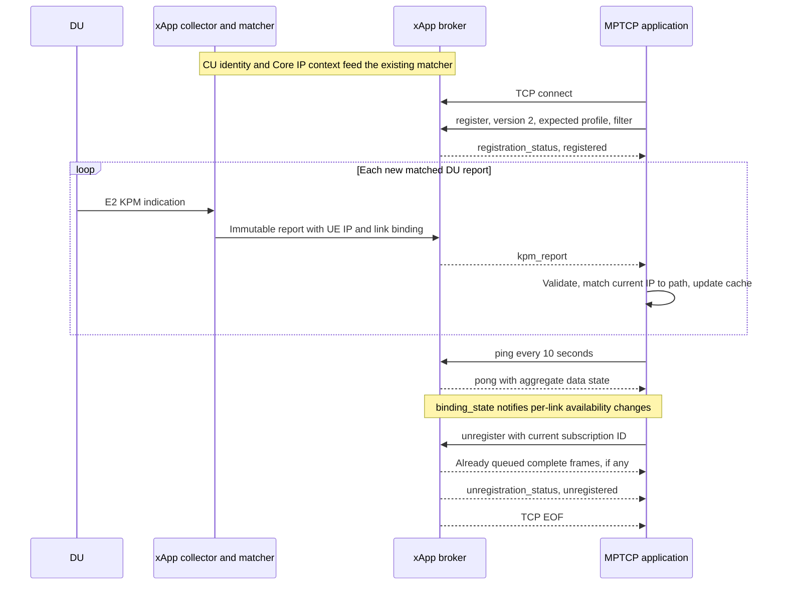

# xApp and MPTCP application interface

Updated October 26, 2026. Protocol version **2**; metric profile **`du27_bound_v1`**.

This document defines the implemented Falcon interface for an MPTCP/MPX application to subscribe to KPM reports. The xApp pushes each newly generated, currently matched report with its DU/UE identity, current UE IPv4, and 27 raw KPM metrics. The MPTCP application uses that IPv4 to associate the report with its own current path. The same interface has been exercised by an independent dummy application in successful 120 second and 360 second live experiments.

This is Falcon's local application protocol. Its version is independent of the E2 service model and of the `v1` suffix in the metric profile or inner report schema. The earlier MPX version-1 draft is a migration reference; a version-1 registration is rejected by the current service.

## 1. Integration at a glance

| Item | Implemented contract |
| --- | --- |
| Server | Subscription broker inside the Python xApp coordinator |
| Client | MPTCP/MPX process on Spark; the existing dummy is a reference consumer |
| Transport | IPv4 TCP, default `127.0.0.1:8765`; configurable port, loopback binding required |
| Framing | One UTF-8 JSON object followed by LF (`\n`) per message |
| Protocol / profile | `version: 2` / `du27_bound_v1` |
| Recommended subscription | `filter: {"mode":"all_matched_links"}` |
| Cadence | Each new matched DU report, nominally every 100 ms per active DU/UE link |
| Identity refresh | CU E2 identity and Open5GS Core polling each use 1000 ms |
| Path association | `message.report.ue_ipv4` matched against the application's current UE source IPv4 |
| Metrics | `message.report.row.metrics`; each entry is `{type, value, unit}` |
| Heartbeat | Client sends `ping` every 10 s; broker returns `pong` |
| Reconnection | Client reconnects and registers again; no history replay |
| Delivery | `best_effort_no_replay`; bounded queues and per-client isolation |

The MPTCP client needs only the app socket and its own current path/address table. It does not read xApp TXT files, query the Core, subscribe to E2, or use the collector's run directory. This deployment requires the consumer to share the broker's host and loopback network namespace; direct remote-host access is outside the implemented endpoint contract.

### Component and identifier definitions

| Term | Meaning |
| --- | --- |
| xApp | C E2 collector plus Python coordinator, identity matching, and publication |
| Broker | The xApp's TCP listener, app registry, filters, lifecycle handling, and output queues |
| Radio link | A complete node/UE key: PLMN, node type, gNB ID/width, DU ID, UE ID type, and F1AP ID |
| MPTCP path | Application-owned identity, such as `(client_uid, link_name, server_uid)`; its current IP is an attribute |
| `app_id` | Client-selected name for one active registration on a broker, for example `mptcp-server` |
| `broker_instance_id` | New UUID for each broker process; distinguishes service restarts |
| `subscription_id` | Broker-assigned registration ID; scope it by broker instance and connection |
| `link_id` | Canonical radio key string; not an MPTCP subflow ID or permanent UE identity |
| `binding_revision` | Decimal-string revision of the binding for that radio key within the running broker |
| `report_seq` | Mapper report sequence represented as a decimal string; may have gaps |
| `delivery_seq` | Per-registration report delivery sequence, starting at `"1"`; control messages do not increment it |

If the application subscribes to several brokers, give each endpoint a stable local source name and scope its caches by that name plus the current broker/subscription IDs. The source name is application configuration, not a field to add to registration.

## 2. Connection and subscription flow



1. Connect and submit registration within 5 s. Keep reading the socket independently of disk writes, dashboard rendering, or transport scheduling.
2. Require `registration_status.status == "registered"`. Save the acknowledged subscription, broker instance, source, profile, metric names, periods, and cutoff.
3. Accept a successful registration even when its `data_state` is `waiting_for_match`. Admission does not require an already available UE match.
4. Process KPM and binding-state messages. Registration status precedes data; a fresh KPM report can precede its `binding_state: receiving` notification.
5. Send heartbeat requests throughout the session, including when KPM is flowing. Incoming reports do not reset the broker's valid-client-request idle deadline.
6. On normal exit, unregister, continue reading queued messages until the final acknowledgement, then require EOF. On an unexpected disconnect, clear or invalidate that source's cache, reconnect, and register afresh.

Acquisition and matching continue without registered applications. Registering, disconnecting, or reconnecting an application does not add E2 subscriptions or change metric acquisition. Application reconnection does not provide SDK/RAN reconnection.

## 3. Wire encoding and message definitions

Requests use exactly the keys shown below. The broker rejects additional request keys, unsupported filter fields, duplicate JSON keys, invalid IDs, and unsupported versions/profiles. Clients should tolerate unknown response/report fields while still validating the required version, profile, identity, and value fields.

`app_id` and `request_id` are 1–64 ASCII characters matching `[A-Za-z0-9_.-]{1,64}`. Use request IDs to correlate replies. One TCP connection has one active registration and one fixed filter; changing the filter requires a new registration on a new connection.

TCP can split one frame across reads or combine several frames in one read. Buffer bytes, split on LF, decode each complete frame, and bound the unfinished frame. Handle partial writes. An EOF with an incomplete frame is a truncated message.

### Register

Recommended all-links request:

```json
{"version":2,"type":"register","request_id":"reg-1","app_id":"mptcp-server","expected_profile":"du27_bound_v1","filter":{"mode":"all_matched_links"}}
```

All six fields are required. This subscribes to all newly matched links, including future matches. There is no IP filter, metric selection, period negotiation, replay request, or filter-update verb.

The alternative exact filter is `{"mode":"links","links":[KEY,...]}`, containing 1–32 distinct complete node/UE keys. See [client-register-exact.json](examples/client-register-exact.json) for the complete request. Equal F1AP IDs on different DUs are different keys. If a UE reconnects with a new F1AP ID, an exact subscription does not automatically follow it. All-links subscription is therefore recommended for the IP-based MPTCP integration.

### Common server envelope

Every server message contains these fields:

| Field | JSON type | Meaning |
| --- | --- | --- |
| `version` | number | Integer `2` |
| `type` | string | Message type from the table below |
| `broker_instance_id` | string | Current broker process UUID |
| `data_source` | string | `e2`, `replay`, or `fixture`; require `e2` for a live deployment |
| `metric_profile` | string | `du27_bound_v1` |

| Server message | Additional fields and behavior |
| --- | --- |
| `registration_status`, success | `request_id`, `status: registered`, `app_id`, `subscription_id`, `metric_names` (ordered 27-name array), echoed `filter`, `report_period_ms: 100`, `cu_period_ms: 1000`, `core_period_ms: 1000`, `cutoff_at_mono_us`, `delivery: best_effort_no_replay`, `data_state`, `last_matching_report_age_ms` |
| `registration_status`, rejection | `status: rejected`, `error_code`, and `request_id` when safely available; subscription/app fields need not be present |
| `kpm_report` | `subscription_id`, sequences, link/revision, clocks, ingress counter, and full `report`; defined in section 4 |
| `binding_state` | `subscription_id`, `link_id`, `binding_revision`, `data_state`, `reason`; state of one radio link, without a new measurement or IP payload |
| `pong` | Echoed `request_id`, aggregate `data_state`, `last_matching_report_age_ms`; **no `subscription_id` field is required** |
| `unregistration_status` | Echoed `request_id`, `status: unregistered`, `subscription_id`; final application frame before EOF on normal completion |
| `error` | `status: rejected`, `error_code`, and `request_id` when safely available; invalid non-registration request |

A complete successful response is in [server-registration.json](examples/server-registration.json). Successful admission commits the cutoff before any new reports are delivered. Only reports with `callback_at_mono_us > cutoff_at_mono_us` can reach the subscription. There is no immediate replay of a cached latest report.

### Heartbeat

```json
{"version":2,"type":"ping","request_id":"ping-1"}
```

Send every 10 s and correlate the pong by `request_id` on the current socket. The dummy treats a still-missing pong at its next 10 s heartbeat deadline as a failure. A complete captured response is in [server-pong.json](examples/server-pong.json).

Pong reports aggregate subscription state, and its last-report age is since the broker last enqueued any matching report. It does not acknowledge each delivered KPM and does not prove that both UE paths are fresh. Track each radio link/path independently.

### Unregister

```json
{"version":2,"type":"unregister","request_id":"unreg-1","subscription_id":"sub-1"}
```

Replace `sub-1` with the acknowledged current ID. The broker stops offering new frames to that client, drains already queued frames, sends `unregistration_status`, and closes. Keep accepting ordinary messages while waiting for the acknowledgement. No application message follows the successful unregistration acknowledgement.

The normal drain bound is 2 s. If the acknowledgement/EOF cannot be completed, close locally and record incomplete cleanup. A server console line saying that an acknowledgement was queued is not proof that the client received it. See the captured [server-unregistration.json](examples/server-unregistration.json).

## 4. KPM report and value contract

Complete captured frames are provided for both paths:

- [server-kpm-du1.json](examples/server-kpm-du1.json): `10.45.0.4`, DU1, F1AP ID `"9"`.
- [server-kpm-du2.json](examples/server-kpm-du2.json): `10.46.0.4`, DU2, F1AP ID `"0"`.

These are full received wire objects from the six-minute experiment. Only dummy-added observation fields were removed; no metric, identifier, timestamp, or numeric value was rounded or relabeled. Their provenance is in [examples/provenance.json](examples/provenance.json).

### KPM envelope

| Field | JSON type | Meaning |
| --- | --- | --- |
| `subscription_id` | string | Current registration ID |
| `report_seq` | decimal string | Mapper sequence; also available as legacy numeric `report.sequence` |
| `delivery_seq` | decimal string | Per-registration KPM sequence, starting at `"1"` |
| `link_id` | string | Full canonical node/UE key |
| `binding_revision` | decimal string | Revision for this link's full binding/IP snapshot |
| `callback_at_mono_us` | decimal string | Collector callback entry, monotonic microseconds |
| `report_ready_at_mono_us` | decimal string | Complete matched report ready, monotonic microseconds |
| `published_at_mono_us` | decimal string | Serialized/enqueued to this client's output, monotonic microseconds |
| `valid_until_mono_us` | decimal string | Source/binding freshness deadline on the same clock |
| `ingress_dropped_total` | decimal string | Cumulative broker ingress losses before client fan-out |
| `report` | object | Complete immutable matched record |

`link_id` is constructed in this order:

```text
mcc:mnc:node_type:gnb_id:gnb_id_bits:du_id:ue_id_type:gnb_cu_ue_f1ap_id
```

For example, `001:01:ngran_gNB_DU:411:22:1:gnb_du:9`. Preserve all components; using only a DU or F1AP ID can mix different UE contexts.

`report_seq` may skip because the mapper also processes reports outside this subscriber's eligible set. `delivery_seq` orders the reports offered to one registration. Its continuity alone cannot prove that no measurement was lost upstream; also inspect ingress counters, cadence, source state, and, for acceptance tests, source/receipt comparisons.

Within an uninterrupted registration, require consecutive `delivery_seq` values from `"1"`. A duplicate, gap, or regression is a delivery/session consistency failure to record before reconnecting. Track increasing `report_seq` and nondecreasing `binding_revision` per radio link; reset these checks on a fresh registration.

### Inner report fields

| JSON path under `report` | Type and interpretation |
| --- | --- |
| `schema` | String `falcon.ue_identity.experimental.v1`; inner schema name, separate from protocol version |
| `app_instance`, `sequence` | Mapper process identity and legacy numeric sequence; use envelope `report_seq` for lossless sequence handling |
| `node` | `mcc`, `mnc`, `node_type`, `gnb_id`, `gnb_id_bits`, `du_id`; `gnb_id_bits` is an integer, radio numeric IDs are decimal strings |
| `row.ue` | `id_type: gnb_du`, `gnb_cu_ue_f1ap_id` as a decimal string |
| `row.sample_idx`, `row.granularity_ms` | Integer sample index and integer `100` |
| `row.incomplete` | `null` when absent or `false`; incomplete reports are not admitted by this profile |
| `row.metrics` | Object keyed by the exact 27 metric names below |
| `binding_status`, `reason` | `matched` plus human-readable matching reason |
| `ue_ipv4` | Current PDU-session IPv4 string belonging to this report's binding |
| `binding` | Association metadata described below |
| `derived_metrics` | Two calculated ratios, separate from the 27 raw KPM fields |
| `header_time_us` | E2 report header Unix timestamp in microseconds, as a decimal string |
| `callback_at_us`, `received_at_us`, `emitted_at_us` | Unix microsecond timestamps for collector callback, coordinator receipt, and report emission; decimal strings |
| `source_instance_id`, `source_indication_seq` | Collector process identity and decimal-string indication sequence |
| `ingress_dropped_total` | Collector ingress loss counter; distinct from the envelope's broker ingress counter |

`binding` includes `method`, `assurance`, `amf_ue_ngap_id`, `ran_ue_ngap_id`, `supi`, `pdu_session_id`, `dnn`, and `guami`. Explicit serving-scope fields `serving_du_id` and `cu_ue_index` are also supplied when available and are present in both captured examples. The current live method/assurance are `core_infoapi_cu_e2` / `cu_reported_du_scope`. `guami` is an array of five strings in the order `[mcc, mnc, amf_region_id, amf_set_id, amf_pointer]`. MPTCP needs the IP correspondence; SUPI and internal RAN IDs remain available for diagnostics.

Preserve ID strings and PLMN leading zeroes. Numeric IDs can legitimately be `"0"`, including the captured DU2 F1AP ID. Use integer parsing with sufficient width rather than floating point for ID/counter/clock arithmetic. A binding revision is scoped to a radio key and broker instance; it does not establish a permanent UE lifecycle identity.

### Metric objects and all 27 names

Each metric has exactly the required semantics of `type`, `value`, and `unit`. Example valid metric objects:

```json
{"type":"real","value":-3,"unit":"dB"}
```

```json
{"type":"no_value","value":null,"unit":"dBFS"}
```

`real` contains a finite JSON number, which can be written as an integer literal. `integer` contains an unsigned 32-bit JSON integer. `no_value` contains `null`, retaining the metric's unit. Never turn an absent measurement into zero; valid numeric zero and negative REAL values must remain numeric. The current protocol has no per-metric `status` or `kpm_type` field.

| Metric name | Numeric type when available | Wire unit | Application meaning |
| --- | --- | --- | --- |
| `DRB.RlcSduDelayDl` | real | `0.1 ms` | DL RLC SDU delay; multiply by 0.1 for ms |
| `DRB.UEThpDl` | real | `kbit/s` | DL RLC throughput |
| `DRB.UEThpUl` | real | `kbit/s` | UL RLC throughput |
| `RRU.PrbTotDl` | integer | `%` | DL PRB utilization, integer representation |
| `RRU.PrbTotUl` | integer | `%` | UL PRB utilization, integer representation |
| `PUSCH.RSRP.dBFS` | real | `dBFS` | PUSCH reference signal power; not calibrated dBm |
| `PUSCH.SNR.dB` | real | `dB` | Selected PUSCH PHY SINR estimate under the historical metric name |
| `CQI` | integer | `index` | DL channel quality index |
| `CQI.Samples` | integer | `samples` | CQI observation count |
| `DL.MCS` | integer | `index` | DL modulation/coding index |
| `UL.MCS` | integer | `index` | UL modulation/coding index |
| `DL.MCS.Samples` | integer | `samples` | DL MCS observation count |
| `UL.MCS.Samples` | integer | `samples` | UL MCS observation count |
| `UL.PHR.dB` | real | `dB` | Latest reported power headroom; can be negative |
| `UL.PHR.AgeMs` | real | `ms` | Age of latest PHR |
| `UL.BSR.Bytes` | integer | `bytes` | Latest reported UL buffer occupancy |
| `UL.BSR.AgeMs` | real | `ms` | Age of latest BSR |
| `DL.Buffer.Bytes` | integer | `bytes` | Latest reported DL buffer occupancy |
| `DL.Buffer.AgeMs` | real | `ms` | Age of newest DL buffer update |
| `DL.MAC.Throughput` | real | `kbit/s` | DL MAC acknowledged rate |
| `UL.MAC.Throughput` | real | `kbit/s` | UL MAC CRC-success rate |
| `DL.HARQ.Ok` | integer | `count` | Positive DL HARQ outcomes |
| `DL.HARQ.Nok` | integer | `count` | Negative DL HARQ outcomes |
| `UL.CRC.Ok` | integer | `count` | Successful UL CRC outcomes |
| `UL.CRC.Nok` | integer | `count` | Failed UL CRC outcomes |
| `PRB.UsageDl.Percent` | real | `%` | DL PRB utilization with fractional precision |
| `PRB.UsageUl.Percent` | real | `%` | UL PRB utilization with fractional precision |

Divide `kbit/s` by 1000 for decimal Mbit/s. The additional `DL.HARQ.FailureRatio` and `UL.CRC.FailureRatio` entries live in `report.derived_metrics`, each in `%`, calculated as `100 × NOK / (OK + NOK)`. Zero-denominator windows remain `no_value`.

Full source/statistical semantics are in the [27 KPM reference](../du_kpm_metrics_reference.md). Scheduler fields, RLC aggregates, and latest-indication fields do not necessarily share the same observation window. In particular, a 100 ms reporting period does not reset PHR/BSR/Buffer age to zero. INTEGER and REAL PRB getters can read separate snapshots; do not require their representations to match exactly.

## 5. Associate reports with MPTCP paths

For each valid incoming KPM frame:

1. Check the current connection's broker instance, subscription, source, and profile. Validate required report fields and the complete radio key.
2. Timestamp complete-frame receipt with the local monotonic clock. Reject a snapshot that has already reached `valid_until_mono_us`.
3. Read `report.ue_ipv4`. Match it against the **current UE source IPv4** of the application's registered paths in this deployment. Do not match the Spark destination address such as `10.45.0.1`.
4. Require one unambiguous current path match. If none or several match, retain diagnostic context and mark the association unavailable rather than assigning the report by DU number alone.
5. Keep the complete report, source/subscription, `link_id`, revision, and receipt time with the application's stable path ID. Replace the latest value for that link/path without relabeling older reports.
6. On IP changes, radio key/revision changes, invalidation, disconnect, or local expiry, invalidate the affected cached association and resolve subsequent fresh reports again. An address reused later must not make a previously cached report current for a different path.

Example current address table for the successful six-minute run:

| Application path example | Current UE source IP | Received radio context |
| --- | --- | --- |
| `(client_uid, 5g-a, server_uid)` | `10.45.0.4` | gNB 411, DU1, F1AP `9` |
| `(client_uid, 5g-b, server_uid)` | `10.46.0.4` | gNB 411, DU2, F1AP `0` |

The path names above are illustrative application configuration. The broker supplies no MPX client UID, link name, MPTCP token, subflow ID, or scheduling decision. IP matching assumes the current testbed's unambiguous IPv4 address domain; overlapping address domains need additional application scoping.

The payload extraction is simply:

```python
record = message["report"]
ue_ipv4 = record["ue_ipv4"]
radio_key = message["link_id"]
metrics = record["row"]["metrics"]
ul_mac = metrics["UL.MAC.Throughput"]
ul_mac_mbit_s = ul_mac["value"] / 1000 if ul_mac["type"] != "no_value" else None
```

This fragment follows frame/session/freshness validation; it is not a complete socket client. The application owns how the resulting measurements are displayed or used by its transport logic.

## 6. Availability, clocks, and client lifecycle policy

| `data_state` | Client interpretation |
| --- | --- |
| `waiting_for_match` | Registered, but no current eligible match; keep heartbeats active |
| `receiving` | A current matched report exists; still check per-link receipt age and each snapshot's deadline |
| `binding_invalid` | Association is unresolved, withdrawn, ambiguous, or expired; invalidate the affected link's current KPM |
| `source_unavailable` | Upstream source has become unavailable/stale; do not keep presenting affected measurements as current |

Registration and pong state are aggregate across the filter. `binding_state` is per `link_id` and carries a revision but no IP; retain a local link-to-path association to invalidate the correct cached path. Apply state notices within the current broker/subscription context and avoid letting an older revision invalidate a newer binding. Silence or an invalid-state notice does not create a measurement or imply a numeric zero.

Fresh queued reports can precede a later invalidation notice. Their IP bindings remain the snapshots from generation; later source changes do not rewrite them. The broker suppresses expired reports before publication, but the receiver must also check expiry after socket buffering. `CLOCK_MONOTONIC` comparisons are valid between these processes on the same host/boot. The accepted timing order is `cutoff < callback <= ready <= published <= receipt < valid_until`, all in monotonic microseconds. Push delay is `(receipt - report_ready_at_mono_us) / 1000` in ms. Unix microsecond timestamps are for display/provenance; header time is not a direct PHY sample-time measurement.

The shipped [identity configuration](../../configs/ue_identity/local.json) uses a 3 s source TTL with 1 s CU/Core refresh. A validity deadline reflects the xApp's observed context, without guaranteeing instantaneous discovery of an IP/session change. The application's own current path/address table remains necessary when matching a received report.

For a dashboard, the MPX-side proposal to mark a link stale after three missed 100 ms periods can be implemented as a local 300 ms display policy. It is separate from the source validity deadline and the 30 s heartbeat idle deadline. Do not close an otherwise responsive connection merely because there are no matched UE measurements.

On EOF/reset, a missed pong deadline, framing failure, or an inconsistent session envelope, close the socket and invalidate that source's current cache. Retry connection after approximately 2 s, then register afresh. Use the newly returned broker/subscription IDs and reset delivery tracking. If the same `app_id` still belongs to an old registered connection, the new registration can receive `duplicate_app_id`; close/retry after backoff. The broker provides no automatic client reconnect and no catch-up replay.

### Default limits and failure behavior

Defaults come from [subscriptions.json](../../configs/ue_identity/subscriptions.json). Deployments can lower bounds; the values below describe the shipped configuration.

| Limit or deadline | Default |
| --- | --- |
| Connections / exact radio keys in one filter | 16 / 32 |
| Client request size | 8192 bytes before LF |
| Server frame size | 65536 bytes including LF |
| Registration / incomplete-request deadline | 5 s / 5 s |
| Valid-client-request idle expiry | 30 s |
| Pending output without write progress | 5 s |
| Unregister/shutdown drain | At most 2 s |
| Broker ingress | 256 owned reports / 4 MiB |
| Per-client output | 64 frames / 1 MiB |

Ingress overload drops a new arrival and increments its counter. A slow/non-reading client whose queue overflows, or whose output makes no progress, is disconnected independently. Other clients and acquisition continue. Clients should put expensive formatting/storage behind their own bounded worker and expose local queue overflow instead of silently discarding data. TCP_NODELAY is enabled by the broker and the reference dummy.

Rejection codes are `invalid_request`, `unsupported_version`, `unsupported_profile`, `duplicate_app_id`, `already_registered`, `too_many_clients`, `frame_too_large`, and `shutting_down`. Registration failures use `registration_status`; other request failures use `error`. A safely parsed `request_id` is echoed when available. Rejections with a valid request ID need not close the connection. EOF can also occur without a final error frame on timeout, queue overflow, write failure, or shutdown; disconnect reasons are recorded in the server lifecycle log rather than guaranteed as wire error codes.

## 7. Migration from the older MPX draft

| Earlier draft | Current implemented contract |
| --- | --- |
| `version: 1` | `version: 2` |
| No required profile in registration | Require `expected_profile: du27_bound_v1` |
| `filter.mode: all_du_ues` | `filter.mode: all_matched_links` |
| Message `type: kpm` | `type: kpm_report` |
| `base5` / `rf7`, approximately 1 s report stream | Full 27-metric profile, nominal 100 ms per matched link |
| Top-level `node`, `ue`, `metrics` | `report.node`, `report.row.ue`, `report.row.metrics` |
| Suggested `ue.ue_ipv4` | Implemented `report.ue_ipv4` |
| Metric `status` / `kpm_type` | Metric `type` / `value` / `unit`; absence is `no_value` with `null` |
| `FALCON.PUSCH.SNR.dB`, `FALCON.PUSCH.RSRP.dBFS` | `PUSCH.SNR.dB`, `PUSCH.RSRP.dBFS` |
| DU-only path correspondence | Match the supplied current UE IP to the current application path |

Version-1 requests are not automatically translated. The MPTCP client must update both registration and payload parsing. The `v1` text inside `du27_bound_v1` identifies this metric profile revision and does not enable protocol version 1.

## 8. Working dummy application use case

The independent [dummy_subscriber.py](../../scripts/ue_identity/dummy_subscriber.py) uses this exact socket protocol. It registers once for all matched links, receives both UE paths on one connection, sends ping every 10 s, validates report/profile/identity/timing, and writes TXT through a separate bounded worker. Normal completion unregisters, reads the final acknowledgement and EOF, drains output, writes a summary, and exits.

### Run the reference consumer

First start the xApp and its existing RIC/CU/DUs/Core using the [Spark subscription commands](../dual_ue_spark_quick_commands.md#7c-live-app-subscription-test-with-one-dummy). Once the service and collector are ready, run **one dummy** in another Spark terminal:

```bash
cd /home/nyu/Desktop/Falcon_repo/Falcon
DUMMY_RUN=$(mktemp -d /tmp/falcon-mptcp-interface-dummy.XXXXXXXX)
printf 'Dummy output directory: %s\n' "$DUMMY_RUN"
set -o pipefail
python3 -B scripts/ue_identity/dummy_subscriber.py \
  --host 127.0.0.1 --port 8765 --app-id interface-dummy --all-links \
  --expected-profile du27_bound_v1 --duration 360 \
  --text-output "$DUMMY_RUN/bindings.txt" \
  --receipts-output "$DUMMY_RUN/receipts.jsonl" \
  --summary "$DUMMY_RUN/summary.json" --check-timing \
  2>&1 | tee -i "$DUMMY_RUN/dummy.log"
DUMMY_RC=${PIPESTATUS[0]}
printf 'dummy exit=%s\n' "$DUMMY_RC" | tee "$DUMMY_RUN/exit.txt"
```

For the exact six-phase traffic workload, follow the matching [Spark section 7d](../dual_ue_spark_quick_commands.md#7d-six-minute-alternating-ul-with-one-subscribed-dummy) and [Laptop section 7d](../dual_ue_laptop_reconnect_quick_start.md#7d-six-minute-alternating-ul-with-one-subscribed-dummy). Finish the dummy before stopping xApp; keep RIC/CU/DUs running until all E2 deletion responses arrive.

| Output | Contents |
| --- | --- |
| `bindings.txt` | Human-readable records with full association, raw metrics, and separate derived values |
| `receipts.jsonl` | Received server objects plus dummy receipt/write observation timestamps |
| `summary.json` | Received/written counts, unregistration result, latency/cadence distributions, and writer queue metrics |
| `dummy.log`, `exit.txt` | Console result and process exit status |

`dummy_received_at_mono_us`, `dummy_received_at_unix_us`, and `dummy_written_at_mono_us` in receipt evidence are added by the dummy. They are not fields sent by xApp. Server example files in this folder omit them, with the removed values retained in the provenance file.

### Completed live experiments

| Result | 120 second test | Six minute test |
| --- | ---: | ---: |
| Received / written reports | 2400 / 2400 | 7200 / 7200 |
| Reports per DU | 1200 | 3600 |
| Report-ready-to-receipt p99 | 2.314 ms | 3.595 ms |
| Report-ready-to-receipt maximum | 5.672 ms | 7.349 ms |
| Callback-to-receipt p99 | 3.838 ms | 5.383 ms |
| Maximum per-link receive interval | 107.304 ms | 109.526 ms |
| Raw KPM fields preserved | 64,800 | 194,400 |
| Normal app unregister and service/E2 exit | Passed | Passed |

Both runs used one all-links dummy on Spark. The six-minute run preserved all 7,200 raw DU rows in the subscription window, with no duplicate, missing, or reordered delivered report. Both IP bindings stayed constant, and each DU delivered exactly 100 reports in every 10 s bin. It completed registration, 35 pongs, unregistration, and final service shutdown with zero active connections/registrations, empty ingress, no recorded service failures, and dummy/xApp exit code 0.

Detailed [120 second results](../reports/du27_app_subscription_live_2026-10-26.md), [six minute results with UL/DL plots](../reports/du27_app_subscription_6min_live_2026-10-26.md), and the [six minute raw archive](../evidence/2026-10-26_du27_app_subscription_6min_live/live-artifacts.tar.gz) are retained. These runs validate the broker-to-independent-application path. Actual MPTCP client parsing, path-cache behavior, and dashboard integration still need joint testing; 30 minute operation and live reconnect/slow-consumer workloads remain separate acceptance work. The implemented lifecycle/isolation behavior also has offline coverage in the [implementation record](../reports/du27_app_subscription_2026-10-26.md).

The timed dummy's `status: passed` alone does not establish an expected report count: a duration-based run can finish without enforcing a minimum count. For integration acceptance, also require nonzero expected links/counts and reconcile raw source, received JSON, and TXT as done in these archived tests.

## 9. MPTCP adaptation checks

- Send the exact v2 all-links registration and validate the returned profile, source, periods, broker, and subscription.
- Read and frame JSON continuously, independently of transport and dashboard work.
- Parse the nested fields, numeric/absent metric types, and decimal-string IDs without loss.
- Resolve each current UE source IP to exactly one current application path; retain link/revision provenance.
- Keep per-link freshness and state; a healthy pong or the other path's reports must not conceal a stale path.
- Implement ping/pong deadlines, disconnect cache invalidation, reconnect with fresh registration, and duplicate-app backoff.
- On normal shutdown, consume queued frames, the unregister acknowledgement, and EOF.
- Compare both paths against the reference dummy under the same live workload before relying on KPM in application transport decisions.

The defining implementation is [subscription_protocol.py](../../scripts/ue_identity/subscription_protocol.py), [subscription.py](../../scripts/ue_identity/subscription.py), [subscription_feed.py](../../scripts/ue_identity/subscription_feed.py), and [metrics.py](../../scripts/ue_identity/metrics.py). The existing [service/operator guide](../kpm_app_interface.md) remains the launch and offline verification reference.
