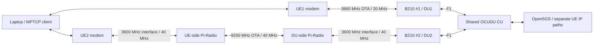

# Project Design and Progress

Updated: 2026-10-30.

Falcon uses two independent UE/modem/USRP/DU paths with a shared OCUDU CU,
Open5GS Core and FlexRIC. Link 1 is the direct 3660-MHz FR1 path. Link 2 uses
a 9250-MHz FR3 air interface with Pi-Radio converters and
3600-MHz USRP/modem interfaces. OCUDU and the modem retain logical n78
configuration on both paths.

On October 30 the operator confirmed that DU2's hardware had been modified
for 9250-MHz operation and that this is its configuration going forward.
DU2 TX 60 / RX 10 dB was obtained by tuning this FR3 hardware path. The
operator also confirmed license availability for the project's 9.25-GHz
experimental band, completed Pi-Radio manual calibration and completed
Quectel antenna rewiring.

The October 29 direct 3600-MHz UE2 connection test is historical. Its result
does not establish integrated UE registration, PDU connectivity or sustained
traffic/KPM through the converted FR3 path. Integrated FR3 UE/PDU connectivity still needs a completed retained test.

## Daily Operation and Documentation

Use [Spark quick commands](spark_quick_commands.md) for the shared
infrastructure, DU startup and experiments. Choose either the
[Laptop one-shot guide](laptop_single_quick_start.md) or the
[Laptop reconnect guide](laptop_reconnect_quick_start.md) for the two modems.
Detailed manual procedures are in [operations](operations/manual_laptop_startup.md),
implementation contracts in [reference](reference/ue_identity_xapp.md), the
MPTCP contract in [interface](interface/README.md), and dated results in
[experiments](experiments/README.md).

## Platform and Repositories

| Component | Responsibility and current location |
| --- | --- |
| Spark | NVIDIA DGX Spark, Ubuntu/aarch64; shared RAN, Core, FlexRIC and subscriber application |
| Laptop | Two Quectel RM500Q modems, separate WWAN/IP paths and MPTCP client |
| OCUDU | C++ CU/DU; `/home/nyu/ocudu`, branch `falcon-dev`; integrated binaries under `build-integrated/apps/` |
| FlexRIC | E2 platform and C SDK; `/home/nyu/flexric`, branch `main`; E2AP v3 / KPM v3 |
| Falcon | Maintained deployment templates, C E2 collector, Python identity matcher/broker, dummy and evidence tools; branch `main` |
| Core | Open5GS AMF/SMF/UPF with persistent MongoDB; current two-DNN/two-TUN layout |

The telemetry path is `CU/DU → E2 → FlexRIC → C collector → Python matcher → TCP application`.
The xApp is within the logical FlexRIC scope and runs as separate processes.
It joins CU NGAP/GUAMI/F1/serving-DU context, DU UE/KPM and read-only AMF/SMF
SUPI/session/IP context. The result is **IDs + IP + KPM**. The retained
[binding topology](reference/figures/ue_identity_topology.svg) illustrates
these roles; its example UE IDs and addresses are historical.

## Progress and Validation Status

| Capability | Current status | Evidence and scope |
| --- | --- | --- |
| Two subscribers, independent IP paths and concurrent UL/KPM | Verified on the earlier direct n78 profiles | [October 13 report](experiments/reports/dual_ue_ul_experiment_report_2026-10-13.md) |
| MPTCP primary/backup video | Verified in the earlier direct-radio demo | [October 23 report](experiments/reports/mptcp_video_experiment_report_2026-10-23.md); this predates broker adaptation |
| UE2 automatic recovery | Two live cycles completed on the earlier profile | [October 24 report](experiments/reports/ue2_fr3_recovery_experiment_report_2026-10-24.md); symmetric disturbance remains supplemental |
| Explicit CU serving-DU scope and current IP binding | Implemented and accepted for the admitted local profile | [100-ms validation](experiments/reports/dual_ue_100ms_validation_report_2026-10-25.md); shared lifecycle-generation proof remains separate |
| 27 raw DU KPM at nominal 100 ms | Verified on the captured direct-radio setup | [Six-minute metric report](experiments/reports/dual_ue_27kpm_stability_report_2026-10-25.md); [metric contract](reference/kpm_metrics.md) |
| App registration and full bound report push | Implemented; one dummy received/wrote 2,400 and 7,200 reports | [120-second](experiments/reports/du27_app_subscription_live_2026-10-26.md) and [six-minute](experiments/reports/du27_app_subscription_6min_live_2026-10-26.md) tests; push p99 2.314 / 3.595 ms; normal cleanup |
| DU2 40-MHz migration | Startup and both direct-radio UE connections confirmed October 29 | DU2 46.08 MS/s / SSB `638976`; direct test then used TX 45 / RX 20 |
| Current 9.25-GHz FR3 hardware and gains | Operator-confirmed deployment from October 30 | Pi-Radio manual calibration and Quectel antenna rewiring complete; license availability confirmed; DU2 TX 60 / RX 10 tuned for this path |
| Integrated FR3 UE/PDU connectivity and sustained traffic/KPM | Completed retained test pending | DU F1/E2 startup and RF preparation alone do not establish end-to-end connectivity |
| Actual MPTCP/MPX consumer using the broker | Joint integration test pending | The verified subscriber was the independent dummy; use the [v2 contract](interface/README.md) |
| Longer live stability and fault cases | Pending | 30-minute run, app/UE reconnect, IP changes/reuse and slow consumers need their own live evidence |
| Guarded CME 902 / CFUN cell-lock fallback | Implemented with offline regression coverage | See [reconnect details](operations/reconnect_reference.md#cme-902-after-a-du-gain-drop); physical fallback execution remains separately unverified |

October 13–26 dual-link reports used DU2 at 20 MHz with direct n78 radio.
Their `FR3` labels were application labels. The October 29 direct 40-MHz
connection checkpoint and October 30 converted hardware/gain confirmation
are distinct. Historical measurements remain scoped to their recorded RF setup.

## Current Radio Profiles

| Parameter | Link 1 / UE1 / DU1 / FR1 | Link 2 / UE2 / DU2 / FR3 |
| --- | --- | --- |
| B210 serial | `3271233` | `328B021` |
| OCUDU and USRP carrier | 3660 MHz | 3600 MHz |
| Carrier NR-ARFCN | `644000` | `640000` |
| Logical NR band | n78 | n78 |
| Channel bandwidth | 20 MHz | 40 MHz |
| USRP sample rate | 23.04 MS/s | 46.08 MS/s |
| Antenna configuration | 1T1R | 1T1R |
| Common / SSB SCS | 30 kHz | 30 kHz |
| PCI | `1` | `2` |
| SSB NR-ARFCN | `643680` | `638976` |
| Resource blocks at 30 kHz | 51 | 106 |
| Nominal USRP-side channel | 3650–3670 MHz | 3580–3620 MHz |
| Physical OTA center | 3660 MHz, direct | 9250 MHz via Pi-Radio |
| Nominal OTA channel | 3650–3670 MHz | 9230–9270 MHz |
| Configured TX / RX gain | 70 / 35 dB | 60 / 10 dB |
| DU ID / sector / NCI | `1` / `0` / `6733824` | `2` / `1` / `6733825` |
| Maintained configuration | [DU1 YAML](../configs/ocudu/dual_fr1/du1_b210_n78_3660mhz.yml) | [DU2 YAML](../configs/ocudu/dual_fr1/du2_b210_n78_40mhz.yml) |

The nominal USRP-side channels have a 30-MHz edge-to-edge gap. Pi-Radio
frequency conversion preserves the intended 40-MHz channel bandwidth; the
converter settings and RF path must support that complete channel at both
ends. Conversion settings and performance are verified separately from the
OCUDU configuration.

The gain values are startup defaults in dB, rather than calibrated output
powers in dBm. Record any runtime console overrides with the run evidence.

The current gain row follows the actual OCUDU startup YAML after subsequent
live tuning, as confirmed by the operator on October 30: DU1 TX 70 / RX 35
and DU2 TX 60 / RX 10. DU2's values apply to the modified 9250-MHz FR3
hardware path. Falcon's maintained DU2 template is synchronized with
the deployed file. The October 29 migration used DU2 TX 45 / RX 20; that
earlier checkpoint and older experiment reports retain their recorded gains.

## Radio Topology

The current deployment uses matching converters on link 2 while preserving
its logical OCUDU and modem settings:



`FR3` now identifies link 2's physical 9250-MHz path. In older direct n78
experiments it was only the application's path label. Record the RF
arrangement and configuration for each run before comparing results.

## Locking and Deployment

OCUDU derives the SSB placement from the carrier, bandwidth and control-channel
configuration. The current DU2 40-MHz profile derives SSB `638976`; its
earlier 20-MHz profile derived `639648`. The two current lock commands are:

```text
UE1: AT+QNWLOCK="common/5g",1,643680,30,78
UE2: AT+QNWLOCK="common/5g",2,638976,30,78
```

Use each command only on its verified modem/AT port. Pi-Radio conversion
does not change these logical n78 lock parameters. Match both converter ends
so that each modem sees the intended logical carrier.

Falcon maintains the YAML templates. The Spark startup procedure copies them
into `/home/nyu/ocudu/configs/`, which the DU launch commands actually read.
The active DU1 file is `du1_b210_n78_3660mhz.yml`. The retired 3750-MHz
DU1 runtime configuration has been removed; historical results remain dated
records of the original setup.
Refresh the Laptop script copies after a radio-profile update. The shared
reconnect script checks the saved lock and actual serving cell before PDU
setup; its guarded CME 902 retry is described in the
[reconnect reference](operations/reconnect_reference.md#cme-902-after-a-du-gain-drop).
Existing `dual_fr1` directory names and plan/runbook filenames are retained
for command and link compatibility; they do not describe the converted OTA band.

- [Spark configuration deployment and startup](spark_quick_commands.md)
- [Laptop script update and reconnect](laptop_reconnect_quick_start.md)
- [Manual modem and lock checks](operations/manual_laptop_startup.md)

## Core and IP Paths

| Attribute | Link 1 | Link 2 |
| --- | --- | --- |
| Modem IMEI | `863305041978437` | `863305041980706` |
| SIM IMSI | `001010000000101` | `001010000000102` |
| DNN | `internet` | `internet2` |
| UE IPv4 pool | `10.45.0.0/16` | `10.46.0.0/16` |
| Spark endpoint / TUN | `10.45.0.1` / `ogstun_1` | `10.46.0.1` / `ogstun_2` |
| Laptop policy table | `151` | `152` |
| Spark iperf3 port | `5201` | `5202` |

Both cells use PLMN `00101`, TAC `7`, and gNB ID `411` with 22 ID bits.
The xApp inside FlexRIC combines E2 CU/DU identity and KPM with Open5GS
AMF/SMF IP context, then pushes **IDs + IP + KPM** to registered applications.
DU reports remain at 100 ms; CU identity and Core polling remain at 1 second.

E2/RIC receive the logical cell information configured in OCUDU. External
Pi-Radio conversion is not automatically reported as a 9250-MHz cell. Treat
physical frequency/path labels as deployment metadata. The version-2
[xApp/MPTCP interface](interface/README.md) retains its existing wire format;
MPTCP associates reports using its current UE IP/path table, rather than an
assumed frequency, DU numbering or historical IP allocation. PRB percentages
must use each cell's current capacity: 51 RBs for DU1 and 106 for DU2.

## Configuration Ownership

| Purpose | Maintained file | Deployment behavior |
| --- | --- | --- |
| DU1 radio/cell/E2 | [DU1 YAML](../configs/ocudu/dual_fr1/du1_b210_n78_3660mhz.yml) | Copied to `/home/nyu/ocudu/configs/`; current launcher reads the 3660-MHz file |
| DU2 radio/cell | [DU2 YAML](../configs/ocudu/dual_fr1/du2_b210_n78_40mhz.yml) | Copied to the same directory; retains logical n78 and tuned FR3 gains |
| DU2 E2/metrics | [DU2 overlay](../configs/ocudu/dual_fr1/du2_flexric.yml) | Loaded after DU2 base; scheduler/RLC period 100 ms |
| CU identity | [CU overlay](../configs/ocudu/cu_identity_e2.yml) | Loaded with the installed CU base; identity period 1000 ms |
| RIC and acquisition | [RIC](../configs/flexric/ric_ue_identity.conf), [27-metric xApp](../configs/flexric/xapp_ue_identity_expanded.conf) | Current isolated plugin and collector build are prepared by the Spark guide |
| Matching and publication | [Identity settings](../configs/ue_identity/local.json), [subscription settings](../configs/ue_identity/subscriptions.json) | AMF/SMF polling 1 s, source TTL 3 s, app listener `127.0.0.1:8765` |

Falcon owns the deployment templates; the launched OCUDU YAML determines
startup settings. Runtime console gain overrides apply to the selected DU
until changed or restarted. Keep template and deployed values synchronized
after an accepted tuning change. The old 3750-MHz DU1 YAML is historical.

## Application Delivery

The active service uses protocol version 2 and profile `du27_bound_v1`.
An application may connect/register while the service is running, receive
new matched reports, send heartbeats, unregister and reconnect independently
of the E2 subscriptions. Reconnect registers afresh without history replay.
Only current matched bindings are published; stale, ambiguous or unresolved
source context remains explicit. Slow clients have separate bounded output queues.

The service runs continuously with `--duration 0` until normal shutdown.
The one all-links dummy owns TXT/receipt storage; routine subscription-mode
xApp output is TCP push. MPTCP matches `report.ue_ipv4` against its current
path table. The [interface document](interface/README.md) contains the wire
schema, lifecycle, captured messages, launch commands and offline verification.

## Startup, Shutdown and Supporting Procedures

Start the Core and current RIC/CU before both DUs; verify radio/F1/E2
readiness, then prepare the two Laptop UEs and traffic endpoints. Start the
xApp after the intended E2 membership exists. A RIC restart requires the
documented DU restart sequence; automatic late joining is not assumed.
Use Spark 7c/7d and the corresponding Laptop sections for the single-dummy tests.

Finish traffic and the dummy, stop xApp normally and retain E2 delete responses,
then shut down both UE watchers/holders, DUs, RIC/CU and Core as needed.
Healthy watchers remain active until stopped; a one-shot holder waits without
ongoing probes after startup. Keep ModemManager running and close minicom
before a watcher owns the selected modem's AT port.

- [Manual modem, bearer, policy-route and reset procedures](operations/manual_laptop_startup.md).
- [Reconnect policy and troubleshooting](operations/reconnect_reference.md).
- [Current Core/TUN networking and rollback](operations/networking.md).
- [Software/drivers](operations/setup/software_installation_and_drivers.md) and [SIM provisioning](operations/setup/sim_provisioning_and_dual_ue.md).
- [DU crash capture](operations/du_crash_capture.md).

## Development and Validation Policy

Preserve the current kernel/toolchain and working configuration. Discover
modems by IMEI/SIM and read current bearer, address and interface state;
historical indices and allocated IPs are not persistent identities. Keep
management Wi-Fi separate from role-specific traffic, with the documented
source/destination guards. Never access a B210 with a probe while a DU owns it.
Keep authentication secrets and derived keys outside Git; retain sanitized evidence.

Record test direction, duration, throughput/errors, radio observations,
configuration hashes and source/receipt timing. Normal startup or a successful
build establishes only that layer. Underflow remediation and snapshot
synchronization remain deferred; their status is not silently converted to a pass.
Cold-start reproduction, repeatability/comparisons and symmetric disturbance/
survivor tests remain [supplemental experiments](experiments/supplemental_experiments.md),
outside the accepted earlier Dual UE stage and its merge criteria.
The newer FR3 path still needs its own integration evidence.

## Next Work

1. Retain a complete FR3 UE acquisition/registration/PDU/private-connectivity
   test using 9.25-GHz OTA, DU2 40 MHz and the tuned 60/10 gains.
2. Run a fresh dual-link traffic/KPM/subscription workload on the current
   20/40-MHz RF setup, checking IP binding, cadence, payload integrity and cleanup.
3. Adapt and jointly test the real MPTCP/MPX consumer, then complete the longer
   live duration and fault scenarios. Track supplemental experiments separately.
