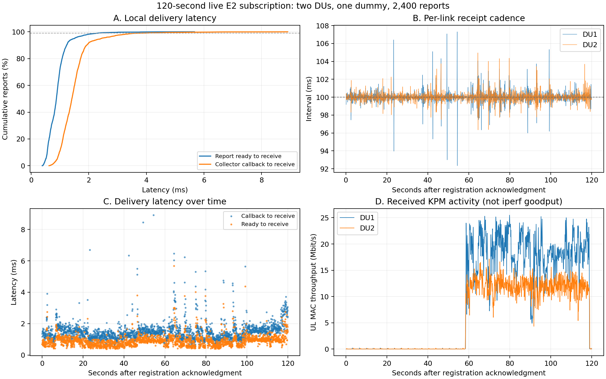

# Dual DU single dummy 120 second live KPM subscription test

> Radio scope: this experiment used direct n78 radio paths with DU2 at
> 20 MHz. Its measurements, gains, lock readbacks and figures retain that
> configuration. See the [current radio design](../dual_link_radio_design.md)
> for the October 29 20/40-MHz profiles and the separately designed Pi-Radio
> 9250-MHz OTA path. This report does not validate either later RF arrangement.

This test verified live E2 KPM delivery with two DUs, one subscribing application, and established IP bindings. **All 2400 reports in the subscription window were received and written to TXT, with all 27 metrics preserved. The p99 latency from report readiness to dummy receipt was 2.314 ms, and the receive interval for each DU remained approximately 100 ms.** Registration, heartbeats, unregistration, and normal shutdown completed.

The test ran on October 26, 2026. Analysis data, plots, two complete message examples, and an archive of the original records are retained in the
[live test evidence directory](../evidence/2026-10-26_du27_app_subscription_live/manifest.json).

## Test window and configuration

| Item | Record |
| --- | --- |
| Registration acknowledgement received by dummy | 2026-10-26 17:56:16.538728 UTC / 13:56:16.538728 EDT |
| Unregistration acknowledgement received by dummy | 2026-10-26 17:58:16.546841 UTC / 13:58:16.546841 EDT |
| Monotonic elapsed time between acknowledgements | 120.008113 s |
| Data source | `e2`, live CU / DU reports |
| Application | One `dual-ue-dummy`, subscribing to `all_matched_links` |
| Interface | `127.0.0.1:8765`, version 2 JSON Lines, `du27_bound_v1` |
| DU measurement / reporting period | 100 ms, 27 raw KPM metrics |
| CU identity period / Core polling period | 1000 ms / 1000 ms |
| Identity and IP sources | CU identity over E2; xApp queries Open5GS AMF / SMF infoAPI |
| Output | xApp pushes reports; dummy independently timestamps receipt and writes TXT asynchronously |

The captured source revisions were Falcon `b6c44ef245abbf44a06ac60becdfdd6f02025fc6`, FlexRIC `d93076eed138079be51c43ca5b57908c67581aab`, and OCUDU `9bbf6398507a30e469df31e4667056577b2af2c5`. The archive includes the run configuration, source revision records, and collector / plugin hashes.

## Data integrity and bindings

| Binding field | DU1 | DU2 |
| --- | --- | --- |
| gNB / DU ID | 411 / 1 | 411 / 2 |
| gNB CU UE F1AP ID | 4 | 0 |
| CU UE index | 4 | 8 |
| AMF UE NGAP ID / RAN UE NGAP ID | 9 / 4 | 13 / 8 |
| SUPI | `imsi-001010000000101` | `imsi-001010000000102` |
| PDU Session ID | 2 | 2 |
| DNN | `internet` | `internet2` |
| UE IPv4 | `10.45.0.3` | `10.46.0.3` |
| Reports received and written | 1200 | 1200 |
| Binding revision | 1 throughout | 1 throughout |

Both bindings used `core_infoapi_cu_e2`, with assurance `cu_reported_du_scope`. All delivered reports were `matched`, had a DU granularity of 100 ms, and contained all 27 raw metrics.

The comparison covered the original collector KPM data, source reports generated by xApp, objects received by dummy, and TXT output:

- All 2400 complete report objects matched between source and receipt records.
- All 64,800 raw KPM metric fields were compared for type, value, unit, and TXT representation. IEEE 754 bit patterns were also checked for the 27,912 REAL values.
- `delivery_seq` was contiguous from 1 through 2400, with no duplicates, gaps, or reordering.
- All 2400 eligible source reports generated after the registration cutoff and before receipt of the unregistration acknowledgement appeared in the receipt records. Every report was received before its binding expired.
- The NGAP / SUPI / PDU / DNN / IP relationships in all 2400 reports matched the latest captured Core snapshot available at that time. This cross-check uses captured Core data; independent Laptop address verification was outside this archive.

Across the entire xApp run, 8718 matched source reports were generated: 3190 before registration, 2400 during the subscription window, and 3128 after the unregistration acknowledgement. The difference between the total source count and the subscriber receipt count reflects these time windows.

## Latency and reporting cadence

All latency measurements below use `CLOCK_MONOTONIC` on the same Spark host. Percentiles use the nearest-rank method, consistent with the dummy summary.

| Stage | p50 ms | p95 ms | p99 ms | Max ms |
| --- | ---: | ---: | ---: | ---: |
| Collector callback → report ready | 0.541 | 0.937 | 1.730 | 7.943 |
| Report ready → publish enqueue | 0.677 | 1.044 | 1.867 | 5.181 |
| Publish enqueue → dummy receipt | 0.232 | 0.493 | 0.833 | 2.085 |
| Report ready → dummy receipt | 0.876 | 1.500 | **2.314** | 5.672 |
| Collector callback → dummy receipt | 1.413 | 2.431 | **3.838** | 8.912 |
| Dummy receipt → TXT write completed | 0.578 | 1.024 | 1.680 | 9.040 |

The callback-to-ready stage includes collector handoff, coordinator processing, and matching; it does not isolate the matching algorithm. Publish enqueue means insertion into the client output queue. TXT write completion includes the program's write and flush operations, without measuring physical storage persistence. Stage p99 values cannot be added to obtain an overall p99.

The configured checks required push p95 ≤ 10 ms, p99 ≤ 25 ms, and max ≤ 100 ms, plus callback-to-receipt p99 ≤ 100 ms. All passed. These measurements start at the collector callback or report readiness and exclude the preceding delay from PHY sampling to the callback.

| Receive interval per link | DU1 | DU2 |
| --- | ---: | ---: |
| Interval samples | 1199 | 1199 |
| Mean interval ms | 100.005 | 100.008 |
| p50 ms | 99.993 | 99.992 |
| p99 ms | 102.687 | 102.125 |
| Min / max interval ms | 92.347 / 107.304 | 96.351 / 104.955 |
| Intervals above 150 ms | 0 | 0 |

The first report arrived 53.722 ms after the registration acknowledgement for DU1 and 48.807 ms after it for DU2. Bindings were already established at registration, so these values measure the wait for the next deliverable report rather than initial UE identity resolution.

At report readiness, the latest captured Core snapshot had been received 58.400–969.849 ms earlier, consistent with the configured 1 s Core refresh period. This measures cache age since receipt, without measuring the full delay from an internal Core state change to its observation.



## Behavior during uplink activity

Received `UL.MAC.Throughput` samples above 1 Mbit/s occurred mainly around 58.4–119.0 s after registration. This is consistent with approximately 60 s of concurrent uplink traffic. The archive contains no Laptop / iperf receiver records, so it does not establish application goodput or end-to-end TCP loss.

| Uplink activity observed through KPM | DU1 | DU2 |
| --- | ---: | ---: |
| Samples with UL MAC > 1 Mbit/s | 605 | 607 |
| Mean UL MAC for these samples, Mbit/s | 18.352 | 11.947 |
| Maximum UL MAC across the full window, Mbit/s | 25.489 | 17.133 |

Each consecutive 30 s window contained 600 received reports across the two links. During the active 60–90 s and 90–120 s windows, push p99 was 3.018 ms and 2.319 ms, respectively. Maximum push latency across the full run was 5.672 ms. This workload showed no application report backlog approaching a reporting period during uplink activity.

Some idle / low traffic windows retained `no_value`: DU1 had 536 occurrences each for PUSCH RSRP and SNR, and DU2 had 540 each. PUSCH SNR was numeric in every sample with UL MAC > 1 Mbit/s. MCS `no_value` coincided with a zero MCS sample count in the corresponding direction.

**A 100 ms reporting period does not mean every field is refreshed every 100 ms.** Some PHR / BSR / Buffer `AgeMs` values reached approximately 3.4 s. DU1 also had 18 windows where RF availability differed from whether `UL.MCS.Samples` was nonzero. Getters at different layers do not guarantee synchronized observations, so MAC sample counts cannot substitute for RF validity. These representations were preserved throughout delivery; measurement source synchronization and push integrity require separate verification.

## Registration, heartbeats, unregistration, and shutdown

Dummy recorded 2415 application messages: 1 registration acknowledgement, 2 binding state messages, 2400 KPM reports, 11 pongs, and 1 unregistration acknowledgement. `frames_queued=2415` includes control messages; `reports_queued=2400` counts only KPM reports.

At service exit, active connections and registrations were both 0, and source queue depth and bytes were both 0. The source queue peaked at 2 and the dummy writer queue at 3. Recorded collector ingress drops remained 0, the service failures list was empty, and both dummy and xApp exited with code 0.

All three E2 subscriptions received deletion responses during shutdown, but the log contains two `ric_req_id not found in the registry` warnings. In the SDK, this message occurs when an Indication handler cannot find the subscription record. Its appearance after deletion responses is consistent with late Indications during shutdown. The specific race was not reproduced, so this remains a shutdown observation; the subscription window showed no missing application reports.

## Two actual received messages

The following JSON examples were extracted from dummy's `receipts.jsonl`, selecting the first report for each IP with `UL.MAC.Throughput > 1000 kbit/s`. They are independent samples from their respective links, rather than a pair from the same source window.

| Example | DU1 | DU2 |
| --- | --- | --- |
| Complete JSON | [10.45.0.3 message](../evidence/2026-10-26_du27_app_subscription_live/examples/du1-10.45.0.3.kpm_report.json) | [10.46.0.3 message](../evidence/2026-10-26_du27_app_subscription_live/examples/du2-10.46.0.3.kpm_report.json) |
| Original receipt line | 1178 | 1175 |
| `report_seq` / `delivery_seq` | 4380 / 1170 | 4377 / 1167 |
| UE IP / F1AP ID | 10.45.0.3 / 4 | 10.46.0.3 / 0 |
| Raw KPM metrics | 27 | 27 |
| UL MAC throughput, kbit/s | 7596.080078125 | 3247.360107421875 |
| PUSCH SNR dB | 22.972715377807617 | 20.735546112060547 |

The complete examples retain the original envelope, full node / UE / binding objects, all 27 raw KPM metrics, two separate derived metrics, and all source timestamps. Numeric values are unrounded, and string types for IDs, sequence numbers, and timestamps are preserved. JSON Lines frames were indented for readability, and the dummy-added fields `dummy_received_at_mono_us`, `dummy_received_at_unix_us`, and `dummy_written_at_mono_us` were removed. These three fields were added by dummy after receipt. Their original values and receipt line hashes are retained in the [example provenance index](../evidence/2026-10-26_du27_app_subscription_live/examples/index.json).

## Scope and remaining acceptance

These results establish data integrity, cadence, latency, and normal lifecycle behavior for a 120 s run on one Spark host with two DUs, one all-links dummy, and unchanged bindings. Application reconnection, UE reconnection, IP changes / reuse, slow clients, and 30 minute live stability still require evidence from those workloads. Existing offline cases do not replace that live verification.

## Retained artifacts and reproduction

| File | Contents |
| --- | --- |
| [analysis.json](../evidence/2026-10-26_du27_app_subscription_live/analysis.json) | Independently checked counts, latency, cadence, bindings, statistics for all 27 metrics, and source file hashes |
| [dummy-summary.json](../evidence/2026-10-26_du27_app_subscription_live/dummy-summary.json) | Original passing dummy result |
| [publisher-summary.json](../evidence/2026-10-26_du27_app_subscription_live/publisher-summary.json) | Original xApp summary |
| [xapp.log](../evidence/2026-10-26_du27_app_subscription_live/xapp.log) / [dummy.log](../evidence/2026-10-26_du27_app_subscription_live/dummy.log) | Original console logs |
| [live-artifacts.tar.gz](../evidence/2026-10-26_du27_app_subscription_live/live-artifacts.tar.gz) | 24 original / analysis files, including complete inputs, source reports, receipts, TXT output, run configuration, and revision / hash records |
| [manifest.json](../evidence/2026-10-26_du27_app_subscription_live/manifest.json) | Archive member list, file sizes, SHA256 hashes, revisions, and example provenance |
| [verification.json](../evidence/2026-10-26_du27_app_subscription_live/verification.json) | Results of reanalysis from the extracted archive, example validation, and hash checks |
| [analyze_results.py](../evidence/2026-10-26_du27_app_subscription_live/analyze_results.py) | Analysis script that runs against the extracted records |

The original directories were `/tmp/falcon-dual-subscriptions.dQ3QHOGw` and `/tmp/falcon-dual-dummy.bdgcdZXp`. The repository archive preserves the results independently of these temporary directories. Collector / plugin binaries are excluded, but their original hashes and the plugin build manifest are retained. Reviewing the captured records does not require launching those binaries.

To reproduce the analysis from the Falcon root, with Python and Matplotlib installed:

```bash
REVIEW_RUN=$(mktemp -d /tmp/falcon-du27-live-review.XXXXXXXX)
tar -xzf docs/evidence/2026-10-26_du27_app_subscription_live/live-artifacts.tar.gz \
  -C "$REVIEW_RUN"
python3 docs/evidence/2026-10-26_du27_app_subscription_live/analyze_results.py \
  --dummy-dir "$REVIEW_RUN/dummy" --service-dir "$REVIEW_RUN/service" \
  --output-dir "$REVIEW_RUN/reanalysis"
```
