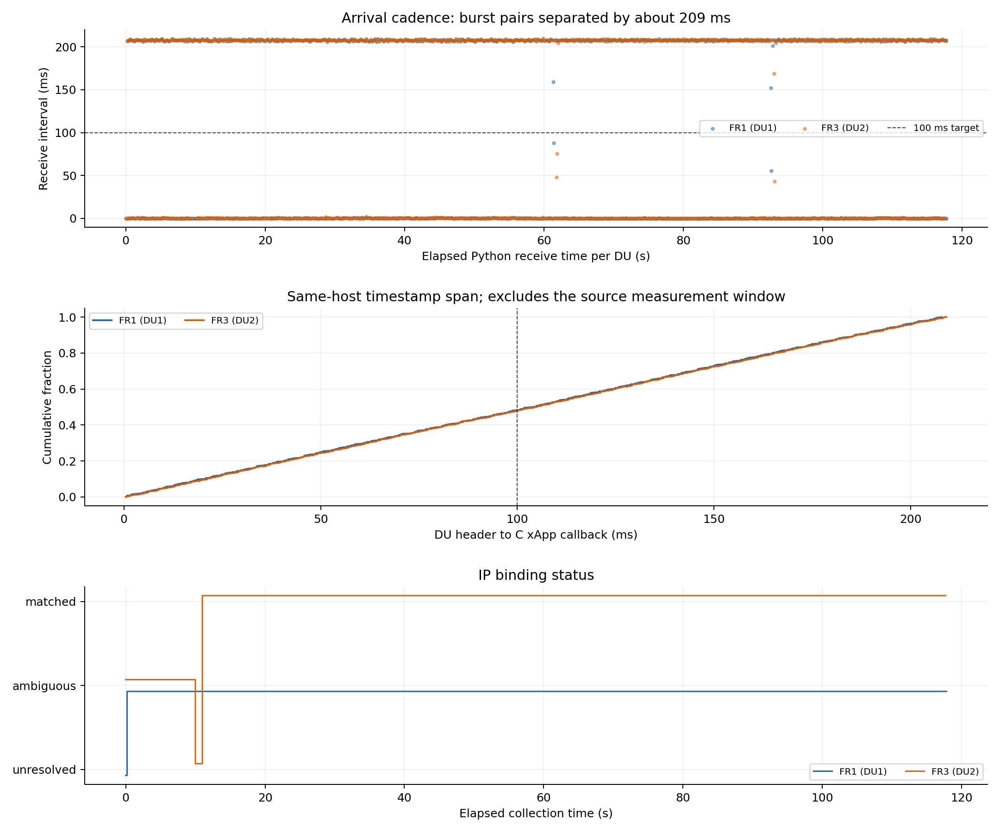
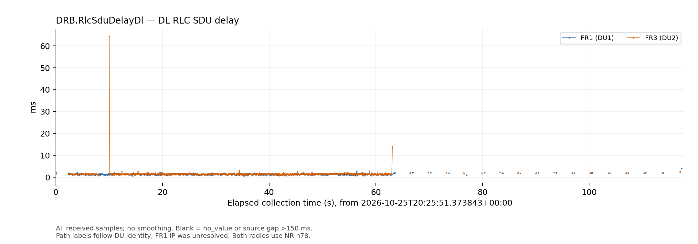
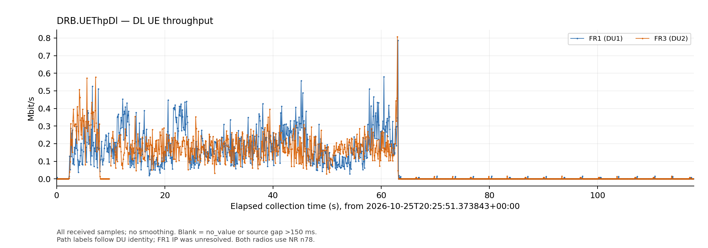
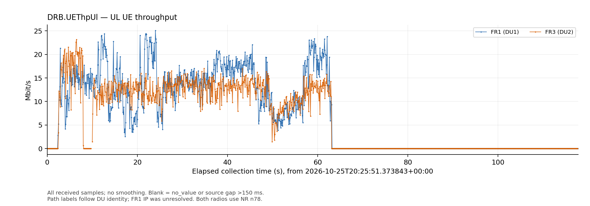
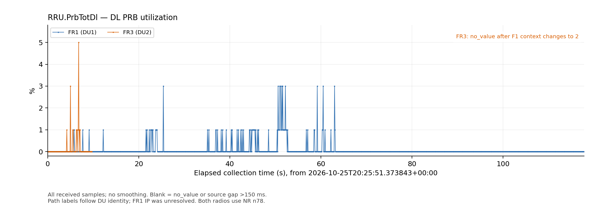
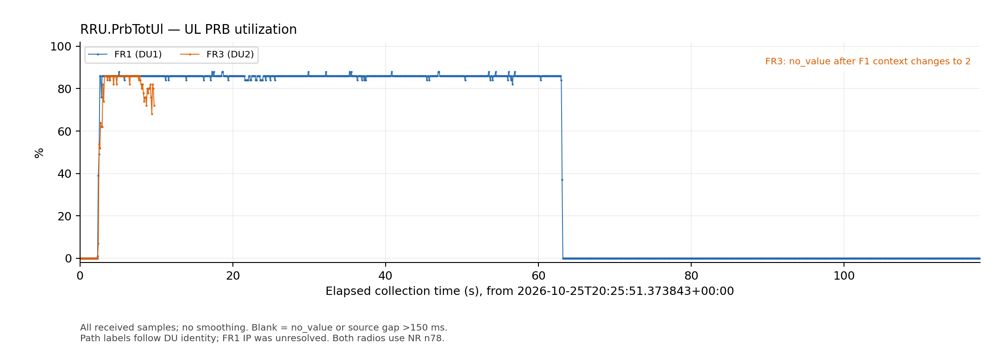
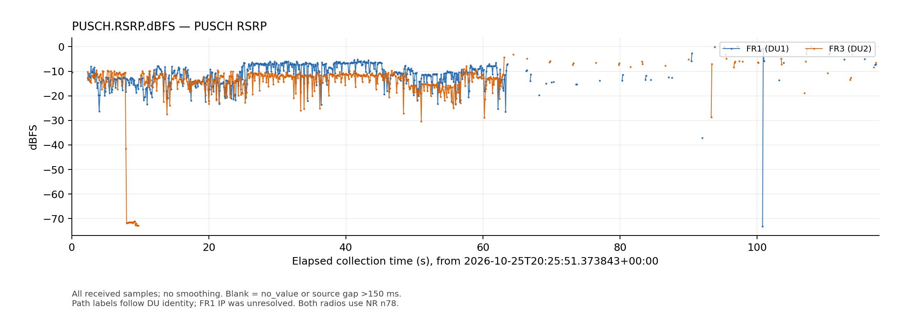
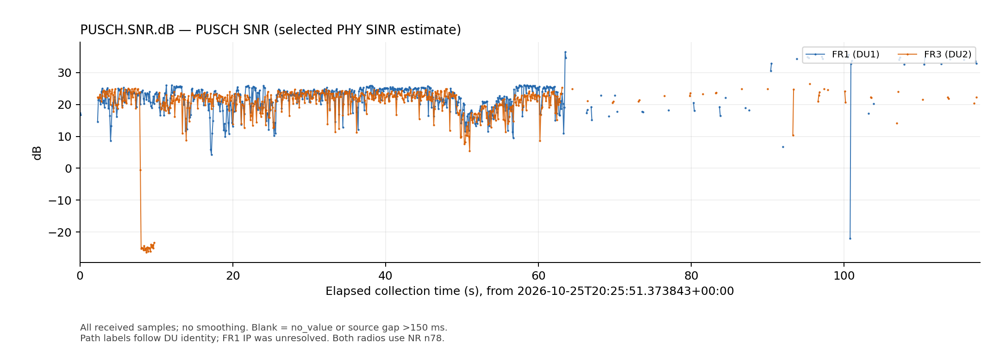

# Dual UE 100 ms KPM reporting experiment

Experiment date: October 25, 2026, 16:25–16:27 EDT (20:25–20:27 UTC). Operator: Ruibin.

**The two DUs sustain approximately 10 reports per second with 100 ms KPM
granularity, while CU identity reporting remains at one second. This run does
not demonstrate evenly spaced 100 ms delivery or complete dual-UE IP binding.**
Reports arrive in bursts approximately 209 ms apart, FR1 never obtains a
verified IP association, and FR3 loses both numeric PRB measurements after an
RRC context replacement. The seven subscribed metric fields reach the xApp
without payload changes or a reported collector overflow.

The capture is `/tmp/falcon-identity-dual.zcurQDSb`, with a requested duration
of 120 seconds and xApp exit code 0. The retained
[audit](../evidence/2026-10-25_du_100ms/audit.json) and
[capture manifest](../evidence/2026-10-25_du_100ms/source_manifest.json)
support the results below. FR1 denotes DU1 and FR3 denotes DU2; both physical
radios operate in NR band n78. Plot labels identify the originating DU and do
not imply a successful subscriber/IP match.

## Requirements and outcome

| Requirement evaluated in this run | Outcome | Evidence |
| --- | --- | --- |
| Both DU source configurations and seven-metric subscriptions use 100 ms | Met | DU startup excerpts contain `du_report_period: 100`; every DU row declares `granularity_ms=100`; the captured subscription requests 100 ms. |
| Sustain approximately 10 DU reports/s through E2, RIC and xApp | Met for this capture | FR1 9.9998 reports/s; FR3 9.9827 reports/s over their observed header spans. |
| Deliver a fresh report at a regular 100 ms application cadence | Not met | Receive intervals alternate between near-zero gaps and approximately 209 ms gaps; DU headers also arrive out of order. |
| Keep CU identity at 1 s and Core polling at 1 s | Met | Median receive intervals are 1000.001 ms for CU and 1000.065 ms for Core. |
| Preserve all seven metric fields and decoded values | Met | All 2,355 DU payloads have equal output payloads, including types and missing values. |
| Obtain numeric values for all seven metrics during active UL | Not met for FR3 | Both PRB metrics are `no_value` in all 1,078 FR3 rows after its F1 context changes. |
| Bind both DU streams continuously to their current UE IPs | Not met | FR1 has zero matched rows; FR3 has 1,068 consecutive matched rows after context replacement. |
| Detect no collector ingress overflow during this capture | Met within available instrumentation | All 2,473 KPM drop counters are zero; no `ingress_loss` or `core_error` event is recorded. |

Here, “regular 100 ms application cadence” concerns receive spacing and
freshness, rather than the average number of reports. The 90–110 ms receive
interval band is a diagnostic illustration, not a previously agreed acceptance
tolerance: neither DU has an interval inside that band in this run.

## Configuration and retained observations

| Component | Configuration or observation |
| --- | --- |
| DU1 / FR1 | gNB 411, DU ID 1, PCI 1; 100 ms statistics; startup TX/RX gains 70/35 dB |
| DU2 / FR3 | gNB 411, DU ID 2, PCI 2; 100 ms statistics; startup TX/RX gains 70/35 dB |
| DU subscription | Format 4; seven metrics; report period and action granularity 100 ms |
| CU subscription | `FALCON.UE.RRCState`; granularity 1000 ms |
| Core | AMF/SMF snapshots every 1 s; source freshness TTL 3 s |
| Received events | 1,179 DU1 reports, 1,176 DU2 reports, 118 CU reports and 120 Core snapshots |
| Output | 2,355 DU rows: 1,068 matched, 1,275 ambiguous, 12 unresolved, zero cached |
| Shutdown | Three subscription deletion responses; xApp exit 0 |

The captured configuration file retains `strict` / `last_known` defaults.
Replaying with the documented experimental `observed_unique` / `fresh_only`
settings reproduces every output status, IP and measurement exactly; these
are the effective settings used for this analysis. Startup gains do not
establish whether runtime gain commands were issued during the capture.

The xApp log also contains `ric_req_id ... not in the registry` during
subscription cleanup. All three deletion responses and normal stop are
recorded. This warning is separate from the measured reporting and binding
problems; exit 0 alone is not a correctness verdict.

## Actual reporting cadence and freshness

Intervals below use two distinct orders. **Collection intervals** sort unique
DU header timestamps. **Receive intervals** retain arrival order and use the
Python ingress monotonic clock. Sorting for the former does not repair or
conceal the latter.

| Measurement | FR1 / DU1 | FR3 / DU2 |
| --- | ---: | ---: |
| DU reports | 1,179 | 1,176 |
| Observed header span | 117.801829 s | 117.703295 s |
| Effective reports/s, `(N−1)/span` | 9.9998 | 9.9827 |
| Sorted collection interval, median | 99.985 ms | 99.982 ms |
| Sorted collection interval, p95 / maximum | 100.255 / 102.508 ms | 100.244 / 299.924 ms |
| Receive interval, median | 0.564 ms | 0.618 ms |
| Receive interval, p95 / maximum | 208.898 / 209.542 ms | 208.925 / 209.922 ms |
| Receive gaps above 150 ms | 566 / 1,178 | 565 / 1,175 |
| Headers moving backward in arrival order | 288 | 265 |
| Duplicate header timestamps | 0 | 0 |
| Header → C xApp callback, median / p95 | 104.161 / 197.555 ms | 104.778 / 198.049 ms |
| C callback → emitted output, p95 / maximum | 1.814 / 10.061 ms | 1.753 / 10.477 ms |



FR1 has no collection-header gap above 150 ms. FR3 has one 299.924 ms gap,
from 20:26:01.073922 to 20:26:01.373846 UTC, overlapping its logged RRC
reestablishment. This is approximately two missing nominal reporting slots;
the evidence does not distinguish omitted reports during UE context replacement
from transport loss. Zero collector drop counters cannot prove zero loss
before the collector.

The burst pattern is already visible at the C callback, whereas callback-to-
Python ingress takes at most 1.653 ms for FR1 and 1.894 ms for FR3. Python
matching and TXT output are therefore not the dominant source of the observed
approximately 209 ms delivery pattern. Its exact origin within DU scheduling,
transport, RIC forwarding or callback dispatch is not isolated by this capture.
Header-to-callback spans use clocks on the same Spark host; they exclude the
preceding source averaging window and are not full radio-to-application latency.

## CU and Core identity association

Both subscribers remain registered/connected in every retained Core snapshot,
with active SMF sessions and unchanged IPs. These are independent Core
observations; FR1's Core IP must not be presented as an xApp-verified binding.

| Identity | FR1 / DU1 | FR3 / DU2 |
| --- | --- | --- |
| SUPI | imsi-001010000000101 | imsi-001010000000102 |
| Core IPv4 / DNN / PDU Session ID | 10.45.0.11 / internet / 1 | 10.46.0.6 / internet2 / 1 |
| AMF / RAN UE NGAP ID | 31 / 2 | 32 / 3 |
| AMF-reported NCI | 6733824 | 6733825 |
| gNB-CU UE F1AP ID | 1 throughout | 1 → 2 |
| Matched / ambiguous / unresolved rows | 0 / 1,177 / 2 | 1,068 / 98 / 10 |
| xApp-verified current IP | Withheld throughout | 10.46.0.6 after context replacement |

At startup, both DU streams carry F1AP ID 1, and the CU report contains two
different AMF identities whose F1 lists both contain 1. These per-DU contexts
are valid, but the current standard CU identity message lacks an explicit
serving-DU/context-generation field that would distinguish them for this join.
The mapper marks F1 key 1 as conflicted and retains that mark for the lifetime
of the xApp instance. It correctly withholds an IP instead of guessing from
DU number, subscriber suffix or subnet.

The [CU context excerpt](../evidence/2026-10-25_du_100ms/cu_context_excerpt.log)
records FR3 RRC reestablishment starting at **20:26:01.129237 UTC** and finishing
at **20:26:01.258669 UTC**. The old RNTI `0x4602` is replaced by `0x460a`, and
F1AP ID 2 replaces 1. CU E2 first reports the new F1 relation at
20:26:02.275035 UTC. FR3's first matched measurement has header time
20:26:02.373892 UTC; all subsequent 1,068 FR3 rows match through the end.
FR1 continues using conflicted key 1, so FR3's recovery does not clear FR1's
binding status.

All 1,068 matches independently agree with the preceding CU identity and
AMF/SMF subscriber/session/IP relation, including GUAMI, gNB and expected NCI.
Maximum preceding CU/Core ages are **994.920 / 998.451 ms**, below the 3 s TTL.
No nonmatched row publishes an IP. Thus **CU at 1 s can supply cached current
identity context to a 100 ms DU stream**, but this run only demonstrates that
successfully for FR3 after its F1 key becomes unique. It does not establish
100 ms identity-change detection or stable binding for both UEs.

## Seven metric time series

Every received sample is retained without smoothing or outlier removal. Curves
are sorted by collection header for readability. `no_value` samples and source
gaps above 150 ms break the line; a measured numeric zero remains zero.
Throughput is converted from kbit/s to Mbit/s, and RLC delay from 0.1 ms to ms.
The [CSV](../evidence/2026-10-25_du_100ms/seven_metrics.csv) preserves original
units, types, arrival sequence and binding status for every row.

| Metric | FR1 numeric / missing | FR3 numeric / missing |
| --- | ---: | ---: |
| `DRB.RlcSduDelayDl` | 635 / 544 | 615 / 561 |
| `DRB.UEThpDl` | 1,179 / 0 | 1,176 / 0 |
| `DRB.UEThpUl` | 1,179 / 0 | 1,176 / 0 |
| `RRU.PrbTotDl` | 1,179 / 0 | 98 / 1,078 |
| `RRU.PrbTotUl` | 1,179 / 0 | 98 / 1,078 |
| `PUSCH.RSRP.dBFS` | 659 / 520 | 640 / 536 |
| `PUSCH.SNR.dB` | 659 / 520 | 640 / 536 |

Both RF fields are REAL in every sample with UL KPM above 1 Mbit/s:
**608/608 FR1 and 586/586 FR3**. Missing RF samples elsewhere must remain
explicitly unavailable; they are not converted to zero. RF values are the
DU's software estimates: RSRP is PUSCH dBFS rather than calibrated dBm, and
the SNR field carries the selected PHY SINR estimate. The live trace verifies
preservation from decoded E2 input to output, not exact alignment against a
separate scheduler snapshot or RF calibration. DU snapshot concurrency work
remains deferred as requested.

FR3's PRB disappearance is different from an idle interval: only **55/586**
UL-active FR3 samples retain numeric PRB fields. The
[DU context excerpt](../evidence/2026-10-25_du_100ms/du2_context_excerpt.log)
shows new internal UE index 1 and removal of index 0 during reestablishment.
The retained [provider source excerpt](../evidence/2026-10-25_du_100ms/provider_source_excerpt.txt)
shows that both PRB getters still treat this internal index as a position in
the dense snapshot vector. With one remaining UE at index 1, the bounds check
rejects position 1 in a one-element vector. This source-level defect is
consistent with the exact transition to 1,078 missing PRB pairs. The RF getters
already search by `ue_index`, explaining why RF can remain available after
the same replacement. No getter was modified during this analysis.

### DL RLC SDU delay



Valid-sample medians are 1.33 ms for FR1 and 1.48 ms for FR3. FR3's maximum
is 64.41 ms; it is retained rather than clipped.

### DL throughput



Peak DL KPM is 0.786 / 0.807 Mbit/s for FR1 / FR3 during this predominantly
uplink traffic capture.

### UL throughput



Peak UL KPM is 25.045 / 23.136 Mbit/s. Sustained traffic is visible in both
DU streams, followed by a near-zero traffic interval. These are DU KPM rates;
the capture does not include Laptop iperf client summaries or receiver goodput.

### DL PRB utilization



### UL PRB utilization



FR3's orange PRB curves end at context replacement because the following
values are missing, not because PRB utilization becomes zero.

### PUSCH RSRP



All numeric values, including zero and low-power outliers, are preserved.
They are not evidence of calibrated received power or exact DU console
agreement for this capture.

### PUSCH SNR



Negative samples around FR3's interruption remain visible. The trace alone
does not identify an operator gain command as their cause.

## Interpretation and reproducibility

The **100 ms rate and seven-field transport capability are demonstrated** at
this two-DU load. For control that needs a fresh, correctly identified complete
measurement set every 100 ms, three issues remain: burst delivery and ordering,
F1 key collision handling/explicit DU context association, and PRB lookup after
UE index replacement. These are separate from the intentionally deferred
snapshot concurrency work. Neither increasing CU frequency alone nor treating
missing values as zero would resolve them.

No ingress overflow is observed over this short capture. CPU utilization,
wire bandwidth, longer-duration capacity and exact per-window scheduler/E2
agreement were not measured, so this run does not set their limits. Existing
Dual UE acceptance scope is unchanged by this reporting experiment.

Artifacts are retained under
[`docs/evidence/2026-10-25_du_100ms`](../evidence/2026-10-25_du_100ms/).

- [Seven-chart overview PNG](../evidence/2026-10-25_du_100ms/seven_metrics_overview.png),
  [SVG](../evidence/2026-10-25_du_100ms/seven_metrics_overview.svg) and
  [seven-page chart PDF](../evidence/2026-10-25_du_100ms/seven_metrics.pdf).
- [Numeric CSV](../evidence/2026-10-25_du_100ms/seven_metrics.csv),
  [audit JSON](../evidence/2026-10-25_du_100ms/audit.json),
  [output rows](../evidence/2026-10-25_du_100ms/rows.ndjson.gz) and
  [decoded input events](../evidence/2026-10-25_du_100ms/inputs.ndjson.gz).
- [Original-file hashes and source provenance](../evidence/2026-10-25_du_100ms/source_manifest.json)
  and [retained artifact hashes](../evidence/2026-10-25_du_100ms/artifact_manifest.json).

Decoded KPM events are retained unchanged. Core snapshots retain only fields
needed for identity/session checks; security, SUCI/GUTI/PEI, QoS and N3 transport
details are omitted. Replaying the retained identity inputs reproduces all
2,355 output rows, excluding run-instance and emission-clock fields, with zero
differences. Every original decoded DU payload is matched one-to-one to its
output, with zero value/type/metadata differences after removing added units.

Regenerate the audit, CSV, seven individual PNG/SVG charts, combined overview,
chart PDF and cadence figure with Python 3 and Matplotlib:

```bash
python3 docs/evidence/2026-10-25_du_100ms/analyze.py
```

This command reads retained files only. It does not start an xApp, query Core,
change UE configuration or operate a radio.
