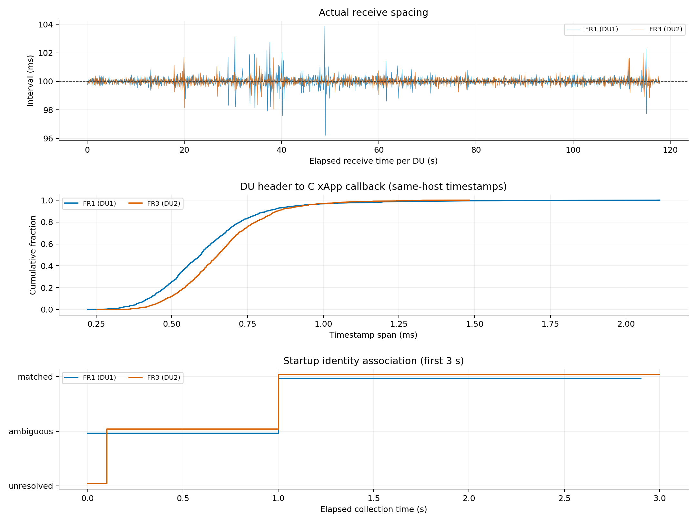
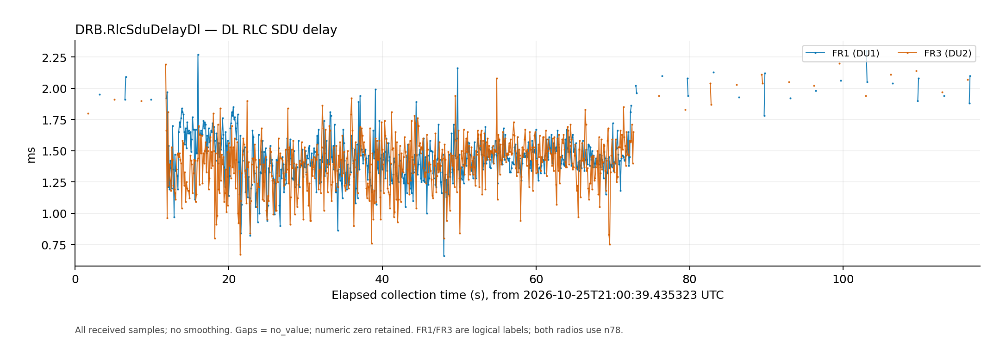
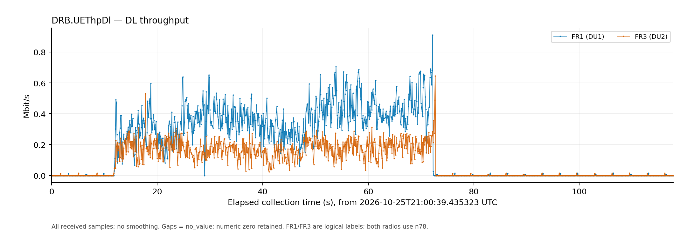
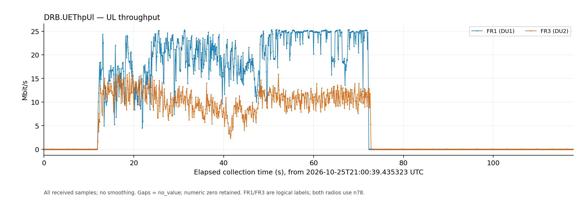
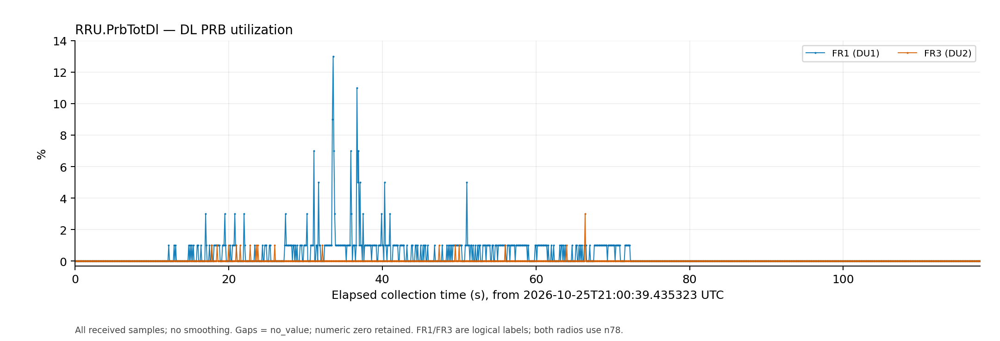
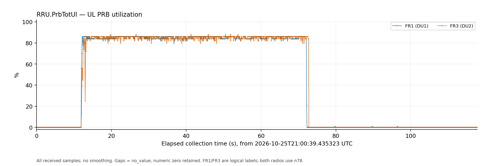
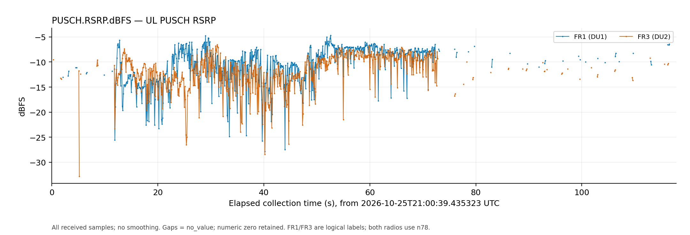
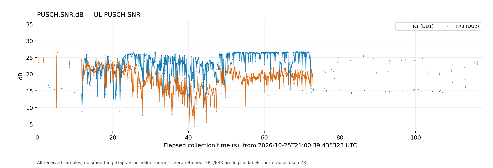

# Dual UE 100 ms KPM reporting validation

Operator: Ruibin. Experiment date: October 25, 2026.
Observed collection window: **17:00:39.435323–17:02:37.238531 EDT**
(21:00:39.435323–21:02:37.238531 UTC).

**This capture demonstrates nominal 100 ms DU delivery and correct current
IP association for both UEs, while CU identity reporting remains at 1 s.**
Each DU delivers 1,179 reports. Every measured receive interval is between
96.214 and 103.879 ms, with no reversed or duplicate header timestamps and
no reported collector ingress loss. Both DUs use F1AP ID 1 throughout; the
explicit CU serving-DU scope separates them correctly.

The startup window contains 20 records without a verified IP. After the first
CU scope report, **all subsequent 2,338 records match continuously**, with zero
differences against the preceding CU/AMF/SMF identities and sessions. All seven
metric fields are preserved. RF and PRB values are available in every sample
whose UL KPM exceeds 1 Mbit/s.

This result covers the sustained connected scenario in this approximately
two-minute run. Shared snapshot concurrency, exact context-generation reuse
and PRB behavior after context replacement retain their separate scope.

## Capture and experiment configuration

The source is `/tmp/falcon-identity-dual.augMIYJM`, app instance
`ac8966b0-4e4e-47f6-8e18-84d15471297a`. The collector requested a 120-second
run and exited with code 0. The following observations come from the captured
configuration, decoded inputs and output records, retained with
[source hashes](../evidence/2026-10-25_du_100ms_validation/source_manifest.json).

| Item | Configuration or observation |
| --- | --- |
| DU nodes | PLMN 001/01, gNB 411, DU IDs 1 and 2 |
| DU report and action granularity | 100 ms; all 2,358 DU rows declare `granularity_ms=100` |
| DU subscription | Format 4, seven measurements |
| CU identity | 1000 ms, `FALCON.UE.RRCState`, standard UEID plus the admitted optional RAN UE identity allocation |
| Explicit CU scope contract | `du36-cuue28-v1` |
| Core polling / source freshness limit | 1 s / 3 s |
| Decoded events | 2,358 DU reports, 118 CU reports and 120 Core snapshots |
| DU output | 2,358 rows: 2,338 matched, 19 ambiguous, 1 unresolved; zero cached |
| Completion | Three subscription deletion responses; xApp exit 0 |

FR1 means UE1/DU1 and FR3 means UE2/DU2. These are the application's logical
path labels; both radios use physical NR band n78. The figures label the DU
that originated a measurement, including the unbound startup samples.

The CU reports carry two UE rows each, for 236 CU identity rows. The 2,358
records in the diagnostic output are DU measurement rows, not a combined count
of DU and CU identities. The approximately 117.8-second observed DU header
span is the period actually covered by received measurements; startup and
subscription setup mean the requested 120 seconds is not a promise of exactly
1,200 reports per DU.

The SDK log contains one `ric_req_id ... not in the registry` diagnostic during
cleanup. All three deletion responses and normal stop are present. This
diagnostic did not prevent collection or successful process completion.

## Actual 100 ms cadence

Receive intervals use consecutive ingress monotonic timestamps for each DU.
Collection intervals use sorted unique header timestamps. Keeping both views
distinguishes report generation timing from delivery spacing.

| Measurement | FR1 / DU1 | FR3 / DU2 |
| --- | ---: | ---: |
| Reports received | 1,179 | 1,179 |
| Observed header span | 117.801724 s | 117.803088 s |
| Effective rate, `(N−1)/span` | 9.99985 reports/s | 9.99974 reports/s |
| Collection interval, median | 99.985 ms | 99.987 ms |
| Receive interval, median | **99.988 ms** | **99.999 ms** |
| Receive interval, p95 | 100.452 ms | 100.383 ms |
| Receive interval, p99 | 101.253 ms | 100.867 ms |
| Receive interval, minimum–maximum | 96.214–103.879 ms | 98.042–101.965 ms |
| Receive intervals above 150 ms | 0 | 0 |
| Reversed / duplicate headers | 0 / 0 | 0 / 0 |
| DU header → C callback, median / maximum | 0.595 / 2.111 ms | 0.653 / 1.482 ms |
| C callback → emitted output, p95 / maximum | 0.958 / 8.677 ms | 0.904 / 10.387 ms |



All 1,178 receive intervals per DU fall inside 90–110 ms. That band is a
descriptive check, not an independently agreed hard real-time tolerance. The
observed range, quantiles and zero long gaps establish regular nominal 100 ms
delivery for this run. They do not guarantee the same bounds under every load.

The E2 connector now enables `SCTP_NODELAY`, avoiding small-message buffering
behind unacknowledged data and delayed SACKs. The separate
[isolated SCTP comparison](../evidence/2026-10-25_cu_du_scope_fix/sctp_cadence.json)
verifies that buffering mechanism. The live measurements here verify the
resulting complete DU/RIC/xApp receive cadence in the tested configuration.

Header-to-callback spans compare timestamps on Spark. They begin at the KPM
header time, exclude the preceding source averaging window and do not measure
full radio-to-application latency. The retained files do not include a
per-source snapshot-generation trace.

CU reports remain at one second: median receive interval **1000.012 ms**,
range 995.175–1004.869 ms. Core snapshot intervals have median **1000.103 ms**.
Neither slower identity source causes the DU stream to be delivered at its
own rate; the mapper reuses a fresh verified relation between updates.

## Explicit DU scope and current IP binding

| Identity | FR1 / DU1 | FR3 / DU2 |
| --- | --- | --- |
| SUPI | imsi-001010000000101 | imsi-001010000000102 |
| Current IPv4 | **10.45.0.12** | **10.46.0.7** |
| DNN / PDU Session ID | internet / 1 | internet2 / 1 |
| gNB-CU UE F1AP ID | **1 throughout** | **1 throughout** |
| CU RAN UE identity octets | `0000000010000002` | `0000000020000003` |
| Decoded serving DU ID / CU UE index | 1 / 2 | 2 / 3 |
| AMF / RAN UE NGAP ID | 35 / 2 | 36 / 3 |
| AMF-reported NCI | 6733824 | 6733825 |
| Matched / total records | 1,169 / 1,179 | 1,169 / 1,179 |

The common GUAMI is PLMN 001/01, AMF region 2, set 1, pointer 0. PDU Session
ID 1 is scoped to its own SUPI, rather than being a global session identifier.

The admitted CU allocation places the 36-bit DU ID above the 28-bit CU UE
index in the existing optional eight-octet RAN UE identity. The collector
preserves those octets. The mapper first associates `(PLMN, gNB, DU ID, F1AP
ID)` with the CU's AMF/GUAMI identity, then joins AMF and SMF to obtain SUPI,
session and IP. Equal F1 numbers on different DUs therefore remain distinct.
The IP is supplied by SMF, not encoded in the RAN UE identity or inferred from
a DU number or subnet.

All 2,338 matched rows use `assurance: cu_reported_du_scope`. The independent
audit checks each against the preceding CU report and AMF/SMF snapshot,
including the DU allocation, CU UE index, GUAMI, NGAP IDs, subscriber, expected
NCI and active PDU IP/DNN/session. There are **zero mismatches**. Maximum
preceding CU/Core ages are **999.784 / 990.614 ms**, below the 3 s freshness
limit. No unverified row publishes an IP and no cached historical IP appears.

### Startup window

The first DU measurements precede the first available CU scope report. The
fallback path sees two bare F1 ID 1 values and withholds identity: one row is
`unresolved`, followed by 19 `ambiguous` rows. Measurement values are retained
throughout this interval.

The first CU identity report arrives at **21:00:40.337844 UTC**. Record 21,
with header time **21:00:40.435384 UTC**, is the first match. From that record
through record 2,358, every row is matched: approximately **116.8 seconds** of
continuous current association across both streams. This initial roughly
one-second window is distinct from a persistent collision after CU scope is
available.

## Seven metric line charts

Every received sample is plotted without smoothing or outlier removal.
`no_value` breaks a line; a numeric zero remains zero. Delay is converted from
0.1 ms units to ms and throughput from kbit/s to Mbit/s. The
[CSV](../evidence/2026-10-25_du_100ms_validation/seven_metrics.csv) retains the
original values, units, types, record sequence and binding status.

| Metric | FR1 numeric / missing | FR3 numeric / missing |
| --- | ---: | ---: |
| `DRB.RlcSduDelayDl` | 629 / 550 | 628 / 551 |
| `DRB.UEThpDl` | 1,179 / 0 | 1,179 / 0 |
| `DRB.UEThpUl` | 1,179 / 0 | 1,179 / 0 |
| `RRU.PrbTotDl` | 1,179 / 0 | 1,179 / 0 |
| `RRU.PrbTotUl` | 1,179 / 0 | 1,179 / 0 |
| `PUSCH.RSRP.dBFS` | 646 / 533 | 651 / 528 |
| `PUSCH.SNR.dB` | 646 / 533 | 651 / 528 |

For UL KPM above 1 Mbit/s, RF and PRB values are numeric in **603/603 FR1**
and **608/608 FR3** samples. Missing RF occurs in idle or low-traffic windows;
it is retained as unavailable instead of being replaced with zero. These
availability results do not establish synchronization between the separately
published scheduler and RLC snapshots.

### DL RLC SDU delay



Valid-sample medians are 1.44 ms for FR1 and 1.43 ms for FR3; maxima are
2.30 and 2.20 ms respectively. Missing windows are excluded from these
statistics, not treated as zero delay.

### DL throughput



Peak DU KPM is 0.912 Mbit/s for FR1 and 0.646 Mbit/s for FR3.

### UL throughput



Peak DU KPM is **25.332 Mbit/s for FR1** and **16.218 Mbit/s for FR3**.
The curves show sustained concurrent UL followed by a low-traffic period.
These values are DU RLC throughput, not Laptop iperf receiver goodput; client
completion/receiver summaries are not part of this capture.

### DL PRB utilization



### UL PRB utilization



Both PRB fields remain numeric throughout. This run contains no observed F1
context change, so it does not validate PRB lookup after context replacement.
The separate index-lookup defect remains outside this result.

### PUSCH RSRP



Valid-sample medians are −9.713 dBFS for FR1 and −11.458 dBFS for FR3.
These are software PUSCH power estimates in dBFS, not calibrated dBm or
UE-measured downlink RSRP.

### PUSCH SNR



Valid-sample medians are 23.620 dB for FR1 and 19.227 dB for FR3. The retained
SNR name carries the selected PHY SINR estimate. RF values are reporting-window
statistics; this capture does not independently establish their exact numeric
alignment with a DU console window or calibrated RF reference.

## Verified scope and reproducibility

This run verifies regular nominal 100 ms reception from two DUs, coexistence
with 1 s CU identity and Core polling, explicit separation of equal F1 IDs,
continuous current binding after startup, and preservation of seven typed
metric fields without reported collector ingress overflow. All 2,358 input DU
measurement payloads have equal output payloads after removing added unit
labels: no value, type, UE ID, sample or granularity differences are found.
Replay using the archived mapper and documented fresh/observed configuration
reproduces all 2,358 rows, excluding run-instance and emission-clock fields.

The result does not establish indefinite capacity, a hard real-time latency
bound, MPTCP steering behavior or exact physical sampling-to-application
latency. Shared DU snapshot concurrency remains deferred. The CU UE index is
not a shared CU/DU generation token; exact full-key reuse and source-restart
lifecycle proof retain their separate requirements. No source synchronization,
RF estimator or PRB getter change was made while producing this report.

Retained artifacts:

- [Seven-chart overview PNG](../evidence/2026-10-25_du_100ms_validation/seven_metrics_overview.png),
  [SVG](../evidence/2026-10-25_du_100ms_validation/seven_metrics_overview.svg) and
  [seven-page chart PDF](../evidence/2026-10-25_du_100ms_validation/seven_metrics.pdf).
- [Audit JSON](../evidence/2026-10-25_du_100ms_validation/audit.json),
  [numeric CSV](../evidence/2026-10-25_du_100ms_validation/seven_metrics.csv),
  [decoded input events](../evidence/2026-10-25_du_100ms_validation/inputs.ndjson.gz),
  [output rows](../evidence/2026-10-25_du_100ms_validation/rows.ndjson.gz) and
  [TXT output](../evidence/2026-10-25_du_100ms_validation/bindings.txt.gz).
- [Source provenance](../evidence/2026-10-25_du_100ms_validation/source_manifest.json)
  and [artifact hashes](../evidence/2026-10-25_du_100ms_validation/artifact_manifest.json).

Decoded KPM events and output rows are retained unchanged. Archived Core
snapshots omit security, SUCI/GUTI/PEI, QoS and N3 transport fields while
preserving the context/session fields used for the audit. Source revisions in
the manifest were read at analysis time; the live capture did not save running
executable hashes.

Regenerate the audit, CSV and all figures using Python 3 and Matplotlib:

```bash
python3 docs/evidence/2026-10-25_du_100ms_validation/analyze.py
```

The command reads retained files only and starts no network services or radios.
