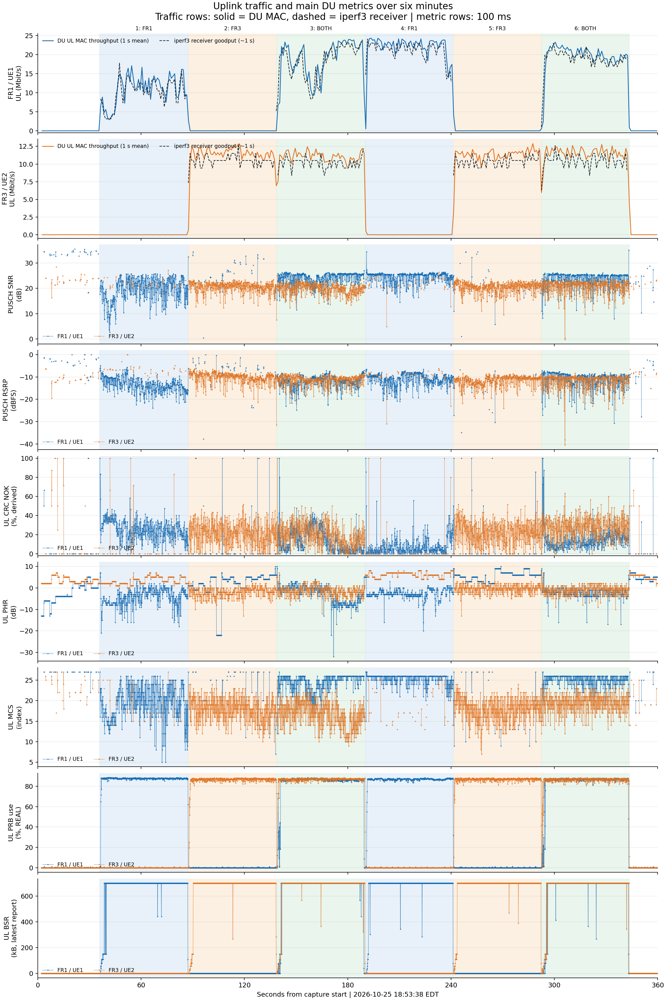
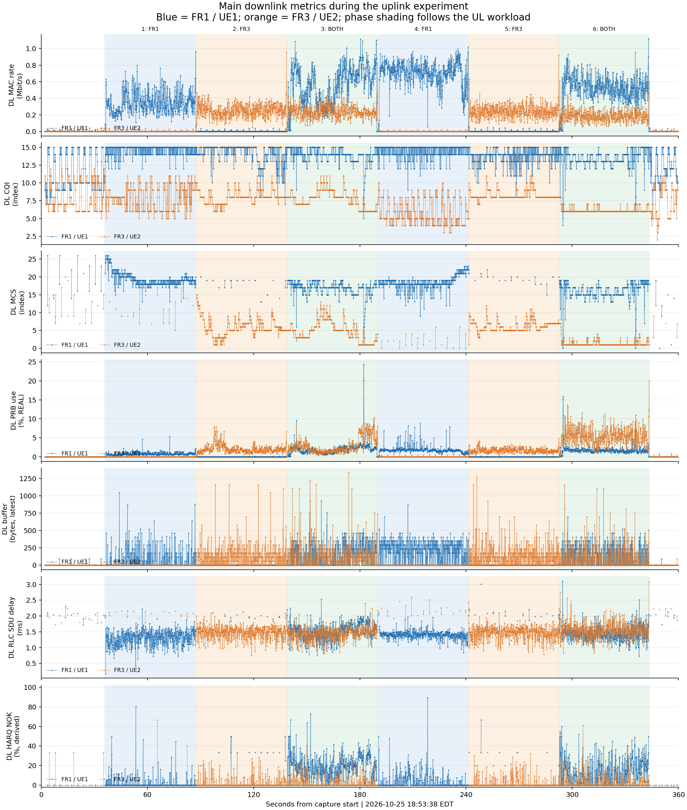
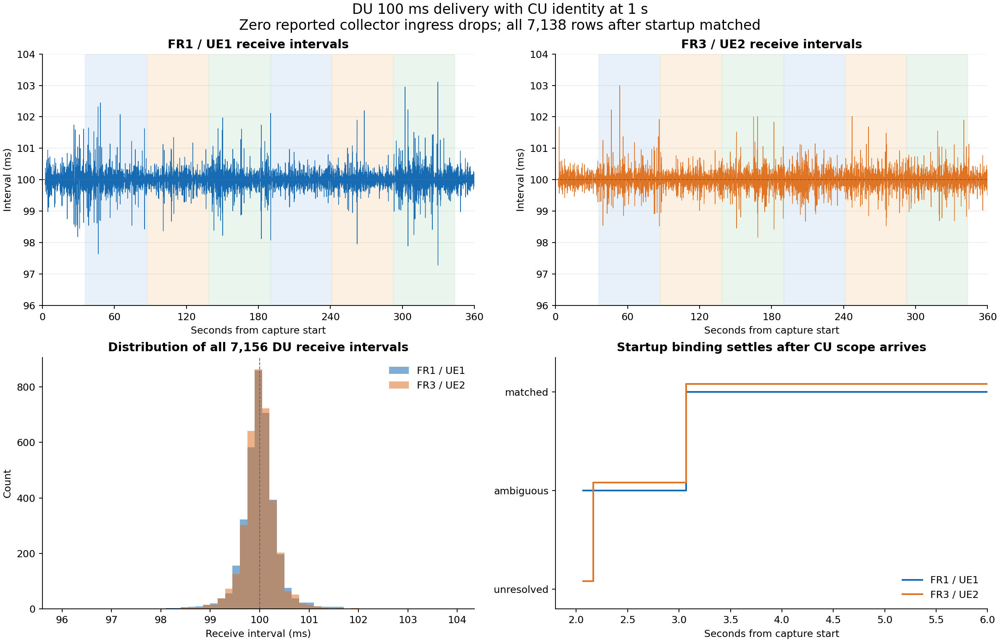
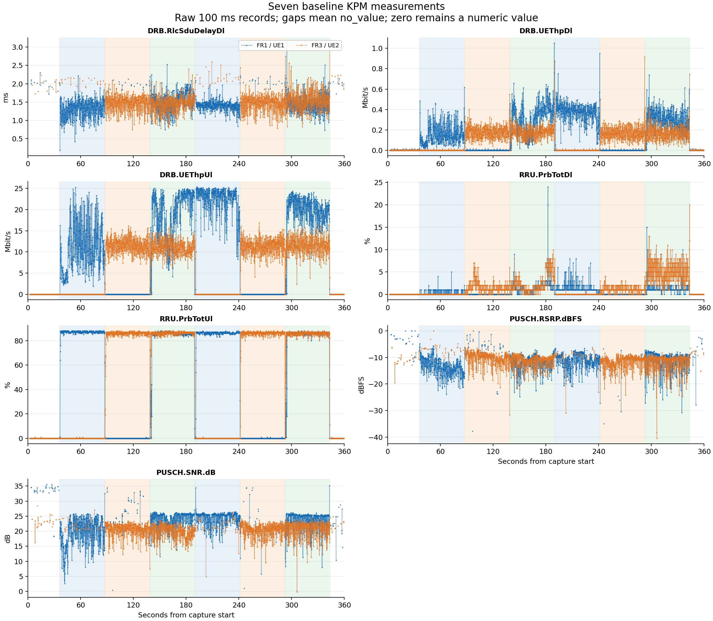
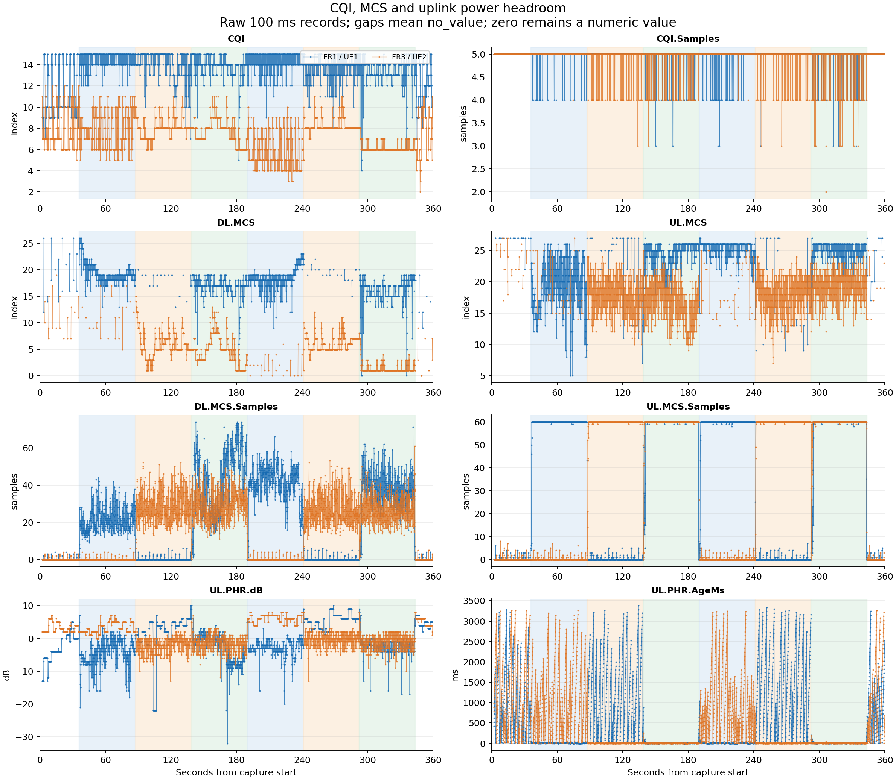
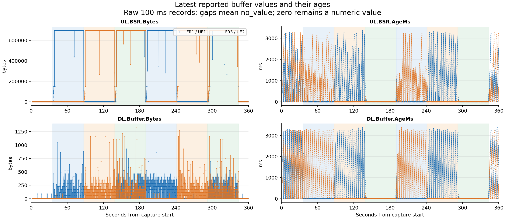
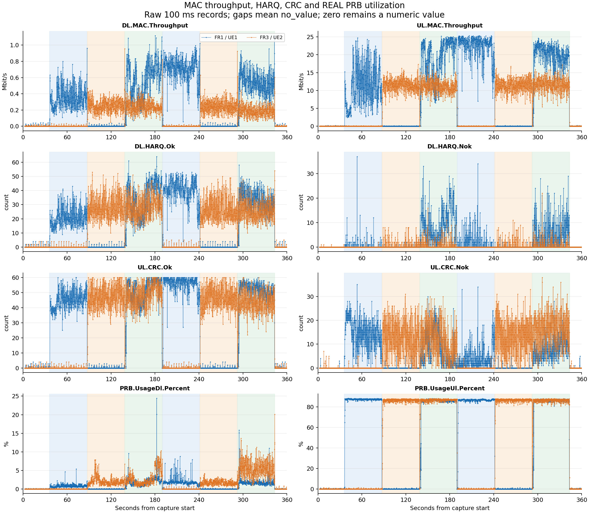

# Dual UE six minute stability and 27 KPM reporting experiment

Operator: Ruibin. Experiment date: October 25, 2026.
Collection window: **18:53:38.060–18:59:38.032 EDT**
(22:53:38.060–22:59:38.032 UTC), 359.972 seconds.

**This run validates sustained dual UE connectivity, alternating and concurrent
TCP uplink, current UE IP binding, and nominal 100 ms delivery of the expanded
27 measurement DU profile while CU identity remains at 1 second.** All six
traffic phases and eight TCP transfers completed. The xApp exited normally,
with no reported collector ingress drops. After startup identity information
became available, all 7,138 subsequent DU records matched the correct UE IP.

RSRP readings of **0 dBFS are normal upper-bound numeric readings** in this
experiment. They remain in the plots and statistics and are not counted as
anomalies. Sparse PRB representation differences and auxiliary-field gaps
remain known consistency observations; they did not coincide with an observed
traffic failure in this run. Snapshot synchronization remains deferred.

## Test configuration and workload

The experiment follows the Spark quick commands section 7b and the Laptop
reconnect quick start section 7a. Both UE reconnect watchers remain active while
the finite traffic runner performs FR1, FR3 and concurrent uploads twice.
Each iperf client requests 50 seconds of source-bound TCP traffic. Spark runs
separate, logged iperf servers for the two destinations.

| Item | FR1 / UE1 / DU1 | FR3 / UE2 / DU2 |
| --- | --- | --- |
| B210 serial | 3271233 | 328B021 |
| Carrier / bandwidth / PCI | 3660 MHz / 20 MHz / 1 | 3600 MHz / 20 MHz / 2 |
| NR band | n78 | n78 |
| Captured startup TX / RX gain | 70 / 35 dB | 70 / 35 dB |
| Laptop interface and IPv4 | wwan0 / 10.45.0.18 | wwan1 / 10.46.0.12 |
| DNN | internet | internet2 |
| Spark server | 10.45.0.1:5201 | 10.46.0.1:5202 |
| DU source and subscription period | 100 ms | 100 ms |

FR1 and FR3 are the application's logical path labels. Both physical radio
links in this experiment operate in n78. Gain entries above are the archived
startup configuration, not a continuous gain trace. Both DUs were launched
under the optional GDB capture wrappers. Their startup banners identify commit
`9bbf639850`; the archived binary hash is the same for both launches.

The CU identity subscription and Core polling each use 1 second, with a
3-second source freshness limit and the admitted `du36-cuue28-v1` CU scope
allocation. The workload uses independent TCP connections on the two paths.

Metric definitions, wire units and types, DU source fields, console columns
and statistical semantics are listed in the
[27 measurement reference](../du_kpm_metrics_reference.md).

## Completed traffic phases

The traffic runner reports `completed`, with no allocation changes. Its actual
duration is 307.886 seconds, including identity checks, connection setup and
phase transitions. Traffic starts 35.757 seconds after capture begins and the
runner finishes 16.329 seconds before capture ends, so all phases are covered.

Rates below are receiver goodput from the iperf client JSON, in decimal Mbit/s.
The Spark server logs independently confirm the source IPs and receiver rates
within their printed rounding precision.

| Phase | Traffic | Start to end EDT | FR1 Mbit/s | FR3 Mbit/s | Combined Mbit/s |
| --- | --- | --- | ---: | ---: | ---: |
| 1 | FR1 | 18:54:13.937–18:55:05.395 | 10.19 | — | 10.19 |
| 2 | FR3 | 18:55:05.623–18:55:56.681 | — | 10.49 | 10.49 |
| 3 | Both | 18:55:56.898–18:56:48.159 | 17.92 | 10.13 | **28.05** |
| 4 | FR1 | 18:56:48.385–18:57:39.240 | 21.12 | — | 21.12 |
| 5 | FR3 | 18:57:39.459–18:58:30.316 | — | 10.33 | 10.33 |
| 6 | Both | 18:58:30.524–18:59:21.579 | 18.69 | 10.43 | **29.12** |

All eight clients exit with code 0 and report **zero TCP retransmissions**.
Receiver durations range from 50.135 to 50.430 seconds. Both server logs have
four completed transfers, no reset/busy/error messages, and no full one-second
interval with zero throughput. The earlier trial's FR1 phase 4 control reset
does not recur here; this successful run does not establish its original cause.

### Uplink traffic and main metrics



| Curve | Source and interpretation |
| --- | --- |
| Blue solid line in the first throughput row | FR1 DU `UL.MAC.Throughput`, averaged into one-second bins |
| Orange solid line in the second throughput row | FR3 DU `UL.MAC.Throughput`, averaged into one-second bins |
| Black dashed line in either throughput row | That path's Spark iperf3 receiver goodput, from approximately one-second server intervals |
| Blue/orange curves in the remaining rows | FR1/FR3 metric values from the original 100 ms records |

The solid and dashed throughput curves describe different protocol layers:
the DU counts MAC transport-block bytes with successful CRC, while iperf
measures application payload received on Spark. The curves also use different
interval boundaries, and server timestamps have one-second precision. They
should follow the same traffic stages; exact numerical equality is not
expected. The solid line is MAC throughput, rather than `DRB.UEThpUl` RLC
throughput.

After the two traffic rows, the seven additional rows show PUSCH SNR, PUSCH
RSRP, the derived UL CRC NOK percentage, UL PHR, UL MCS, REAL UL PRB
utilization and latest UL BSR, in that order. BSR is displayed in decimal
kB (1000 bytes). These
metric rows retain the original 100 ms records. The CRC percentage is
`100 × NOK / (OK + NOK)`; a window without outcomes remains a gap.

Background shading follows the actual phase timestamps: blue, orange and
green indicate FR1-only, FR3-only and concurrent uploads. RSRP 0 dBFS remains
a normal numeric reading.

FR1's first solo transfer is slower than its second. Within the phase interiors,
mean PUSCH SNR is 19.52 versus 24.36 dB and mean UL MCS is 19.50 versus 25.37;
iperf sender mean RTT is 354.5 versus 170.8 ms. These observations accompany
the throughput change, but the phases are not controlled capacity comparisons.

### Main downlink metrics during the uplink workload



The separate DL overview shows DL MAC throughput, CQI, DL MCS, REAL DL PRB
utilization, latest DL buffer occupancy, DL RLC SDU delay and the derived DL
HARQ NOK percentage. Blue is FR1 and orange is FR3 throughout. Every row uses
the original 100 ms records, with delay converted to ms and rate to Mbit/s.
The HARQ percentage uses the same NOK/total rule and leaves zero-denominator
windows unavailable.

This figure describes the downlink activity accompanying the TCP uploads,
including acknowledgement and control traffic. Its background still marks the
UL test phases; dedicated downlink capacity testing is outside this run.

## DU delivery cadence and identity continuity

The collector retains 3,579 DU reports from each path, 358 CU reports and 360
Core snapshots. All 7,158 DU records declare 100 ms granularity. Receive
intervals below use consecutive ingress monotonic timestamps for each DU.

| Measurement | FR1 / DU1 | FR3 / DU2 |
| --- | ---: | ---: |
| Received DU records | 3,579 | 3,579 |
| Receive interval median | **100.003 ms** | **100.003 ms** |
| Receive interval p95 | 100.535 ms | 100.496 ms |
| Receive interval p99 | 101.232 ms | 100.961 ms |
| Receive interval minimum–maximum | 97.281–103.107 ms | 98.167–103.001 ms |
| Receive intervals above 150 ms | 0 | 0 |
| Header interval median | 99.987 ms | 99.988 ms |
| Duplicate or reversed headers | 0 | 0 |
| Header to C callback median | 0.757 ms | 0.732 ms |
| Python receive to output median | 0.336 ms | 0.332 ms |

The requested 360 seconds includes setup; 3,579 received records per DU are
consistent with approximately 358 seconds of active DU reporting. The maximum
reported collector ingress drop counter is zero. CU receive intervals have
median 1000.001 ms, p99 1000.908 ms and maximum 1003.055 ms. The slower CU
identity source coexists with regular DU delivery.

Header-to-callback timing starts at the report header timestamp and excludes
the preceding averaging window. It is not full RF measurement-to-application
latency. The delivery observations do not prove that all fields in a record
come from an immutable source snapshot.



| Identity | FR1 / DU1 | FR3 / DU2 |
| --- | --- | --- |
| SUPI | imsi-001010000000101 | imsi-001010000000102 |
| Current IPv4 | **10.45.0.18** | **10.46.0.12** |
| DNN / active PDU Session ID | internet / 1 | internet2 / 1 |
| gNB-CU UE F1AP ID | **1** | **1** |
| CU RAN UE identity octets | 0000000010000002 | 0000000020000003 |
| Decoded serving DU / CU UE index | 1 / 2 | 2 / 3 |
| AMF UE NGAP / RAN UE NGAP ID | 51 / 2 | 52 / 3 |
| Matched records | 3,569 | 3,569 |

The first 20 DU records comprise 19 `ambiguous` and one `unresolved` record
while CU scope becomes available. They publish no IP. Every subsequent record
is `matched`, with `assurance=cu_reported_du_scope`; no later unbound record
occurs. Explicit DU scope distinguishes the equal F1AP ID values.

An independent audit checks all **7,138 matched rows** against the preceding
archived CU and Core inputs: DU allocation, CU UE index, F1AP identity,
GUAMI/NGAP identity, SUPI, DNN, PDU Session ID and IPv4 all agree. Maximum
preceding CU/Core input ages are 999.680/969.648 ms. Both subscribers remain
`connected` with unchanged NGAP contexts in all 360 Core snapshots, and the
Laptop runner observes no allocation change. These continuity observations
use Core, E2 and phase snapshots; watcher attempt logs are not part of this
archive.

## Measurements and line charts

Every DU row contains the same 27 metric names. All 7,158 output metric maps
retain exactly the values and record types in their corresponding decoded E2
inputs. No nonfinite numeric values, out-of-range PRB percentages or emitted
negative ages occur. The two application-derived HARQ/CRC ratios also match
recomputation from their reported counts; they are separate from the 27 E2
measurements.

All four figures below use the raw 100 ms records without smoothing or outlier
removal. Blue is FR1 and orange is FR3. `no_value` creates a gap; numeric zero
remains zero. DL RLC delay is converted from 0.1 ms units to ms, and throughput
from kbit/s to Mbit/s. Other values retain their declared units. The complete
[availability table](../evidence/2026-10-25_dual_ue_27kpm_stability/metric_availability.csv)
and [typed 100 ms CSV](../evidence/2026-10-25_dual_ue_27kpm_stability/metrics_100ms.csv.gz)
retain the detailed counts and original values.

### Seven baseline measurements



RSRP and SNR are numeric in 2,169 FR1 and 2,181 FR3 records. Other windows
without usable PUSCH samples retain `no_value`, rather than a fabricated zero.
RSRP spans −37.750 to 0 dBFS for FR1 and −40.453 to 0 dBFS for FR3. SNR spans
0.431 to 35.516 dB and −0.199 to 28.464 dB respectively.

**The five FR1 and two FR3 RSRP readings of 0 dBFS are accepted normal
upper-bound readings.** The existing DU PHY-to-FAPI conversion clamps each
available RSRP sample to [−128, 0] dBFS before scheduler averaging. E2 preserves
the resulting finite average. These seven readings are included in statistics,
plotted in the ordinary path colors, and excluded from consistency-anomaly
counts. Their pre-limit values were not recorded. RSRP is software PUSCH power
in dBFS, rather than calibrated received power in dBm. The SNR-named field
carries the DU's selected PHY SINR estimate. The inspected conversion and
averaging code is retained in the [source excerpts](../evidence/2026-10-25_dual_ue_27kpm_stability/source_semantics.txt).

### CQI MCS and power headroom



CQI, PHR and their companion fields support interpretation of channel reports.
MCS is unavailable when its averaging window has no usable observations;
sample counts preserve that distinction. Negative PHR and negative SNR are
valid numeric values. Age fields describe time since the latest indication,
not a fresh sample generated by every E2 report.

### Uplink and downlink buffers



BSR and DL buffer fields contain the latest reported queue values and their
ages. They are not application throughput or predictions of future demand.

### MAC rates outcomes and REAL PRB



The active path's UL MAC rate and REAL UL PRB usage follow the traffic phases.
The other path retains small watcher/control traffic. HARQ/CRC NOK counts can
be nonzero while iperf TCP retransmissions remain zero because they describe
different protocol layers. The counts plotted here are the reported window
counts, not IP packet-loss measurements.

## Known consistency observations and runtime messages

Five FR1 records contain six INTEGER/REAL PRB comparisons that do not obey the
expected floor relationship. They occur at **18:58:40.440–18:58:49.540 EDT**,
during phase 6, after initial connection/ping checks. This is **5/3,579 =
0.140%** of FR1 records, or **5/511 = 0.978%** of FR1 records within phase 6.
For example, a REAL UL utilization of 85.3268% accompanies INTEGER 84%.
This difference exceeds ordinary floating-point rounding uncertainty.

The report collector calls each metric getter separately. INTEGER and REAL
PRB each read the current cache and compute their own value; cache replacement
between calls is a plausible explanation. The retained data do not establish
that interleaving as the cause. Applications may use only
`PRB.UsageDl.Percent` and `PRB.UsageUl.Percent`, avoiding reliance on equality
with the legacy integer fields. This choice does not repair cross-field
snapshot consistency.

Five other records have a missing companion field while the related value
remains numeric. Every affected field is numeric again in the next report.

| Time EDT | Path | Missing field | Related numeric value |
| --- | --- | --- | --- |
| 18:58:44.540 | FR1 | UL.PHR.AgeMs | PHR 0 dB |
| 18:58:46.240 | FR1 | UL.MCS.Samples | UL MCS 26 |
| 18:59:25.842 | FR3 | UL.PHR.AgeMs | PHR 6 dB |
| 18:59:28.642 | FR3 | RRU.PrbTotDl | REAL DL PRB 0% |
| 18:59:33.842 | FR3 | UL.PHR.AgeMs | PHR 4 dB |

Consumers can retain a valid main value while keeping missing age/sample
information unknown. A missing age must not be interpreted as zero age. Both
the PRB differences and these missing fields already exist in the decoded E2
inputs; Python IP mapping does not introduce them. Their exact source remains
a separate follow-up. The [consistency records](../evidence/2026-10-25_dual_ue_27kpm_stability/consistency_observations.json)
exclude the normal RSRP zero observations.

The DU logs also retain RF timing and scheduling messages during the capture:

| Recorded message | FR1 / DU1 | FR3 / DU2 |
| --- | ---: | ---: |
| RF underflow | 2,299 | 2,315 |
| RF late | 2,158 | 2,071 |
| Modulator busy | 26 | 23 |
| DL task queue full | 60 | 63 |
| HARQ timeout/discard | 24 | 16 |

These are log-message counts, not independent packet-loss counts. No CU W/E
message occurs in the collection window. Application traffic and E2 collection
complete despite the recorded DU messages. This run establishes functional
stability for its six-minute workload; it does not close RF real-time tuning
or the previous intermittent crash investigation. Subscription cleanup has
all three deletion responses and xApp exit 0.

## Retained evidence and reproduction

Original Spark capture: `/tmp/falcon-identity-dual.qbyVsyGT`.
Original Laptop runner directory: `/tmp/falcon-dual-stability-v7mq9unp`.
The archived copies and [source manifest](../evidence/2026-10-25_dual_ue_27kpm_stability/source_manifest.json)
make this report independent of the temporary directories. Full decoded input
and output streams are compressed losslessly. The archive also includes eight
client JSON files, both server logs, captured configurations/startup output,
the RIC log and W/E lines from the DU/CU capture window. Shutdown after the
collection window is outside these runtime counts.

| Artifact | Purpose |
| --- | --- |
| [Analysis JSON](../evidence/2026-10-25_dual_ue_27kpm_stability/analysis.json) | Detailed cadence, traffic, metric and runtime summaries |
| [Verification JSON](../evidence/2026-10-25_dual_ue_27kpm_stability/verification.json) | Independent raw-value and preceding CU/Core identity checks |
| [Phase CSV](../evidence/2026-10-25_dual_ue_27kpm_stability/phase_results.csv) | Actual phase timing and receiver goodput |
| [Report interval CSV](../evidence/2026-10-25_dual_ue_27kpm_stability/report_intervals.csv) | Every DU header and receive interval |
| [Normal RF observations](../evidence/2026-10-25_dual_ue_27kpm_stability/normal_rf_observations.json) | Seven retained normal upper-bound RSRP records |
| [Figure and audit script](../evidence/2026-10-25_dual_ue_27kpm_stability/render_figures.py) | Rebuild figures, CSVs and independent checks offline |

From the Falcon repository root, with Python 3, NumPy and Matplotlib installed:

```bash
python3 docs/evidence/2026-10-25_dual_ue_27kpm_stability/render_figures.py
```

PNG and SVG versions of all seven figures are retained alongside the datasets.
Reproduction reads archived files only and does not operate UE, modem, RAN,
Core or iperf processes.
