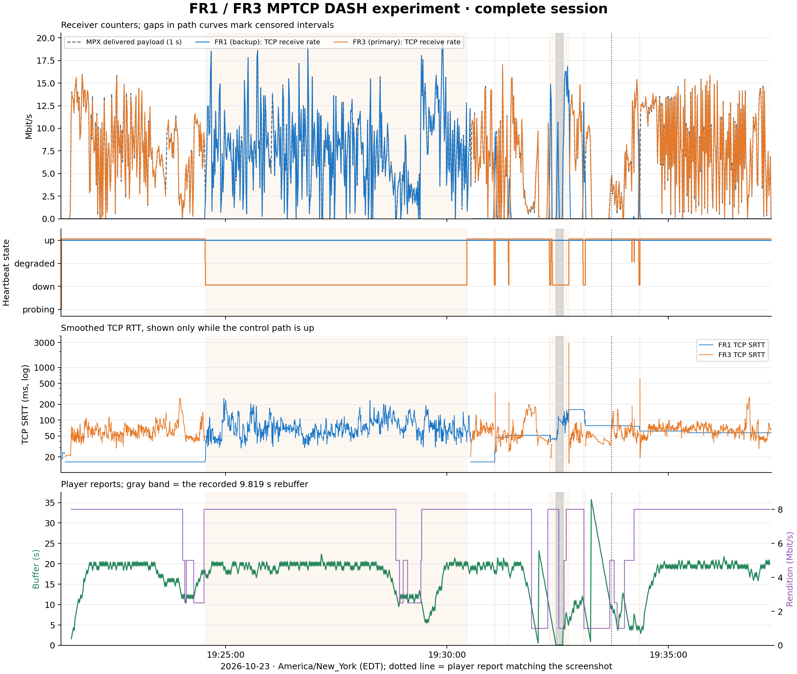
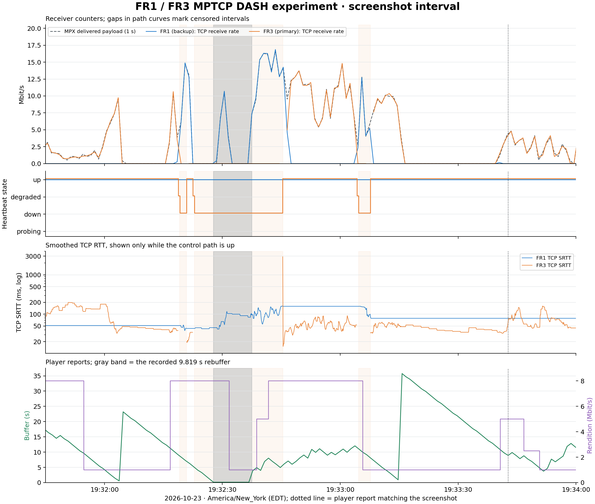
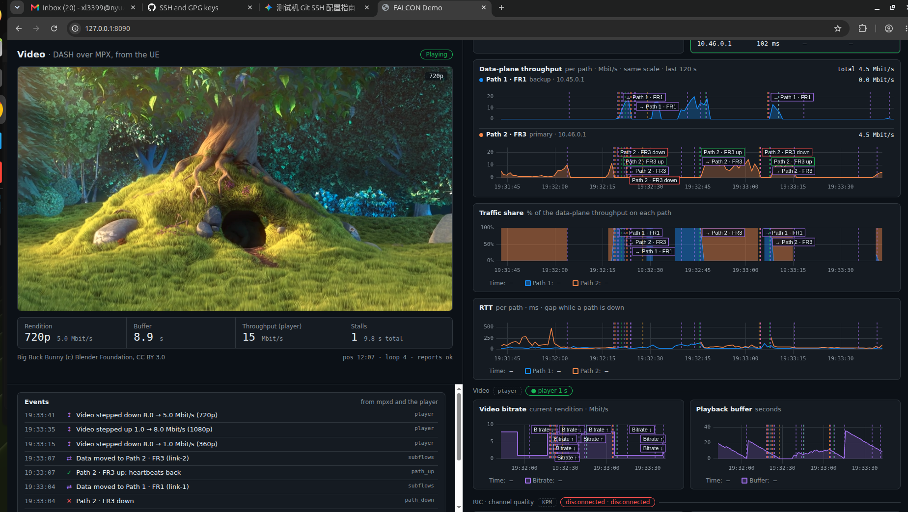

# FR1/FR3 MPTCP Video and Switching Experiment Report

Experiment date: **2026-10-23**. All wall-clock times use
**America/New_York, EDT (UTC−04:00)**.

**The screenshot's MPX/MPTCP video experiment passed functional verification.**
The retained session contained two private-address MPTCP paths and delivered
**870,269,205 application-channel bytes
(870.269 MB)** to Spark. Average MPX payload goodput was
**7.228 Mbit/s** across the 963.197-second metrics
window. Video played while the primary **FR3** link underwent repeated heartbeat-state
changes, and received-byte growth confirmed use of the backup **FR1** link. The player
recorded **one 9.819-second rebuffering event**.

The evidence supports primary/backup operation and recovery. It does not
establish simultaneous bandwidth aggregation or a calibrated failover latency.
The dashboard's “FR3” label identifies the second demo path; **both physical
radio links used n78 FR1**.

## Experiment identity and recovered data

This report covers the same experiment as the supplied screenshot
`Screenshot from 2026-10-23 19-33-51.png`, rather than a new run or the earlier
18:38 session in the same source files. Records were selected by MPX session
ID **`3d293a88328ef4b45294ee09cd7d3d28`**. The complete original metrics file still matched the
SHA-256 saved during the earlier screenshot audit:
`848c139488f3eedd00c5386e5b075facfdb6a421a1ec8bc6c13be0d6481eed0a`.

| Recovered item | Scope / count | Artifact |
| --- | --- | --- |
| Raw session metrics | 9,624 records, including 8 after client deregistration | [Compressed JSONL](../evidence/2026-10-23_mptcp_report/session-metrics.jsonl.gz) |
| Active-session metrics | 9,616 records; 19:21:16.848682–19:37:20.045863 | [100-ms transport CSV](../evidence/2026-10-23_mptcp_report/transport_samples.csv) |
| Typical sampling interval | Median 100.153 ms; maximum 109.524 ms | [Summary JSON](../evidence/2026-10-23_mptcp_report/summary.json) |
| Player reports | 948 reports; 19:21:30.744–19:37:17.744 | [Player CSV](../evidence/2026-10-23_mptcp_report/player_samples.csv), [raw JSONL](../evidence/2026-10-23_mptcp_report/session-player.jsonl.gz) |
| Transport events | Session and path transitions; post-deregistration transitions excluded from analysis | [Events CSV](../evidence/2026-10-23_mptcp_report/transport_events.csv), [raw JSONL](../evidence/2026-10-23_mptcp_report/session-events.jsonl) |
| Player events | Startup, quality changes, one stall/recovery and loop events | [Events CSV](../evidence/2026-10-23_mptcp_report/player_events.csv) |
| Screenshot and configuration | Original screenshot, resolved server configuration and console transcripts | [Original archive](../evidence/2026-10-23_mptcp_demo/manifest.json), [source manifest](../evidence/2026-10-23_mptcp_report/source_manifest.json) |

The raw JSONL lines were preserved, with gzip compression. The CSVs, summary
and figures were derived from those archived inputs. No service, radio or
traffic experiment was restarted to prepare this report.

## Testbed and traffic direction

The report and figures use **FR1** for `link-1` (backup, `10.45.0.1`) and
**FR3** for `link-2` (primary, `10.46.0.1`). Downloaded CSV fields retain
`path1_*` = FR1 and `path2_*` = FR3; the recorded identifiers are preserved.

DASH content originated on the UE laptop and was played in the Spark browser.
The browser requested `http://127.0.0.1:8080/loop.mpd`; the Spark TCP forwarder
carried requests over the MPX `tcp` channel to the UE-side HTTP service. Video
responses flowed **UE laptop → radio path → Spark**, through MPTCP TCP port
`9001`. MPX heartbeat/control traffic used UDP port `9002`.

| Parameter | FR1 (backup) | FR3 (primary) |
| --- | --- | --- |
| Dashboard link / label | `link-1` / FR1 | `link-2` / FR3 (logical label) |
| Data role | Backup | Primary |
| Spark service IP | `10.45.0.1` | `10.46.0.1` |
| Configured Spark TUN | `ogstun_1` | `ogstun_2` |
| UE addresses observed in this session | `10.45.0.3` | `10.46.0.3`, later `10.46.0.4` |
| DNN / configured pool | `internet` / `10.45.0.0/16` | `internet2` / `10.46.0.0/16` |
| Radio from retained DU startup | n78, 3660 MHz, PCI 1, 20 MHz | n78, 3600 MHz, PCI 2, 20 MHz |
| B210 serial | `3271233` | `328B021` |

The server used Linux `7.0.0-1019-nvidia aarch64`, `mpxd 0.4`, kernel MPTCP
path management, and configured BBR congestion control. The resolved server
configuration set a 50-ms heartbeat interval, degraded threshold of 8 misses,
and down threshold of 16 misses: nominal 400/800-ms heartbeat thresholds.
These settings do not measure actual failure-detection delay. The server's
RIC/KPM broker connection was unavailable during the demonstration.

The [TUN split](../networking/dual_ue_tun_split.md) retained a shared CU, UPF and Spark host.
Source configuration associated each pool with a DU; a separate fresh
SIM/serving-cell identity ledger was not captured for this MPX run. DU2's
console acknowledged RX gains of 5, 20 and 15 dB, but those commands lacked
individual timestamps. A fixed gain or gain-to-failure causal relationship
cannot be assigned to the screenshot interval.

## Complete-session results

The client registered at **19:21:16.828780** and deregistered at
**19:37:20.062084**, a duration of **963.233 seconds (16 min 3.233 s)**.
Eight cleanup-period metrics after deregistration were retained in the raw
archive but excluded from the following statistics.

| Metric | Result |
| --- | --- |
| Active metrics observation span | 963.197181 s |
| MPX delivered application-channel bytes | **870,269,205 bytes = 870.269 MB = 829.953 MiB** |
| Mean MPX payload goodput over that span | **7.228 Mbit/s** |
| Median / p95 of 1-second payload-rate bins | 7.093 / 14.609 Mbit/s |
| Maximum 1-second payload-rate bin | 19.577 Mbit/s |
| Final MPX `data_dropped_bytes` counter | 0 |
| FR1 observed nonnegative TCP receive-counter increments | 370,964,427 bytes |
| FR3 observed nonnegative TCP receive-counter increments | 500,199,850 bytes |
| Established subflow snapshots with an unmapped address pair | 0 |

“MPX payload” counts fully delivered application-channel messages, including
TCP-forwarder protocol content. It is not pure encoded-video bytes. Its
average includes idle periods, startup and disruptions; it is not link capacity.
A zero MPX drop counter does not establish zero TCP retransmissions or zero
radio loss.

The two path totals are observed TCP-counter increments with censored
intervals, not an exact split of unique application bytes. TCP framing,
subflow replacement and missing flow identities prevent equating their sum
with the MPX payload total. First/missing/ambiguous flow intervals were omitted;
FR3 also had **six counter-reset intervals**. Rates in incomplete 1-second
path bins are left blank in the CSV and plotted as gaps.



Blue is FR1, orange is FR3, and the dashed gray throughput curve is MPX
payload delivery. Pale orange shading marks FR3's heartbeat-DOWN intervals;
gray shading marks the player stall. The dotted line identifies the player
report whose visible fields matched the screenshot. The RTT axis is logarithmic
so the recovery tail remains visible alongside ordinary RTT values.

## FR1/FR3 state changes and backup delivery

Before deregistration, FR1 had **no degraded/down events** after its initial
0.330-second probing period. FR3 had **9 degraded events and 7 complete
down/up cycles**. It spent 574.418 s up, 3.366 s degraded, 384.805 s down and
0.644 s probing. Its reported DOWN duration was 39.95% of the registered
session. These are classifications during this demonstration, not a reliability
estimate for an uncontrolled radio environment.

| Cycle | FR3 DOWN at | FR3 UP at | DOWN duration (s) | MPX payload inside sampled DOWN interval (MB) | Mean payload rate inside interval (Mbit/s) |
| --- | --- | --- | --- | --- | --- |
| 1 | 19:24:32.578 | 19:30:27.046 | 354.468 | 335.804 | 7.580 |
| 2 | 19:31:04.178 | 19:31:05.532 | 1.354 | 1.036 | 6.892 |
| 3 | 19:31:23.528 | 19:31:24.102 | 0.573 | 0.066 | 1.309 |
| 4 | 19:32:19.128 | 19:32:20.860 | 1.732 | 2.276 | 11.364 |
| 5 | 19:32:22.878 | 19:32:45.365 | 22.486 | 16.248 | 5.818 |
| 6 | 19:33:04.678 | 19:33:07.615 | 2.937 | 2.809 | 7.737 |
| 7 | 19:34:20.428 | 19:34:21.684 | 1.256 | 0.560 | 3.725 |

The payload columns use the **first and last metrics samples strictly inside**
each DOWN interval; they do not interpolate bytes at event boundaries.
[The cycle CSV](../evidence/2026-10-23_mptcp_report/path_down_cycles.csv) records those exact sample endpoints,
spans and observed per-path TCP increments.

During the longest DOWN cycle, the interior samples showed **335,804,461 bytes**
of MPX payload delivery over **354.429 s**, averaging **7.580 Mbit/s**, while
FR1's TCP receive counter grew. This is direct evidence of useful backup
traffic during the primary path's reported unavailability.

For the short cycle visible near 19:33 in the screenshot, the server recorded:

| Event | Time (EDT) |
| --- | --- |
| FR3 degraded | 19:33:04.278661 |
| FR3 down | 19:33:04.678671 |
| FR3 up | 19:33:07.615246 |

The 2.937-second DOWN interval is **not** a measured failover latency. Its
interior samples delivered **2,809,218 MPX payload bytes** over 2.904812 s;
FR1's observed TCP receive increments totaled **2,811,010 bytes**, while
FR3's observed increments were zero for those interior intervals.

The dashboard's “Data moved” event is inferred from a usable path's established
subflow and primary/backup role. Its timestamps do not directly measure the
last data byte on one path and first data byte on the other. Kernel TCP state
can also remain ESTABLISHED while the heartbeat state is DOWN. The report
therefore distinguishes heartbeat events, TCP byte progress and UI labels.

## Playback quality and the screenshot interval

| Player metric | Result |
| --- | --- |
| Report receipt window | 19:21:30.744–19:37:17.744; 947.000 s |
| Reported startup | 395 ms |
| Rebuffer count / event duration | **1 / 9.819 s**; final rounded cumulative field 9.82 s |
| Rebuffer interval | **19:32:27.689–19:32:37.508** |
| Rebuffer time / observed player window | **1.037%** |
| Buffer median / p95 / maximum | 18.780 / 20.610 / 35.750 s |
| Player download-estimator median / p95 | 14.577 / 20.209 Mbit/s |
| Final reported quality | 1080p, nominal 8.0 Mbit/s |
| Final cumulative quality-switch counter | 31 |
| Final cumulative errors / reloads | 0 / 0 |
| Final dropped / total video-frame counters | 3 / 28,153 |

The nominal rendition distribution used each report's value until the next
report receipt, across the 947-second player window:

| Reported rendition | Nominal bitrate (Mbit/s) | Estimated time (s) | Fraction of player window |
| --- | --- | --- | --- |
| 1080p | 8.0 | 782.999 | 82.68% |
| 720p | 5.0 | 46.998 | 4.96% |
| 540p | 2.5 | 43.001 | 4.54% |
| 360p | 1.0 | 74.002 | 7.81% |

These are report-based rendition durations, including periods with a stalled
player. They do not measure the encoded bitrate or displayed quality of every
frame. The `switch` event stream contains an initial entry with no previous
rendition; the reported switch count should not be interpreted as 31
independently measured quality transitions.

The sole rebuffer overlapped the **19:32:22.879–19:32:45.365** FR3 DOWN cycle.
The player resumed **7.857 seconds before** the server classified FR3 UP;
FR1's receive-counter growth documented backup data delivery during that
cycle. This establishes overlap and recovery observations. The retained logs
do not identify the physical impairment or prove why buffering was exhausted.



### Original screenshot and exact player match



The screenshot's visible player values matched the original report received
at **19:33:42.744 EDT**: 720p at 5.0 Mbit/s, buffer **8.92 s**, player download
estimate **15.028 Mbit/s**, playback position **727.33 s**, loop 4, and one
stall totaling **9.82 s**. The filename's `19-33-51` was not treated as an exact
measurement timestamp; the reason for that difference was not determined.

The screenshot displayed current path throughput of 0.0 / 4.5 Mbit/s and total
4.5 Mbit/s. Those are point-in-time dashboard values, separate from the player
estimator and complete-session average. For the retained **19:32–19:34**
metrics window, **1,197 samples** covered **119.829264 s**, delivering
**68,727,239 application-channel bytes** at a mean of **4.588 Mbit/s**.

## Smoothed RTT observations

| Link | TCP SRTT samples while heartbeat state was UP | Median (ms) | p95 (ms) | Maximum (ms) |
| --- | --- | --- | --- | --- |
| FR1 | 9,608 | 57.451 | 135.198 | 260.327 |
| FR3 | 5,634 | 60.142 | 119.231 | 2895.687 |

For comparison, heartbeat SRTT medians were **30.766 ms / 48.383 ms**, and p95
values were **118.129 ms / 134.510 ms** for FR1 / FR3. These distributions
summarize repeated samples of smoothed estimates; they are not packet RTT
percentiles. Samples with missing/zero values or a control state other than
UP were excluded. Recovery tails were retained rather than clipped.

RTT values came from kernel TCP information and MPX heartbeat statistics.
The report did not estimate one-way delay or align an independent UE clock.
No KPM/SINR/BLER series was available from the disconnected broker for this run.

## Calculation methods, reproducibility and limits

- **Payload goodput:** difference in the monotonic `data_delivered_bytes`
  counter × 8, divided by elapsed metrics time and 1,000,000. This counter was
  monotonic throughout the selected session.
- **One-second rates:** allocate each observed counter increment uniformly
  over its sample interval, then integrate into wall-clock-second bins. First
  and last bins use their actual coverage duration. Payload-byte conservation
  was checked against the original cumulative counter.
- **Path rates:** use uniquely mapped ESTABLISHED subflows and nonnegative
  receive-counter increments. Missing/ambiguous identities, changed addresses
  and counter resets are censored. The raw JSONL omitted TCP port pairs, while
  the live dashboard calculated deltas using full 4-tuples. Consequently these
  reconstructed path curves cannot exactly reproduce every live UI rate.
- **Percentiles:** linear interpolation at `(n−1) × q` over valid samples.
- **Path durations:** integrate ordered path-state events between registration
  and client deregistration; exclude later shutdown events.
- **Player timing:** select reports by Spark receipt time; retain original
  browser event timestamps for the stall duration. No fixed clock correction
  was applied to the screenshot filename.

From the repository root, regenerate the summary, CSVs and figures with:

```bash
(
  cd docs/evidence/2026-10-23_mptcp_report &&
  sha256sum -c sha256sums.txt
) &&
python3 docs/evidence/2026-10-23_mptcp_report/analyze.py --self-test &&
python3 docs/evidence/2026-10-23_mptcp_report/analyze.py
```

Analysis uses Python 3 and Matplotlib; CSV/JSON analysis uses the standard
library. PNG and editable SVG versions of both plots are retained. The
self-check covers interpolation, byte-conserving binning, missing samples,
counter resets and address changes. [Measurement-source excerpts](../evidence/2026-10-23_mptcp_report/measurement_sources.json)
document the source fields and dashboard logic used for interpretation.
The exact experiment binaries were not independently matched to those source
checkouts. Verify the archived checksums before regeneration; regenerated
figure metadata can change file hashes even when the numerical results agree.

The available evidence does not include packet captures, a deployed UE
configuration snapshot, UE event logs, or timestamped fault-injection commands.
It cannot establish calibrated failure-trigger-to-recovery latency, exact
per-path unique application-byte shares, radio failure causes, physical FR3
operation or RIC-driven steering. The later handbook changes to block Wi-Fi
fallback after reset were not applied/validated as part of this experiment;
address-pair telemetry alone is not interface-level proof of Wi-Fi exclusion.

## Data downloads and provenance

- [Machine-readable result summary](../evidence/2026-10-23_mptcp_report/summary.json)
- [Complete 100-ms transport samples](../evidence/2026-10-23_mptcp_report/transport_samples.csv)
  and [one-second throughput](../evidence/2026-10-23_mptcp_report/throughput_1s.csv)
- [Heartbeat down/up cycles](../evidence/2026-10-23_mptcp_report/path_down_cycles.csv)
  and [transport events](../evidence/2026-10-23_mptcp_report/transport_events.csv)
- [Player samples](../evidence/2026-10-23_mptcp_report/player_samples.csv)
  and [player events](../evidence/2026-10-23_mptcp_report/player_events.csv)
- [Original compressed MPTCP records](../evidence/2026-10-23_mptcp_report/session-metrics.jsonl.gz),
  [player records](../evidence/2026-10-23_mptcp_report/session-player.jsonl.gz),
  [session events](../evidence/2026-10-23_mptcp_report/session-events.jsonl)
- [Resolved server configuration](../evidence/2026-10-23_mptcp_report/server-resolved.yaml),
  [actual Spark forwarder configuration](../evidence/2026-10-23_mptcp_report/forward-server.runtime.yaml),
  [web service startup log](../evidence/2026-10-23_mptcp_report/webui.log)
- [Full-session SVG](../evidence/2026-10-23_mptcp_report/session_overview.svg)
  and [screenshot-window SVG](../evidence/2026-10-23_mptcp_report/screenshot_window.svg)
- [Extraction manifest](../evidence/2026-10-23_mptcp_report/source_manifest.json),
  [original screenshot audit](../evidence/2026-10-23_mptcp_demo/audit.json)
  and [original archive](../evidence/2026-10-23_mptcp_demo/manifest.json)
- [Independent validation](../evidence/2026-10-23_mptcp_report/validation.json),
  [artifact hashes](../evidence/2026-10-23_mptcp_report/artifact_manifest.json)
  and [checksum list](../evidence/2026-10-23_mptcp_report/sha256sums.txt)

All MB values use 1,000,000 bytes; all Mbit/s values use 1,000,000 bit/s.
Source hashes and extraction rules were retained with the data. The previous
two-minute screenshot audit was preserved; this report extends its scope to
the complete matching session.
