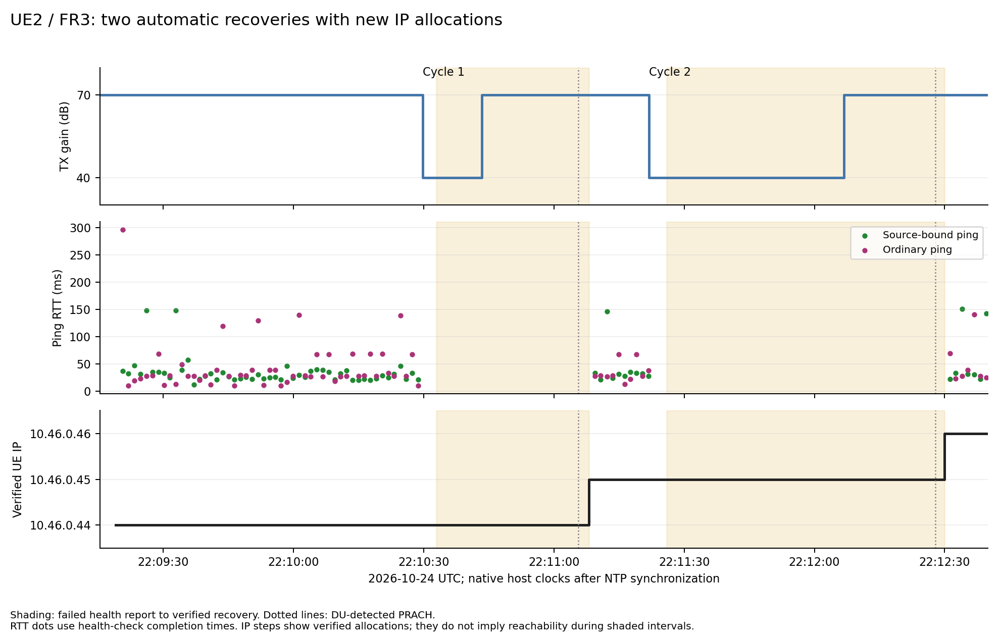
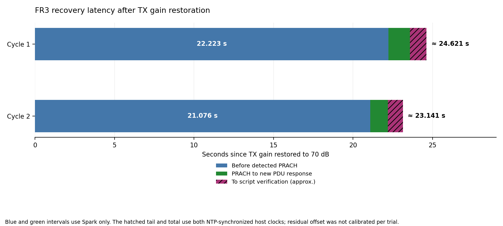

# UE2 FR3 Automatic Recovery Experiment Report

Experiment date: **2026-10-24**. Author: **Ruibin**.
Local observation window: **18:09:15.370–18:25:39.768 America/New_York, EDT**.
Event tables and figures use **UTC** to align the two hosts.

**UE2 / FR3 recovered automatically in both completed TX-gain disturbance cycles.**
After DU2 TX gain was restored from 40 to 70 dB, the watcher verified connectivity
in approximately **24.621 seconds** and **23.141 seconds**. Each recovery obtained
a new IPv4 allocation and rebuilt the host path: **10.46.0.44 → 10.46.0.45 →
10.46.0.46**. Source-bound and ordinary ping both passed after each recovery.

The largest measured interval preceded the DU's first detected PRACH after gain
restoration: **22.223 seconds** and **21.076 seconds**, measured entirely on Spark.
The current script optimization stage remains complete; these results establish
functional recovery in two observed cycles, rather than a recovery-time guarantee.

## Scope and time measurement

The analyzed window is **22:09:15.370196–22:25:39.768254 UTC**, ending at the last
completed healthy check before the operator stopped the test. As requested,
**the final shutdown sequence is excluded** from recovery outcomes and timings.
Attempts **1–84** are analyzed. Later stop-stage attempts **85–87** and the final
health-check failure are retained in the raw archive but excluded. The raw final
summary extends into termination and is not used as the outcome of either cycle.

Both hosts had been synchronized to external NTP sources before this test.
The [clock context](../evidence/2026-10-24_ue2_fr3_recovery/clock-context.json)
records the prior verification. Native UTC timestamps are used directly; the
historical approximately 199.6-second Laptop correction is **not** applied.
Cross-host timings, including gain restoration to watcher SUCCESS, are approximate
because residual clock offset was not calibrated at each trial. Spark-only
DU/CU/gain intervals do not depend on that cross-host alignment.

Gain timestamps identify observation of successful console acknowledgements,
not a hardware measurement of RF settling. PRACH timestamps identify the first
detection recorded by the DU, not necessarily the UE's first transmission attempt.

## Testbed and settings

FR3 is the project's label for its second path. Its physical radio link in this
experiment was **NR SA n78**, with a shared CU and Open5GS core.

| Item | Recorded setting |
| --- | --- |
| UE | UE2 / FR3; Quectel RM500Q family |
| Modem IMEI / SIM IMSI | `863305041980706` / `001010000000102` |
| Modem / bearer objects | `Modem/31` / `Bearer/70` |
| B210 / DU ID | `328B021` / `2` |
| DU / CU build identifiers | `4cffc0479f` / `bbbbeefa5e` |
| Carrier / bandwidth / SCS | 3600 MHz / 20 MHz / 30 kHz |
| Carrier NR-ARFCN / SSB NR-ARFCN | `640000` / `639648` |
| Target cell | PLMN `00101`, TAC `7`, PCI `2`, NCI `66C001` |
| APN / Spark service endpoint | `internet2` / `10.46.0.1` |
| Host path | `wwan1`, policy table `152`, MTU `1400` |
| TX gain | Initial 70 dB; two acknowledged 40 → 70 dB cycles on port `0` |
| RX gain | Startup value **35 dB**; no RX changes recorded |
| Watcher | `interval=1`, `verbose=2`, automatic cell locking enabled |
| Recovery settings | Radio grace 10 s; cell-lock cooldown 30 s; registration-client timeout 5 s; PDU-disconnect client timeout 2 s |
| CU PDU-request timer | Runtime configuration confirmed **10 s** |

Runtime configuration and protocol records are retained in the
[DU2 excerpt](../evidence/2026-10-24_ue2_fr3_recovery/spark/du2-events.log) and
[CU excerpt](../evidence/2026-10-24_ue2_fr3_recovery/spark/cu-events.log).
The [watcher summary](../evidence/2026-10-24_ue2_fr3_recovery/laptop/summary.json)
retains its actual parameters. Object numbers, prefixes and IP addresses are
observations from this run, not values to hard-code into later launches.

## Initial connection and cell lock

**Attempt 1 succeeded in 3.651 seconds.** The initial serial readback was already
`2,639648,30,78`; the script verified and reused that lock. The AT serving-cell
reply identified the expected NR SA cell, and subsequent ModemManager, PDU,
route and ping checks passed. This uploaded run therefore starts with a verified
lock and a first-attempt SUCCESS, rather than the earlier reported startup pattern.

One background registration request was dispatched during startup. Its pending
client status did not prevent fresh connection checks from accepting an already
verified working path. No further explicit registration request was recorded
during either disturbance cycle.

## Recovery measurements

| Event, UTC | Cycle 1 | Cycle 2 |
| --- | --- | --- |
| TX gain reduced to 40 dB | 22:10:29.813254 | 22:11:21.871522 |
| DU detected radio-link failure | 22:10:32.936370 | 22:11:27.796375 |
| TX gain restored to 70 dB | 22:10:43.389353 | 22:12:06.776610 |
| First subsequently detected PRACH | 22:11:05.612080 | 22:12:27.852119 |
| `RRCSetupComplete` | 22:11:05.651283 | 22:12:27.891243 |
| New `PDUSessionResourceSetupResponse` | 22:11:06.971223 | 22:12:28.971249 |
| Watcher SUCCESS | 22:11:08.009982, attempt **29** | 22:12:29.918076, attempt **84** |
| Newly verified allocation | **10.46.0.45/30** | **10.46.0.46/30** |

| Interval | Cycle 1 | Cycle 2 | Clock basis |
| --- | --- | --- | --- |
| Low-gain hold | 13.576 s | 44.905 s | Spark |
| Restored gain → detected PRACH | **22.223 s** | **21.076 s** | Spark |
| PRACH → `RRCSetupComplete` | 39.203 ms | 39.124 ms | Spark |
| PRACH → new PDU resource response | **1.359 s** | **1.119 s** | Spark |
| Restored gain → verified SUCCESS | **≈24.621 s** | **≈23.141 s** | Cross-host approximation |
| First reported health failure → SUCCESS | 35.093 s | 63.920 s | Laptop |
| Successful recovery attempt itself | 1.556 s | 1.552 s | Laptop |

The health-failure intervals include time while TX gain was still low; they are
not recovery times measured from restored signal conditions. Reported failure
also follows polling and ping timeouts, so it is not an exact RF-loss timestamp.



Shading runs from the first failed health report to verified recovery. Dotted
lines mark detected PRACH. RTT dots represent completed healthy checks, and IP
steps represent the latest verified allocations; neither interpolates successful
traffic through an unverified interval.



The blue and green segments use Spark timestamps. The hatched tail ends at
Laptop verification and inherits the cross-host timing qualification above.

## PDU recovery and new IP handling

During each radio-recovery inspection, the lock remained correct and the AT
serving-cell state was `SEARCH`. The watcher preserved the reported PDU rather
than forcing a disconnect. Later snapshots showed `disconnecting`: attempt **28**
in cycle 1 and attempts **55–83** in cycle 2. These were observed modem/backend
transitions; no script `--simple-disconnect` command occurred in the analyzed window.

Once registration and the target cell were ready, each successful recovery
performed one normal `--simple-connect`, read the current allocation, cleared
the old host address/routes/rules and installed the new source address and
policy-table entry. The CU recorded old PDU resource release followed by a new
PDU resource setup in both cycles. The progression was:

| Verified point | IPv4 allocation | ModemManager bearer object | Host path |
| --- | --- | --- | --- |
| Startup | `10.46.0.44/29` | `Bearer/70` | `wwan1`, table `152` |
| Cycle 1 recovery | `10.46.0.45/30` | `Bearer/70` | Rebuilt for `.45` |
| Cycle 2 recovery | `10.46.0.46/30` | `Bearer/70` | Rebuilt for `.46` |

**The unchanged bearer object number does not mean the PDU allocation stayed
unchanged.** Its IPv4/prefix changed, and the new allocation was queried and
verified before traffic testing. The evidence demonstrates automatic host-path
adaptation to changed UE IP addresses.

Across the analyzed period, the log contains **three PDU connect commands**
(startup plus two recoveries), **zero PDU disconnect commands**, and **one startup
registration request**. Recorded AT operations were read-only queries; correct
lock settings were reused without configuration writes.

The two cycles contained **81 retry results**: 25 stopped at serving-cell checks
and 56 at registration checks. Each failed attempt took **0.031–0.734 seconds**,
followed by the configured interval. `--interval 1` is a delay after a completed
round, not a fixed one-second period. Retry outcomes during an outage are not
independent trials and are not used to calculate a connection success rate.

## Traffic verification and continued monitoring

Before accepting each SUCCESS, the watcher verified source-bound and ordinary
routes, its Wi-Fi fallback guard, and both ping modes against `10.46.0.1`.

| Recovery | Source-bound ping | Ordinary ping |
| --- | --- | --- |
| Cycle 1, source `10.46.0.45` | 1 sent / 1 received; **22.413 ms** | 1 sent / 1 received; **69.071 ms** |
| Cycle 2, source `10.46.0.46` | 1 sent / 1 received; **40.793 ms** | 1 sent / 1 received; **30.460 ms** |

The analyzed log also contains **637 completed healthy monitoring rounds**, each
with a successful ping in both modes: 51 using `.44`, 10 using `.45`, and **576
using `.46`**. After cycle 2 SUCCESS, monitoring continued for **789.850 seconds
(13 min 9.850 s)** through the last healthy check, with no additional reported
failure before the excluded closing stage.

## Interpretation and current stage

Both completed disturbance cycles recovered their target NR SA cell, a working
IPv4 PDU allocation and both verified host traffic paths. The current automation
policy and parameters remain the accepted script-stage baseline.

The dominant measured wait was before the DU detected renewed random access.
These logs cannot determine whether the UE was still searching/synchronizing,
waiting in an internal recovery procedure, or sending access attempts that the
DU did not detect. RX gain remained at its recorded startup value of 35 dB;
this experiment did not compare receive-gain settings or isolate that cause.

Two observed recoveries establish functionality, not a population latency
distribution. This experiment measures UE radio/PDU/IPv4 recovery. MPTCP subflow
adaptation and video continuity require separate transport/player traces.

## Evidence and reproduction

| Evidence | Retained artifact |
| --- | --- |
| Complete Laptop log | [Compressed original log](../evidence/2026-10-24_ue2_fr3_recovery/laptop/run.log.gz), including the excluded closing records |
| Per-attempt results | [Original JSONL](../evidence/2026-10-24_ue2_fr3_recovery/laptop/attempts.jsonl), [CSV with inclusion flags](../evidence/2026-10-24_ue2_fr3_recovery/attempts.csv) |
| Monitoring samples | [Health-check CSV with inclusion flags](../evidence/2026-10-24_ue2_fr3_recovery/health_checks.csv) |
| Registration events | [Original JSONL](../evidence/2026-10-24_ue2_fr3_recovery/laptop/registration_events.jsonl) |
| Gain timing | [Console transcript](../evidence/2026-10-24_ue2_fr3_recovery/spark/du2-startup.log), [output timing](../evidence/2026-10-24_ue2_fr3_recovery/spark/du2-startup.log.timing), [parsed gain events](../evidence/2026-10-24_ue2_fr3_recovery/gain-events.jsonl) |
| RAN events and settings | [DU2 excerpt](../evidence/2026-10-24_ue2_fr3_recovery/spark/du2-events.log), [CU excerpt](../evidence/2026-10-24_ue2_fr3_recovery/spark/cu-events.log), with original line numbers |
| Results and provenance | [Analysis JSON](../evidence/2026-10-24_ue2_fr3_recovery/analysis.json), [source manifest](../evidence/2026-10-24_ue2_fr3_recovery/source_manifest.json), [SHA256 checksums](../evidence/2026-10-24_ue2_fr3_recovery/sha256sums.txt) |

The source manifest identifies the new uploaded run and file hashes. DU/CU
archives contain selected configuration/protocol lines, excluding security-key
and raw-payload dumps. Recalculation passed **33 data consistency checks** and
does not operate radios or modify network state. From the repository root:

```bash
python3 -B docs/evidence/2026-10-24_ue2_fr3_recovery/analyze.py --plot
```

PNG and SVG figures are generated with matplotlib. Analysis uses the repository's
gain-time extractor and the archived transcript/timing pair, so the original
temporary paths are not needed for recalculation.
