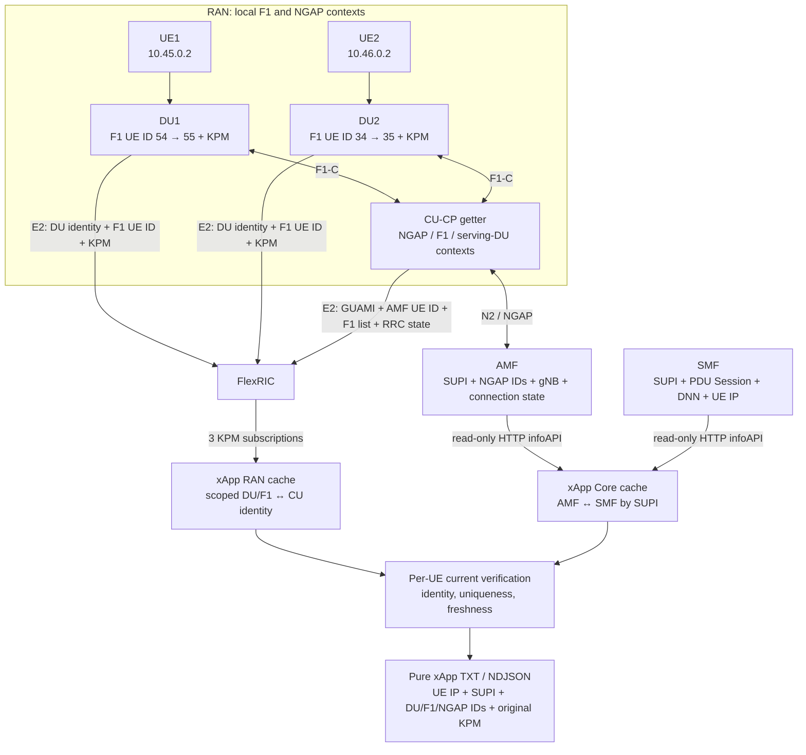
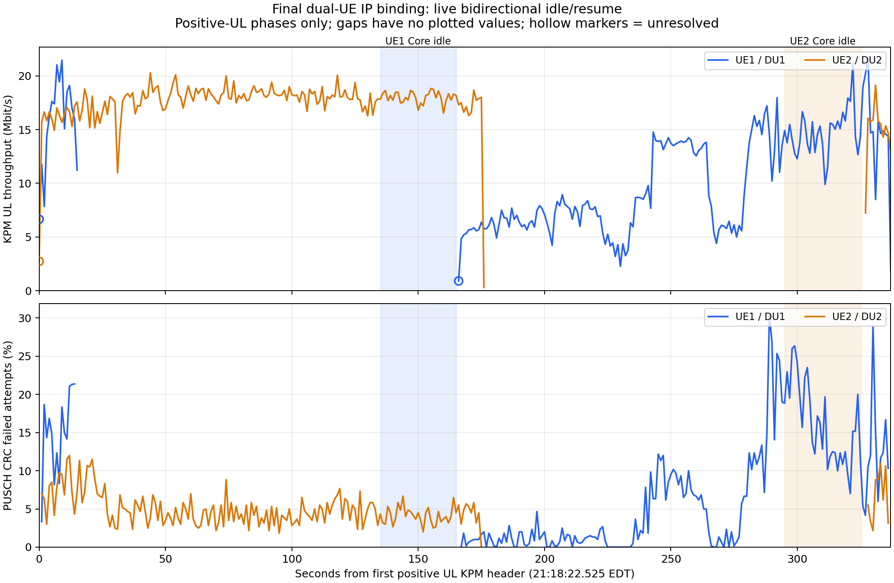

# Dual UE IP binding: final implementation and live validation

Developer: Ruibin Chen. Experiment date: October 21, 2026,
America/New_York. Falcon and OCUDU branch: `Dual-UE`.

The standalone xApp associates each DU's UE KPM with the actual subscriber,
PDU session and UE IP by combining CU/DU E2 reports with read-only AMF/SMF
queries. Established UE links are verified independently: one UE entering
idle does not interrupt its active peer's current IP binding.

The six-minute live validation produced **648 records: 645 matched,
3 unresolved startup/resume samples and 0 cached**. Each UE completed an
observed Core connected → idle → connected transition. During each actual
idle interval, the active peer produced 30 consecutive correctly matched
positive-UL records. Both UE IPs were retained while F1/NGAP contexts changed.
All four Laptop iperf clients and the xApp exited 0.

This report describes the final implemented behavior and this live validation.
The validated assurance is experimental observed association; explicit
serving-DU/context-generation transport and the remaining lifecycle/recovery
acceptance are outside the completed functional scope below.

## Matching topology and information supplied by each component



F1-C and N2 populate CU contexts. The xApp receives CU/DU data through E2 and
queries Core directly; the CU does not call the Core infoAPIs.

| Component | Fields supplied | Role in the association |
| --- | --- | --- |
| DU | E2 node PLMN/gNB/DU ID; standard `UEID-GNB-DU` with gNB-CU UE F1AP ID; original base5 KPM and measurement metadata | Identifies the DU and F1 context that produced a measurement. Admitted configuration supplies the gNB bit length. |
| CU-CP | Local getter reads NGAP/GUAMI/F1 and serving-DU contexts. E2 carries AMF UE NGAP ID, GUAMI, CU UE F1AP ID list and `FALCON.UE.RRCState` | Bridges DU F1 identity to an AMF-scoped UE identity. Current standard CU E2 UEID does not carry the getter's explicit per-UE serving-DU/generation fields. |
| AMF | SUPI, AMF/RAN UE NGAP IDs, gNB ID, connection state and reported cell/NCI | Connects the CU identity to the subscriber. The audit independently checks the expected lab cell. |
| SMF | SUPI, PDU Session ID, DNN, UE IPv4 and session state | Connects the subscriber/session to the actual UE IP. |

The xApp performs three joins:

1. Use the DU row's PLMN/gNB/DU/F1 identity to find a unique current CU
   F1-to-AMF/GUAMI relation in the admitted gNB scope.
2. Match `(GUAMI, gNB ID, AMF UE NGAP ID)` against the AMF cache to obtain
   SUPI and RAN UE NGAP ID. The Core endpoint's GUAMI scope is explicitly
   configured and checked against CU E2, rather than inferred from an ID.
3. Join AMF and SMF by SUPI, select the unique eligible session, and attach
   its IP/DNN/session fields to the original DU KPM row.

For example, resumed UE1 follows `DU1 / F1 55 → CU GUAMI + AMF UE 90 →
AMF SUPI imsi-001010000000101 → SMF PDU 1 / internet / 10.45.0.2`.
IMEI is independent Laptop validation evidence. Numeric equality between
F1 and NGAP identifiers, or inference from an IP subnet, is not the join.
DU/CU E2 reports do not supply the UE IP used by this application.

## Final matching and output policy

CU and DU reports need not arrive simultaneously. The xApp caches their
scoped identities and checks source freshness using monotonic receive times,
with a three-second TTL. Report timing and first-observed relation boundaries
prevent an older measurement from being assigned a later identity.

| Situation | Final behavior |
| --- | --- |
| First association for a DU/F1 context | Require all admitted DU observations to be current, unique observed DU/F1 and CU candidates, and matching fresh CU/Core data. |
| Established link, own CU/Core data current | Recompute that UE's current binding independently. Other-DU silence alone does not remove its IP or change it to cached. |
| Established scope needed while another DU is stale | Publish `matched` with `assurance: established_du_scope_current_context`. The IP comes from fresh own Core data. |
| Own verification inputs missing, historical policy enabled | Reuse only that context's verified history as `cached`, with last verification time and age. This does not claim current verification. |
| New context without evidence, known conflict/retirement or input loss | Withhold an unverified IP; preserve KPM and expose the reason. A new context cannot inherit an unrelated or retired binding. |

When all admitted DU sources are current, a unique experimental match uses
`assurance: observed_unique_current_context`. Initial scope establishment still
needs the multi-DU observations because F1 IDs are allocated in per-DU contexts
and CU standard UEID lacks explicit serving-DU/generation transport.

The live test uses `independent_links: true` and explicit
`--observed-unique --fresh-only`. These CLI options override the local JSON's
`strict`/`last_known` defaults. Historical IP fallback is disabled in the test;
all matched outputs use current own CU/Core data. The normal last-known policy
remains available separately.

Implementation changes comprise the CU-CP snapshot/getter and CU E2 provider,
the standalone collector/coordinator and an isolated FlexRIC KPM plugin with
the 40-bit AMF ID decoder fix. Accepted DU radio/KPM behavior and installed
FlexRIC files are unchanged. Core source, subscriber/IP allocation and session
policy are unchanged; the xApp uses the existing read-only infoAPIs.
Plan 2 broker/MPX integration remains separate.

## Actual identity chains

The common scope is PLMN 001/01, gNB 411 with 22 bits, and GUAMI region 2,
set 1, pointer 0. PDU Session ID 1 is scoped to its own SUPI.

| Field | UE1 / DU1 | UE2 / DU2 |
| --- | --- | --- |
| Laptop IMEI | 863305041978437 | 863305041980706 |
| IMSI | 001010000000101 | 001010000000102 |
| UE IPv4 / prefix | 10.45.0.2/30 | 10.46.0.2/30 |
| DNN / PDU Session ID | internet / 1 | internet2 / 1 |
| DU ID / independently checked NCI | 1 / 6733824 | 2 / 6733825 |
| gNB-CU UE F1AP ID, before → after idle | 54 → 55 | 34 → 35 |
| AMF UE NGAP ID, before → after idle | 89 → 90 | 88 → 91 |
| RAN UE NGAP ID, before → after idle | 88 → 89 | 87 → 90 |
| PHY RNTI, before → after idle | 0x463a → 0x463b | 0x4623 → 0x4624 |

Laptop truth independently confirms both IMEI/IMSI/APN/source-IP assignments.
The raw-input audit checks each CU F1-to-AMF/GUAMI relation and the AMF/SMF
SUPI/session/IP relation, plus AMF-reported NCI. The selected CU identity log
headers additionally tie the four radio contexts to their actual RNTIs.

## Live six-minute bidirectional idle/resume validation

The operator launched the foreground services, xApp and inline Laptop command.
One xApp instance, `4b672336-4fb7-43f3-8b0b-90209065e92d`, covers the full
360-second capture. SDK xApp ID 14 registers CU/gNB 411, DU1 and DU2,
subscribes three times and receives all three deletion responses before normal
stop. The operator recorded xApp exit 0.

| Observation | Result |
| --- | --- |
| Core snapshots | 360 |
| CU / DU1 / DU2 KPM reports | 355 / 324 / 324 |
| Original DU KPM payloads checked | 648; values, types, units and metadata preserved |
| Current CU/Core/DU/cell associations checked | 645 |
| Core errors / ingress loss / reported C drops | 0 / 0 / 0 |
| Maximum preceding Core / CU age on a match | 0.988943 / 1.000906 seconds, below the three-second TTL |
| Registered nodes / subscriptions / deletion responses | 3 / 3 / 3 |

| Output | DU1 / UE1 | DU2 / UE2 | Total |
| --- | --- | --- | --- |
| Records | 324 | 324 | 648 |
| `matched` | 322 | 323 | 645 |
| `cached` | 0 | 0 | 0 |
| `unresolved` | 2 | 1 | 3 |

### Independent matching during both idle intervals

Times below are Spark-local first observations on October 21, 2026 EDT.
Polling/reporting periods are one second; the observations are not exact
protocol event times.

| UE entering idle | Observed Core idle interval | Duration | Active peer result |
| --- | --- | --- | --- |
| UE1 | 21:20:37.549751–21:21:07.552904 | 30.003153 s | UE2: 30 consecutive matched records, all positive UL. |
| UE2 | 21:23:17.566119–21:23:47.568614 | 30.002495 s | UE1: 30 consecutive matched records, all positive UL. |

Across the complete capture, 59 matched outputs use an established DU/F1
scope while the other DU is outside TTL. The active UE continues to use its
own fresh CU/Core relation and actual IP. No historical IP fallback or
cross-UE assignment is observed.

SMF retains each unique session/IP with inactive user-plane state during AMF
idle and returns it to active on resume. The first resumed matches use the
actual resumed F1/NGAP relations shown above:

| Resume observation | UE1 | UE2 |
| --- | --- | --- |
| First resumed matched record | 305 | 592 |
| First resumed matched output time, EDT | 21:21:09.527089 | 21:23:49.525601 |
| From later matching fresh CU/Core prerequisite to output | 1.001012 s | 0.998971 s |

Both observed convergence times are within the three-reporting-period target
under complete healthy inputs. They are measurements of this trial.

### Startup and resume boundary records

The final run has three unresolved records, with null IP and original KPM:

- Record 1, DU2: the other admitted DU has not yet been observed at startup.
- Record 2, DU1: the initial measurement header predates independently
  observed CU identity availability by a fraction of a millisecond.
- Record 303, DU1: the first measurement of the resumed F1 context predates
  its observed CU relation. The next DU1 sample matches.

These are the affected UE's own first-association boundaries. The active peer
remains matched during both tested idle intervals. The xApp outputs in real
time and does not retrospectively assign later evidence to these measurements.

### Example xApp output records

These two blocks are copied verbatim from this run's
[live TXT](../evidence/2026-10-21_ue_identity_live/16_bidirectional_idle_live/bindings.txt).
They show each active UE retaining a current IP binding while its peer is idle.
The TXT contains only xApp output; SDK messages are in a separate log.

UE1 / DU1 while UE2 is idle:

```text
record=570 status=matched collection_time=2026-10-22T01:23:27.526176Z
  app_instance=4b672336-4fb7-43f3-8b0b-90209065e92d header_time_us=1792632207526176
  RAN: PLMN=001/01 gNB=411 (22 bits) DU_ID=1 UE(gNB-CU UE F1AP ID)=55
  Core: SUPI=imsi-001010000000101 AMF_UE_NGAP_ID=90 RAN_UE_NGAP_ID=89
  AMF(GUAMI): PLMN=001/01 region=2 set=1 pointer=0
  Session: PDU_SESSION_ID=1 DNN=internet UE_IPv4=10.45.0.2
  Mapping: method=core_infoapi_cu_e2 assurance=established_du_scope_current_context
  Reason: current UE CU/Core relation matches its established DU/F1 association
  KPM: sample_idx=0 granularity_ms=1000 incomplete=absent
    DRB.RlcSduDelayDl = 13.300000190734863 [0.1 ms] (real)
    DRB.UEThpDl = 150 [kbit/s] (real)
    DRB.UEThpUl = 12798 [kbit/s] (real)
    RRU.PrbTotDl = 0 [%] (integer)
    RRU.PrbTotUl = 86 [%] (integer)
```

UE2 / DU2 while UE1 is idle:

```text
record=280 status=matched collection_time=2026-10-22T01:20:46.524749Z
  app_instance=4b672336-4fb7-43f3-8b0b-90209065e92d header_time_us=1792632046524749
  RAN: PLMN=001/01 gNB=411 (22 bits) DU_ID=2 UE(gNB-CU UE F1AP ID)=34
  Core: SUPI=imsi-001010000000102 AMF_UE_NGAP_ID=88 RAN_UE_NGAP_ID=87
  AMF(GUAMI): PLMN=001/01 region=2 set=1 pointer=0
  Session: PDU_SESSION_ID=1 DNN=internet2 UE_IPv4=10.46.0.2
  Mapping: method=core_infoapi_cu_e2 assurance=established_du_scope_current_context
  Reason: current UE CU/Core relation matches its established DU/F1 association
  KPM: sample_idx=0 granularity_ms=1000 incomplete=absent
    DRB.RlcSduDelayDl = 14.399999618530273 [0.1 ms] (real)
    DRB.UEThpDl = 335 [kbit/s] (real)
    DRB.UEThpUl = 17547 [kbit/s] (real)
    RRU.PrbTotDl = 0 [%] (integer)
    RRU.PrbTotUl = 86 [%] (integer)
```

## Uplink throughput and PHY observations

The two-panel figure uses only this final live trial. Blue is UE1/DU1;
orange is UE2/DU2. Shading marks the actual Core idle intervals.



The upper panel shows the 376 positive-UL KPM samples, 188 per UE, in the four
traffic phases. Values convert kbit/s to decimal Mbit/s. Lines stop during each
UE's quiet gap; no zero-valued idle curve or connecting line is inserted.
Hollow markers retain the three unresolved measurement samples. The lower
panel uses only complete one-second bins inside the same per-UE active phases,
with each F1 context linked to its actual RNTI through CU identity records.
Missing PHY bins remain blank.

The view spans the first through last positive UL header, 21:18:22.525040–
21:23:59.528146 EDT, about 337.003 seconds. Activity is determined by Spark's
KPM observations. Cross-host clocks are uncalibrated, so these bounds are not
claimed as exact Laptop iperf process start/end times. All 648 original output
rows remain in the retained evidence.

| PUSCH measure in complete active-phase bins | DU1 | DU2 |
| --- | --- | --- |
| Decode attempts | 109,999 | 109,627 |
| Attempts with CRC failure | 8,198 | 5,454 |
| CRC failure attempt ratio | 7.45% | 4.98% |
| Median logged PUSCH SINR | 17.6 dB | 24.0 dB |

The CRC failure attempt ratio is `KO / (OK + KO)` over logged PUSCH decoding
attempts, including HARQ retransmissions. It is separate from TCP loss,
TCP retransmission counts and calibrated first-transmission BLER. These
observations do not establish the cause of throughput variations.

Export [PNG](../evidence/2026-10-21_ue_identity_live/16_bidirectional_idle_live/dual_ul_kpm.png)
or [SVG](../evidence/2026-10-21_ue_identity_live/16_bidirectional_idle_live/dual_ul_kpm.svg).
The [plot manifest](../evidence/2026-10-21_ue_identity_live/16_bidirectional_idle_live/plot_manifest.json)
records phase windows, context mappings, definitions and hashes. Its source
artifacts include the positive KPM CSV, per-second PHY CSV, an identity-only
CU excerpt and selected-context compressed PUSCH records in the same directory.

## Laptop traffic results

The Laptop command measured 150.0 seconds of quiet for each UE. It completed
in 337.767 seconds with `STATUS: completed`, no error and four iperf exits of 0.

| Client | Requested duration | Receiver duration | Receiver throughput | Sender retransmits |
| --- | --- | --- | --- | --- |
| UE1 before idle | 15 s | 15.29 s | 15.3 Mbit/s | 0 |
| UE2 before idle, continuing during UE1 idle | 175 s | 175.16 s | 16.9 Mbit/s | 0 |
| UE1 after resume, continuing during UE2 idle | 170 s | 170.34 s | 9.62 Mbit/s | 1 |
| UE2 after resume | 10 s | 10.20 s | 14.6 Mbit/s | 1 |

The [operator summary](../evidence/2026-10-21_ue_identity_live/16_bidirectional_idle_live/operator_run.json)
and [Laptop identity truth](../evidence/2026-10-21_ue_identity_live/16_bidirectional_idle_live/laptop_identity_result.json)
retain the supplied results. Both IMSI/APN/IP assignments are independently
verified. The supplied UE2 identity extraction ends after its prefix, so later
interface/route fields are not reconstructed. Full Laptop per-second logs
were not supplied; receiver summaries and exits do not establish stall-free
operation or comparative performance.

Spark inputs span 21:18:17.538329–21:24:17.525270 EDT; Laptop reports a start
at 21:15:01.181637 EDT in its own clock domain. Idle and matching conclusions
use only Spark-local Core/CU/DU times. Laptop uses its own clock for client and
quiet durations; no cross-host per-second alignment is assumed.

## Acceptance scope and reproduction

The validated functional scope is CU identity reporting, three-node xApp
subscription, current UE/IP/KPM association, independent matching of established
links during either UE's idle interval, and resumed-context association with
retained PDU/IP. One live idle/resume round per UE passed.

Initial multi-DU scope establishment, missing explicit serving-DU/generation
fields on CU E2, unseen exact-key reuse, handover, source restart/recovery,
repeated comparative performance and calibrated clock alignment remain outside
this acceptance. A separate cold-start rerun is required to claim cold-start
reproducibility. Plan 2/MPX integration is unchanged.

Reproduce with the paired
[Spark Quick Start](../dual_ue_spark_quick_commands.md) and
[Laptop Quick Start](../dual_ue_laptop_quick_commands.md#binding-idle).
Use the identity-configured RIC and CU, both DUs, the dual xApp config and
`--observed-unique --fresh-only --duration 360`.

Retained evidence:

- [Pure xApp TXT](../evidence/2026-10-21_ue_identity_live/16_bidirectional_idle_live/bindings.txt)
- [Decoded CU/DU/Core inputs](../evidence/2026-10-21_ue_identity_live/16_bidirectional_idle_live/inputs.ndjson)
- [Associated output rows](../evidence/2026-10-21_ue_identity_live/16_bidirectional_idle_live/rows.ndjson)
- [Subscription/deletion log](../evidence/2026-10-21_ue_identity_live/16_bidirectional_idle_live/xapp.log)
- [Independent audit and hashes](../evidence/2026-10-21_ue_identity_live/16_bidirectional_idle_live/audit.json)

Audit and regenerate the figures from retained files without starting services
or traffic:

```bash
python3 docs/evidence/2026-10-21_ue_identity_live/16_bidirectional_idle_live/plot.py
python3 docs/evidence/2026-10-21_ue_identity_live/16_bidirectional_idle_live/audit.py
```
