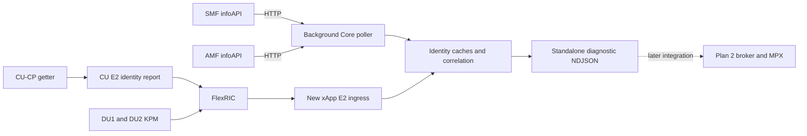

# Standalone CU/DU Identity xApp and Core IP Correlation Plan

Develop a new standalone `xapp_ue_identity` that receives CU-CP identity reports
and existing DU KPM, queries Open5GS SMF/AMF infoAPI, and emits diagnostic
UE-IP-to-radio associations. Integrate with Plan 2 only in a later task.

| Field | Value |
| --- | --- |
| Plan | 4 |
| Task | `cu-ue-ip-e2-binding` |
| Status | Planning only; implementation and live acceptance pending |
| Created at | 23 : 08: 51 Oct 20, 2026 EDT |
| Last updated at | 00 : 07: 31 Oct 21, 2026 EDT |
| Time zone | `America/New_York` |
| Developer | Ruibin Chen |
| Reviewer | To be assigned |
| New application | `xapp_ue_identity`; independent build and launch target |
| Falcon inspection baseline | `1fc8a96f1ad3fc7aef910f73ce3293d2d156190c` |
| OCUDU inspection baseline | `c9d695dfaba8e894bae8c9d95aa1b7e6437c7fc1` |
| FlexRIC inspection baseline | `10b8ec79d0f011902d329b2ed37f33f8b101b591` |
| Plan 2 dependency | None for development or acceptance; integration deferred |
| Plan 3 relationship | Uses the dual-UE setup; its other pending gates remain separate |
| Deployment | Spark: Core, CU, two DUs, FlexRIC, new xApp; Laptop: two modems and truth/traffic collection |
| Initial address scope | IPv4 in the existing non-overlapping testbed domain |
| Core scope | Read existing interfaces; no Core source, session policy, subscriber or IP-allocation changes |
| RAN scope | CU-CP context export and E2 reporting; preserve DU KPM and CU-UP packet processing |

The October 21 user instruction is **no code changes now**. This revision changes
planning documentation only. Every checkbox is pending. New symbols, paths and
fields below are proposals. Inspection revisions describe source snapshots,
not proof of the binaries running; reconcile actual builds before execution.

## 1. Current Decision and Scope

1. SMF supplies `SUPI + PDU Session ID -> UE IP / DNN`.
2. AMF supplies `SUPI -> AMF/RAN UE NGAP IDs / gNB / connection state`.
3. CU-CP exports its existing association between AMF-side UE identity and
   serving DU/F1AP UE context.
4. The new standalone xApp joins those relations to actual DU KPM.

CU does not query the Core infoAPI. CU already learns NGAP IDs through normal N2
signalling. Its getter reads locally stored identities for its E2 reporting
module. The xApp queries SMF and AMF to connect IP/session/subscriber identity to
the radio context.

This supersedes the unimplemented October 20 design that observed IP packets in
CU-UP, joined CU-UP/CU-CP contexts through E1, and required a private IP-binding
model plus Plan 2 broker. The current design obtains IP from Core and exports
identifiers from CU-CP. A private E2 model is a decision to justify if necessary,
not a fixed prerequisite.

Included: CU-CP snapshot/lifecycle handling, applicable identity-bearing E2
reports, independent CU/DU subscriptions, bounded background Core queries,
identity caches, safe correlation, diagnostic NDJSON and live validation.

Deferred or excluded:

- Plan 2 broker, TCP protocol, client registration/filtering and application
  subscriptions. No Plan 2 source or plan changes are required.
- Actual MPX/MPTCP integration, path creation, scheduling or RIC traffic control.
- CU-UP IP learning, packet inspection, PDCP/SDAP changes or new E1 procedures.
- Core source patches, allocation/session policy, subscriber data, DNN/pool or
  UPF rule changes; DU metric/identifier or PHY/MAC/RLC changes.
- IPv6 publication, overlapping IP domains and general roaming/multi-Core support.
- SDK-wide automatic RIC reconnection or dynamic node discovery after startup.
- Guaranteed attribution across exact identifier reuse without verifiable shared
  context identity in DU reports.

If infoAPI requires configuration or a different binary/version, record it as a
separate assessed deployment change. Do not silently upgrade or patch Core to
satisfy this read-only prerequisite. No deployment occurs in this revision.

## 2. Established State and Source Anchors

The [retained dual-UE report](../docs/reports/dual_ue_ul_experiment_report_2026-10-13.md)
contains actual `(gNB 411, DU1, CU UE F1AP ID 11)` and
`(gNB 411, DU2, CU UE F1AP ID 7)` KPM. Laptop records contain historical IPs
`10.45.0.6` and `10.46.0.5`. Rediscover current values; that run did not prove the
complete automatic Core/CU/DU association.

| Item | Established state | Pending work |
| --- | --- | --- |
| DU KPM | Actual two-DU reception, base five metrics and F1AP UE IDs; no IP/SUPI | Preserve values/identity in the new app |
| CU contexts | NGAP/F1AP share internal UE index; UE manager stores actual DU ID | Safe joined view, lifecycle validity and serving-context export |
| CU E2 | Agent exists; current CU KPM is node-level and UE matching does not populate lists | Applicable per-UE report implementation |
| Standard E2 UEID | Includes AMF UE NGAP ID, GUAMI and CU UE F1AP ID list | Verify DU association, semantics and end-to-end decoder support |
| Existing monitor | Enumerates nodes at startup; supports multiple subscriptions | Retain as regression tool; new independent app/config |
| Core packages | AMF/SMF `2.8.0~noble5`; binaries contain infoAPI endpoint strings | Actual running API and schema validation |
| Core probe | Configured-address HTTP probes returned connection refused | Repeat during normal Core operation; static strings are not a live pass |
| HTTP/JSON toolchain | `pkg-config` did not find `libcurl`/`json-c` | Freeze dependencies instead of assuming they are installed |

Source anchors for future changes:

| Source | Responsibility |
| --- | --- |
| OCUDU `lib/ngap/ue_context/ngap_ue_context.h` | Add/update/remove NGAP identities and transfer internal UE index |
| OCUDU `lib/f1ap/cu_cp/ue_context/f1ap_cu_ue_context.h` | F1AP create/update/find/remove by internal index |
| OCUDU `lib/cu_cp/ue_manager/` | Actual `gnb_du_id`, serving UE context and existing metrics collection |
| OCUDU `include/ocudu/cu_cp/cu_cp_metrics_notifier.h` | Existing snapshot lacks the required NGAP/F1 identity fields |
| OCUDU `lib/cu_cp/metrics_handler/metrics_handler_impl.cpp` | Existing control-executor snapshot/periodic-report pattern |
| OCUDU `lib/e2/e2sm/e2sm_kpm/e2sm_kpm_cu_meas_provider_impl.cpp` | Current node-level providers and incomplete UE matching |
| OCUDU `lib/e2/e2sm/e2sm_kpm/e2sm_kpm_asn1_packer.cpp` | Advertises UE report styles only when UE-level measurements exist |
| OCUDU `include/ocudu/asn1/e2sm/e2sm_common_ies.h` | Existing standardized UEID fields |
| OCUDU `apps/units/o_cu_cp/e2/` | CU-CP E2 configuration/translation |
| Falcon `scripts/dual_fr1/xapp_oran_moni_dual.c` | Reusable SDK/subscription logic; current print path displays F1 list or AMF ID, not both |
| Falcon `scripts/dual_fr1/build_kpm_monitor.sh` | Pinned local SDK/library build pattern |

## 3. Independent Architecture and Deliverables

One new xApp subscribes independently to one CU-CP and two DUs. Each source has
its own identity, subscription and freshness. CU-UP E2 is unnecessary here.

| Proposed location | Deliverable |
| --- | --- |
| Falcon `scripts/ue_identity/` | Independent `xapp_ue_identity`, E2 ingress, Core adapter, caches, matcher and output |
| Falcon `scripts/ue_identity/build.sh` | Separate binary, reproducible pinned SDK build |
| Falcon `configs/flexric/xapp_ue_identity.conf` | Suitable separate CU/DU subscriptions |
| Falcon `configs/ue_identity/` | Core endpoints, AMF/GUAMI scope, allowed CU/DU identities and limits |
| Falcon `configs/ocudu/cu_identity_e2.yml` | Candidate opt-in CU-CP E2 overlay |
| OCUDU CU-CP collection/E2 interfaces | Proposed `get_ue_identity_snapshot()` or equivalent, owned records, lifecycle validity and reporting |
| Falcon `tests/ue_identity/` | Independent Core/E2 fixtures, correlation and lifecycle tests |
| Falcon `docs/ue_identity_xapp.md` | Frozen standalone schema, build/start commands and limitations |
| Falcon `patches/ocudu/`, optionally `patches/flexric/` | Separate reviewed patches and exact baseline manifests |

Freeze file boundaries and HTTP/JSON dependencies in Step 2. Reuse existing
logic without modifying the accepted monitor or requiring Plan 2's proposed
`xapp_kpm_broker`. If a helper process is chosen, define its bounded interface
and include it in the independent launch target.

## 4. CU Getter and E2 Contract

The getter copies existing context information. It does not query AMF, allocate
IDs, decode NAS or inspect user packets. Required logical information is:

- CU/PLMN/gNB and AMF identity scope, AMF UE NGAP ID and GUAMI.
- Actual serving DU ID and relevant CU/DU UE F1AP IDs.
- RAN UE NGAP ID and internal UE index for traceability where available;
  internal indices never become cross-node lookup keys.
- Readiness/release state and genuine lifetime/version evidence supported by
  the selected reporting contract.

Read mutable contexts on their owning executor; hand copied records to E2.
Extend an existing snapshot or add a dedicated read-only view. Incomplete joins
remain pending. Handle release-start, removal, resume, index transfer and
handover without keeping obsolete serving associations active.

### Standard-report decision gate

Prefer existing `UEID-GNB` fields for AMF UE NGAP ID/GUAMI and the F1AP list.
Adding a numeric measurement getter or enabling CU E2 alone is insufficient:
UE enumeration, supported report styles, actual measurement collection and
encoding/decoding must all work.

If using KPM, select a legitimate CU UE-level measurement and implement its real
semantics. Do not relabel node counters as per-UE metrics, invent placeholder
zeroes or assume an identity-only empty measurement report is valid. Evaluate
applicable standard alternatives if KPM is unsuitable. Current local E2SM-RC
report-subscription hooks are incomplete, so RC is not a ready substitute.

Before declaring standard UEID sufficient:

- Verify actual F1AP-ID allocation scope across local DU instances. Do not
  assume CU-wide uniqueness from per-DU context storage/allocators.
- Supply explicit DU association or prove the key uniquely selects its DU KPM
  source. Conflicting same-ID candidates remain ambiguous.
- Define complete snapshots versus filtered KPM UE lists. Missing ordinary
  KPM rows are not release notifications.
- Specify restart, retirement and uncertainty handling. Standard UEID alone
  does not carry a complete lifecycle contract.
- Keep `ran-UEID` distinct from RAN UE NGAP ID; they are different fields.

If fields/semantics are missing, document them and compare a scoped E2
extension/private model before implementing it. Freeze any model identity,
codec, ownership and FlexRIC changes in an explicit design update. Do not assume
custom transport is required or trivial. CU allocator redesign and DU context
tokens are separate scope/risk decisions.

## 5. Core Queries and Scoped Association

| Source | Initial configured endpoint | Fields to verify and use |
| --- | --- | --- |
| SMF | `http://127.0.0.4:9090/pdu-info` | `supi`, per-session `psi`, `ipv4`, `dnn`, state |
| AMF | `http://127.0.0.5:9090/ue-info` | `supi`, `gnb.amf_ue_ngap_id`, `gnb.ran_ue_ngap_id`, `gnb.gnb_id`, `cm_state` |

Loopback requires the same host/network namespace. The optional infoAPI is
implementation-dependent; official documentation is not proof every installed
version exposes it. Verify real responses before relying on these paths.

Run HTTP outside E2 callbacks with bounded deadlines, response sizes and pages.
Validate types, canonical IDs, pagination and completeness. Failed/truncated
responses cannot replace complete state as if missing rows had been deleted.
AMF and SMF queries are not an atomic cross-NF transaction; retain each query's
start/end times and hold inconsistent joins unresolved.

| Cache | Key / relation |
| --- | --- |
| SMF sessions | SMF/address-domain + SUPI + PDU Session ID -> IP/DNN/state |
| AMF identities | AMF source + SUPI -> AMF UE NGAP ID / gNB / available RAN ID / state |
| CU identities | CU node + AMF identity scope + AMF UE NGAP ID -> verified serving DU/F1 context |
| DU rows | PLMN + gNB ID/bit length + node type + actual DU ID + UE-ID type + CU UE F1AP ID |

The AMF API example does not expose a standalone GUAMI field. Establish how its
configured endpoint corresponds to the CU-reported GUAMI using actual AMF
configuration/identity evidence. Never join bare AMF UE numbers across sources.
Cross-check RAN UE NGAP ID only where genuinely available on both sides.

Normalize SUPI explicitly and losslessly; preserve leading MCC/MNC zeroes,
identifier widths and missing-versus-zero distinctions. Never infer ownership
from list order, historical IP, throughput, RNTI alone, equal internal numbers
or subnet-to-DU assumptions. A DNN filter selects sessions, not serving DUs.

Retain multiple PDU sessions. Singular `ue_ipv4` requires one eligible IPv4 in
the admitted domain; multiple candidates are ambiguous. Idle alone does not
release an IP/session, while no current radio context prevents a current radio
association. UE-level KPM is not per-IP/PDU/MPTCP-subflow traffic accounting.

## 6. Asynchrony, Freshness and Identifier Reuse

Cache identity relations across reports; CU/DU phases and rates may differ.
Do not pair each CU report to one DU report or match by nearest arrival time.

| Situation | Required behavior |
| --- | --- |
| CU relation available first | Enrich rows covered by the verified current context |
| DU row arrives first | Brief bounded wait; later attach only with evidence the relation covers that row, otherwise unresolved |
| Release/transfer/change becomes known | Retire the old relation; keep bounded history for pending old rows |
| CU/Core source becomes silent | Expire confidence; preserve raw DU values with stale/null identity |
| Filtered/incomplete CU report omits a UE | Do not infer release |
| Explicit complete snapshot | Replace only after validating completeness/order under the frozen contract |
| Queue loss/inconsistent owner state | Invalidate confidence and reconcile |

Retain header time, available granularity, callback time and row index with
their actual meanings. KPM header time is not exact PHY sampling time and
callback time is not collection time. Cross-source time comparison needs a
common clock or measured uncertainty; local deadlines use monotonic clocks.
A later snapshot cannot automatically establish historical context start time.

| Initial experiment parameter | Value to validate |
| --- | --- |
| CU report / Core poll period | 1000 ms each; no overlapping poll cycles |
| Source freshness deadline | Three expected update periods |
| Pending DU buffer | At most 2000 ms, 256 rows and 4 MiB |
| Active cache | 256 UEs, at most 8 session candidates per UE |
| HTTP bound | 2 MiB per response, at most 16 pages per cycle |
| Retired context history | Initially 30 seconds, separately bounded |

Bounds control resource use and expiry, not proof of identity. Overflow and
partial cycles require explicit diagnostics. Valid idle snapshots refresh
source liveness without inventing traffic or deleting surviving sessions.

A CU-local generation or xApp poll counter does not identify an old DU report's
context generation. Exact full-key reuse with delayed KPM remains ambiguous or
unresolved unless a documented source boundary/shared token excludes old data.
Timers or two fresh snapshots do not establish that boundary. Initial acceptance
covers stable current contexts and safe failure at uncertain transitions.

## 7. Standalone Output and Future Integration

Emit diagnostic terminal/NDJSON results using a separately versioned experimental
schema. This is not Plan 2 TCP or an MPX interface. Freeze these logical fields:

- App-instance/schema identity, row/report sequences and original full DU key.
- Original metric type/value/unit/no-value/incomplete states, unchanged.
- Header/callback/output times with documented semantics.
- `binding_status`: `matched`, `unresolved`, `ambiguous` or `stale`; concrete
  reason, nullable `ue_ipv4`, contributing session and CU/Core provenance.
- For matches, `method: core_infoapi_cu_e2` and assurance limited to the tested
  current-context capability.

Failed association retains raw KPM with null IP. Do not invent metric zeroes or
duplicate UE measurements per session candidate. Keep SDK logs separate from
machine-readable output. SUPI may stay in the diagnostic truth trace instead of
becoming a mandatory downstream field.

Define an internal `DU row + binding result -> output sink` boundary. A later
Plan 2 task can reuse validated modules and adapt the sink. No broker TCP
server, registration/filter protocol or actual MPX integration is required here.

## 8. Detailed Implementation and Validation Steps

These are future steps. Do not begin code/configuration changes in the current
planning-only revision.

### Step 1: Verify Runtime Prerequisites and Baselines

- [ ] Record actual Core/CU/DU/FlexRIC binaries, plugins and configs; preserve
  the accepted monitor/build/launch artifacts.
- [ ] During normal Core operation, read real SMF/AMF responses and validate
  schema, pagination, states and endpoint-to-AMF/GUAMI scope.
- [ ] Independently compare a modem bearer IP to SMF, then its SUPI to AMF and
  current gNB/NGAP context. Record unavailable prerequisites explicitly.

**Gate:** real Core capability and initial identity evidence, or Core-dependent
acceptance remains pending. Fixtures/static binary strings are insufficient.

### Step 2: Freeze Interfaces and Independent Build

- [ ] Freeze standalone modules/build/dependencies after inspecting the toolchain.
- [ ] Define admitted sources, canonical keys, output/fixture schemas and bounds.
- [ ] Select the CU report style and legitimate measurement/identity semantics;
  document missing standard fields and any evaluated alternative.

**Gate:** every required field has a verified source and transport path; neither
Plan 2 nor CU-UP packet processing is a dependency.

### Step 3: CU-CP Snapshots and Lifecycle

- [ ] Add an opt-in getter/view, owned records and injection into collection/E2.
- [ ] Join NGAP/F1/serving DU on owning executors; test deliberately unequal IDs.
- [ ] Cover partial setup, AMF-ID updates, release-start/removal, resume, index
  transfer, handover, restart and duplicate F1 IDs across DUs.

**Gate:** independent context tests pass; export-disabled RAN behavior remains
unchanged and ambiguity is explicit.

### Step 4: CU E2 Reports

- [ ] Supply UE identities, applicable UE enumeration/measurement collection and
  report advertisement/subscription; retain standard field/metric semantics.
- [ ] Verify actual encoding/decoding, callback ownership and field fidelity on
  the pinned CU/FlexRIC builds.
- [ ] Retain real E2 Setup, function definition, subscription, nonempty actual UE
  indications and clean deletion; test completeness, loss and ordering rules.

**Gate:** real CU identity reports reach an xApp; enabling a flag or printing
local snapshots does not satisfy E2 delivery.

### Step 5: New Multi-Node xApp

- [ ] Create an independent executable/config; retain the existing DU monitor.
- [ ] Discover/configure one CU and two DUs at startup; report missing sources.
  Explicit DU-only diagnostic mode may emit unresolved rows.
- [ ] Subscribe using suitable per-node reports; copy into bounded queues and
  read AMF identity plus F1 lists together, outside the old print-only logic.
- [ ] Preserve base5 identities/metrics/units/states, report losses and perform
  normal cleanup of every successful subscription.

**Gate:** standalone app receives actual CU and two-DU inputs without a broker.

### Step 6: Core Poller and Correlation

- [ ] Implement bounded HTTP/pagination/type validation, owned complete snapshots,
  timeout/error handling and scoped AMF/GUAMI association.
- [ ] Join SMF/AMF by SUPI/session, CU by scoped AMF identity and DU by verified
  complete radio key; implement source expiry, pending rows and retired history.
- [ ] Test malformed/partial pages, failed or inconsistent Core cycles, source
  restart, multi-session candidates, duplicate IDs and missing/zero distinctions.

**Gate:** fixtures produce correct matched/unresolved/ambiguous/stale states;
unknown state never silently becomes a confident association.

### Step 7: Real Single UE

- [ ] Rediscover SIM/bearer IP/serving cell and trace one live association through
  raw SMF, AMF, decoded CU E2 and DU KPM to the standalone output.
- [ ] Verify valid traffic and unchanged KPM; distinguish idle session retention
  from radio-context retirement.
- [ ] Delay or remove a source and confirm bounded waiting with unresolved/stale
  output; do not backdate a later relation without source evidence.

**Gate:** independently checked complete live identity chain and preserved KPM.

### Step 8: Dual UE and Asynchronous Reports

- [ ] Start Core/RIC, CU, two DUs, then the new app; confirm three intended E2 nodes.
- [ ] Record current Laptop identities/routes; run UE1-only, UE2-only and
  concurrent source-bound UL for at least 60 seconds each.
- [ ] Retain at least 30 consecutive post-settling complete correctly associated
  base5 rows per UE in the same concurrent window, with zero observed cross-UE
  assignments. Report unresolved windows rather than silently excluding them.
- [ ] Test different CU/DU phases/rates and both arrival orders. Measure convergence
  from the later prerequisite; validate the proposed three-period healthy bound.

**Gate:** both live paths match independent truth without Plan 2 or MPX.

### Step 9: Transitions, Loss and Recovery

- [ ] Repeat ordinary reattachment three times per UE and record actual IP/ID changes.
- [ ] Test same-IP/new-F1 context, exact-key reuse/delayed rows, two UEs on one DU,
  multiple PDU IPs, partial setup/release and serving-context ambiguity.
- [ ] Test CU/Core silence, filtered lists, incomplete snapshots/pages, queue loss
  and recovery without false release/resurrection.
- [ ] Restart the app with an empty cache. Use controlled RAN/app recovery where
  current SDK limitations require it; do not claim automatic RIC reconnection.

**Gate:** supported recovery is evidenced; uncertain reuse stays unresolved.

### Step 10: Performance, Review and Future Handoff

- [ ] Compare CU export disabled/enabled with initially three paired 60-second
  concurrent runs per mode; retain CPU, queues, throughput and Core query load.
- [ ] Assess an initial 5% median-throughput regression target only after measuring
  baseline variability; noisy baselines leave performance acceptance pending.
- [ ] Test configured bounds and at least 64 synthetic UEs; run affected timestamp,
  DU metric and shutdown regressions.
- [ ] Retain artifact/config hashes, developer/reviewer findings, limitations and
  rollback commands; document reusable interfaces for later Plan 2 integration.

**Gate:** reproducible standalone functionality/performance/review; Plan 2 and
MPX remain future work, not acceptance dependencies.

## 9. Startup, Rollback and Risk

Startup: existing Core and RIC ready -> CU with CU-CP E2 -> DU1/DU2 with F1/E2 ->
new xApp subscriptions/Core poller -> establish or rediscover UE sessions.
CU/DU E2 registration is independent; CU-first also provides the DU F1 peer.
E2 Setup registers nodes/functions, while UE mappings require actual contexts,
working reporting and successful subscriptions. Current CU configuration does
not enable CU E2. The future overlay uses verified keys `enable_cu_cp_e2`,
`enable_cu_up_e2`, `addrs`, `port`, `bind_addrs`, `e2sm_kpm_enabled`.

Rollback: normally stop the new app and delete successful subscriptions, disable
only candidate CU export/E2, restore recorded CU artifacts and run the accepted
DU-only monitor. Preserve installed timestamp/RF fixes; record controlled restart
requirements. Core policies/database are not rollback inputs for this route.

| Surface | Risk and gate |
| --- | --- |
| Core infoAPI | Potentially small source-change scope; real availability/schema consistency must be demonstrated |
| CU getter/lifecycle | Avoids packet-path observer, but executor ownership and ID/context reuse require tests |
| Standard CU E2 | Existing fields help; incomplete local UE reporting still needs implementation |
| Private E2 model if necessary | Additional codec/plugin/SDK surface; justify against standard coverage |
| Standalone app | Independent deployment/testing; bounded polling/queues must preserve KPM ingress |

Avoiding Core source changes reduces Core impact, not the entire task's risk. Keeping
CU-UP unchanged removes the old packet observer but does not prove lifecycle
correctness or eliminate E2 integration work.

## 10. Completion Ledger and References

| Gate | Required retained evidence |
| --- | --- |
| Core | Real API/schema/pagination/state checks and scoped identity chain |
| CU getter | Joined contexts, lifecycle tests and verified DU/F1 scope |
| CU E2 | Real setup/subscription/indications, fidelity and valid semantics |
| New app | Independent build/config, three sources and clean shutdown |
| Correlation | Deterministic failure/status tests and complete live chain |
| Dual UE | Independent truth, traffic windows and per-link row counts |
| Asynchrony/recovery | Rate/phase/order, loss/restart and safe-reuse evidence |
| Performance/review | Repeated comparisons, bounded resources, manifests and rollback |

Close Plan 4 only when standalone gates pass. Report intermediate status
honestly; fixture success is not live acceptance. Plan 2/MPX integration stays
outside this plan's completion criteria.

- [Plan 3: dual UE/DU setup](dual-ue-du-fr1-channels.md).
- [Plan 2: later integration reference only](xapp-kpm-app-subscription.md).
- [Plan 1: optional RF extension, not a base5 prerequisite](e2sm-kpm-du-rf-metrics.md).
- [Actual dual-UE UL/KPM report](../docs/reports/dual_ue_ul_experiment_report_2026-10-13.md).
- [CU identity excerpts](../docs/evidence/2026-10-13_dual_kpm_reports/cu_identity_excerpt.log)
  and [Laptop truth](../docs/evidence/2026-10-13_dual_kpm_reports/operator_inputs.json).
- [Spark workflow](../docs/dual_ue_spark_quick_commands.md) and
  [Laptop workflow](../docs/dual_ue_laptop_quick_commands.md).
- [Open5GS infoAPI documentation](https://open5gs.org/open5gs/docs/tutorial/07-infoAPI-UE-gNB-session-data/).
- [OCUDU E2 metrics](https://docs.ocudu.org/knowledge_base/e2sm_kpm_metrics/).
- [O-RAN E2SM UEID, ETSI TS 104 040](https://www.etsi.org/deliver/etsi_ts/104000_104099/104040/04.00.00_60/ts_104040v040000p.pdf).
- [3GPP TS 38.401 UE identity scopes](https://www.etsi.org/deliver/etsi_ts/138400_138499/138401/19.02.00_60/ts_138401v190200p.pdf).

The standalone xApp, correlation policy, diagnostic output and any extra
lifecycle transport are local contracts whose implementation remains pending.
