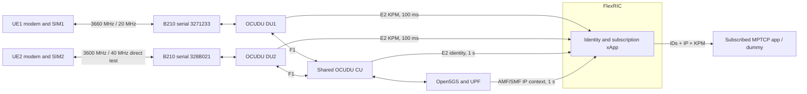

# Dual UE and Dual DU Radio Link Implementation Plan

Maintain two independent UE/modem/B210/OCUDU DU paths with a shared CU,
Open5GS and FlexRIC. DU1 uses 3660 MHz / 20 MHz. DU2 uses a 3600-MHz n78
interface / 40 MHz, designed for a 9250-MHz OTA path through Pi-Radio.
The current setup tests both paths directly in n78, without converters.
The [radio design](../docs/dual_link_radio_design.md) defines current profiles,
IP mapping and validation scope. This plan retains the original dual-n78
bring-up steps and dated acceptance records. Expanded 27-metric reporting
and app subscriptions have their own Plan 1/2 records.

| Field | Value |
| --- | --- |
| Plan | 3 |
| Task | `dual-ue-du-fr1-channels` |
| Status | Current dual-UE functional scope verified; cold start, full repeatability and bidirectional disturbance/survivor experiments are follow-up work, excluded from current acceptance and merge criteria; integrations retain their separate scope |
| Created at | 14 : 50: 09 Oct 11, 2026 EDT |
| Last updated at | 2026-10-29, DU2 40-MHz and Pi-Radio profile update |
| Time zone | `America/New_York` |
| Developer | Ruibin |
| Reviewer | To be assigned |
| Falcon inspection baseline | `3f12f627d80cdad14bc9a5ab267f8f65452a2da9` |
| OCUDU inspection baseline | `69801c7e9a3a72e4f29d98f14f626f156444c3ca` |
| FlexRIC inspection baseline | `736508123fe4b5dc3db83fb5baf5f0a8e9b04fe8`, with the existing local timestamp repair |
| Prerequisites | Baseline: authorization covering both selected channels and actual lab conditions, two independently tunable radios, two prepared UE/modem/SIM paths, and the existing five-metric E2 path. Integration: accepted dual-link baseline and the applicable Plan 1/2 stage |
| Execution order | Steps 1–9 cover the functional baseline; Step 10 tracks nonblocking supplemental experiments; Step 11 integrates accepted features while preserving Plan 2 Stage A → Plan 1 → Plan 2 Stage B |
| Initial deployment | Direct n78 lab baseline; shared CU/Open5GS/two DUs/FlexRIC on Spark and two RM500Q modems on one laptop. Current profiles are 20/40 MHz; the designed converted 9250-MHz OTA path is separate from this baseline |

Maintain one plan for this task. Complete checkboxes only after the stated exit
criteria pass and the reviewer can inspect the retained evidence. Plan numbers
identify tasks; they do not require executing Plan 1 before this baseline.

## 2026-10-29 DU2 Radio Profile Update

The maintained DU2 configuration is now `du2_b210_n78_40mhz.yml`: 40 MHz
bandwidth, 46.08 MS/s, TX 45 / RX 20 and offline-derived SSB ARFCN `638976`.
DU1 remains at 3660 MHz / 20 MHz, 23.04 MS/s and TX 70 / RX 35. DU2 keeps its
logical 3600-MHz n78 carrier. Its designed Pi-Radio branch converts this to a
9250-MHz OTA center. OCUDU and E2/RIC retain logical n78 cell information.
The nominal DU2 channel is 3580–3620 MHz at the USRP and, with conversion,
9230–9270 MHz OTA. The current test has no Pi-Radio; DU2 startup confirms
40 MHz / 46.08 MS/s / SSB `638976`, and the operator confirmed both direct-radio
UE connections on October 29.

Earlier pass records and lock readbacks in this plan used DU2's 20-MHz profile
and SSB `639648`. They remain historical evidence. Sustained traffic/KPM with
the new 40-MHz profile and converted 9250-MHz operation remain to be recorded.
Use the maintained
[Spark startup handbook](../docs/dual_ue_spark_quick_commands.md) and refresh
the [Laptop scripts](../docs/dual_ue_laptop_reconnect_quick_start.md#2-copy-or-update-scripts--laptop-terminal-watchers-stopped)
before running the new profile. The CBRS channel-selection discussion below
describes the original unconverted baseline rather than the converted OTA band.

## 2026-10-24 Acceptance Scope Revision

The operator moved **cold-start reproduction, full repeatability/comparative
experiments, and bidirectional link-loss/recovery with survivor traffic** to
[supplemental experiments](../docs/development/dual_ue_supplemental_experiments.md).
They are follow-up experimental requirements, **not acceptance criteria or
merge prerequisites for the current Dual UE development scope**. Their status
remains not completed; this scope change does not turn them into passed tests.

Current functional verification covers the intended modem/SIM/cell identities,
PDU/IP paths, policy routing and Wi-Fi fallback guards, private connectivity,
concurrent UL and correctly attributed KPM. Retained reports also cover
experimental CU/DU/Core association, MPTCP primary/backup video and UE2 automatic
recovery with changed IPs. Cold-start, repeated load/UDP comparisons and symmetric
disturbance trials are not needed to accept or merge those implemented functions.
Runtime identity checks and route guards remain part of normal operation.

This revision supersedes earlier dated references to these three experiments
as full-baseline gates, including the original Step 10 criteria. Historical
reports and their measurements keep their original scope. Plan 1/2 integrations,
protocol-explicit identity transport, actual FR3 conversion and RIC/AI steering
retain their separate requirements.

## Historical Checkpoints through 2026-10-13

The [single-link runbook](../docs/runbooks/full_reproduction_runbook.md) records successful
SA registration and application traffic with IMSI `001010000000001`, followed
by real five-metric KPM reception from DU1. This is historical evidence, not a
claim that those services or radios are running now.

The historical DU1 carrier is ARFCN `650000` / 3750 MHz, with SSB `649632`.
Preserve that configuration and its historical evidence. DU1 was migrated to
ARFCN `644000` / 3660 MHz on 2026-10-12, with newly observed SSB `643680`.
Single-UE uplink functionality and five-metric KPM reception passed. Underflow
remediation is deferred by the operator's 2026-10-13 instruction; the dual-link
UL acceptance requirements remain pending.

The [SIM preparation record](../docs/setup/sim_provisioning_and_dual_ue.md) identifies
two provisioned cards and two physical RM500Q modems. Both new subscribers have now registered on their intended cells. Two DU/radios
have started; both private IP paths and concurrent TCP UL functionality have
passed. At that checkpoint full repeatability was pending; the October 24
revision now tracks it as a supplemental experiment outside current acceptance.
DU2's radio/F1/cell and E2/KPM configurations are now prepared and deployed for
B210 `328B021`, discovered over USB 3 on 2026-10-13 after reconnection. Offline
configuration checks and DU parsing pass. After reconnecting both radios, UHD
loaded their firmware and two successive discovery runs found both `3271233`
and `328B021` simultaneously over USB 3. DU1 uses host controller `NVDA8000:00`
at `2-1.3`; DU2 uses `NVDA8000:02` at `6-1.1`. DU2 subsequently started at
3600 MHz / PCI 2 / SSB 639648 with F1/E2 completed; the RIC registered gNB 411 /
DU ID 2 and accepted KPM RAN function ID 2. UE2 registration and single-link UL subsequently passed as recorded below;
concurrent TCP UL and real two-DU KPM subsequently passed the checkpoint below,
while full acceptance remains pending. See the
[live startup evidence](../docs/evidence/2026-10-13_du2_startup/manifest.json).

The inspected DU1 file uses TX gain **70** and RX gain **35**. Historical records
include RX 40 and an earlier TX 80. Preserve the actual current file, record its
hash and gains as historical reference. Select and record gain/attenuation for
the stated indoor low-power setup; driver gain 70 is not a calibrated radiated
power value. Accept the new baseline only after revalidation.

The operator describes an indoor, short-range, low-power setup with partial
shielding. Record the actual shield arrangement, antenna geometry, attenuation,
and output/leakage measurements. Partial shielding is an experimental condition;
its isolation must be measured rather than assumed.

This task covers two FR1 cells, cell selection, subscriber/session preparation,
shared-CU operation, independent host data paths, coexistence tests, and per-DU/
per-UE KPM attribution. Pi-Radio/FR3 conversion, MPTCP steering, AI prediction,
and calibrated RF measurement work have separate acceptance requirements.

The operator subsequently requested separate UE/server subnets. The prepared
[migration](../docs/networking/dual_ue_subnets.md) retains UE1 `internet / 10.45.0.0/16`
and assigns UE2 `internet2 / 10.46.0.0/16`, with Spark endpoints `10.45.0.1`
and `10.46.0.1` on the shared `ogstun`. The operator applied the migration:
SMF/UPF were active, UE2 read back `internet2`, and both gateway addresses/routes
were present. Deployed files independently match the prepared bundle. See the
[core migration evidence](../docs/evidence/2026-10-13_dual_subnet_migration/manifest.json).
UE2 was disabled/detached before application; the subsequent identity/PDU/ping
checkpoint below now passed, followed by single-link UL/KPM smoke; cold-start
persistence remains pending. Core migration alone
does not complete the dual-link acceptance steps.

After the migration, UE2 modem 5 / IMEI `863305041980706` / IMSI
`001010000000102` registered on NR5G-SA / PLMN `00101`. Its AT readback confirmed
DU2 NCI `00066C001` (decimal `6733825`), PCI 2, TAC 7, SSB `639648` and n78,
with C5GREG `0,1`. The initial 902 lock failure was followed by a successful
write/readback `2,639648,30,78`; its exact earlier failure cause is not proven.
See [UE2 registration evidence](../docs/evidence/2026-10-13_du2_registration/manifest.json).
UE2 subsequently established bearer 3: connected yes, suspended no, APN
`internet2`, IPv4/static `10.46.0.2/30`, `wwan0`, gateway `10.46.0.1`, MTU 1400.
Old `internet` bearer 2 was disconnected. The laptop route lookup resolved
through `wwan0 / table 152`; ping received 5/5 with zero loss, RTT
min/avg/max/mdev 37.127/116.899/422.149/152.655 ms, and Wi-Fi remained the default
route. See [IPv4 path evidence](../docs/evidence/2026-10-13_du2_ipv4_path/manifest.json).
Full dual-link UL/KPM, path-loss/survivor checks, restart retention, and lock enforcement with
both DUs present remain pending; Steps 7/8's two-UE acceptance is not complete.

The operator's latest daily workflow starts the shared core/CU/RIC, then both
DU1 and DU2 and both iperf servers before any laptop UE setup. The laptop booklet
now contains a complete ordered UE1 sequence followed by a complete ordered UE2
sequence, each with its own identity/lock/PDU/complete role reset/table/ping/UL.
Keep both DUs and both verified PDU paths active for concurrent UL/KPM. Earlier
single-DU checkpoints remain historical evidence; full acceptance stays pending.

## 2026-10-13 UE2 / DU2 Single-Link UL Checkpoint

[Evidence](../docs/evidence/2026-10-13_du2_ul/manifest.json) retains the operator's
client/server output, actual Spark KPM log, parsed rows and current artifact hashes.

- [x] Verify UE2 IMSI `001010000000102` / IMEI `863305041980706`, SA on DU2 PCI 2 / NCI `6733825` / SSB `639648`, and successful lock write/readback.
- [x] Establish `internet2` IPv4 bearer 3 / `10.46.0.2/30` / `wwan0`; route over table 152 and private ping 5/5 with zero loss while preserving Wi-Fi defaults.
- [x] Complete 60-second TCP UL: receiver **15.5 Mbit/s over 60.34 s**, sender **15.8 Mbit/s / Retr 1**; client and server summaries agree.
- [x] Receive **12 complete five-metric KPM reports for UE F1AP 67** with numeric `DRB.UEThpUl` / `RRU.PrbTotUl`, successful subscription/delete responses and the stock success marker. Only DU2 was active; report age 574–896 us.
- [x] Start DU1 alongside DU2: actual serial `3271233` / USB 3 / PCI 1 / SSB `643680`, F1/E2 completed and RIC accepted DU ID 1; both DU processes observed. See [startup evidence](../docs/evidence/2026-10-13_dual_du_startup/manifest.json).
- [x] Recheck UE2 after DU1 joins: intended DU2 NCI/PCI/SSB and SA retained; private ping 5/5, zero loss. This is idle coexistence, not deliberate path-loss testing.
- [x] Verify UE1 IMEI `863305041978437` / active SIM IMSI `001010000000101`, AT port `/dev/ttyUSB6`, NR5G-SA on DU1 PCI 1 / NCI `6733824` / SSB `643680`; lock write/readback `1,643680,30,78` passed. IPv4 `internet` simple-connect succeeded and listed bearer 4; subsequent actual metadata/path checks are recorded below. See [UE1 registration and UE2 coexistence evidence](../docs/evidence/2026-10-13_du1_registration/manifest.json).
- [x] Read connected, non-suspended UE1 `internet` bearer 4 / `10.45.0.2/30` / `wwan1` / gateway `10.45.0.1` / MTU 1400. UE1 lookup resolved to table 151 / wwan1, private ping was 5/5 with zero loss, both role lookup/guard rules read back, and UE2 returned echo sequences 1–5 after UE1 configuration. Latest Wi-Fi default-route output was not included. See [dual IPv4 path evidence](../docs/evidence/2026-10-13_dual_ipv4_paths/manifest.json).
- [x] Complete new UE1 60-second TCP UL / UE2 test traffic idle: receiver **10.5 Mbit/s over 60.23 s**, sender **10.9 Mbit/s / Retr 0**, pipeline exit **0**, timestamped 19:15:26–19:16:27 EDT. Wi-Fi default route read back unchanged. Both DUs had been instructed to remain running; no UE1 KPM capture was supplied. Sender one-second transfer varied, including four zero-transfer intervals, so only UL functionality passes. See [UE1 UL evidence](../docs/evidence/2026-10-13_du1_ul/manifest.json).
- [x] Verify both DU nodes in the diagnostic xApp and two KPM subscription/delete responses with pipeline exit 0. The 19:29:23–19:30:14 EDT probe received **zero UE callback blocks**; this is subscription/lifecycle evidence, not two-link KPM data. See [subscription evidence](../docs/evidence/2026-10-13_dual_kpm_subscriptions/manifest.json).
- [ ] Complete streaming and deliberate path-survivor checks. Concurrent TCP UL subsequently passed in the checkpoint below. The earlier concurrent launcher's `wait`/`printf` lost variable expansions; its printed zero statuses and end timestamp remain invalid historical records.
- [x] Accumulate at least 30 real UL-active rows per DU with explicit DU/F1AP attribution, subscription/deletion responses and normal xApp exit. The latest completed capture has 63/61 complete five-metric UL-active rows, approximately 62/61 inside the clock-corrected laptop window; see the checkpoint below.
- [ ] Complete the full cross-layer modem/SIM/cell/F1AP/bearer ledger under its own scope. Repeated/comparative UDP, cold-start and bidirectional disturbance/survivor work is now tracked as supplemental experiments under the October 24 revision.
- [ ] Restore and verify connections after modem power cycle: the operator reported `AT+QNWLOCK="common/5g"` readback `0` (affected role unspecified). Treat locks as requiring boot restoration, reselect by IMEI/SIM, reapply each intended lock and require actual PCI/NCI/SSB/SA before PDU; refresh bearer/path and recheck cell before UL. Prior live mappings do not certify restored connections. See [power-cycle observation](../docs/evidence/2026-10-13_modem_lock_power_cycle/manifest.json).

This checkpoint is **DU2 Single-Link UL Functionality / KPM Smoke Passed**.
It does not complete the dual-link baseline or certify RF stability. Underflow
count/growth remediation remains deferred. The stock callback's common gNB ID
is contextual attribution with one DU, not proof of attribution with two DUs.

After the modem power/reconnection event, UE2 reported successful IPv4 connection
with bearer 5 / `10.46.0.3/29` / `wwan0` / MTU 1400. Existing rules 10161/10162
still used `10.46.0.2`; the new-path preflight correctly refused the collision.
That allocation and its failed rebinding are historical; subsequent dynamic
preflight and concurrent UL/KPM are recorded below. A repeatable full cold-start
workflow remains pending. See
[UE2 reattachment evidence](../docs/evidence/2026-10-13_ue2_reattach/manifest.json).

## 2026-10-13 Concurrent TCP UL and Two-DU KPM Checkpoint

[Experiment results report](../docs/reports/dual_ue_ul_experiment_report_2026-10-13.md)
records the setup, concurrent UL/KPM results, clock alignment, PHY observations
and the distinction between path separation and unverified fault/access isolation.

[Retained evidence](../docs/evidence/2026-10-13_dual_kpm_reports/manifest.json)
contains both full Spark KPM logs, 492 parsed rows, RIC lifecycle, selected CU
identity records, operator laptop metadata/receiver intervals, PHY aggregates
and the throughput/CRC plot. Laptop values come from the operator transcript;
the original complete laptop logs remain in `/tmp/falcon-dual-ul-iakb3ttb` there.

- [x] Complete concurrent TCP UL through two bound endpoints: UE1 `10.45.0.6`
  / modem 13 / bearer 9 / wwan0 / table 151 received **13.8 Mbit/s over 61.02 s**;
  UE2 `10.46.0.5` / modem 14 / bearer 10 / wwan1 / table 152 received
  **17.3 Mbit/s over 60.25 s**. Both clients exited 0, both senders reported
  Retr 0 and their included server receiver summaries agree. The sum of the
  reported mean receiver rates is approximately **31.1 Mbit/s**.
- [x] Receive real KPM from both DUs during UL: latest capture has **123 callbacks
  per DU**, stable tuples `(DU1, F1AP11)` / `(DU2, F1AP7)`, **63/61 complete
  UL-positive five-metric rows** and **61 matched simultaneous UL-active pairs**.
  Both subscription/delete pairs and normal xApp exit passed. An earlier
  completed capture also had 123 callbacks per DU and 57/56 complete UL-active rows.
- [x] Reconcile the observed host-clock discrepancy. Manually simultaneous
  readbacks indicate Spark is approximately **199.27 s ahead of Laptop**.
  Corrected laptop bounds are **22:17:25.532–22:18:27.454 EDT**, overlapping the
  latest capture and containing approximately **62/61 complete UL-active rows**.
  UE1's first 60 KPM/receiver interval profiles correlate at **r=0.963**. This
  is an approximate retrospective alignment, not precise clock synchronization.
- [x] Confirm CU-side node/cell attribution: CU internal UE19 maps DU1 / PCI1 /
  RNTI 0x460c / F1AP11; internal UE13 maps DU2 / PCI2 / RNTI 0x4608 / F1AP7.
  KPM does not carry modem/SIM identity; the complete cross-layer ledger remains pending.
- [ ] Complete precise host-clock synchronization and the remaining repeated,
  UDP, guard/survivor, streaming and cold-start work. The October 24 revision
  moves the repeated/comparative, cold-start and bidirectional disturbance
  experiments outside current acceptance and merging.

UL-active KPM sample means are **14.35 / 18.06 Mbit/s**; these are RLC-layer
measurements and have different windows/overheads from application receivers.
DU1's logged PUSCH failed-CRC attempts are **5572/36831 (15.13%)**, versus
DU2 **2636/36078 (7.31%)**, in the selected 63-second PHY window. DU1's greater
rate fluctuation is consistent with its higher decoding-failure fraction; this
does not establish the RF cause or measure TCP loss/first-transmission BLER.
Missing idle DL-delay values stay unreported; DL metrics are observations.
The two normal monitor runs did not reproduce the earlier disconnected-xApp
deletion-failure abort; that FlexRIC failure-path defect remains unfixed.
This checkpoint establishes concurrent UL functionality and real two-DU KPM,
while full Plan 3 acceptance and underflow remediation remain pending/deferred.

## 2026-10-12 Single-UE / DU1 Uplink Checkpoint

The operator requested **uplink-only** acceptance for this checkpoint. The
frequency migration succeeded within n78; the band itself did not change.
[Today's log](../dev_logs/2026-10-12_ruibin.md) and the
[retained evidence manifest](../docs/evidence/2026-10-12_du1_3660mhz/manifest.json)
record startup, UE correlation, traffic, telemetry, and configuration hashes.

- [x] Deploy the complete DU1 file at `/home/nyu/ocudu/configs/du1_b210_n78_3660mhz.yml`, preserving the historical base/E2 files; maintained/deployed hashes matched.
- [x] Verify B210 `3271233` over USB 3, carrier `644000` / 3660 MHz, SSB `643680`, PCI 1, 20 MHz / 30 kHz, and successful F1/E2 setup for DU ID 1.
- [x] Verify one DU, UE F1AP ID 5, IPv4 private ping (5/5, 0% loss), 30-second TCP uplink (receiver 17.0 Mbit/s; sender Retr 0), and 12 complete five-metric KPM rows with subscription/deletion and the success marker.
- [ ] Deferred: resolve RF underflows. A bounded snapshot contained 117 underflows by 11:39:44 EDT; underflow count/growth is an observation, not a gate for the current UL baseline.
- [ ] Retain the active IMSI/SIM/bearer and modem serving-cell readback. These were not captured in the acceptance excerpts.
- [ ] Historical remaining work included RF conditions, DU2, coexistence, identity and cold start. Cold-start, full comparative/repeated and bidirectional disturbance experiments are now supplemental under the October 24 scope revision.

This historical checkpoint is **Migration Successful / Uplink Functionality
Passed / Stability Pending**, not completion of Steps 1–10. The 2026-10-13 scope
revision below also makes the future dual-link baseline UL-only and defers
underflow remediation; it does not retroactively certify RF stability.

## 2026-10-13 Execution Priority and UL Acceptance Revision

The operator requested DU2 implementation first, deferral of the underflow issue,
and acceptance focused only on UL. Apply this revision to Steps 4 and 6–10 and
the application regression checks in Step 11:

- Prepare DU2 at 3600 MHz / ARFCN 640000, DU ID 2, PCI 2, sector ID 1,
  NCI 6733825, and F1/E2 local bind 127.0.10.3. Preserve DU1 at 3660 MHz.
- Accept UE1-only UL, UE2-only UL, and simultaneous UE1+UE2 UL. Retain SA/PDU,
  intended serving cell, distinct IP/WWAN paths, receiver throughput and identity
  correlation. The October 24 revision moves full repeatability and comparative
  UL/UDP experiments outside current acceptance and merging.
- Do not require application DL or mixed UL/DL traffic trials. Radio DL
  synchronization/control and TCP acknowledgements remain part of normal SA/UL
  operation; this revision does not alter TDD or disable the radio downlink.
- Keep the existing five-metric subscription for compatibility. Require numeric
  `DRB.UEThpUl` and `RRU.PrbTotUl` with correct DU/UE attribution in the active UL
  window; DL entries and noValue states are observations, not UL acceptance gates.
- Record underflow counts if available, but do not block DU2 work or this UL
  baseline solely on their count/growth. Failed UL transfers, lost SA/PDU paths,
  process failures, incorrect identities, and routing failures still fail their
  respective gates. Do not describe this result as RF-stability certification.

Preparation completed in this revision:

- [x] Create DU2 radio/cell/F1 configuration and separate E2/KPM overlay.
- [x] Implement offline dual-DU identity, address, channel, log, metrics, and
  missing-radio checks in `scripts/dual_fr1/check_config.py`.
- [x] Parse maintained/deployed DU2 configuration with the installed DU binary
  and derive SSB 639648 / offsetToPointA 0 / kSSB 20 / CORESET0 0 / SS0 0 using
  the existing OCUDU RAN library (n78, 51 PRBs, 30-kHz common/SSB SCS, maximum
  CORESET0 duration 2). The same helper reproduces DU1's observed SSB 643680.
- [x] Bind independently discovered B210 `328B021`, confirm USB 3, deploy the
  maintained configuration and pass offline identity/topology checks.
- [x] Rediscover both B210s simultaneously in two successive runs; confirm
  USB 3 / 5000 Mb/s and separate host-controller paths for both devices.
- [x] Verify actual DU2 startup: B210 328B021 over USB 3, carrier 640000 /
  3600 MHz, PCI 2, SSB 639648, F1/E2 completed, RIC gNB 411 / DU ID 2 and KPM ID 2.
- [ ] Verify UE2 identity, registration, IPv4 PDU and UL. Repeat discovery after
  reconnecting hardware before the later dual-DU test.

See the [DU2 bring-up procedure](../docs/runbooks/dual_fr1_runbook.md) and
[preparation evidence](../docs/evidence/2026-10-13_du2_preparation/manifest.json)
for current commands and explicit preparation-versus-live acceptance status.

## Carrier Selection and RF Contract

| Parameter | DU1 current profile | DU2 current profile |
| --- | --- | --- |
| Band | n78, explicitly configured | n78, explicitly configured |
| Carrier NR-ARFCN | `644000` | `640000` |
| Carrier center | 3660 MHz | 3600 MHz |
| Channel bandwidth | 20 MHz | 40 MHz |
| Common SCS | 30 kHz | 30 kHz |
| Nominal USRP-side channel interval | 3650–3670 MHz | 3580–3620 MHz |
| Intended OTA center / interval | 3660 MHz / 3650–3670 MHz | 9250 MHz / 9230–9270 MHz via Pi-Radio |
| SSB NR-ARFCN | `643680` confirmed in startup and 2026-10-13 UE1 lock/serving-cell readback | `638976` derived for 40 MHz and confirmed in October 29 startup |
| Radio | B210 serial `3271233`, USB 3 at `2-1.3` / controller `NVDA8000:00`; rediscover before use | B210 serial `328B021`, USB 3 at `6-1.1` / controller `NVDA8000:02`; rediscover before use |
| Sample rate | 23.04 MS/s | 46.08 MS/s |
| Configured TX / RX gain | 70 / 35 dB | 45 / 20 dB |

For the direct n78 test, both complete nominal channels lie within the US
CBRS frequency range, 3550–3700 MHz. The designed 9250-MHz converted OTA path
is a separate RF arrangement; the CBRS discussion here applies to direct n78.
Use this pair only when the applicable operating authorization covers both
full intervals and the actual location/power/emission conditions. A grant
restricted to 3550–3650 MHz does not cover the proposed DU1 channel; select a
different authorized pair if necessary. Indoor shielding and a configured
`band: 78` do not establish authorization or a Part 96 CBRS operating mode.
[NIST CBRS overview](https://www.nist.gov/programs-projects/citizens-broadband-radio-service).

For this range, the NR mapping is
`F_REF_MHz = 3000 + 0.015 × (N_REF − 600000)`. n78 covers 3300–3800 MHz;
its 30 kHz channel raster accepts these two ARFCNs. The proposed centers are
60 MHz apart, leaving 30 MHz between the current USRP-side nominal channel edges. This is a
non-overlapping channel proposal, conditional on the actual lab spectrum and
coexistence results. [ETSI / 3GPP TS 38.104, Sections 5.2 and 5.4](https://www.etsi.org/deliver/etsi_ts/138100_138199/138104/16.20.00_60/ts_138104v162000p.pdf).

Set `band: 78` explicitly: both candidates overlap other NR bands, and automatic
band inference is unsuitable. Validate against the pinned OCUDU band helper and
SSB/CORESET0 derivation: 51 PRBs for DU1's 20 MHz and 106 PRBs for DU2's
40 MHz, both at 30 kHz.
Rederive both SSB values. Historical SSB `649632` belongs to the 3750-MHz
configuration and must not be used for the new DU1 carrier. Never use a carrier
ARFCN as the modem's SSB lock or translate a historical carrier-to-SSB offset.

Use two separate B210s. A B210's receive channels share one RX LO, its transmit
channels share one TX LO, and its analog bandwidth is at most 56 MHz. Its two
antenna channels cannot provide these two independently separated carriers.
[UHD B2x0 hardware manual](https://files.ettus.com/manual/page_usrp_b200.html).
The RM500Q-GL hardware documentation lists n78 support; verify each actual SKU,
firmware, antenna path, and SA operation at the chosen carrier.
[Quectel RM500Q-GL Hardware Design, Table 32](https://quectel.com/content/uploads/2024/02/Quectel_RM500Q-GL_Hardware_Design_V1.1-2.pdf).

Nominal channel separation does not establish immunity to unwanted emissions,
receiver blocking, or TDD cross-link interference. Both radios initially retain
the validated clocking approach. Equal TDD patterns alone do not prove aligned
frames with independent internal clocks. Add filtering, attenuation, physical
isolation, or verified timing synchronization only when measurements justify
them; repeat the affected cases afterward.

## Topology and Identity Contract

This diagram shows the current direct n78 test. The designed converted
9250-MHz link-2 branch is shown in the [radio specification](../docs/dual_link_radio_design.md).



| Item | DU1 / UE1 | DU2 / UE2 |
| --- | --- | --- |
| Shared PLMN / gNB | `00101`, gNB ID `411`, 22 bits | Same shared gNB identity; confirm in F1/E2 |
| DU ID | `1` | `2` |
| Cell sector ID | `0` | `1` |
| PCI | `1` | `2` |
| NR cell identity | `6733824` | `6733825` |
| TAC / SST / DNN | `7` / `1` / `internet` | `7` / `1` / `internet2` |
| UE IPv4 pool / Spark endpoint | `10.45.0.0/16` / `10.45.0.1` | `10.46.0.0/16` / `10.46.0.1` |
| DU F1-C bind | `127.0.10.2` | `127.0.10.3` |
| DU F1-U bind | `127.0.10.2:2152` | `127.0.10.3:2152` |
| CU F1 endpoints | `127.0.10.1:38472` SCTP and `127.0.10.1:2152` UDP | Shared CU listeners |
| RIC E2 destination | `127.0.0.1:36421` | Same RIC destination |
| DU E2 local bind | `127.0.0.1` | `127.0.10.3`; local SCTP port is ephemeral |
| Intended new IMSI | `001010000000101` / OC011830 | `001010000000102` / OC011831 |
| Recorded modem IMEI | `863305041978437` | `863305041980706` |
| WWAN interface / UE IP / UE F1AP ID | Discover during each run | Discover during each run |

With a 22-bit gNB ID, `NCI = (gnb_id << 14) | sector_id`. A separate one-cell
DU also defaults its sector to zero; changing only DU ID and PCI would leave
duplicate NR CGI under the shared gNB. Set DU2's sector explicitly and confirm
both CGIs in the CU. Preserve CU N2/N3 and existing core addresses.

E2 `port: 36421` is the RIC destination, shared by both DUs. Port 36422 is the
xApp E42 interface. F1-C/E2 clients can use separate ephemeral local ports;
F1-U's fixed UDP port needs the distinct local IPs above. Confirm actual sockets
and associations rather than accepting a count of matching port strings.

The telemetry key includes full PLMN with MNC width, node type, gNB ID and bit
length, DU ID, UE identifier type, and gNB-CU UE F1AP ID. An IMSI, WWAN address,
or modem IMEI is not automatically carried in the existing DU KPM row. Maintain
a run-scoped correlation table from modem/cell, CU/DU context, and session
evidence. UE IDs may change or be reused after reattachment.

Sharing a PLMN or SST does not bind a subscriber to its intended DU. The stock
Style 4 request includes SST 1, but the current provider does not enforce that
condition as slice isolation. Verify each modem's actual serving cell.

## Planned Deliverables

The following files are execution deliverables; this plan does not imply that
they already exist:

| Location | Purpose |
| --- | --- |
| `configs/ocudu/dual_fr1/du1_b210_n78_3660mhz.yml` | Deployed and verified for single-link UL functionality; underflow remediation deferred |
| `configs/ocudu/dual_fr1/du2_b210_n78_40mhz.yml` | Current 40-MHz DU2 radio/cell/F1 configuration for B210 328B021; startup and operator-confirmed direct UE connection on October 29; sustained 40-MHz traffic/KPM and converted operation pending; earlier experiment records used 20 MHz |
| `configs/ocudu/dual_fr1/du2_flexric.yml` | Current DU2 E2/KPM overlay and 100-ms scheduler/RLC metrics |
| `configs/flexric/xapp_du_kpm_base5.conf` | One DU-only five-metric subscription, shared with Plan 2 when available |
| `patches/flexric/dual-fr1-kpm-diagnostics.patch` | Minimal monitor attribution, missing-value, and lifecycle changes |
| `scripts/dual_fr1/check_config.py` | Implemented offline identities, F1/E2, nominal channels, missing serial, metrics and writable log checks; operating authorization and SSB derivation remain separate |
| `scripts/dual_fr1/configure_ue_routes.sh` | Guarded per-UE policy routes and precise rollback |
| `scripts/dual_fr1/verify_kpm.py` | Per-link report/lifecycle/evidence checks |
| `docs/runbooks/dual_fr1_runbook.md` | DU2 preparation/bring-up and UL-only acceptance procedure; startup/F1/E2, UE2 solo UL and subsequent concurrent TCP UL / two-DU KPM checkpoints observed; full acceptance pending |
| `docs/dual_ue_laptop_quick_commands.md` | Separate ordered UE1/UE2 sequences, source/server-destination rules and complete per-role IPv4 reset using current state only. October 13 launcher record: UE1 modem/SIM 13 / bearer 9 / 10.45.0.6/30 / wwan0 / table 151 and UE2 modem/SIM 14 / bearer 10 / 10.46.0.5/30 / wwan1 / table 152. Both exits 0, receiver 13.8/17.3 Mbit/s; that KPM capture has 123 callbacks per DU and 63/61 complete UL-active rows. Approximate +199.27-second historical clock correction gives 62/61 rows inside the laptop run. Full repeatability/comparative UDP, cold-start and bidirectional disturbance experiments are now supplemental, outside current acceptance and merging |
| `scripts/dual_fr1/reset_ue_network.py` / `tests/dual_ue_reset_test.py` | Implemented per-role IPv4 reset from current IMEI/ports and kernel state, with optional PDU disconnect. Added `--shutdown`: disconnect, clear the role's host path, delete all selected-modem bearer objects and disable it; rereads identity and verifies zero bearers / disabled state. Ordinary reset and disconnect-only behavior are preserved. Thirty-two offline stateful tests passed, covering both roles, other-UE preservation, stale bearers, idempotence, dry run, failed deletion/disable, reconnection and changed identity. No live laptop shutdown executed by the agent |
| `scripts/dual_fr1/run_dual_ul.py` / `tests/dual_ue_ul_test.py` | Implemented concurrent launcher that discovers both current IMEI/SIM/APN/bearer addresses and interfaces instead of historical tuples, checks installed prefixes and source/unbound routes, and rereads identities before starting either client; supports read-only preflight and records real per-process status/time/metadata, with partial-start/interrupt cleanup. Twenty-five offline tests passed, including indexed/scalar access technologies, LTE/missing-report rejection and different/unreported gateways. Operator's measured concurrent run completed with both exits 0 and receiver 13.8/17.3 Mbit/s, overlapping the latest dual-DU KPM after approximate clock correction. Full acceptance pending |
| `docs/dual_ue_spark_quick_commands.md` | Spark commands for core/CU/RIC/two-DU startup, both server endpoints, DU-tagged KPM capture and shutdown |
| `scripts/dual_fr1/xapp_oran_moni_dual.c` / `scripts/dual_fr1/build_kpm_monitor.sh` | Built isolated diagnostic using pinned FlexRIC API/library; labels each callback with DU ID, supports finite capture and dense subscription cleanup; latest two completed captures each have 123 real UE callbacks per DU, both subscription/delete pairs and normal exit. Latest capture has 61 simultaneous complete UL-active row pairs. Earlier disconnected-xApp deletion-failure abort path remains unfixed |
| `docs/evidence/2026-10-13_dual_kpm_reports/` | Retained two full Spark captures, 492 parsed rows, RIC lifecycle, selected CU identity ledger, operator laptop summary/receiver intervals, approximate clock alignment, PUSCH aggregates, reproducible analysis and throughput/CRC plot |
| `docs/networking/dual_ue_subnets.md` / `scripts/dual_fr1/prepare_dual_subnets.py` / `scripts/dual_fr1/apply_dual_subnets.sh` / `scripts/dual_fr1/ue2_dnn.js` | Dual-subnet migration, backups, saved apply command, targeted UE2 DNN rename and rollback; six mocked apply tests passed; core, registered IPv4/private-ping paths, solo UL and subsequent concurrent TCP UL / dual-DU KPM checkpoints observed; full acceptance pending |

Keep DU1's maintained configuration in Falcon and deploy it to
`$OCUDU_SOURCE/configs/du1_b210_n78_3660mhz.yml`. DU1 parse/start commands use
that deployed copy; repeat the copy after configuration changes and retain its
hash in acceptance evidence. The current copy is deployed and passed the uplink functional checkpoint;
Underflow remediation is deferred; full dual-link UL acceptance remains pending.

Use per-run local log overlays under the evidence directory for CU and DU2;
DU1 uses its standalone configuration and `log --filename` for the run's log.
Do not overwrite the working historical DU1 base/E2 files. Keep authentication material
and raw security-bearing logs outside Git; publish only reviewed excerpts.

## Step 1 Capture the Historical Single Link

- [ ] Read the [handoff](../docs/development/development_handoff.md), single-link runbook,
  [Spark commands](../docs/single_ue/spark_quick_commands.md), and SIM preparation record.
- [ ] Record source revisions/local diffs, binary/plugin hashes, installed RIC
  and xApp configs, current DU1/CU files, gains, and relevant host settings.
- [ ] Preserve FlexRIC's uncommitted timestamp repair and `kpm_timestamp.h`.
  Coordinate source branches with Plan 1/2 owners; retain unrelated local work.
- [ ] Archive the original 3750-MHz configuration and existing traffic/KPM
  evidence. Repeat that historical RF run only if its operating authorization
  covers it; otherwise retain the existing evidence and proceed to the authorized
  CBRS migration. The new single-link acceptance is mandatory in Step 4.
- [ ] Resolve the current RX-35 versus historical RX-40 discrepancy through
  recorded file hashes; preserve the original file. Freeze the newly accepted
  carrier/gain/attenuation settings after Step 4's single-link repeat.

Create persistent evidence in Bash on Spark:

```bash
set -euo pipefail
FALCON_REPO=/home/nyu/Desktop/Falcon_repo/Falcon
OCUDU_SOURCE=/home/nyu/ocudu
FLEXRIC_SOURCE=/home/nyu/flexric
FLEXRIC_DUAL_BUILD="$FLEXRIC_SOURCE/build-dual-fr1"
DUAL_FR1_EVIDENCE_ROOT=/home/nyu/verification/dual-fr1
mkdir -p "$DUAL_FR1_EVIDENCE_ROOT"
DUAL_FR1_EVIDENCE=$(mktemp -d "$DUAL_FR1_EVIDENCE_ROOT/run-XXXXXXXX")
mkdir -p "$DUAL_FR1_EVIDENCE"/{baseline,inventory,configs,radio,core,ue,routing,kpm,traffic,coexistence,restart,integration}
git -C "$FALCON_REPO" rev-parse HEAD > "$DUAL_FR1_EVIDENCE/baseline/falcon-head.txt"
git -C "$OCUDU_SOURCE" rev-parse HEAD > "$DUAL_FR1_EVIDENCE/baseline/ocudu-head.txt"
git -C "$FLEXRIC_SOURCE" rev-parse HEAD > "$DUAL_FR1_EVIDENCE/baseline/flexric-head.txt"
git -C "$FLEXRIC_SOURCE" diff --binary > "$DUAL_FR1_EVIDENCE/baseline/flexric-local.patch"
sha256sum "$OCUDU_SOURCE/configs/cu.yml" \
  "$OCUDU_SOURCE/configs/du1_b210_n78_20mhz.yml" \
  "$OCUDU_SOURCE/configs/du1_flexric.yml" \
  /usr/local/lib/flexric/libkpm_sm.so \
  /usr/local/bin/flexric/xApp/c/xapp_oran_moni \
  > "$DUAL_FR1_EVIDENCE/baseline/sha256.txt"
```

Retain command, host, New York save time, exit code, and sanitized results for
each check. Each acceptance run uses fresh evidence; raw logs remain protected
locally. Never infer current runtime status from historical documentation.

**Exit criteria:** a hashed historical baseline is retained and distinguished
from the proposed CBRS deployment. New-carrier acceptance remains pending.

## Step 2 Inventory Hardware and Select Both CBRS Carriers

- [ ] Stop any DU that owns a radio before using UHD discovery/probe tools.
  Inventory two actual B210 serials, USB paths, antennas, and power connections.
- [ ] Confirm each radio operates over USB 3 and assess shared controller/load
  limits. Rediscover serial `3271233`; do not invent the second serial or use
  two ports of the same B210 as independent carriers.
- [ ] Verify both modem IMEIs, installed SIMs, firmware, SA n78 capability, and
  distinct QMI/AT ports using the existing UE selection workflow.
- [ ] Survey the usable lab spectrum with an available analyzer or receive-only
  scan while the relevant radio is free. Record surrounding signals and actual
  test conditions. Treat the runbook's 3750-MHz/gain settings as historical
  references; the following checks select this deployment's authorized settings.
- [ ] Confirm the existing authorization covers DU1 3650–3670 MHz and DU2
  3580–3620 MHz for the current direct test, the actual lab location,
  operating power/emissions, and validity
  period. Record the applicable authorization/reference locally; do not infer
  coverage from indoor operation or partial shielding.
- [ ] Evaluate DU1 ARFCN 644000 / 3660 MHz and DU2 ARFCN 640000 / 3600 MHz,
  at 20 and 40 MHz respectively. If either is unsuitable or outside the
  actual authorization,
  select another authorized n78 pair with both full channels inside CBRS,
  recompute intervals/separation, and review the new configs before proceeding.
- [ ] Establish the indoor low-power RF path using measured output, reviewed
  attenuation/gain, and recorded shielding. Check leakage outside the shield
  and at the test-area boundary; adjust isolation/power if the intended operating
  conditions are not met. Use the same measured layout for solo/concurrent tests.
- [ ] Record TDD pattern, clock source, gain, antenna placement, and attenuation.
  Document initial independent clocking without claiming synchronization.

**Exit criteria:** two usable radio/UE paths, the recorded indoor setup, and two
authorized CBRS-range candidate channels are identified. Acceptance remains
pending until DU1 revalidation and live coexistence pass.

## Step 3 Prepare Shared CU and Two Distinct DU Configurations

- [ ] Preserve the historical DU1 files and prepare the standalone
  `du1_b210_n78_3660mhz.yml` with `cell_cfg.dl_arfcn: 644000`, explicit
  n78/20 MHz/30 kHz, radio/F1/E2/KPM settings, and validated low-power RF
  settings. The file is deployed with actual TX 70 / RX 35 values. The 2026-10-12
  uplink functional checkpoint passed; underflow remediation is deferred and
  calibrated-condition validation remains pending. Keep its radio and cell/DU identity unchanged.
  Create DU2 from a reviewed copy, changing radio serial, carrier, DU ID,
  sector ID, PCI, F1 binds, and logs.
- [ ] Keep the shared gNB ID/width consistent across CU and DUs. Verify the CU
  accepts two DUs and two distinct NR CGIs. Its inspected default capacity is
  six DUs; no capacity change is needed unless the actual deployed config differs.
- [ ] Use DU2 F1 bind `127.0.10.3` and E2 destination `127.0.0.1:36421` with its
  own local bind. Keep DU1 network/identity settings, CU listeners, and N2/N3/
  core addresses unchanged while migrating DU1's RF carrier.
- [ ] Enable scheduler/RLC metrics and a 100-ms report period on both DUs.
  The original five-metric inventory omitted CU E2. The current identity and
  subscription workflow also needs the CU identity overlay at 1000 ms;
  deploy it using the current Spark handbook.
- [ ] Generate CU/DU2 log overlays and set DU1's log using `log --filename`,
  with absolute paths under this run's evidence directory; use distinct pcap
  paths if capture is enabled.
- [ ] Measure CPU and USB resources for two DUs. If explicit CPU groups are
  needed, choose them from actual physical-core topology and reserve capacity
  for CU/RIC/core. Keep sibling threads together and recheck worker defaults
  affected by `sched_getaffinity`. Record any affinity as a separate overlay or
  launch setting; preserve the established kernel and boot configuration.

DU1 carrier fields in the complete standalone configuration; review its
gain/attenuation settings separately and select the run's log at launch:

```yaml
cell_cfg:
  dl_arfcn: 644000
  band: 78
  channel_bandwidth_MHz: 20
  common_scs: 30
```

DU2 review template for the current 40-MHz profile; replace the radio placeholder
with the discovered physical serial before any executable test:

```yaml
gnb_id: 411
gnb_id_bit_length: 22
gnb_du_id: 2
f1ap:
  addrs: 127.0.10.1
  bind_addrs: 127.0.10.3
f1u:
  socket:
    - bind_addr: 127.0.10.3
ru_sdr:
  device_driver: uhd
  device_args: type=b200,serial=REPLACE_WITH_ACTUAL_DU2_SERIAL,num_recv_frames=64,num_send_frames=64
  srate: 46.08
  clock: internal
  clock_ppm: 0.0
  freq_offset: 0
  tx_gain: 45
  rx_gain: 20
cell_cfg:
  dl_arfcn: 640000
  band: 78
  channel_bandwidth_MHz: 40
  common_scs: 30
  plmn: "00101"
  tac: 7
  pci: 2
  sector_id: 1
```

The template gains are current configuration values, not calibrated transmit
powers or proof of live RF performance. Step 2 must review the actual
gain/attenuation. The runtime log overlay is mandatory.

```yaml
e2:
  enable_du_e2: true
  addrs: [127.0.0.1]
  bind_addrs: [127.0.10.3]
  port: 36421
  e2sm_kpm_enabled: true
metrics:
  layers:
    enable_sched: true
    enable_rlc: true
  periodicity:
    du_report_period: 100
```

**Exit criteria:** reviewed configs have unique radios, DU/cell identities,
socket binds, and logs; unresolved placeholders prevent startup.

## Step 4 Validate Configuration and Prepare Both Subscribers

- [ ] Implement offline checks for duplicate serial/DU ID/CGI/PCI, address
  conflicts, gNB consistency, nominal channel overlap, unresolved placeholders,
  both complete channels inside CBRS and the recorded authorization, metric
  enablement, and writable distinct log paths.
- [ ] Derive both DUs' valid SSB/Point A/CORESET0 using the exact checkout's band
  helper/configuration path. Record the result and cross-check live startup later.
- [ ] Parse each DU configuration with the available `--dryrun` mode. It returns
  before full semantic validation and radio startup; a zero exit proves parsing
  and auto-derivation only. Retain separate band/helper checks and live validation.
- [ ] Prepare or verify both Open5GS subscribers using their corresponding
  protected credential files and existing administration workflow. Preserve
  subscriber `001010000000001`; confirm SST 1, DNN `internet`, IPv4 session type 1,
  and the installed SQN representation. Retain only nonsecret projections.
- [ ] Confirm the `00101` identity across NRF, AMF, CU, DUs, and SIMs.
- [ ] With DU2 stopped, start shared CU, the existing RIC, and DU1 using its
  new standalone CBRS configuration. Derive/confirm the new DU1 SSB, update UE1's cell lock, and
  revalidate the original subscriber's SA registration, IPv4 PDU session, private
  ping and uplink traffic, actual KPM reception with numeric UL metrics, and normal
  monitor subscription/deletion/exit. Use the installed monitor for this first
  single-DU check; Step 5 adds dual-DU diagnostics afterward.
- [ ] Record the new DU1 carrier/SSB, gains, attenuation, measured output/leakage,
  config hashes, and results as the accepted CBRS single-link UL baseline before
  enabling DU2 or replacing the original subscriber for dual-UE testing.

Example parse-only checks after the planned configs and CU/DU2 log overlays exist:

```bash
cp "$FALCON_REPO/configs/ocudu/dual_fr1/du1_b210_n78_3660mhz.yml" \
  "$OCUDU_SOURCE/configs/du1_b210_n78_3660mhz.yml"
"$OCUDU_SOURCE/build/apps/cu/ocu" \
  -c "$OCUDU_SOURCE/configs/cu.yml" \
  -c "$DUAL_FR1_EVIDENCE/configs/cu_logs.yml" --dryrun
"$OCUDU_SOURCE/build/apps/du_split_8/odu" \
  -c "$OCUDU_SOURCE/configs/du1_b210_n78_3660mhz.yml" \
  --dryrun log --filename "$DUAL_FR1_EVIDENCE/radio/du1.log"
"$OCUDU_SOURCE/build/apps/du_split_8/odu" \
  -c "$FALCON_REPO/configs/ocudu/dual_fr1/du2_b210_n78_40mhz.yml" \
  -c "$FALCON_REPO/configs/ocudu/dual_fr1/du2_flexric.yml" \
  -c "$DUAL_FR1_EVIDENCE/configs/du2_logs.yml" --dryrun
```

**Exit criteria:** parsing/offline checks pass, DU1's new CBRS single-link
UL traffic/KPM baseline is accepted, and both new subscribers are prepared with
their own credentials. Their live registration is still required in Step 7.

## Step 5 Prepare the Existing Five Metric KPM Monitor

- [ ] First run the installed timestamp-repaired `xapp_oran_moni` on the accepted
  CBRS single-link setup to preserve the accepted monitor lifecycle/reception result.
- [ ] Create or reuse the reviewed DU-only `xapp_du_kpm_base5.conf`: one Style 4
  KPM subscription at 1000 ms, `ngran_gNB_DU`, installed timestamp-repaired SM
  plugin, database OFF, and exactly the following actions:

| Measurement | Representation | Unit |
| --- | --- | --- |
| `DRB.RlcSduDelayDl` | REAL | 0.1 ms |
| `DRB.UEThpDl` | REAL | kbit/s |
| `DRB.UEThpUl` | REAL | kbit/s |
| `RRU.PrbTotDl` | INTEGER | % |
| `RRU.PrbTotUl` | INTEGER | % |

- [ ] Add a small separate diagnostic patch to the existing monitor. Print the
  full node identity, DU ID, UE type/F1AP ID, row index, collection timestamp,
  and named values together for each row. Retain `report_age_us`; represent
  noValue explicitly and validate row bounds before indexing measurement lists.
  Preserve REAL precision in the retained evidence rather than relying on
  two-decimal console formatting.
- [ ] Give this diagnostic patch a revision/base/helper-hash manifest and emit
  a machine-readable row marker such as `FALCON_DUAL_FR1_DIAG_V1`. Retain patch,
  source-diff, monitor-binary, plugin, and config hashes; marker presence alone
  cannot establish correct merged behavior.
- [ ] Store and delete only successful subscription handles. The current
  monitor stores by node-array index but deletes a dense prefix; fix this
  locally so skipped nodes cannot cause incorrect cleanup. Do not add broker
  or RF getters to this diagnostic patch.
- [ ] Keep the SDK's controller calls serialized. Discovery is performed at
  startup; require both DU Setup records before starting the xApp.
- [ ] For at least 30 rows per link, use repeated normally completed stock-length
  runs, or implement a reviewed bounded duration option in the monitor. Parse
  any new monitor option before SDK argument parsing. Do not treat a single
  stock approximately 10-second run as a long-duration measurement.
- [ ] For the baseline, orderly stop means waiting for the finite monitor run
  to finish and delete its subscriptions. The SDK's current SIGINT handler
  exits abruptly; Ctrl+C cannot prove cleanup. If early-stop support is added,
  install reviewed flag-only SIGINT/SIGTERM handlers after SDK initialization
  and perform subscription deletion in the serialized controller thread.
- [ ] Build the monitor in a separate `build-dual-fr1` directory using the
  existing GCC/E2AP-v3/KPM-v3 settings and preserved timestamp source repair.
  Keep the installed monitor available for rollback.
- [ ] Verify two DU identities sharing gNB 411, repeated/reused UE numbers,
  noValue/empty rows, and successful-handle cleanup with bounded fixtures before
  accepting live attribution. The fixture cannot substitute for two live links.

Build after applying the reviewed diagnostic delta while retaining local
timestamp changes, using the [recorded FlexRIC build settings](../docs/setup/software_installation_and_drivers.md):

```bash
cmake -S "$FLEXRIC_SOURCE" -B "$FLEXRIC_DUAL_BUILD" \
  -DCMAKE_C_COMPILER=gcc -DCMAKE_BUILD_TYPE=Debug \
  -DE2AP_VERSION=E2AP_V3 -DKPM_VERSION=KPM_V3_00 \
  -DXAPP_DB=NONE_XAPP -DXAPP_MULTILANGUAGE=OFF
cmake --build "$FLEXRIC_DUAL_BUILD" --target xapp_oran_moni -j 8
```

**Exit criteria:** the existing monitor can produce unambiguous five-metric
per-DU/per-UE evidence and exit normally, independently of Plan 1/2 completion.
Under the current UL scope, DL noValue/nonnumeric observations do not block
acceptance; the two UL measurements must be numeric and correctly attributed.

## Step 6 Bring Up Two DUs and the Existing RIC

- [ ] Use the runbook's existing core/MongoDB/host-performance procedure.
  Start shared CU, then the existing FlexRIC RIC, then DU1 and DU2 in separate
  foreground terminals with their reviewed configurations and per-run log paths.
- [ ] Confirm both DUs complete F1 Setup; the CU records different DU IDs and
  CGIs. Confirm actual carrier/SSB/PCI/radio serial in each startup log.
- [ ] Confirm two distinct E2 Setup records in the same RIC and KPM RAN function
  ID 2 accepted for each. Do not use gNB ID 411 alone as proof of two nodes.
- [ ] Check F1-C/E2 associations by local/remote tuple and process, F1-U UDP binds,
  RF error counters, and host CPU/USB load. Diagnose address collisions separately
  from RF issues. Keep CU E2 disabled for this initial inventory.
- [ ] After both DUs are registered, launch the reviewed existing monitor with
  the DU-only five-action config. Require exactly the two intended DU nodes and
  two successful subscriptions; no UE reports yet is not a traffic failure.

DU2 launch recipe for its own Spark terminal:

```bash
sudo "$OCUDU_SOURCE/build/apps/du_split_8/odu" \
  -c "$FALCON_REPO/configs/ocudu/dual_fr1/du2_b210_n78_40mhz.yml" \
  -c "$FALCON_REPO/configs/ocudu/dual_fr1/du2_flexric.yml" \
  -c "$DUAL_FR1_EVIDENCE/configs/du2_logs.yml"
```

DU1 launch recipe for a separate Spark terminal, using its complete configuration:

```bash
sudo "$OCUDU_SOURCE/build/apps/du_split_8/odu" \
  -c "$OCUDU_SOURCE/configs/du1_b210_n78_3660mhz.yml" \
  log --filename "$DUAL_FR1_EVIDENCE/radio/du1.log"
```

Start the CU using Step 4's CU configuration/log layers and the runbook's
privileged foreground launch. Use the installed RIC and existing `ric.conf`;
its E2/E42 ports remain 36421/36422. Export this run's paths in every relevant
terminal; values are not automatically shared across shells. Use this same
DU1 standalone configuration for Step 4's single-link acceptance and later integration.

**Exit criteria:** one CU and one RIC accept both uniquely identified DUs, and
the existing five-metric xApp subscribes successfully to each.

## Step 7 Register Each UE on Its Intended Cell

- [ ] Use one laptop terminal per UE. Select by recorded IMEI and current SIM
  identity, then rediscover modem/SIM/QMI/AT ports after reconnects.
- [ ] Validate UE1 alone on DU1 with SIM1/new subscriber, then UE2 alone on DU2
  with SIM2/new subscriber. Preserve each successful standalone result.
- [ ] Apply the firmware-verified NR SA/n78 selection and cell-lock workflow
  from the separate [UE1 lock sequence](../docs/dual_ue_laptop_quick_commands.md#ue1-cell-lock)
  and [UE2 lock sequence](../docs/dual_ue_laptop_quick_commands.md#ue2-cell-lock). Use DU1 PCI 1 /
  its newly derived and observed CBRS SSB, and DU2 PCI 2 / its own derived and
  observed SSB. The booklet's historical 649632 lock applies only to 3750 MHz;
  replace it for this deployment. Require each
  configuration write to return OK; read back lock and serving-cell details.
- [ ] Require private PLMN `00101`, intended cell/PCI/SSB, SA registration,
  attached packet service, and connected non-suspended IPv4 bearer: UE1
  `internet / 10.45.0.0/16`, UE2 `internet2 / 10.46.0.0/16` after the
  [subnet migration](../docs/networking/dual_ue_subnets.md).
  A ready SIM, high signal indicator, or idle `NOCONN` text alone is insufficient.
- [ ] Attach both concurrently. Record actual bearer IDs, WWAN interfaces,
  addresses/prefix/MTU/gateway, serving cells, and CU/DU UE contexts.
- [ ] Create a correlation ledger tying IMSI/modem → serving cell/DU → CU UE
  F1AP ID → bearer/WWAN/IP. Recheck it after every reattachment or restart.

**Exit criteria:** two different subscribers have simultaneous PDU sessions
through their intended cells; the two link identities are independently evidenced.

## Step 8 Configure and Verify Two Independent Laptop IP Paths

The single-link helper installs one main-table route to `10.45.0.1`. Running it
twice would replace or reject the other interface's route. Implement a guarded
source-policy route setup for this dual-link test instead.

- [ ] Confirm WWAN ownership between ModemManager and NetworkManager, distinct
  actual UE IPs, and dedicated interfaces. Preserve management Wi-Fi/default
  routes; use current bearer IP/prefix/MTU rather than historical values.
- [ ] Use `noprefixroute` for manually assigned WWAN addresses and reserve two
  currently unused routing tables and rule priorities. Proposed table IDs
  151/152 use lookup priorities 10151/10161 and guard priorities 10152/10162;
  server-destination lookups use 10153/10163 and destination guards use
  10154/10164. All require conflict checks before use.
- [ ] For each actual UE address, add a rule scoped to that source and the
  role's private Spark destination. Its table routes UE1 `10.45.0.1/32` or UE2
  `10.46.0.1/32` directly over that
  WWAN with the same source address, matching the existing verified QMI path.
  Revalidate this recipe if the bearer/network model differs.
- [ ] Add destination-only lookups for UE1 `10.45.0.1/32` → table 151 and UE2
  `10.46.0.1/32` → table 152 so unbound applications also select the intended
  WWAN and the route's current preferred UE source address. Install matching
  destination-only `unreachable` guards after these lookups, before main-table
  routing, to prevent Wi-Fi fallback when a server route disappears. The laptop
  booklet includes setup/cleanup commands; live unbound verification is pending.
- [ ] Add a narrowly scoped `unreachable` rule immediately after each source/
  destination lookup rule. If its WWAN route disappears, traffic must fail
  locally before reaching the main-table Wi-Fi or other-modem route. Install
  the guard before exposing the new source path; retain it until traffic is
  stopped and that run's source address is removed during cleanup.
- [ ] Track every address, MTU change, route, rule, and any per-interface sysctl
  in a run-owned ledger. Reject conflicts and clean partial failures precisely;
  never flush an entire shared routing table or replace another role's entries.
  Complete role reset is now available in `reset_ue_network.py --ue 1/2`:
  clear its dedicated table/reserved priorities and current WWAN IPv4 state,
  using current IMEI/address/rule inventory without historical session values.
  Reset uses the defined DOWN / MTU-1500 baseline; retained ledgers remain
  evidence rather than cleanup prerequisites. Live reset/rebuild is pending.
- [ ] Check actual packet paths and reverse-path filtering. If strict filtering
  rejects the intended multihomed return path, record and review a change on
  only the affected WWAN interface, then restore it during cleanup. Linux uses
  the maximum of the all/interface `rp_filter` settings.
  [Linux kernel IP sysctl documentation](https://www.kernel.org/doc/html/latest/networking/ip-sysctl.html).
- [ ] Verify `ip route get` from each UE IP, interface counters/captures, and
  successful private ping. Source/interface-bound traffic must reach its own
  path, with no implicit fallback over Wi-Fi or the other modem.
- Supplemental experiment: disconnect each bearer/remove its run-owned path in
  turn and retain affected-path and survivor-traffic observations. Track this in
  [bidirectional disturbance experiments](../docs/development/dual_ue_supplemental_experiments.md#3-bidirectional-link-loss-and-recovery);
  completion is not required for current acceptance or merging. Actual route
  ownership and fallback guards remain required operating behavior.

Verification commands in each UE's own terminal after guarded route setup:

```bash
ip -4 route get "${SERVER_IP:?Select the role endpoint}" from "${UE_IP:?Read the current bearer first}"
ip -4 route get "$SERVER_IP"
ip -4 rule show
ip -4 route show default
ping -q -I "$UE_IP" -c 20 "$SERVER_IP"
ping -q -c 20 "$SERVER_IP"
```

**Exit criteria:** both source-bound and unbound requests resolve over the
correct WWAN/current UE source, both paths pass private ping, destination guards
prevent fallback on path loss, and management routing remains usable.

## Step 9 Validate Dual Link Traffic and Existing KPM

- [ ] Start two separate Spark iperf3 server processes bound to `10.45.0.1:5201`
  and `10.46.0.1:5202` after migration. Two concurrent clients must not contend for one
  single-test server process.
- [ ] Measure UE1 UL alone and UE2 UL alone, then both UL concurrently.
  Bind clients to actual source IPs and
  verify the policy route/interface used for each transfer.
- [ ] Retain 60-second receiver summaries, direction, bitrate, retransmissions,
  UL UDP loss/jitter, IP/WWAN identity, and concurrent DU/host observations. Use
  distinct filenames per case, repetition, direction, and link.
- [ ] Overlap traffic with repeated normally completed monitor runs. Accumulate
  at least 30 real rows for each intended link while both links are attached;
  each active-window acceptance requires correct attribution and numeric
  `DRB.UEThpUl` and `RRU.PrbTotUl` observations for each link. Retain the other
  three entries/noValue states as observations without DL pass/fail requirements.
- [ ] Verify full DU/UE identity and timestamps, per-link report counts, both
  subscription/deletion results, and normal xApp exit. Correlate throughput
  changes with that link's traffic; KPM-layer bitrate need not equal iperf rate.
- [ ] Do not accept an all-null UL run or report physical multi-link validation
  from fixtures. If UL PRB values fail, retain the failing tuple and investigate
  the existing getter limitation rather than substituting zero.

Spark servers, each in its own foreground terminal:

```bash
iperf3 -s -B 10.45.0.1 -p 5201
```

```bash
iperf3 -s -B 10.46.0.1 -p 5202
```

Laptop uplink examples in the corresponding UE terminals, with independently
discovered variables:

```bash
iperf3 -c 10.45.0.1 -p 5201 -B "${UE1_IP:?Read UE1 bearer}" -t 60 -i 1 -J
```

```bash
iperf3 -c 10.46.0.1 -p 5202 -B "${UE2_IP:?Read UE2 bearer}" -t 60 -i 1 -J
```

Rate-controlled UDP examples after choosing each link's offered load from the
measured standalone UL capacity; save each JSON result separately:

```bash
iperf3 -c 10.45.0.1 -p 5201 -B "${UE1_IP:?Read UE1 bearer}" \
  -u -b "${UE1_OFFERED_RATE:?Choose the measured controlled rate}" \
  -t 60 -i 1 --get-server-output -J
```

```bash
iperf3 -c 10.46.0.1 -p 5202 -B "${UE2_IP:?Read UE2 bearer}" \
  -u -b "${UE2_OFFERED_RATE:?Choose the measured controlled rate}" \
  -t 60 -i 1 --get-server-output -J
```

Monitor command after the diagnostic build is available; repeat completed runs
during the traffic window and save each log separately:

```bash
"$FLEXRIC_DUAL_BUILD/examples/xApp/c/monitor/xapp_oran_moni" \
  -c "$FALCON_REPO/configs/flexric/xapp_du_kpm_base5.conf"
```

The current OCUDU PRB getters index a snapshot vector using an internal UE
index. Sparse/reused indexes can produce wrong or missing values, even with one
physical UE per DU. Five-metric delivery proves transport and attribution, not
all getter correctness. Track getter correctness separately; an unresolved
missing UL-metric failure keeps this UL gate pending. DL noValue/nonnumeric
observations are recorded without blocking the current UL target.

**Exit criteria:** both independent data paths work concurrently, and the
existing KPM xApp receives numeric UL throughput/UL PRB measurements with correct
DU/UE attribution for both links and completes both subscription lifecycles
normally. The other three subscribed measurements remain observations.

## Step 10 Track Supplemental Experiments

The following work is tracked separately from current acceptance and merging:

- [ ] Cold-start reproduction from restarted Spark/Laptop/modems, with fresh
  identities, TUN configuration, PDU/IP paths and host routing.
- [ ] Full repeatability and comparative UL/load/UDP experiments, including
  repeated isolated, other-DU-idle and concurrent cases, and planned restart
  reproductions with fresh KPM attribution.
- [ ] Bidirectional link-loss/recovery: disturb UE2 while UE1 continues traffic,
  then reverse roles, recording survivor behavior and restored PDU/IP/KPM state.

Use the [supplemental experiment requirements](../docs/development/dual_ue_supplemental_experiments.md)
for the test method and evidence to retain. Keep these checkboxes pending until
performed; their completion is not an exit criterion for the current baseline.
Describe only the RF conditions and disturbance directions actually measured.
Underflow remediation remains a separate deferred task.

## Step 11 Integrate Accepted Plan 1 and Plan 2 Features

Baseline completion does not wait for RF getters or the broker. Track each
integration independently; a completed feature can be integrated as soon as its
gate below passes. Keep the existing global implementation order in
[Plan 2](xapp-kpm-app-subscription.md): Stage A → [Plan 1](e2sm-kpm-du-rf-metrics.md)
→ Stage B.

| Integration | Required accepted inputs | Dual-link acceptance |
| --- | --- | --- |
| Existing monitor, five metrics | Plan 3 functional checks in Steps 1–9 and handoff; Step 10 is supplemental | Baseline accepted independently of Plan 1/2 |
| Broker/dummy, `base5` | Dual baseline and Plan 2 Stage A | All-links and exact-link clients receive five metrics from the intended links |
| Existing monitor, seven metrics | Dual baseline and Plan 1 | Both DUs expose correct RSRP/SNR and all five existing measurements |
| Broker/dummy, `rf7` | Dual baseline, Plan 1, and Plan 2 Stage B | Both links push seven correctly attributed metrics with Plan 2's delivery guarantees |

- [ ] Before each integration, retain a new revision/config/binary manifest and
  fresh evidence directory. Merge the diagnostic changes with the accepted
  feature patch on a reviewed branch. Preserve timestamp repair, successful-
  handle cleanup, and attribution; avoid blindly stacking cumulative patches
  touching the same monitor file.
- [ ] Keep the accepted CBRS radio configurations, newly derived SSB locks, and
  measured low-power settings throughout integration. Adapt Plan 1/runbook
  commands to use these configurations rather than copying their historical
  3750-MHz carrier or 649632 lock.
- [ ] For Plan 2 Stage A, start the accepted broker with `--metric-profile base5`
  only after both DUs are registered. Run one all-links dummy plus two exact-link
  dummies; require at least 30 real rows per link, successful registration and
  unregister, no cross-link delivery, and callback-to-dummy value/state equality
  using Plan 2's retained evidence mechanism.
- [ ] For Plan 1, deploy the reviewed RF implementation to the DU binary used
  by both processes and verify both capability advertisements. Repeat Plan 1's
  source-window correlation and valid RSRP/SNR checks separately for each actual
  DU/UE. A DU1-only RF result cannot close the dual-link RF integration.
- [ ] For Plan 2 Stage B, run the accepted `rf7` subscription/config and the same
  three dummy filters. Require seven entries, at least 30 real rows per link,
  at least 10 rows per link with both RF values valid, and no swapped/rounded/
  substituted RF measurements. Preserve unavailable values explicitly.
- [ ] After RF integration, rerun both links in `base5`, including application
  UL traffic, attribution, source-to-dummy preservation when the broker is present,
  and orderly lifecycle. Keep accepted baseline evidence immutable.
- [ ] Record each integration as Accepted or Pending with its precise gate.
  If a feature is not accepted, retain the working five-metric dual baseline
  and schedule that integration without declaring it complete.

**Exit criteria:** each enabled integration has passed its own dual-link gate.
Future feature integration remains explicitly Pending until those inputs and
checks pass; MPTCP is not part of this interface acceptance.

## Step 12 Review Handoff and Rollback

- [ ] Deliver reviewed configs/scripts/patch and the English dual-FR1 runbook,
  including actual serials, approved carrier/derived SSB, identities, startup/
  shutdown sequence, routing ledger, hardware layout, and sanitized evidence.
- [ ] Reviewer signs off baseline and each integration separately. Preserve
  source-getter limitations, measured coexistence conditions, and pending work.
- [ ] For a feature regression, restore accepted five-metric monitor/broker
  operation and its recorded binary/config. Undo only the reviewed feature
  delta; preserve timestamp repair and working dual-radio configuration.
- [ ] For a DU2/RF coexistence fault, stop traffic and wait for the finite monitor
  to complete cleanup (or use the accepted broker's graceful shutdown), then
  disconnect the affected bearer, remove only its run-owned routes/rules/addresses, and stop
  DU2 by its recorded process. Restore the accepted DU1 setup and rerun its
  private traffic/KPM smoke check. Do not use a blanket kill of both DUs.
- [ ] Roll back to the accepted CBRS DU1 carrier/SSB/gain profile. The archived
  3750-MHz configuration is historical; restore its RF operation only when the
  applicable authorization covers that channel and operating conditions.
- [ ] For full shutdown, stop traffic, delete xApp subscriptions normally, release
  both PDU sessions and run-owned laptop settings, then stop DUs, RIC, CU, and
  the runbook's core services as needed. Preserve MongoDB/subscribers and SIMs.

**Completion:** current baseline acceptance uses the functional checks in
Steps 1–9 and the applicable handoff/rollback review. Step 10's cold-start,
full-repeatability and bidirectional disturbance experiments are follow-up work,
not acceptance or merge requirements. Plan 3 may be reported as Baseline Accepted /
Integration Pending while waiting for Plan 1/2. Report full integration only after
every selected ready feature passes Step 11; never present a pending experiment
or integration as tested.
