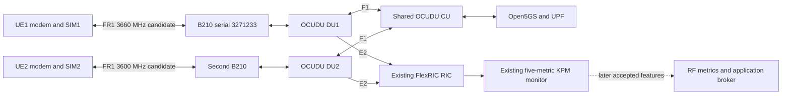

# Dual UE and Dual DU FR1 Channel Implementation Plan

Extend the existing single FR1 link into two independent n78 links, each with
its own UE, modem, radio, and OCUDU DU. Move DU1 into an authorized CBRS-range
channel and select a separate CBRS-range channel for DU2. First revalidate DU1
at its new carrier, then validate both links with the existing FlexRIC RIC and
five-metric KPM xApp. Integrate the RF metrics and application broker when their
respective Plan 1 and Plan 2 acceptance gates pass.

| Field | Value |
| --- | --- |
| Plan | 3 |
| Task | `dual-ue-du-fr1-channels` |
| Status | Planned; implementation and acceptance pending |
| Created at | 14 : 50: 09 Oct 11, 2026 EDT |
| Last updated at | 10 : 37: 33 Oct 12, 2026 EDT |
| Time zone | `America/New_York` |
| Developer | To be assigned |
| Reviewer | To be assigned |
| Falcon inspection baseline | `3f12f627d80cdad14bc9a5ab267f8f65452a2da9` |
| OCUDU inspection baseline | `69801c7e9a3a72e4f29d98f14f626f156444c3ca` |
| FlexRIC inspection baseline | `736508123fe4b5dc3db83fb5baf5f0a8e9b04fe8`, with the existing local timestamp repair |
| Prerequisites | Baseline: authorization covering both selected channels and actual lab conditions, two independently tunable radios, two prepared UE/modem/SIM paths, and the existing five-metric E2 path. Integration: accepted dual-link baseline and the applicable Plan 1/2 stage |
| Execution order | Steps 1–10 establish the dual FR1 baseline independently; Step 11 integrates accepted features while preserving Plan 2 Stage A → Plan 1 → Plan 2 Stage B |
| Initial deployment | Indoor, short-range, low-power testbed with partial shielding; shared CU/Open5GS/two DUs/FlexRIC on Spark and two RM500Q modems on one laptop; both carriers within the CBRS frequency range |

Maintain one plan for this task. Complete checkboxes only after the stated exit
criteria pass and the reviewer can inspect the retained evidence. Plan numbers
identify tasks; they do not require executing Plan 1 before this baseline.

## Current State and Scope

The [single-link runbook](../docs/full_reproduction_runbook.md) records successful
SA registration and application traffic with IMSI `001010000000001`, followed
by real five-metric KPM reception from DU1. This is historical evidence, not a
claim that those services or radios are running now.

The historical DU1 carrier is ARFCN `650000` / 3750 MHz, with SSB `649632`.
Archive that configuration and its evidence. The target dual-link deployment
replaces it with a new DU1 carrier inside CBRS; it requires fresh SSB derivation,
modem locking, and single-link traffic/KPM acceptance.

The [SIM preparation record](../docs/sim_provisioning_and_dual_ue.md) identifies
two provisioned cards and two physical RM500Q modems. Registration of their new
subscribers, a second DU/radio, and simultaneous private IP paths remain pending.
The current repository/source inspection has not established DU2's radio serial
or a working DU2 configuration.

The inspected DU1 file uses TX gain **70** and RX gain **35**. Historical records
include RX 40 and an earlier TX 80. Preserve the actual current file, record its
hash and gains as historical reference. Select and record gain/attenuation for
the stated indoor low-power setup; driver gain 70 is not a calibrated radiated
power value. Accept the new baseline only after revalidation.

The operator describes an indoor, short-range, low-power setup with partial
shielding. Record the actual shield arrangement, antenna geometry, attenuation,
and output/leakage measurements. Partial shielding is an experimental condition;
its isolation must be measured rather than assumed.

This task covers two FR1 cells, cell selection, subscriber/session preparation,
shared-CU operation, independent host data paths, coexistence tests, and per-DU/
per-UE KPM attribution. Pi-Radio/FR3 conversion, MPTCP steering, AI prediction,
and calibrated RF measurement work have separate acceptance requirements.

## Carrier Selection and RF Contract

| Parameter | DU1 proposed CBRS migration | DU2 proposed configuration |
| --- | --- | --- |
| Band | n78, explicitly configured | n78, explicitly configured |
| Carrier NR-ARFCN | `644000` | `640000` |
| Carrier center | 3660 MHz | 3600 MHz |
| Channel bandwidth | 20 MHz | 20 MHz |
| Common SCS | 30 kHz | 30 kHz |
| Nominal channel interval | 3650–3670 MHz | 3590–3610 MHz |
| SSB NR-ARFCN | `643680` in operator-provided 2026-10-12 startup summary; UE confirmation pending; recheck after configuration/version changes | Derive from the final DU2 configuration; confirm startup and UE scan |
| Radio | B210 serial `3271233`; rediscover before use | Separate B210; record the actual second serial |
| Sample rate | 23.04 MS/s | Start from 23.04 MS/s and validate the actual selected radio |
| Gain | Choose/record low-power gain and attenuation; historical TX 70 / RX 35 is a reference | Choose/record independently for the second RF path and verify low-power operation |

Both complete nominal channels lie within the US CBRS range, 3550–3700 MHz.
Use this pair only when the applicable operating authorization covers both
full intervals and the actual location/power/emission conditions. A grant
restricted to 3550–3650 MHz does not cover the proposed DU1 channel; select a
different authorized pair if necessary. Indoor shielding and a configured
`band: 78` do not establish authorization or a Part 96 CBRS operating mode.
[NIST CBRS overview](https://www.nist.gov/programs-projects/citizens-broadband-radio-service).

For this range, the NR mapping is
`F_REF_MHz = 3000 + 0.015 × (N_REF − 600000)`. n78 covers 3300–3800 MHz;
its 30 kHz channel raster accepts these two ARFCNs. The proposed centers are
60 MHz apart, leaving 40 MHz between nominal channel edges. This is a
non-overlapping channel proposal, conditional on the actual lab spectrum and
coexistence results. [ETSI / 3GPP TS 38.104, Sections 5.2 and 5.4](https://www.etsi.org/deliver/etsi_ts/138100_138199/138104/16.20.00_60/ts_138104v162000p.pdf).

Set `band: 78` explicitly: both candidates overlap other NR bands, and automatic
band inference is unsuitable. Validate against the pinned OCUDU band helper and
SSB/CORESET0 derivation, including the 51-PRB, 20-MHz/30-kHz configuration.
Rederive both SSB values. Historical SSB `649632` belongs to the 3750-MHz
configuration and must not be used for the new DU1 carrier. Never use a carrier
ARFCN as the modem's SSB lock or translate a historical carrier-to-SSB offset.

Use two separate B210s. A B210's receive channels share one RX LO, its transmit
channels share one TX LO, and its analog bandwidth is at most 56 MHz. Its two
antenna channels cannot provide these two independently separated carriers.
[UHD B2x0 hardware manual](https://files.ettus.com/manual/page_usrp_b200.html).
The RM500Q-GL hardware documentation lists n78 support; verify each actual SKU,
firmware, antenna path, and SA operation at the chosen carrier.
[Quectel RM500Q-GL Hardware Design, Table 32](https://quectel.com/content/uploads/2024/02/Quectel_RM500Q-GL_Hardware_Design_V1.1-2.pdf).

Nominal channel separation does not establish immunity to unwanted emissions,
receiver blocking, or TDD cross-link interference. Both radios initially retain
the validated clocking approach. Equal TDD patterns alone do not prove aligned
frames with independent internal clocks. Add filtering, attenuation, physical
isolation, or verified timing synchronization only when measurements justify
them; repeat the affected cases afterward.

## Topology and Identity Contract



| Item | DU1 / UE1 | DU2 / UE2 |
| --- | --- | --- |
| Shared PLMN / gNB | `00101`, gNB ID `411`, 22 bits | Same shared gNB identity; confirm in F1/E2 |
| DU ID | `1` | Proposed `2` |
| Cell sector ID | Current first-cell default `0`; confirm | Explicit proposed `1` |
| PCI | `1` | Proposed `2` |
| NR cell identity | Expected `6733824` | Proposed `6733825` |
| TAC / SST / DNN | `7` / `1` / `internet` | Same core/session settings |
| DU F1-C bind | `127.0.10.2` | Proposed `127.0.10.3` |
| DU F1-U bind | `127.0.10.2:2152` | Proposed `127.0.10.3:2152` |
| CU F1 endpoints | `127.0.10.1:38472` SCTP and `127.0.10.1:2152` UDP | Shared CU listeners |
| RIC E2 destination | `127.0.0.1:36421` | Same RIC destination |
| DU E2 local bind | Current `127.0.0.1` | Proposed `127.0.10.3`; local SCTP port is ephemeral |
| Intended new IMSI | `001010000000101` / OC011830 | `001010000000102` / OC011831 |
| Recorded modem IMEI | `863305041978437` | `863305041980706` |
| WWAN interface / UE IP / UE F1AP ID | Discover during each run | Discover during each run |

With a 22-bit gNB ID, `NCI = (gnb_id << 14) | sector_id`. A separate one-cell
DU also defaults its sector to zero; changing only DU ID and PCI would leave
duplicate NR CGI under the shared gNB. Set DU2's sector explicitly and confirm
both CGIs in the CU. Preserve CU N2/N3 and existing core addresses.

E2 `port: 36421` is the RIC destination, shared by both DUs. Port 36422 is the
xApp E42 interface. F1-C/E2 clients can use separate ephemeral local ports;
F1-U's fixed UDP port needs the distinct local IPs above. Confirm actual sockets
and associations rather than accepting a count of matching port strings.

The telemetry key includes full PLMN with MNC width, node type, gNB ID and bit
length, DU ID, UE identifier type, and gNB-CU UE F1AP ID. An IMSI, WWAN address,
or modem IMEI is not automatically carried in the existing DU KPM row. Maintain
a run-scoped correlation table from modem/cell, CU/DU context, and session
evidence. UE IDs may change or be reused after reattachment.

Sharing a PLMN or SST does not bind a subscriber to its intended DU. The stock
Style 4 request includes SST 1, but the current provider does not enforce that
condition as slice isolation. Verify each modem's actual serving cell.

## Planned Deliverables

The following files are execution deliverables; this plan does not imply that
they already exist:

| Location | Purpose |
| --- | --- |
| `configs/ocudu/dual_fr1/du1_b210_n78_3660mhz.yml` | Standalone DU1 radio/cell/F1/E2/KPM configuration; new carrier, actual file gains, and separately derived SSB; live acceptance pending |
| `configs/ocudu/dual_fr1/du2_b210_n78_20mhz.yml` | Reviewed DU2 radio, cell, and F1 configuration with actual serial |
| `configs/ocudu/dual_fr1/du2_flexric.yml` | DU2 E2/KPM and 1000-ms scheduler/RLC metrics |
| `configs/flexric/xapp_du_kpm_base5.conf` | One DU-only five-metric subscription, shared with Plan 2 when available |
| `patches/flexric/dual-fr1-kpm-diagnostics.patch` | Minimal monitor attribution, missing-value, and lifecycle changes |
| `scripts/dual_fr1/check_config.py` | Offline identity, address, channel, placeholder, and file checks |
| `scripts/dual_fr1/configure_ue_routes.sh` | Guarded per-UE policy routes and precise rollback |
| `scripts/dual_fr1/verify_kpm.py` | Per-link report/lifecycle/evidence checks |
| `docs/dual_fr1_runbook.md` | Final operator procedure and actual tested settings |

Keep DU1's maintained configuration in Falcon and deploy it to
`$OCUDU_SOURCE/configs/du1_b210_n78_3660mhz.yml`. DU1 parse/start commands use
that deployed copy; repeat the copy after configuration changes and retain its
hash in acceptance evidence. The current copy is deployed; live acceptance
remains pending.

Use per-run local log overlays under the evidence directory for CU and DU2;
DU1 uses its standalone configuration and `log --filename` for the run's log.
Do not overwrite the working historical DU1 base/E2 files. Keep authentication material
and raw security-bearing logs outside Git; publish only reviewed excerpts.

## Step 1 Capture the Historical Single Link

- [ ] Read the [handoff](../docs/development_handoff.md), single-link runbook,
  [Spark commands](../docs/spark_quick_commands.md), and SIM preparation record.
- [ ] Record source revisions/local diffs, binary/plugin hashes, installed RIC
  and xApp configs, current DU1/CU files, gains, and relevant host settings.
- [ ] Preserve FlexRIC's uncommitted timestamp repair and `kpm_timestamp.h`.
  Coordinate source branches with Plan 1/2 owners; retain unrelated local work.
- [ ] Archive the original 3750-MHz configuration and existing traffic/KPM
  evidence. Repeat that historical RF run only if its operating authorization
  covers it; otherwise retain the existing evidence and proceed to the authorized
  CBRS migration. The new single-link acceptance is mandatory in Step 4.
- [ ] Resolve the current RX-35 versus historical RX-40 discrepancy through
  recorded file hashes; preserve the original file. Freeze the newly accepted
  carrier/gain/attenuation settings after Step 4's single-link repeat.

Create persistent evidence in Bash on Spark:

```bash
set -euo pipefail
FALCON_REPO=/home/nyu/Desktop/Falcon_repo/Falcon
OCUDU_SOURCE=/home/nyu/ocudu
FLEXRIC_SOURCE=/home/nyu/flexric
FLEXRIC_DUAL_BUILD="$FLEXRIC_SOURCE/build-dual-fr1"
DUAL_FR1_EVIDENCE_ROOT=/home/nyu/verification/dual-fr1
mkdir -p "$DUAL_FR1_EVIDENCE_ROOT"
DUAL_FR1_EVIDENCE=$(mktemp -d "$DUAL_FR1_EVIDENCE_ROOT/run-XXXXXXXX")
mkdir -p "$DUAL_FR1_EVIDENCE"/{baseline,inventory,configs,radio,core,ue,routing,kpm,traffic,coexistence,restart,integration}
git -C "$FALCON_REPO" rev-parse HEAD > "$DUAL_FR1_EVIDENCE/baseline/falcon-head.txt"
git -C "$OCUDU_SOURCE" rev-parse HEAD > "$DUAL_FR1_EVIDENCE/baseline/ocudu-head.txt"
git -C "$FLEXRIC_SOURCE" rev-parse HEAD > "$DUAL_FR1_EVIDENCE/baseline/flexric-head.txt"
git -C "$FLEXRIC_SOURCE" diff --binary > "$DUAL_FR1_EVIDENCE/baseline/flexric-local.patch"
sha256sum "$OCUDU_SOURCE/configs/cu.yml" \
  "$OCUDU_SOURCE/configs/du1_b210_n78_20mhz.yml" \
  "$OCUDU_SOURCE/configs/du1_flexric.yml" \
  /usr/local/lib/flexric/libkpm_sm.so \
  /usr/local/bin/flexric/xApp/c/xapp_oran_moni \
  > "$DUAL_FR1_EVIDENCE/baseline/sha256.txt"
```

Retain command, host, New York save time, exit code, and sanitized results for
each check. Each acceptance run uses fresh evidence; raw logs remain protected
locally. Never infer current runtime status from historical documentation.

**Exit criteria:** a hashed historical baseline is retained and distinguished
from the proposed CBRS deployment. New-carrier acceptance remains pending.

## Step 2 Inventory Hardware and Select Both CBRS Carriers

- [ ] Stop any DU that owns a radio before using UHD discovery/probe tools.
  Inventory two actual B210 serials, USB paths, antennas, and power connections.
- [ ] Confirm each radio operates over USB 3 and assess shared controller/load
  limits. Rediscover serial `3271233`; do not invent the second serial or use
  two ports of the same B210 as independent carriers.
- [ ] Verify both modem IMEIs, installed SIMs, firmware, SA n78 capability, and
  distinct QMI/AT ports using the existing UE selection workflow.
- [ ] Survey the usable lab spectrum with an available analyzer or receive-only
  scan while the relevant radio is free. Record surrounding signals and actual
  test conditions. Treat the runbook's 3750-MHz/gain settings as historical
  references; the following checks select this deployment's authorized settings.
- [ ] Confirm the existing authorization covers DU1 3650–3670 MHz and DU2
  3590–3610 MHz, the actual lab location, operating power/emissions, and validity
  period. Record the applicable authorization/reference locally; do not infer
  coverage from indoor operation or partial shielding.
- [ ] Evaluate DU1 ARFCN 644000 / 3660 MHz and DU2 ARFCN 640000 / 3600 MHz,
  each at 20 MHz. If either is unsuitable or outside the actual authorization,
  select another authorized n78 pair with both full channels inside CBRS,
  recompute intervals/separation, and review the new configs before proceeding.
- [ ] Establish the indoor low-power RF path using measured output, reviewed
  attenuation/gain, and recorded shielding. Check leakage outside the shield
  and at the test-area boundary; adjust isolation/power if the intended operating
  conditions are not met. Use the same measured layout for solo/concurrent tests.
- [ ] Record TDD pattern, clock source, gain, antenna placement, and attenuation.
  Document initial independent clocking without claiming synchronization.

**Exit criteria:** two usable radio/UE paths, the recorded indoor setup, and two
authorized CBRS-range candidate channels are identified. Acceptance remains
pending until DU1 revalidation and live coexistence pass.

## Step 3 Prepare Shared CU and Two Distinct DU Configurations

- [ ] Preserve the historical DU1 files and prepare the standalone
  `du1_b210_n78_3660mhz.yml` with `cell_cfg.dl_arfcn: 644000`, explicit
  n78/20 MHz/30 kHz, radio/F1/E2/KPM settings, and validated low-power RF
  settings. The file is prepared with actual TX 70 / RX 35 values; RF validation
  remains pending. Keep its radio and cell/DU identity unchanged.
  Create DU2 from a reviewed copy, changing radio serial, carrier, DU ID,
  sector ID, PCI, F1 binds, and logs.
- [ ] Keep the shared gNB ID/width consistent across CU and DUs. Verify the CU
  accepts two DUs and two distinct NR CGIs. Its inspected default capacity is
  six DUs; no capacity change is needed unless the actual deployed config differs.
- [ ] Use DU2 F1 bind `127.0.10.3` and E2 destination `127.0.0.1:36421` with its
  own local bind. Keep DU1 network/identity settings, CU listeners, and N2/N3/
  core addresses unchanged while migrating DU1's RF carrier.
- [ ] Enable scheduler/RLC metrics and a 1000-ms report period on both DUs.
  Leave CU E2 disabled for the initial two-DU inventory.
- [ ] Generate CU/DU2 log overlays and set DU1's log using `log --filename`,
  with absolute paths under this run's evidence directory; use distinct pcap
  paths if capture is enabled.
- [ ] Measure CPU and USB resources for two DUs. If explicit CPU groups are
  needed, choose them from actual physical-core topology and reserve capacity
  for CU/RIC/core. Keep sibling threads together and recheck worker defaults
  affected by `sched_getaffinity`. Record any affinity as a separate overlay or
  launch setting; preserve the established kernel and boot configuration.

DU1 carrier fields in the complete standalone configuration; review its
gain/attenuation settings separately and select the run's log at launch:

```yaml
cell_cfg:
  dl_arfcn: 644000
  band: 78
  channel_bandwidth_MHz: 20
  common_scs: 30
```

DU2 review template; replace the radio placeholder and historical gain examples
with the reviewed low-power settings before any executable test:

```yaml
gnb_id: 411
gnb_id_bit_length: 22
gnb_du_id: 2
f1ap:
  addrs: 127.0.10.1
  bind_addrs: 127.0.10.3
f1u:
  socket:
    - bind_addr: 127.0.10.3
ru_sdr:
  device_driver: uhd
  device_args: type=b200,serial=REPLACE_WITH_ACTUAL_DU2_SERIAL,num_recv_frames=64,num_send_frames=64
  srate: 23.04
  clock: internal
  clock_ppm: 0.0
  freq_offset: 0
  tx_gain: 70
  rx_gain: 35
cell_cfg:
  dl_arfcn: 640000
  band: 78
  channel_bandwidth_MHz: 20
  common_scs: 30
  plmn: "00101"
  tac: 7
  pci: 2
  sector_id: 1
```

The template gains are historical reference values, not validated low-power
settings or a calibrated power prescription. Step 2 must select the actual
gain/attenuation. The runtime log overlay is mandatory.

```yaml
e2:
  enable_du_e2: true
  addrs: [127.0.0.1]
  bind_addrs: [127.0.10.3]
  port: 36421
  e2sm_kpm_enabled: true
metrics:
  layers:
    enable_sched: true
    enable_rlc: true
  periodicity:
    du_report_period: 1000
```

**Exit criteria:** reviewed configs have unique radios, DU/cell identities,
socket binds, and logs; unresolved placeholders prevent startup.

## Step 4 Validate Configuration and Prepare Both Subscribers

- [ ] Implement offline checks for duplicate serial/DU ID/CGI/PCI, address
  conflicts, gNB consistency, nominal channel overlap, unresolved placeholders,
  both complete channels inside CBRS and the recorded authorization, metric
  enablement, and writable distinct log paths.
- [ ] Derive both DUs' valid SSB/Point A/CORESET0 using the exact checkout's band
  helper/configuration path. Record the result and cross-check live startup later.
- [ ] Parse each DU configuration with the available `--dryrun` mode. It returns
  before full semantic validation and radio startup; a zero exit proves parsing
  and auto-derivation only. Retain separate band/helper checks and live validation.
- [ ] Prepare or verify both Open5GS subscribers using their corresponding
  protected credential files and existing administration workflow. Preserve
  subscriber `001010000000001`; confirm SST 1, DNN `internet`, IPv4 session type 1,
  and the installed SQN representation. Retain only nonsecret projections.
- [ ] Confirm the `00101` identity across NRF, AMF, CU, DUs, and SIMs.
- [ ] With DU2 stopped, start shared CU, the existing RIC, and DU1 using its
  new standalone CBRS configuration. Derive/confirm the new DU1 SSB, update UE1's cell lock, and
  revalidate the original subscriber's SA registration, IPv4 PDU session, private
  ping and uplink/downlink traffic, actual five-metric reception, and normal
  monitor subscription/deletion/exit. Use the installed monitor for this first
  single-DU check; Step 5 adds dual-DU diagnostics afterward.
- [ ] Record the new DU1 carrier/SSB, gains, attenuation, measured output/leakage,
  config hashes, and results as the accepted CBRS single-link baseline before
  enabling DU2 or replacing the original subscriber for dual-UE testing.

Example parse-only checks after the planned configs and CU/DU2 log overlays exist:

```bash
cp "$FALCON_REPO/configs/ocudu/dual_fr1/du1_b210_n78_3660mhz.yml" \
  "$OCUDU_SOURCE/configs/du1_b210_n78_3660mhz.yml"
"$OCUDU_SOURCE/build/apps/cu/ocu" \
  -c "$OCUDU_SOURCE/configs/cu.yml" \
  -c "$DUAL_FR1_EVIDENCE/configs/cu_logs.yml" --dryrun
"$OCUDU_SOURCE/build/apps/du_split_8/odu" \
  -c "$OCUDU_SOURCE/configs/du1_b210_n78_3660mhz.yml" \
  --dryrun log --filename "$DUAL_FR1_EVIDENCE/radio/du1.log"
"$OCUDU_SOURCE/build/apps/du_split_8/odu" \
  -c "$FALCON_REPO/configs/ocudu/dual_fr1/du2_b210_n78_20mhz.yml" \
  -c "$FALCON_REPO/configs/ocudu/dual_fr1/du2_flexric.yml" \
  -c "$DUAL_FR1_EVIDENCE/configs/du2_logs.yml" --dryrun
```

**Exit criteria:** parsing/offline checks pass, DU1's new CBRS single-link
traffic/KPM baseline is accepted, and both new subscribers are prepared with
their own credentials. Their live registration is still required in Step 7.

## Step 5 Prepare the Existing Five Metric KPM Monitor

- [ ] First run the installed timestamp-repaired `xapp_oran_moni` on the accepted
  CBRS single-link setup to preserve the accepted monitor lifecycle/reception result.
- [ ] Create or reuse the reviewed DU-only `xapp_du_kpm_base5.conf`: one Style 4
  KPM subscription at 1000 ms, `ngran_gNB_DU`, installed timestamp-repaired SM
  plugin, database OFF, and exactly the following actions:

| Measurement | Representation | Unit |
| --- | --- | --- |
| `DRB.RlcSduDelayDl` | REAL | 0.1 ms |
| `DRB.UEThpDl` | REAL | kbit/s |
| `DRB.UEThpUl` | REAL | kbit/s |
| `RRU.PrbTotDl` | INTEGER | % |
| `RRU.PrbTotUl` | INTEGER | % |

- [ ] Add a small separate diagnostic patch to the existing monitor. Print the
  full node identity, DU ID, UE type/F1AP ID, row index, collection timestamp,
  and named values together for each row. Retain `report_age_us`; represent
  noValue explicitly and validate row bounds before indexing measurement lists.
  Preserve REAL precision in the retained evidence rather than relying on
  two-decimal console formatting.
- [ ] Give this diagnostic patch a revision/base/helper-hash manifest and emit
  a machine-readable row marker such as `FALCON_DUAL_FR1_DIAG_V1`. Retain patch,
  source-diff, monitor-binary, plugin, and config hashes; marker presence alone
  cannot establish correct merged behavior.
- [ ] Store and delete only successful subscription handles. The current
  monitor stores by node-array index but deletes a dense prefix; fix this
  locally so skipped nodes cannot cause incorrect cleanup. Do not add broker
  or RF getters to this diagnostic patch.
- [ ] Keep the SDK's controller calls serialized. Discovery is performed at
  startup; require both DU Setup records before starting the xApp.
- [ ] For at least 30 rows per link, use repeated normally completed stock-length
  runs, or implement a reviewed bounded duration option in the monitor. Parse
  any new monitor option before SDK argument parsing. Do not treat a single
  stock approximately 10-second run as a long-duration measurement.
- [ ] For the baseline, orderly stop means waiting for the finite monitor run
  to finish and delete its subscriptions. The SDK's current SIGINT handler
  exits abruptly; Ctrl+C cannot prove cleanup. If early-stop support is added,
  install reviewed flag-only SIGINT/SIGTERM handlers after SDK initialization
  and perform subscription deletion in the serialized controller thread.
- [ ] Build the monitor in a separate `build-dual-fr1` directory using the
  existing GCC/E2AP-v3/KPM-v3 settings and preserved timestamp source repair.
  Keep the installed monitor available for rollback.
- [ ] Verify two DU identities sharing gNB 411, repeated/reused UE numbers,
  noValue/empty rows, and successful-handle cleanup with bounded fixtures before
  accepting live attribution. The fixture cannot substitute for two live links.

Build after applying the reviewed diagnostic delta while retaining local
timestamp changes, using the [recorded FlexRIC build settings](../docs/software_installation_and_drivers.md):

```bash
cmake -S "$FLEXRIC_SOURCE" -B "$FLEXRIC_DUAL_BUILD" \
  -DCMAKE_C_COMPILER=gcc -DCMAKE_BUILD_TYPE=Debug \
  -DE2AP_VERSION=E2AP_V3 -DKPM_VERSION=KPM_V3_00 \
  -DXAPP_DB=NONE_XAPP -DXAPP_MULTILANGUAGE=OFF
cmake --build "$FLEXRIC_DUAL_BUILD" --target xapp_oran_moni -j 8
```

**Exit criteria:** the existing monitor can produce unambiguous five-metric
per-DU/per-UE evidence and exit normally, independently of Plan 1/2 completion.

## Step 6 Bring Up Two DUs and the Existing RIC

- [ ] Use the runbook's existing core/MongoDB/host-performance procedure.
  Start shared CU, then the existing FlexRIC RIC, then DU1 and DU2 in separate
  foreground terminals with their reviewed configurations and per-run log paths.
- [ ] Confirm both DUs complete F1 Setup; the CU records different DU IDs and
  CGIs. Confirm actual carrier/SSB/PCI/radio serial in each startup log.
- [ ] Confirm two distinct E2 Setup records in the same RIC and KPM RAN function
  ID 2 accepted for each. Do not use gNB ID 411 alone as proof of two nodes.
- [ ] Check F1-C/E2 associations by local/remote tuple and process, F1-U UDP binds,
  RF error counters, and host CPU/USB load. Diagnose address collisions separately
  from RF issues. Keep CU E2 disabled for this initial inventory.
- [ ] After both DUs are registered, launch the reviewed existing monitor with
  the DU-only five-action config. Require exactly the two intended DU nodes and
  two successful subscriptions; no UE reports yet is not a traffic failure.

DU2 launch recipe for its own Spark terminal:

```bash
sudo "$OCUDU_SOURCE/build/apps/du_split_8/odu" \
  -c "$FALCON_REPO/configs/ocudu/dual_fr1/du2_b210_n78_20mhz.yml" \
  -c "$FALCON_REPO/configs/ocudu/dual_fr1/du2_flexric.yml" \
  -c "$DUAL_FR1_EVIDENCE/configs/du2_logs.yml"
```

DU1 launch recipe for a separate Spark terminal, using its complete configuration:

```bash
sudo "$OCUDU_SOURCE/build/apps/du_split_8/odu" \
  -c "$OCUDU_SOURCE/configs/du1_b210_n78_3660mhz.yml" \
  log --filename "$DUAL_FR1_EVIDENCE/radio/du1.log"
```

Start the CU using Step 4's CU configuration/log layers and the runbook's
privileged foreground launch. Use the installed RIC and existing `ric.conf`;
its E2/E42 ports remain 36421/36422. Export this run's paths in every relevant
terminal; values are not automatically shared across shells. Use this same
DU1 standalone configuration for Step 4's single-link acceptance and later integration.

**Exit criteria:** one CU and one RIC accept both uniquely identified DUs, and
the existing five-metric xApp subscribes successfully to each.

## Step 7 Register Each UE on Its Intended Cell

- [ ] Use one laptop terminal per UE. Select by recorded IMEI and current SIM
  identity, then rediscover modem/SIM/QMI/AT ports after reconnects.
- [ ] Validate UE1 alone on DU1 with SIM1/new subscriber, then UE2 alone on DU2
  with SIM2/new subscriber. Preserve each successful standalone result.
- [ ] Apply the firmware-verified NR SA/n78 selection and cell-lock workflow
  from the [UE booklet](../docs/ue_laptop_quick_commands.md). Use DU1 PCI 1 /
  its newly derived and observed CBRS SSB, and DU2 PCI 2 / its own derived and
  observed SSB. The booklet's historical 649632 lock applies only to 3750 MHz;
  replace it for this deployment. Require each
  configuration write to return OK; read back lock and serving-cell details.
- [ ] Require private PLMN `00101`, intended cell/PCI/SSB, SA registration,
  attached packet service, and connected non-suspended IPv4 `internet` bearer.
  A ready SIM, high signal indicator, or idle `NOCONN` text alone is insufficient.
- [ ] Attach both concurrently. Record actual bearer IDs, WWAN interfaces,
  addresses/prefix/MTU/gateway, serving cells, and CU/DU UE contexts.
- [ ] Create a correlation ledger tying IMSI/modem → serving cell/DU → CU UE
  F1AP ID → bearer/WWAN/IP. Recheck it after every reattachment or restart.

**Exit criteria:** two different subscribers have simultaneous PDU sessions
through their intended cells; the two link identities are independently evidenced.

## Step 8 Configure and Verify Two Independent Laptop IP Paths

The single-link helper installs one main-table route to `10.45.0.1`. Running it
twice would replace or reject the other interface's route. Implement a guarded
source-policy route setup for this dual-link test instead.

- [ ] Confirm WWAN ownership between ModemManager and NetworkManager, distinct
  actual UE IPs, and dedicated interfaces. Preserve management Wi-Fi/default
  routes; use current bearer IP/prefix/MTU rather than historical values.
- [ ] Use `noprefixroute` for manually assigned WWAN addresses and reserve two
  currently unused routing tables and rule priorities. Proposed table IDs
  151/152 use lookup priorities 10151/10161 and guard priorities 10152/10162;
  all require conflict checks before use.
- [ ] For each actual UE address, add a rule scoped to that source and the
  private Spark destination. Its table routes `10.45.0.1/32` directly over that
  WWAN with the same source address, matching the existing verified QMI path.
  Revalidate this recipe if the bearer/network model differs.
- [ ] Add a narrowly scoped `unreachable` rule immediately after each source/
  destination lookup rule. If its WWAN route disappears, traffic must fail
  locally before reaching the main-table Wi-Fi or other-modem route. Install
  the guard before exposing the new source path; retain it until traffic is
  stopped and that run's source address is removed during cleanup.
- [ ] Track every address, MTU change, route, rule, and any per-interface sysctl
  in a run-owned ledger. Reject conflicts and clean partial failures precisely;
  never flush shared routing tables or replace another run's entries.
- [ ] Check actual packet paths and reverse-path filtering. If strict filtering
  rejects the intended multihomed return path, record and review a change on
  only the affected WWAN interface, then restore it during cleanup. Linux uses
  the maximum of the all/interface `rp_filter` settings.
  [Linux kernel IP sysctl documentation](https://www.kernel.org/doc/html/latest/networking/ip-sysctl.html).
- [ ] Verify `ip route get` from each UE IP, interface counters/captures, and
  successful private ping. Source/interface-bound traffic must reach its own
  path, with no implicit fallback over Wi-Fi or the other modem.
- [ ] Negative-test disconnecting each bearer/removing its run-owned path in
  turn: the affected source cannot reach Spark through another interface, while
  the survivor still works. Check captures/counters, then rediscover the restored
  bearer/IP and refresh its rules and correlation ledger before continuing.

Verification commands in each UE's own terminal after guarded route setup:

```bash
ip -4 route get 10.45.0.1 from "${UE_IP:?Read the current bearer first}"
ip -4 rule show
ip -4 route show default
ping -q -I "$UE_IP" -c 20 10.45.0.1
```

**Exit criteria:** each source address resolves over the correct WWAN, both
paths pass private ping, and management routing remains usable.

## Step 9 Validate Dual Link Traffic and Existing KPM

- [ ] Start two separate Spark iperf3 server processes bound to `10.45.0.1`, on
  ports 5201 and 5202. Two concurrent clients must not contend for one
  single-test server process.
- [ ] Measure UE1 alone and UE2 alone, then both concurrently. Test uplink,
  downlink, and opposite-direction pairs; bind clients to actual source IPs and
  verify the policy route/interface used for each transfer.
- [ ] Retain 60-second receiver summaries, direction, bitrate, retransmissions,
  UDP loss/jitter, IP/WWAN identity, and concurrent DU/host error growth. Use
  distinct filenames per case, repetition, direction, and link.
- [ ] Overlap traffic with repeated normally completed monitor runs. Accumulate
  at least 30 real rows for each intended link while both links are attached;
  each active-window acceptance requires all five named entries and at least
  one numeric observation of every metric per link. Preserve noValue explicitly.
- [ ] Verify full DU/UE identity and timestamps, per-link report counts, both
  subscription/deletion results, and normal xApp exit. Correlate throughput
  changes with that link's traffic; KPM-layer bitrate need not equal iperf rate.
- [ ] Do not accept an all-null run or report physical multi-link validation
  from fixtures. If PRB values fail, retain the failing tuple and investigate
  the existing getter limitation rather than substituting zero.

Spark servers, each in its own foreground terminal:

```bash
iperf3 -s -B 10.45.0.1 -p 5201
```

```bash
iperf3 -s -B 10.45.0.1 -p 5202
```

Laptop uplink examples in the corresponding UE terminals, with independently
discovered variables; add `-R` for each downlink case:

```bash
iperf3 -c 10.45.0.1 -p 5201 -B "${UE1_IP:?Read UE1 bearer}" -t 60 -i 1 -J
```

```bash
iperf3 -c 10.45.0.1 -p 5202 -B "${UE2_IP:?Read UE2 bearer}" -t 60 -i 1 -J
```

Rate-controlled UDP examples after choosing each link's offered load from the
measured standalone capacity; repeat with `-R` for downlink and save each JSON
result separately:

```bash
iperf3 -c 10.45.0.1 -p 5201 -B "${UE1_IP:?Read UE1 bearer}" \
  -u -b "${UE1_OFFERED_RATE:?Choose the measured controlled rate}" \
  -t 60 -i 1 --get-server-output -J
```

```bash
iperf3 -c 10.45.0.1 -p 5202 -B "${UE2_IP:?Read UE2 bearer}" \
  -u -b "${UE2_OFFERED_RATE:?Choose the measured controlled rate}" \
  -t 60 -i 1 --get-server-output -J
```

Monitor command after the diagnostic build is available; repeat completed runs
during the traffic window and save each log separately:

```bash
"$FLEXRIC_DUAL_BUILD/examples/xApp/c/monitor/xapp_oran_moni" \
  -c "$FALCON_REPO/configs/flexric/xapp_du_kpm_base5.conf"
```

The current OCUDU PRB getters index a snapshot vector using an internal UE
index. Sparse/reused indexes can produce wrong or missing values, even with one
physical UE per DU. Five-metric delivery proves transport and attribution, not
all getter correctness. Track getter correctness separately; an unresolved
missing-metric failure keeps this five-metric gate pending.

**Exit criteria:** both independent data paths work concurrently, and the
existing KPM xApp receives the five measurements with correct DU/UE attribution
for both links and completes both subscription lifecycles normally.

## Step 10 Accept Coexistence and Repeatability

- [ ] With fixed gains and recorded antenna/attenuation setup, compare each
  link alone, the other DU transmitting idle, both uplink, both downlink, DU1 UL
  with DU2 DL, and DU1 DL with DU2 UL. Run three 60-second trials per case.
- [ ] Select the same controlled offered load for a link in its isolated and
  simultaneous trials, at no more than 70% of its demonstrated solo capacity.
  Use receiver goodput and UDP loss/jitter; full-rate TCP tests additionally
  characterize shared resource limits.
- [ ] Use these initial project acceptance thresholds: continuous SA/PDU
  sessions, no wrong-cell migration, receiver goodput at least 90% of its
  isolated result, and UDP loss at most 1% at the controlled rate. Record any
  reviewed threshold change before testing; do not lower it after a failure.
- [ ] Compare available DU PHY/modem quality evidence. Where measurements are
  comparable, require median PUSCH SINR degradation no more than 3 dB and
  CRC-failure/BLER increase no more than five percentage points. Record missing
  observability and its effect on the RF conclusion. Existing dummy KPM RF
  getters cannot supply this evidence; use available PHY/firmware observations.
- [ ] Count USB/radio underflow, overflow, late events, process failures, and
  host saturation for every case. No persistent error growth or dropped link
  can pass. Separate RF coupling from CPU/USB/CU/UPF/routing bottlenecks and
  repeat the failing case after a measured remedy.
- [ ] Reattach UE2 while UE1 continues, then reverse the roles. Update changed
  F1AP IDs and verify fresh attribution, working survivor traffic, and KPM.
- [ ] Wait for the monitor's finite run and subscription cleanup, then restart
  RIC and DUs in the documented order. Relaunch the xApp after both Setup records.
  The existing SDK has no accepted
  late-DU-join or automatic RIC-reconnection path. Repeat two-link reception.
- [ ] After each reattachment/restart, repeat Step 9's active-window five-metric
  gate with fresh identities and at least 30 rows per link. Missing PRB values
  or ambiguous/wrong-source tuples keep the corresponding repeatability gate
  pending; retain evidence and diagnose the source/index issue separately.
- [ ] Repeat a complete cold start with both subscribers and retained configs.
  Preserve the hashes/results as the accepted dual FR1 baseline.

**Exit criteria:** coexistence passes under the recorded load/setup, both links
survive the intended independent-UE tests, and cold-start/restart procedures are
reproducible. State the result as nominally non-overlapping carriers with tested
coexistence; do not claim zero interference in all operating conditions.

## Step 11 Integrate Accepted Plan 1 and Plan 2 Features

Baseline completion does not wait for RF getters or the broker. Track each
integration independently; a completed feature can be integrated as soon as its
gate below passes. Keep the existing global implementation order in
[Plan 2](xapp-kpm-app-subscription.md): Stage A → [Plan 1](e2sm-kpm-du-rf-metrics.md)
→ Stage B.

| Integration | Required accepted inputs | Dual-link acceptance |
| --- | --- | --- |
| Existing monitor, five metrics | Plan 3 Steps 1–10 | Baseline accepted independently of Plan 1/2 |
| Broker/dummy, `base5` | Dual baseline and Plan 2 Stage A | All-links and exact-link clients receive five metrics from the intended links |
| Existing monitor, seven metrics | Dual baseline and Plan 1 | Both DUs expose correct RSRP/SNR and all five existing measurements |
| Broker/dummy, `rf7` | Dual baseline, Plan 1, and Plan 2 Stage B | Both links push seven correctly attributed metrics with Plan 2's delivery guarantees |

- [ ] Before each integration, retain a new revision/config/binary manifest and
  fresh evidence directory. Merge the diagnostic changes with the accepted
  feature patch on a reviewed branch. Preserve timestamp repair, successful-
  handle cleanup, and attribution; avoid blindly stacking cumulative patches
  touching the same monitor file.
- [ ] Keep the accepted CBRS radio configurations, newly derived SSB locks, and
  measured low-power settings throughout integration. Adapt Plan 1/runbook
  commands to use these configurations rather than copying their historical
  3750-MHz carrier or 649632 lock.
- [ ] For Plan 2 Stage A, start the accepted broker with `--metric-profile base5`
  only after both DUs are registered. Run one all-links dummy plus two exact-link
  dummies; require at least 30 real rows per link, successful registration and
  unregister, no cross-link delivery, and callback-to-dummy value/state equality
  using Plan 2's retained evidence mechanism.
- [ ] For Plan 1, deploy the reviewed RF implementation to the DU binary used
  by both processes and verify both capability advertisements. Repeat Plan 1's
  source-window correlation and valid RSRP/SNR checks separately for each actual
  DU/UE. A DU1-only RF result cannot close the dual-link RF integration.
- [ ] For Plan 2 Stage B, run the accepted `rf7` subscription/config and the same
  three dummy filters. Require seven entries, at least 30 real rows per link,
  at least 10 rows per link with both RF values valid, and no swapped/rounded/
  substituted RF measurements. Preserve unavailable values explicitly.
- [ ] After RF integration, rerun both links in `base5`, including application
  traffic, attribution, source-to-dummy preservation when the broker is present,
  and orderly lifecycle. Keep accepted baseline evidence immutable.
- [ ] Record each integration as Accepted or Pending with its precise gate.
  If a feature is not accepted, retain the working five-metric dual baseline
  and schedule that integration without declaring it complete.

**Exit criteria:** each enabled integration has passed its own dual-link gate.
Future feature integration remains explicitly Pending until those inputs and
checks pass; MPTCP is not part of this interface acceptance.

## Step 12 Review Handoff and Rollback

- [ ] Deliver reviewed configs/scripts/patch and the English dual-FR1 runbook,
  including actual serials, approved carrier/derived SSB, identities, startup/
  shutdown sequence, routing ledger, hardware layout, and sanitized evidence.
- [ ] Reviewer signs off baseline and each integration separately. Preserve
  source-getter limitations, measured coexistence conditions, and pending work.
- [ ] For a feature regression, restore accepted five-metric monitor/broker
  operation and its recorded binary/config. Undo only the reviewed feature
  delta; preserve timestamp repair and working dual-radio configuration.
- [ ] For a DU2/RF coexistence fault, stop traffic and wait for the finite monitor
  to complete cleanup (or use the accepted broker's graceful shutdown), then
  disconnect the affected bearer, remove only its run-owned routes/rules/addresses, and stop
  DU2 by its recorded process. Restore the accepted DU1 setup and rerun its
  private traffic/KPM smoke check. Do not use a blanket kill of both DUs.
- [ ] Roll back to the accepted CBRS DU1 carrier/SSB/gain profile. The archived
  3750-MHz configuration is historical; restore its RF operation only when the
  applicable authorization covers that channel and operating conditions.
- [ ] For full shutdown, stop traffic, delete xApp subscriptions normally, release
  both PDU sessions and run-owned laptop settings, then stop DUs, RIC, CU, and
  the runbook's core services as needed. Preserve MongoDB/subscribers and SIMs.

**Completion:** baseline acceptance requires Steps 1–10 and the applicable
handoff/rollback review. Plan 3 may be reported as Baseline Accepted / Integration
Pending while waiting for Plan 1/2. Report full integration only after every
selected ready feature passes Step 11; never present a pending feature as tested.
