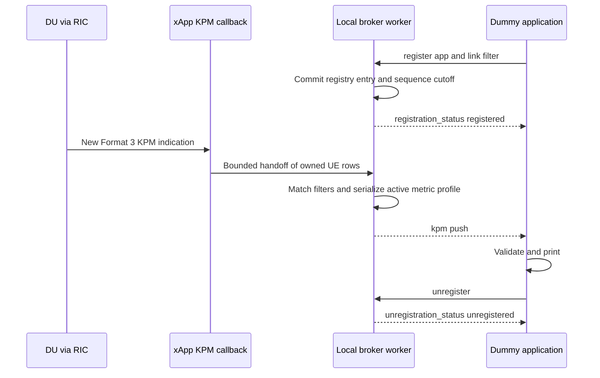

# KPM xApp Subscription and Publishing Interface Implementation Plan

First implement the broker and an independent dummy application, then validate
registration and KPM publishing with the five measurements already available
through FlexRIC. After that baseline passes, extend the same xApp and interface
with PUSCH RSRP and SNR, producing seven measurements per DU and UE. Keep MPTCP
integration and traffic routing outside this task.

| Field | Value |
| --- | --- |
| Plan | 2 |
| Task | `xapp-kpm-app-subscription` |
| Status | Planned; implementation and acceptance pending |
| Created at | 14 : 15: 11 Oct 11, 2026 EDT |
| Last updated at | 14 : 41: 36 Oct 11, 2026 EDT |
| Time zone | `America/New_York` |
| Developer | To be assigned |
| Reviewer | To be assigned |
| Falcon inspection baseline | `3f12f627d80cdad14bc9a5ab267f8f65452a2da9` |
| OCUDU inspection baseline | `69801c7e9a3a72e4f29d98f14f626f156444c3ca` |
| FlexRIC inspection baseline | `736508123fe4b5dc3db83fb5baf5f0a8e9b04fe8`, with the existing local timestamp repair |
| Prerequisites | Stage A: existing five-metric KPM path, no RF patch required. Stage B: accepted Stage A and accepted RF implementation from [Plan 1](e2sm-kpm-du-rf-metrics.md) |
| Execution order | Plan 2 Steps 1–8 (Stage A); then remaining [Plan 1](e2sm-kpm-du-rf-metrics.md) RF work and acceptance; then Plan 2 Steps 9–11 (Stage B) |
| Initial deployment | xApp and dummy clients on the same Spark host |

Maintain one plan for this task. Complete checkboxes only after their exit
criteria pass and the reviewer can inspect the retained evidence.

## Scope and Current Implementation

The current timestamp-repaired monitor can receive the five existing DU metrics.
The installed `xapp_oran_sm.conf` contains their DU Style 4 subscription. Create
a repository-owned DU-only five-metric config during Stage A; the repository's
existing RF configs request six or seven measurements and are not the Stage A input.

The [seven-metric configuration](../configs/flexric/xapp_du_rf_metrics.conf)
and cumulative RF monitor patch are Stage B inputs. Plan 1 must establish correct
RSRP/SNR acquisition before live seven-metric acceptance. Broker/dummy development
and live five-metric acceptance do not depend on applying that RF patch.

| Stage | Implement and validate | Required gate |
| --- | --- | --- |
| A | Broker, registry, dummy, and the existing five KPM measurements | Fixture/socket tests and real five-metric E2-to-dummy delivery pass in Step 8 |
| B | Add RSRP and SNR to the accepted interface | Start only after Stage A passes and Plan 1 is accepted; verify seven-metric delivery in Step 10 |

Execute this plan's Steps 1–8 first, then complete any remaining Plan 1 RF work,
then execute Steps 9–11. If Plan 1 is already accepted, retain its evidence and
still require Stage A acceptance before adding the RF publisher profile.

There are two independent subscriptions:

1. **E2 acquisition:** the xApp subscribes once to each selected DU for the active
   metric profile at 1000 ms, using Style 4 and Format 3 reports. Start with five;
   enable seven only after the Stage A gate.
2. **Application delivery:** each external app registers with the xApp's local
   server to receive all links or an exact list of DU and UE associations.

App registration must not create another E2 subscription. App disconnection must
not delete the shared E2 subscription. Continue collecting while no app is registered.

For this first version, all intended DUs and the RIC must be available before
the live xApp starts. Keep a static DU subscription set until shutdown; relaunch
after DU membership or RIC changes. The current SDK has blocking startup and
assertion-based subscription/timeouts. Periodic discovery alone would not make
late joins or automatic E2 reconnection reliable. Those SDK changes are separate
work. An app may register while the UE is idle or has not yet produced KPM.

Develop a dedicated `xapp_kpm_broker` target from the existing monitor's reviewed
KPM builders and decoder handling. Keep `xapp_oran_moni` available for Plan 1's
diagnostics and regressions. Reuse the SDK and KPM handling directly; never parse
monitor terminal output to construct application data.

Stage A includes mandatory live validation with the existing five measurements.
Fixtures alone cannot authorize Stage B. This task verifies decoded-value
preservation, attribution, registration, and delivery. It does not certify PHY
calibration or fix the DU measurement getters. In particular, the current OCUDU
PRB getters use an internal UE index as a snapshot vector offset;
sparse/reordered multi-UE source correctness
needs upstream validation or a separate repair. Preserve and disclose that limit.

## Architecture and Data Ownership



Use three execution responsibilities:

- **SDK controller:** initialize the SDK, establish the static DU subscriptions,
  and remove successful subscriptions during shutdown. Serialize SDK report/remove
  calls in this thread; the existing SDK uses shared synchronous request state.
- **KPM callback:** validate and deep-copy one owned snapshot per UE/measurement
  row into a bounded ingress queue. Assign a monotonic `report_seq` at callback
  entry. Do not send sockets, serialize JSON, or call subscription APIs here.
- **Broker worker:** own all sockets, the app registry, filter evaluation, JSON
  serialization, per-client queues, timeouts, and disconnect cleanup.

The SDK frees both the decoded indication and node identity after the callback
returns. No queued snapshot may retain SDK pointers. Create the queue/context
before SDK subscriptions can produce callbacks, and retain it until SDK callback
dispatch has stopped. Network writes must never hold the ingress queue lock.

## Link and Measurement Contract

Identify a link by the complete node identity plus the UE context:

`PLMN + node type + gNB ID and bit length + DU ID + UE ID type + CU UE F1AP ID`

Preserve MCC as three digits and MNC as two or three digits. Derive gNB bit length
from the SDK's `nb_id.unused` field. Require a present DU ID for this DU-only
publisher; never replace a missing DU ID with zero. Preserve optional `ran_ue_id`
as metadata when present. UE F1AP IDs may change or be reused after reconnection;
they are not permanent subscriber identifiers or MPTCP path identifiers.

Select one process-wide profile at startup using `--metric-profile base5` or,
after Stage A acceptance, `--metric-profile rf7`. Default to `base5`; the profile
does not change during a process run and apps cannot change E2 acquisition.
Profile changes require restart and fresh app registration.

One outbound KPM message represents one UE row from one indication. Include
exactly the active profile's five or seven named entries, with explicit absence
states when the source omits an active metric. In `base5`, omit the two RF keys
entirely; do not emit placeholder RSRP/SNR values or request them from the DU.
Do not merge different DUs, UEs, indication rows, or source windows into one row.
The active values share a KPM report row; that does not prove identical underlying
PHY, scheduler, and RLC measurement windows.

| Metric | Profile | DU representation | Exported unit |
| --- | --- | --- | --- |
| `DRB.RlcSduDelayDl` | `base5` and `rf7` | `REAL` | `0.1 ms` |
| `DRB.UEThpDl` | `base5` and `rf7` | `REAL` | `kbit/s` |
| `DRB.UEThpUl` | `base5` and `rf7` | `REAL` | `kbit/s` |
| `RRU.PrbTotDl` | `base5` and `rf7` | `INTEGER` | `%` |
| `RRU.PrbTotUl` | `base5` and `rf7` | `INTEGER` | `%` |
| `FALCON.PUSCH.RSRP.dBFS` | `rf7` only, Stage B | `REAL` | `dBFS` |
| `FALCON.PUSCH.SNR.dB` | `rf7` only, Stage B | `REAL` | `dB` |

Keep the raw delay unit; for example, `13.8` in `0.1 ms` means `1.38 ms`.
RSRP is software uplink PUSCH DM-RS power. The SNR name retains the scheduler's
selected PHY SINR source. Preserve Plan 1's units and validity rules. No measured
RSRQ or additional SINR metric is introduced.

For each metric, publish `kpm_type`, `status`, `value`, and `unit`:

| Source condition | `kpm_type` | `status` | `value` |
| --- | --- | --- | --- |
| Valid source number | `integer` or `real` | `ok` | Original decoded number |
| KPM `noValue` | `noValue` | `no_value` | `null` |
| Missing named metric | `absent` | `not_reported` | `null` |
| Invalid RF integer, non-finite real, or unsupported record type | Actual source type where known | `invalid` with a reason | `null` |

This SDK represents integer, real, and noValue records; do not invent another
source record type. Preserve a valid zero. Serialize finite doubles with enough
precision to round-trip the decoded value; normal two-decimal terminal formatting
must not become the machine interface. Preserve the row's incomplete flag as
`true`, `false`, or `null` for absent; do not mark incomplete data fully reliable.

Use measurement names to map values. For each active named profile, reject
ambiguous mappings, duplicate names, name/value length mismatch, or unsupported
measurement-ID-only mappings with a diagnostic. Never guess column order when
the indication has no usable mapping. Missing entries in an otherwise valid
named row remain explicit `not_reported` entries.

## Local Application Protocol Version 1

Use TCP on **`127.0.0.1:8765`**, separate from FlexRIC E2/E42 ports. Each wire
message is one UTF-8 JSON object followed by a newline. Pretty-printed examples
below represent single-line frames on the connection. Treat TCP as a byte stream:
handle split lines, several lines in one read, and partial writes.

One TCP connection owns one registration. The app initiates the connection and
the xApp pushes on that same connection. No callback port, polling, database,
HTTP server, or external message broker is needed. This version is restricted
to the same host; cross-host delivery is a future interface deployment task.

Use JSON strings for unsigned IDs, sequence counters, and epoch-microsecond
timestamps to preserve 64-bit values across clients. Numeric ID strings must be
canonical unsigned decimal; MCC/MNC retain their specified leading zeros.
Protocol version, bit length, row index, and metric numeric values remain JSON
numbers. The examples use synthetic identities and values.

### Register and Receive Status

An app subscribing to every DU/UE sends:

```json
{
  "version": 1,
  "type": "register",
  "request_id": "reg-001",
  "app_id": "dummy-all",
  "filter": {"mode": "all_du_ues"}
}
```

An app requesting specific associations supplies `mode: links` and a nonempty
list of exact node/UE keys. Each key has this shape:

```json
{
  "node": {
    "mcc": "001", "mnc": "01", "node_type": "ngran_gNB_DU",
    "gnb_id": "411", "gnb_id_bits": 22, "du_id": "1"
  },
  "ue": {"id_type": "gnb_du", "gnb_cu_ue_f1ap_id": "1007"}
}
```

Limit a registration to 32 exact links. Match the complete key, with no guessed
DU, default UE, or substring matching. Accept registration for a currently idle
or absent UE; its state is waiting for matching KPM, not registration failure.

On success, return:

```json
{
  "version": 1,
  "type": "registration_status",
  "request_id": "reg-001",
  "status": "registered",
  "app_id": "dummy-all",
  "subscription_id": "sub-1",
  "broker_instance_id": "example-instance",
  "data_source": "fixture",
  "metric_profile": "base5",
  "metric_names": ["DRB.RlcSduDelayDl", "DRB.UEThpDl", "DRB.UEThpUl", "RRU.PrbTotDl", "RRU.PrbTotUl"],
  "data_state": "waiting_for_kpm",
  "report_period_ms": 1000,
  "delivery": "best_effort_no_replay"
}
```

Registration status declares the active profile and exact metric-name set.
The dummy checks both before accepting pushes. Registration success confirms
registry admission, not source readiness or receipt of
a measurement. At registry commit, capture the current atomic `report_seq` as a
cutoff. Deliver only rows whose callback started after this cutoff; an old callback
still being normalized must not become a new post-registration report. Queue
the success frame before any KPM frame for that connection.

Reject invalid requests with `registration_status`, `status: rejected`, the
request ID when safely available, and a stable `error_code`. Define at least
`unsupported_version`, `invalid_request`, `duplicate_app_id`, `already_registered`,
`too_many_clients`, and `frame_too_large`. Malformed frames without a usable request
ID receive an `error` frame when possible, followed by connection closure.
Keep app/request identifiers to 1–64 ASCII characters from `[A-Za-z0-9_.-]`.

### Push a KPM Row

```json
{
  "version": 1,
  "type": "kpm",
  "subscription_id": "sub-1",
  "broker_instance_id": "example-instance",
  "data_source": "fixture",
  "metric_profile": "base5",
  "report_seq": "42",
  "delivery_seq": "1",
  "sample_idx": 0,
  "header_time_us": "1791745200000000",
  "received_at_unix_us": "1791745200000500",
  "published_at_unix_us": "1791745200000600",
  "node": {
    "mcc": "001", "mnc": "01", "node_type": "ngran_gNB_DU",
    "gnb_id": "411", "gnb_id_bits": 22, "du_id": "1"
  },
  "ue": {"id_type": "gnb_du", "gnb_cu_ue_f1ap_id": "1007", "ran_ue_id": null},
  "incomplete": null,
  "ingress_dropped_total": "0",
  "metrics": {
    "DRB.RlcSduDelayDl": {"kpm_type": "real", "status": "ok", "value": 13.8, "unit": "0.1 ms"},
    "DRB.UEThpDl": {"kpm_type": "real", "status": "ok", "value": 1280.0, "unit": "kbit/s"},
    "DRB.UEThpUl": {"kpm_type": "real", "status": "ok", "value": 5120.0, "unit": "kbit/s"},
    "RRU.PrbTotDl": {"kpm_type": "integer", "status": "ok", "value": 12, "unit": "%"},
    "RRU.PrbTotUl": {"kpm_type": "integer", "status": "ok", "value": 86, "unit": "%"}
  }
}
```

Stage B keeps this version-1 envelope and sets `metric_profile: rf7`. The success
reply lists seven names, and each KPM frame adds the two RF entries from the
measurement table. Unknown profiles are rejected; five-metric operation remains
supported after the extension. Implement RF-specific behavior in Step 9.

Assign a fresh broker instance ID on every process start. `report_seq` identifies
a callback within that instance; `delivery_seq` starts at 1 for each registration
and increases for each KPM frame queued to it. Multiple UE rows can share a report
sequence. Filtered report-sequence gaps do not by themselves prove loss.

`header_time_us` is the repaired KPM header time. `received_at_unix_us` is captured
at callback entry; `published_at_unix_us` records serialization/enqueue time,
not successful client receipt. `sample_idx` is the original row index. These
fields do not establish PHY sample age or pure transport latency. Use monotonic
time for internal deadlines. Human-readable save/log timestamps use New York
24-hour display, for example `14 : 15: 11 Oct 11, 2026 EDT`.

### Unregister and Check Liveness

Support `unregister` with version, request ID, and subscription ID. At acceptance,
stop adding matching frames, drain already queued frames, then send
`unregistration_status` with `status: unregistered` and close the connection.
No KPM may follow that acknowledgment. Never discard the remainder of a partially
sent JSON frame and splice an acknowledgment into it.

Support `ping` and `pong` with a request ID on the same connection. The dummy sends
a ping every 10 seconds; close a registered connection after 30 seconds without
any complete valid client request. Replies include current data state and time
since the last matching KPM, or null when none has arrived. A quiet UE must not
produce fabricated zero-valued KPM. On EOF, reset, timeout, or client overflow,
remove the registry entry and free its buffers. Reconnect requires a new
registration; no history is replayed. An active duplicate `app_id` is rejected.

### Bounds and Backpressure

| Resource | Initial bound and behavior |
| --- | --- |
| Client connections | 16; reject additional admission |
| Incoming JSON line | 8 KiB; reject/close oversized or invalid frames |
| Initial registration and incomplete request | 5 seconds using monotonic deadlines |
| Exact link filters per app | 32 |
| Outbound JSON frame | 16 KiB; record serialization errors rather than truncating JSON |
| Owned ingress queue | 256 rows and 4 MiB; drop a newly arriving row on overflow and increment a counter |
| Per-client output queue | 64 frames and 1 MiB, including control frames |
| Slow subscriber | Disconnect it on queue overflow or 5 seconds of pending writes without progress |
| Unregister/shutdown drain | At most 2 seconds; close if draining cannot complete |

Track admission rejects, active clients, malformed inputs, ingress drops,
serialization errors, client overflows, and disconnect reasons. Put the cumulative
ingress drop counter in later KPM frames and diagnostics. A full client queue
affects only that client. Delivery is best effort: there is no durable replay,
application acknowledgment for every KPM, or exactly-once guarantee.

## Step 1 Confirm Dependencies and Preserve the Baseline

- [ ] Record Falcon/FlexRIC revisions, local diffs, configuration hashes, compiler
  versions, and the existing monitor/KPM plugin hashes.
- [ ] Preserve the existing timestamp repair and five-metric reception baseline.
  Record Plan 1's RF implementation separately when Stage B begins; do not make
  it a Stage A prerequisite.
- [ ] Record separate Stage A fixture/live and Stage B fixture/live results.
  Preserve the original PRB mapping limitation explicitly.
- [ ] Create an implementation branch and unique evidence directory outside the
  source/build trees. Keep the original monitor available for comparison.

Use Bash variables throughout this task:

```bash
set -euo pipefail
FALCON_REPO=/home/nyu/Desktop/Falcon_repo/Falcon
FLEXRIC_SOURCE=/home/nyu/flexric
FLEXRIC_BUILD="$FLEXRIC_SOURCE/build-ocudu"
KPM_APP_EVIDENCE_ROOT=/home/nyu/verification/kpm-app-subscription
mkdir -p "$KPM_APP_EVIDENCE_ROOT"
KPM_APP_EVIDENCE=$(mktemp -d "$KPM_APP_EVIDENCE_ROOT/run-XXXXXXXX")
mkdir -p "$KPM_APP_EVIDENCE"/{baseline,base5/{tests,dummy,live},rf7/{tests,dummy,live}}

git -C "$FALCON_REPO" rev-parse HEAD > "$KPM_APP_EVIDENCE/baseline/falcon-head.txt"
git -C "$FLEXRIC_SOURCE" rev-parse HEAD > "$KPM_APP_EVIDENCE/baseline/flexric-head.txt"
git -C "$FLEXRIC_SOURCE" diff --binary > "$KPM_APP_EVIDENCE/baseline/flexric-local.patch"
git -C "$FLEXRIC_SOURCE" status --short > "$KPM_APP_EVIDENCE/baseline/flexric-status.txt"
sha256sum "$FLEXRIC_BUILD/examples/xApp/c/monitor/xapp_oran_moni" \
  /usr/local/lib/flexric/libkpm_sm.so \
  /usr/local/etc/flexric/xapp_oran_sm.conf \
  > "$KPM_APP_EVIDENCE/baseline/artifact-sha256.txt"
```

Retain the timestamp helper if it is still untracked, as instructed in Plan 1.
For every verification command, save the exact invocation, output, and exit
status; use a logging wrapper that retains the executable's exit code when piping.

**Exit criteria:** the approved input revisions and recoverable local changes
are recorded; Stage A can run with the existing five metrics independently of RF work.

## Step 2 Freeze the Protocol and Add Build Targets

- [ ] Write the version-1 protocol specification and JSON examples from this plan.
  Define field types, limits, state transitions, error codes, and ordering rules.
- [ ] Add the dedicated xApp and test targets in the monitor CMake directory.
  Keep E2AP v3, KPM v3.00, GCC, and the current `NONE_XAPP` build settings.
  Define a `FALCON_REPO_ROOT` CMake cache path, validate it, and use it to locate
  the Falcon C regression/fixture sources. Do not assume Falcon resides beneath
  the FlexRIC source tree.
- [ ] Use `json-c` for JSON parsing/serialization and target-specific linking.
  This host currently has no `libjson-c-dev` and `pkg-config` cannot find it.
  Add the documented build dependency; keep it scoped to the new targets.
  Use bounded parsing and a schema validator rather than a handwritten JSON parser.
- [ ] Keep fixture mode separate from live mode in startup configuration while
  exercising the same production normalizer, registry, and socket publisher.
- [ ] Declare the active profile in status/push frames. Implement `base5` first;
  keep RF activation out of Stage A. Add the `rf7` implementation only in Step 9.
- [ ] Create `configs/flexric/xapp_du_kpm_base5.conf` from the installed config's
  DU block: exactly five names, Style 4, 1000 ms, and database OFF for `NONE_XAPP`.
  Preserve the installed config and working RIC/DU configuration.

Proposed implementation files, to be created during execution:

| Location | Responsibility |
| --- | --- |
| FlexRIC `examples/xApp/c/monitor/xapp_kpm_broker.c` | Main, owned configuration, SDK/fixture startup, readiness, stop handling |
| FlexRIC `examples/xApp/c/monitor/kpm_broker/kpm_source.[ch]` | Five-metric action builders first; RF extension in Stage B; static DU handles |
| FlexRIC `.../kpm_broker/kpm_snapshot.[ch]` | Format 3 validation, full identities, typed owned snapshots, ingress queue |
| FlexRIC `.../kpm_broker/kpm_protocol.[ch]` | Request validation and versioned JSON encoding |
| FlexRIC `.../kpm_broker/kpm_server.[ch]` | Listener, registry, filters, partial I/O, per-client queues, timers |
| FlexRIC `.../kpm_broker/kpm_fixture.[ch]` | Offline APER fixture loading and callback injection |
| Falcon `configs/flexric/kpm_app_broker.json` | Loopback bind, port, protocol limits, timeout defaults |
| Falcon `configs/flexric/xapp_du_kpm_base5.conf` | DU-only subscription for the existing five metrics |
| Falcon `scripts/flexric/dummy_kpm_client.py` | Independent client using Python standard-library sockets/JSON |
| Falcon `scripts/flexric/test_kpm_app_subscription.py` | Subprocess/socket integration runner and evidence summary |
| Falcon `tests/flexric_kpm_broker_test.c` | Normalizer, ownership, ordering, filter, and queue regressions |
| Falcon `tests/flexric_kpm_broker_fixture.c` | Generate five-metric APER fixtures first; extend to seven in Stage B |
| Falcon `docs/kpm_app_interface.md` | Final implemented protocol and operator examples |
| Falcon `patches/flexric/kpm-app-subscription-base5.patch` | Reviewed Stage A delta against the existing timestamp-repaired source |
| Falcon `patches/flexric/kpm-app-subscription-rf7.patch` | Separate Stage B extension after accepted Stage A and Plan 1 |

Use `find_package(PkgConfig)` and `pkg_check_modules(JSONC REQUIRED IMPORTED_TARGET
json-c)` for the new targets, linking `PkgConfig::JSONC`. Provide a clear configure
error when the dependency is absent. Keep the existing monitor usable without
enabling the new broker targets, and document the feature switch.
For offline targets linking both the static KPM codec and SDK, preserve the
existing harness's KPM ASN runtime selection before the E2AP runtime; same-named
ASN functions use incompatible descriptors. Keep normal dynamic plugin loading
for the live xApp target.

**Exit criteria:** the protocol is reviewable, build targets and dependencies
are defined, and no existing monitor/SDK behavior changes implicitly.

## Step 3 Implement the Application Registry and Registration Barrier

- [ ] Implement connection states `awaiting_registration`, `registered`,
  `closing`, and `closed`. The broker worker owns all state changes.
- [ ] Store app ID, subscription ID, full link filter, report-sequence cutoff,
  registration time, last valid client activity, output queue, and delivery counter.
- [ ] Validate the complete registration before admitting it. Reject active duplicate
  app IDs, repeated registration on the same connection, unsupported versions,
  invalid filters, and capacity overflow without changing existing entries.
- [ ] Commit the cutoff and queue the successful status before evaluating KPM
  delivery for that connection. Rows from earlier callbacks must not leak through
  even when they remain in the ingress queue.
- [ ] Match exact node/UE identities; never filter on UE F1AP ID alone. For each
  eligible row, deliver to every matching registered connection.
- [ ] Implement unregister, EOF/reset cleanup, ping/pong, timeouts, and fresh
  reconnect registration. Registry entries are in memory and expire on process exit.

**Exit criteria:** success precedes data, pre-registration backlog is excluded,
filters are correct, and disconnected/unregistered entries cannot receive new rows.

## Step 4 Implement Bounded Nonblocking Publishing and Shutdown

- [ ] Use nonblocking sockets with `poll` or equivalent and a wakeup descriptor
  for callback-to-worker notification. Accumulate bounded incoming lines and
  maintain a per-frame write offset for partial sends.
- [ ] Serialize a normalized row once when practical; attach each connection's
  subscription/delivery fields without sharing mutable buffers between clients.
  Start with the five-entry snapshot contract and a local injection adapter;
  integrate the actual KPM callback after broker and dummy implementation.
- [ ] Enforce every resource/time bound in the protocol. Handle `EAGAIN`, interrupted
  calls, EOF, resets, and broken pipes as connection events, not process termination.
- [ ] Remove only the slow/overflowing subscriber; healthy subscribers and the
  KPM callback continue. Free snapshots when no longer queued/referenced.
- [ ] Make startup print a readiness line only after the configured listener is
  bound. Live startup follows the RIC/DU prerequisite; fixture startup skips SDK init.
- [ ] On SIGINT/SIGTERM, the handler sets a stop flag. Main disables new callback
  enqueueing, stops admission, removes successful E2 subscriptions serially, and
  stops SDK dispatch while broker context is still valid. Then finish bounded
  client drains, join the worker, close descriptors, and free storage.
  Reinstall the broker's flag-only handlers after `init_xapp_api()`, which
  installs its own abrupt SIGINT handler. Fixture mode installs broker handlers
  directly because it does not initialize the SDK.

**Exit criteria:** no client network operation blocks the SDK callback, queue
memory is bounded, partial frames remain valid, and normal shutdown has no
callbacks accessing freed broker state.

## Step 5 Implement the Dummy Application

- [ ] Connect to `127.0.0.1:8765`, send registration, and require a matching
  `registration_status` with `status: registered` before treating data as accepted.
- [ ] Support `--all-links` and `--links-file`, `--app-id`, `--host`, `--port`,
  `--reports`, `--timeout`, `--jsonl-output`, and `--expected-profile`.
  Start with expected `base5`; profile selection belongs to the server.
  Default to local host; no MPTCP APIs.
- [ ] Maintain the 10-second ping schedule, parse split/coalesced frames, verify
  protocol/instance/subscription fields, and count only KPM pushes toward `--reports`.
- [ ] Check the advertised profile/metric names and print complete node/DU/UE
  identity, original header time, and all five active values with units/states.
  Print null states explicitly; never replace them with zero. Add seven-metric
  expectations in Stage B while retaining five-metric support.
- [ ] Save each received JSON frame when requested. Use full values for validation;
  readable presentation may be compact without altering saved data.
- [ ] After the requested report count, send unregister, verify its final status,
  and exit 0. Reject status failures, malformed data, timeout, missing metrics,
  unexpected closure, or a changed broker instance without reconnection with nonzero exit.
- [ ] On Ctrl+C, attempt bounded unregister and close. Reconnect creates a fresh
  registration; do not silently replay or reuse an expired subscription ID.

**Exit criteria:** an independent Python program can demonstrate the complete
register/status/push/print/unregister interface and report meaningful failures.

## Step 6 Connect the Existing Five Metrics and Owned Normalization

- [ ] Use the current timestamp-repaired monitor's Style 4 builders and decoder
  handling with `xapp_du_kpm_base5.conf`. Request exactly the existing five names.
  No Plan 1 RF implementation is required for this stage.
- [ ] Subscribe once per full DU identity, store only successful handles, and
  avoid indexing handles by an assumed dense node-array position.
- [ ] Restrict collection to gNB-DU nodes with DU identity and baseline KPM
  capabilities. Validate the five-name action/config before reporting readiness.
- [ ] Implement a callback adapter that creates complete owned five-entry UE
  rows, preserving raw finite values, noValue, missing entries, and incomplete flags.
- [ ] Validate node/UE type, pointers, list bounds, measurement-name lengths,
  duplicate identities/names, and row cardinality before reading them.
- [ ] Reject malformed/ambiguous rows with counted diagnostics. Copy every string,
  optional ID, and value before returning. Increment the atomic report sequence
  at callback entry and enqueue without waiting for a client.
- [ ] Add opt-in `--callback-evidence PATH` capture of the owned callback rows
  before network serialization. A worker writes it; the callback never performs
  file I/O. Bound capture to 1000 rows by default and report any trace/drop/limit
  error. Key records by instance, profile, report sequence, node/DU/UE, and row.
  Retain types/states and numeric integers; capture finite REAL values as IEEE-754
  bit strings using an independent trace representation so two-decimal formatting
  or the network serializer cannot hide a value change.
- [ ] Parse broker-owned flags before passing remaining arguments to `init_fr_args`;
  do not assume FlexRIC understands `--source`, `--metric-profile`, or broker flags.

Inspect `src/xApp/msg_dispatcher_xapp.c`, `src/xApp/e42_xapp_api.c`, and
`src/xApp/e42_xapp.c` for SDK lifetime/concurrency rules. Obtain full node/UE
identity from existing callback data; do not require applying the RF monitor
patch simply to obtain identity, safe missing-value handling, or normal shutdown.

**Exit criteria:** the production callback feeds the implemented broker/dummy
path with owned five-entry rows; source and output configuration both select `base5`.

## Step 7 Run Five Metric Fixture and Socket Tests

- [ ] Create fresh APER header/message fixtures using the actual FlexRIC KPM
  encoder and decoder. Feed the decoded objects and recorded node identities
  into the production callback, ingress queue, registry, and server.
- [ ] Include DU1/UE1007 and DU2/UE1007 with distinct values, plus DU1/UE2091.
  This proves repeated UE numbers across DUs and multiple UEs within one DU.
- [ ] Include reordered five-metric names, multiple rows, fractional REAL values,
  measured zero, noValue, one absent active metric, and incomplete rows.
- [ ] Include malformed mappings, unsupported UE/record types, non-finite values,
  an unexpected profile, and a missing DU ID. Require diagnostics without crashes
  or fabricated valid measurements.
- [ ] Mark every fixture-driven status/KPM frame `data_source: fixture`.
  Generate a fresh five-metric fixture; do not require RF fixtures or getters.
  Assert exactly five keys and no RF subscription or output entries.
- [ ] Free and overwrite decoded buffers immediately after the callback in a
  regression to prove the queued data is independently owned.

### Socket Integration and Failure Cases

Implement a Python runner that starts the actual `xapp_kpm_broker` in fixture
mode and the actual dummy client as subprocesses. Use real TCP sockets and the
production code; a separate Python mock server does not satisfy acceptance.

| Required test | Observable result |
| --- | --- |
| Broker first, app later | Listener ready; success status precedes first post-cutoff KPM |
| Two registered apps | Each receives the expected matching rows independently |
| All-links versus exact-links | Same F1AP ID on another DU never leaks into the exact filter |
| Reordered/multi-row five metrics | Correct names, identities, row indices, types, units, and values |
| Profile declaration | `base5` status and pushes contain the exact five names; no RF placeholders |
| Fractional/zero/noValue/absent/incomplete | Preserved states; no JSON NaN, rounding loss, or fake zeros |
| Invalid/oversized/version/duplicate requests | Explicit rejection; existing clients keep working |
| Split/coalesced input and partial output | Valid newline framing, correct parsing and write offsets |
| Unregister/EOF/reconnect | Cleanup, final acknowledgment barrier, fresh subscription and no replay |
| Queue saturation and non-reading client | Slow client removed; fast client continues; callback has no socket wait |
| Ingress overflow | Counted drop, bounded memory, later frames expose cumulative count |
| Quiet/stopped fixture source | No invented KPM; ping/pong and data-state responses remain meaningful |
| SIGINT/SIGTERM and process restart | Normal cleanup; new instance ID and empty registry after restart |
| Full registry and incomplete-frame timeout | Bounded admission and timely removal |

Use deterministic synchronization and deadlines instead of fixed sleeps for
ordering tests. Force partial writes/queue overflow with configurable test bounds
or a tested I/O adapter; localhost TCP buffers alone may hide these cases.
Use AddressSanitizer/UndefinedBehaviorSanitizer for broker-owned memory paths and
a focused concurrency check for queue/context shutdown. Keep sanitizer builds
separate from the deployed FlexRIC build.

Require an explicit manifest of mandatory case names, test-runner exit 0, and
zero skipped required cases. Retain machine-readable per-case outcomes, commands,
logs, fixture hashes, and actual dummy JSONL receipts. A printed `PASS` without
these cases running does not close the gate.

Create the planned files/targets and use these Stage A build/test commands.
The feature switch and profile flag below are part of the implementation to add:

```bash
pkg-config --modversion json-c
cmake -S "$FLEXRIC_SOURCE" -B "$FLEXRIC_BUILD" \
  -DFALCON_KPM_BROKER=ON -DFALCON_REPO_ROOT="$FALCON_REPO"
cmake --build "$FLEXRIC_BUILD" \
  --target xapp_kpm_broker falcon_kpm_broker_test falcon_kpm_broker_fixture -j 8

python3 "$FALCON_REPO/scripts/flexric/test_kpm_app_subscription.py" \
  --broker "$FLEXRIC_BUILD/examples/xApp/c/monitor/xapp_kpm_broker" \
  --unit-test "$FLEXRIC_BUILD/examples/xApp/c/monitor/falcon_kpm_broker_test" \
  --fixture-generator "$FLEXRIC_BUILD/examples/xApp/c/monitor/falcon_kpm_broker_fixture" \
  --dummy "$FALCON_REPO/scripts/flexric/dummy_kpm_client.py" \
  --metric-profile base5 --output-dir "$KPM_APP_EVIDENCE/base5/tests"
```

**Exit criteria:** every mandatory five-metric fixture/socket case executes and
passes, including ownership, multi-link filtering, and bounded slow-client isolation.
This fixture gate alone does not permit the RF extension.

## Step 8 Demonstrate and Accept Live Five Metric Delivery

Complete Step 7, then demonstrate broker/dummy registration and output with
its retained five-metric fixture set before connecting the same publisher to E2.

The runner must generate/persist fixtures before returning. In one Spark terminal,
launch the broker using its retained complete fixture set:

```bash
"$FLEXRIC_BUILD/examples/xApp/c/monitor/xapp_kpm_broker" \
  --source fixture \
  --metric-profile base5 \
  --broker-config "$FALCON_REPO/configs/flexric/kpm_app_broker.json" \
  --fixture-dir "$KPM_APP_EVIDENCE/base5/tests/fixtures" \
  --fixture-period-ms 1000 --fixture-repeat
```

In another Spark terminal, set the same evidence path/variables and run:

```bash
python3 "$FALCON_REPO/scripts/flexric/dummy_kpm_client.py" \
  --host 127.0.0.1 --port 8765 --app-id dummy-all --all-links \
  --expected-profile base5 \
  --reports 30 --timeout 60 \
  --jsonl-output "$KPM_APP_EVIDENCE/base5/dummy/all-links.jsonl"
```

Run a second client concurrently with an exact-links file generated by the test
runner for DU1/UE1007:

```bash
python3 "$FALCON_REPO/scripts/flexric/dummy_kpm_client.py" \
  --host 127.0.0.1 --port 8765 --app-id dummy-du1 \
  --expected-profile base5 \
  --links-file "$KPM_APP_EVIDENCE/base5/tests/fixtures/du1-ue1007-links.json" \
  --reports 10 --timeout 60 \
  --jsonl-output "$KPM_APP_EVIDENCE/base5/dummy/du1-only.jsonl"
```

Capture success replies, printed five-value rows, receipts, unregister responses,
and process exit statuses. Compare the machine receipts to independent fixture
expectations. Stop the broker normally and confirm the port/registry is released.

### Mandatory Live Five Metric Gate

Start the existing RIC/DU/UE path using the [runbook](../docs/full_reproduction_runbook.md).
Keep its radio configuration and scheduler/RLC metrics enabled. Stop the fixture
broker and launch the same target with the five-metric subscription:

```bash
"$FLEXRIC_BUILD/examples/xApp/c/monitor/xapp_kpm_broker" \
  --source e2 --metric-profile base5 \
  -c "$FALCON_REPO/configs/flexric/xapp_du_kpm_base5.conf" \
  --broker-config "$FALCON_REPO/configs/flexric/kpm_app_broker.json" \
  --callback-evidence "$KPM_APP_EVIDENCE/base5/live/callback.jsonl"
```

Run the dummy in a second terminal during controlled traffic:

```bash
python3 "$FALCON_REPO/scripts/flexric/dummy_kpm_client.py" \
  --host 127.0.0.1 --port 8765 --app-id dummy-live-base5 --all-links \
  --expected-profile base5 --reports 30 --timeout 60 \
  --jsonl-output "$KPM_APP_EVIDENCE/base5/live/dummy.jsonl"
```

- [ ] Require successful registration, `data_source: e2`, `metric_profile: base5`,
  and at least 30 real received rows with exactly the five baseline entries.
- [ ] Generate traffic that exercises the baseline measurements. Observe at least
  one valid numeric sample for each of the five over the acceptance window;
  preserve expected noValue samples as well. A quiet/all-null run does not pass.
- [ ] Compare saved callback values/types/states to independent dummy receipts,
  keyed by broker instance, report sequence, node/DU/UE identity, and row index.
  Compare finite REAL bit patterns after parsing the receipt. Require exact
  preservation, no missing trace match/capture error, and successful unregister/normal exit.
- [ ] Use actual reported UE IDs for live filters; fixture UE1007 is not a live
  allocation. If two physical links are available, verify both; otherwise retain
  mandatory fixture multi-link coverage and mark physical multi-link coverage pending.
- [ ] Retain the accepted Stage A source/patch, binary hashes, baseline config,
  socket-test results, live receipts, and reviewer sign-off under `base5/`.

**Exit criteria:** the broker and dummy pass the existing five-metric fixture,
socket, demonstration, and live E2-to-dummy gates. Record Stage A as accepted
only when all four pass. If live data is unavailable, leave Stage A pending and
do not begin the RSRP/SNR implementation stage.

## Step 9 Add RSRP and SNR After Stage A Acceptance

Begin this implementation only after Step 8 is accepted and Plan 1's RF export
is accepted. If either prerequisite is pending, keep the five-metric broker usable
and record Stage B as pending. Do not enable RF placeholders to bypass either gate.

- [ ] Preserve the accepted Stage A commit/patch, config, binary, and evidence.
  Integrate Plan 1's reviewed RF changes without overwriting the broker/dummy work.
  Use compatible verification checkouts if its runners reject the newer broker
  revision; preserve revision guards and review any base adaptation explicitly.
- [ ] Add the `rf7` profile by extending the five-name list with exactly
  `FALCON.PUSCH.RSRP.dBFS` and `FALCON.PUSCH.SNR.dB`. Use the reviewed seven-metric
  config while keeping `base5` as the default and retaining its config.
- [ ] Add RF type/unit/validity handling: finite REAL values, valid zero,
  noValue, invalid integers, and non-finite values. Preserve full precision and
  the original five metrics; do not change registration or connection semantics.
- [ ] Declare `rf7` and all seven metric names in registration status, and seven
  entries in each KPM frame. Make the dummy validate `--expected-profile rf7`.
  Keep exact DU/UE filters, queue limits, sequence cutoffs, and identity handling.
- [ ] Require both RF capabilities and actual seven-metric admission in live mode.
  Report failure explicitly; never fall back to five while claiming `rf7` readiness.
- [ ] Extend the fixture generator and mandatory test manifest with RF-specific
  cases. Retain all Stage A cases and keep phase evidence in separate directories.
- [ ] Retain the Stage B interface delta as `kpm-app-subscription-rf7.patch`,
  separate from Stage A, the timestamp repair, and the upstream RF patches.

**Exit criteria:** the same accepted interface supports an explicit seven-metric
profile, and five-metric operation remains available without RF dependencies.

## Step 10 Verify Seven Metrics and Recheck the Five Metric Baseline

- [ ] Rebuild the actual broker/test/fixture targets after Step 9. Rerun the full
  Stage A `base5` fixture/socket suite and a live five-metric smoke check; retain
  at least 10 actual baseline rows after the extension. Use a fresh regression
  directory; do not overwrite signed Stage A results under `base5/`:

```bash
mkdir -p "$KPM_APP_EVIDENCE/rf7/base5-regression"
KPM_BASE5_REGRESSION=$(mktemp -d "$KPM_APP_EVIDENCE/rf7/base5-regression/run-XXXXXXXX")
mkdir -p "$KPM_BASE5_REGRESSION/live"
python3 "$FALCON_REPO/scripts/flexric/test_kpm_app_subscription.py" \
  --broker "$FLEXRIC_BUILD/examples/xApp/c/monitor/xapp_kpm_broker" \
  --unit-test "$FLEXRIC_BUILD/examples/xApp/c/monitor/falcon_kpm_broker_test" \
  --fixture-generator "$FLEXRIC_BUILD/examples/xApp/c/monitor/falcon_kpm_broker_fixture" \
  --dummy "$FALCON_REPO/scripts/flexric/dummy_kpm_client.py" \
  --metric-profile base5 --output-dir "$KPM_BASE5_REGRESSION/tests"
```

For the live smoke check, reuse Step 8's five-metric launch/client commands with
`--reports 10`, callback evidence at `$KPM_BASE5_REGRESSION/live/callback.jsonl`,
and dummy receipts at `$KPM_BASE5_REGRESSION/live/dummy.jsonl`.

- [ ] Generate fresh seven-metric APER fixtures and run the same socket/dummy path.
  Include negative/fractional RSRP, fractional SNR, zero, noValue, invalid RF
  integers, non-finite RF values, reordered names, and multiple DU/UE identities.
  Existing RF-only two-metric fixtures cannot replace this complete fixture set.

```bash
python3 "$FALCON_REPO/scripts/flexric/test_kpm_app_subscription.py" \
  --broker "$FLEXRIC_BUILD/examples/xApp/c/monitor/xapp_kpm_broker" \
  --unit-test "$FLEXRIC_BUILD/examples/xApp/c/monitor/falcon_kpm_broker_test" \
  --fixture-generator "$FLEXRIC_BUILD/examples/xApp/c/monitor/falcon_kpm_broker_fixture" \
  --dummy "$FALCON_REPO/scripts/flexric/dummy_kpm_client.py" \
  --metric-profile rf7 --output-dir "$KPM_APP_EVIDENCE/rf7/tests"
```

- [ ] Start the RIC and all intended DUs using Plan 1's accepted operating
  procedure. Confirm both RF capabilities, identities, and seven-metric admission.
  Stop other broker runs and launch the same target in live seven-metric mode:

```bash
"$FLEXRIC_BUILD/examples/xApp/c/monitor/xapp_kpm_broker" \
  --source e2 --metric-profile rf7 \
  -c "$FALCON_REPO/configs/flexric/xapp_du_rf_metrics.conf" \
  --broker-config "$FALCON_REPO/configs/flexric/kpm_app_broker.json" \
  --callback-evidence "$KPM_APP_EVIDENCE/rf7/live/callback.jsonl"
```

Run the existing dummy with the expected profile changed to seven:

```bash
python3 "$FALCON_REPO/scripts/flexric/dummy_kpm_client.py" \
  --host 127.0.0.1 --port 8765 --app-id dummy-live-rf7 --all-links \
  --expected-profile rf7 --reports 30 --timeout 60 \
  --jsonl-output "$KPM_APP_EVIDENCE/rf7/live/dummy.jsonl"
```

- [ ] Require `data_source: e2`, `metric_profile: rf7`, exactly seven entries per
  row, and at least 30 real received rows during controlled traffic. Compare
  decoded callback values/types/states to independent dummy receipts as in Step 8.
  Observe at least 10 rows with both RF values valid; preserve missing-value cases.
- [ ] If two physical links are available, collect at least 10 rows for each,
  compare full identities, and use an exact-link client to verify exclusion.
  Record single-link-only coverage when the second physical link is unavailable.
- [ ] Leave WWAN/IP/IMSI binding and MPTCP subflow selection outside this task.
  Keep source correctness evidence from Plan 1 separate from transport equality.

**Exit criteria:** seven-metric fixture/socket and live delivery pass, Stage A
regressions remain green, and actual source/receipt equality is recorded. If RF
live data is unavailable, retain Stage A acceptance and leave Stage B pending.

## Step 11 Review Deliverables and Close Interface Acceptance

- [ ] Retain separate Stage A and Stage B interface patches, both subscription
  configs, protocol, dummy client, fixtures/tests, revisions, and binary hashes.
- [ ] Keep timestamp and RF patches separate. Update [repository documentation](../docs/development_handoff.md)
  with the new target/launch paths and the local interface scope.
- [ ] Record Stage A fixture/live and Stage B fixture/live acceptance separately.
  Preserve the PRB source caveat and separate physical multi-link coverage.
- [ ] Have the reviewer verify all mandatory results, registration ordering,
  owned callback data, queue bounds, disconnect cleanup, and successful dummy output.

| Completion gate | Required evidence |
| --- | --- |
| Protocol | Versioned registration/status/push/unregister schema and exact-link contract |
| Stage A five metrics | Five-metric fixtures/socket cases plus real E2-to-dummy receipts with unchanged values/types/states |
| Stage B prerequisites | Stage A accepted before RF implementation; Plan 1 accepted before RF integration |
| Stage B seven metrics | Seven-metric fixtures/socket cases and actual RF-enabled E2-to-dummy receipts pass |
| Multi-link isolation | Two DUs sharing a UE number and two UEs on one DU pass filtering |
| Registration | Success precedes data; cutoff excludes prior callbacks; rejected requests do not mutate registry |
| Resource behavior | Bounded queues; slow subscriber isolation; timeout/EOF/unregister cleanup |
| Demonstration | Actual broker and two dummy clients register, receive, print, and exit successfully |
| Regression | Accepted five-metric broker/dummy still pass after the extension; monitor and timestamp repair remain usable |
| Live evidence | Actual five and seven metrics recorded separately; fixture success cannot close either live gate |

Record `Stage A accepted; Stage B pending` when only the five-metric stage has
passed. Close the full 5+2 task only after both stages' required fixture/socket,
demonstration, and live gates pass. Record physical multi-link coverage as pending
when the second link is unavailable, while preserving successful single-link
live results and mandatory fixture multi-link coverage. MPTCP remains separate.

## Rollback

Stop dummy clients normally, then stop the broker with SIGINT/SIGTERM and verify
subscription deletion/SDK shutdown when in live mode.

For Stage B failures, first restart the broker with `--metric-profile base5` and
the accepted `xapp_du_kpm_base5.conf`. If code regression remains, reverse/revert
only the reviewed Stage B interface delta, rebuild, and repeat the accepted five
metric smoke check. Preserve the accepted Stage A broker, dummy, config, and evidence.

For Stage A interface failures, reverse/revert its dedicated delta as needed and
relaunch the original timestamp-repaired `xapp_oran_moni` with the five-metric
config. Do not use seven-metric subscriptions as the baseline fallback.

Reverse only the reviewed interface patch or revert its dedicated commit after
checking for later dependencies. For uncommitted patch execution, check reversal
before applying it; for committed work use a reviewed revert rather than forcing
an apply. Rebuild affected targets and disable `FALCON_KPM_BROKER` if needed.
Preserve Plan 1's DU fixes, timestamp repair, configurations, and original monitor.
Clear in-memory registrations by stopping the broker; do not remove RIC or DU
source changes to roll back an application-delivery feature.

## Repository References

- [Plan 1 RF implementation and validation](e2sm-kpm-du-rf-metrics.md).
- [Existing five-metric installed config](/usr/local/etc/flexric/xapp_oran_sm.conf),
  whose DU block is the source for the planned repository-owned baseline config.
- [Seven-metric DU subscription configuration](../configs/flexric/xapp_du_rf_metrics.conf).
- [Existing RF monitor candidate](../patches/flexric/73650812-du-rf-metrics.patch).
- [Existing RF callback/codec harness](../tests/flexric_du_rf_metrics_test.c)
  and [its runner](../scripts/flexric/test_du_rf_metrics.py).
- [Timestamp repair](../docs/troubleshooting/2026-10-07_flexric_latency_fix.md).
- [Current implementation record](../docs/troubleshooting/2026-10-07_flexric_bringup.md#du-rf-metrics-extension-offline-package-2026-10-09)
  and [full reproduction runbook](../docs/full_reproduction_runbook.md).
