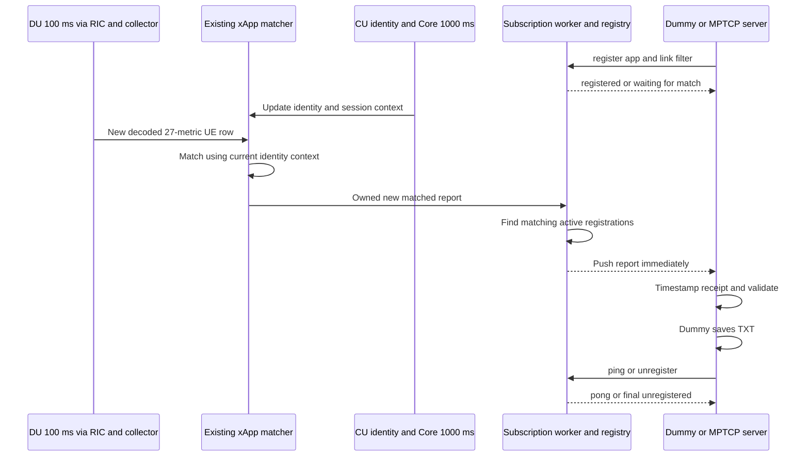

# xApp subscription and bound KPM report push plan

Deployment context, October 29: the [current radio design](../docs/dual_link_radio_design.md)
uses DU1 at 3660 MHz / 20 MHz and DU2 at a 3600-MHz n78 interface / 40 MHz,
designed for 9250-MHz OTA through Pi-Radio. Both UEs connected in the current
direct test without converters. The 120/360-second delivery evidence used
the earlier 20-MHz DU2 profile. Radio changes retain the version-2 wire
contract, current-IP matching and 100-ms DU cadence; path labels do not
identify actual RF conversion or substitute for UE identity.

Extend the existing **27-metric identity xApp at 100 ms** with an application
subscription service. An application such as the MPTCP server registers with the
xApp. Each newly generated, successfully matched KPM report is offered to every
matching registered application, retaining the report's existing link, UE,
CU/Core/session and current IP association. The example dummy application receives
these pushes and saves them to TXT. Validate connection stability and the added
time between report generation and application receipt.

| Field | Value |
| --- | --- |
| Plan | 2 |
| Task | `xapp-kpm-app-subscription` |
| Status | Implemented; 107/107 normal and sanitizer offline cases, 60-second paced delivery, and 120/360-second single-dummy live E2 delivery pass; 30-minute and live fault acceptance pending |
| Created at | 14 : 15: 11 Oct 11, 2026 EDT |
| Last updated at | Oct 26, 2026 EDT, after the six-minute live run |
| Time zone | `America/New_York` |
| Developer | Codex |
| Reviewer | To be assigned |
| Falcon inspected HEAD | `d4fbd0846c28fe055aea887d4e015c0b86255ab9`, plus the current uncommitted base5 prototype |
| FlexRIC inspected HEAD | `3597413fb564ceb778778e7c3dde4534a2c321d5`, plus the current uncommitted base5 prototype |
| OCUDU inspected HEAD | `9bbf6398507a30e469df31e4667056577b2af2c5` |
| Acquisition baseline | 27 raw DU KPM names, DU producer/subscription/granularity 100 ms; CU identity and Core polling 1000 ms |
| Execution order | Integrate subscriptions at the existing matched-report output; validate the full 27-metric path directly at 100 ms |
| Initial deployment | xApp and dummy/MPTCP server on the same Spark host; loopback TCP |
| Current authorization | Offline implementation completed; operator-run live captures are available for analysis, reporting and archival |

This revision supersedes the previous base5 → rf7 → expanded 1000 → 200 → 100 ms
execution order. **Five- or seven-metric live acceptance is no longer a prerequisite
for this task.** Their existing code, configs and offline results remain reusable
transport regressions. The active task starts from the working 27-metric matched
report pipeline. Maintain this single active plan; the
[previous text](../docs/evidence/2026-10-26_kpm_app_subscription/plan_before_du27_revision.txt)
is retained only as historical evidence.

## Implementation checkpoint

The subscription-mode coordinator now routes the existing mapper's newly matched
27-metric snapshots to a bounded loopback publisher. Registration, all/exact
filters, heartbeat, disconnect/unregister cleanup and immutable link/UE/CU/Core/IP
bindings are implemented. The independent dummy validates socket reports and
writes its own TXT asynchronously. Acquisition remains independent of app churn.

Both normal and ASan/UBSan collector verification pass **107/107 mandatory cases,
zero skipped**, including 23 subscription cases. A separate 60-second original-pace
archived-input run delivers and writes all 1,140 eligible reports to the all-link
dummy and 570 to the exact-link dummy. Complete source/receipt/TXT comparisons pass;
report-ready-to-receive p99 is 3.380/3.595 ms. The final replay has no ingress/client
overflow or expired report. An initial EOF ordering failure is retained with its
fix and dedicated regression.

See the [implementation report](../docs/reports/du27_app_subscription_2026-10-26.md),
[interface and commands](../docs/kpm_app_interface.md) and
[retained manifest](../docs/evidence/2026-10-26_du27_app_subscriptions/manifest.json).
Sanitizers instrument the changed collector, with the existing SDK/plugin reused.
That offline checkpoint started no equipment. Subsequent operator-run
[120-second](../docs/reports/du27_app_subscription_live_2026-10-26.md) and
[360-second](../docs/reports/du27_app_subscription_6min_live_2026-10-26.md) live E2
tests use one all-links dummy. They deliver and write all 2,400 / 7,200 reports,
with push p99 2.314 / 3.595 ms. The six-minute run additionally verifies every raw
DU row in its subscription window and normal three-subscription E2 cleanup.
The 30-minute workload, live fault cases and reviewer acceptance remain open.

## Verified starting point

Read-only source/configuration inspection and a fresh scan of the archived raw
rows confirm the operator's current baseline:

| Evidence | Finding |
| --- | --- |
| [Expanded E2 configuration](../configs/flexric/xapp_ue_identity_expanded.conf) | Exactly the 27 DU actions in `metrics.EXPANDED`; DU 100 ms, CU identity 1000 ms |
| [Metric registry](../scripts/ue_identity/metrics.py) and [reference](../docs/du_kpm_metrics_reference.md) | Raw metric names, units and INTEGER/REAL/noValue semantics already exist; derived failure ratios remain separate |
| [Coordinator](../scripts/ue_identity/xapp_ue_identity.py) | `run.handle()` calls `Mapper.ingest()`, then writes each generated record to stdout NDJSON and optional TXT |
| [Matcher](../scripts/ue_identity/mapping.py) | Generated records already contain full DU/UE identity, binding status/reason, CU/Core/session relation and current UE IPv4 |
| [TXT formatter](../scripts/ue_identity/text_report.py) | `format_record()` already formats bound identity and KPM values for a human-readable report |
| [October 25 live report](../docs/reports/dual_ue_27kpm_stability_report_2026-10-25.md) | Six-minute dual-UE acquisition and association run at nominal 100 ms |
| [October 26 raw-data recheck](../docs/evidence/2026-10-26_kpm_app_subscription/du27_baseline_recheck.json) | 7,158 rows, all with exactly 27 names and 100 ms granularity; 3,579 rows per DU; 7,138 matched, 19 ambiguous and 1 unresolved |

The 20 startup rows without a current match must stay explicitly unbound. The
existing matched records carry `cu_reported_du_scope` in this captured deployment.
Do not infer associations from DU numbering, IP subnet, traffic rate, or FR1/FR3
labels. The admitted `du36-cuue28-v1` CU allocation and existing reuse/quarantine
rules remain in force; the CU index is not a shared lifecycle generation token.
Diagnostic invocations retain their seven-metric default. Subscription mode now
selects 27 metrics by default and validates the expanded 100 ms DU/1000 ms CU
configuration before source startup.

Current compact matched report payloads in that archive are 2,731–2,905 UTF-8
bytes before the new subscription envelope. This is a sizing observation for
the existing reports, not a bound on all future frames.

The [earlier base5 prototype](../docs/evidence/2026-10-26_kpm_app_subscription/base5_interface_reference.txt)
passed 25 offline transport cases and a synthetic demonstration. It does not yet
publish the 27-metric matched reports or their CU/Core/IP bindings. Those results
cannot establish the new application's correctness, stability or timeliness.

## Required behavior and scope

1. The xApp listens for application subscription requests, validates each request,
   creates a registry entry and acknowledges admission before delivering data.
2. It continues the existing shared DU/CU acquisition and Core polling independently
   of application registration. An application never creates or deletes an E2
   subscription, changes source periods or changes the identity matching policy.
3. For each new report returned by the existing matcher, preserve an immutable
   snapshot of its full identity, association and 27 measurements. After a current
   match succeeds, consult the app registry and enqueue the report to every
   application whose filter matches that snapshot.
4. Publishing follows **actual DU arrivals and report generation**. A DU's nominal
   100 ms period normally yields about ten reports per second per active UE/link.
   There is no independent 1-second batch, periodic retransmission of the latest
   report, wait for the other DU, or wait for a new CU/Core poll on every DU row.
5. In subscription mode, the xApp's routine report destination is application
   push. It does not write a per-report TXT file or require stdout redirection to
   construct or transport reports. The dummy owns the required TXT output.
6. The dummy registers, receives and validates bound reports, records receipt
   times, saves TXT, maintains the connection and unregisters cleanly. Its evidence
   must establish stable receipt and bounded added delay at the full 27-metric rate.

MPTCP is a real intended consumer of this interface. This task defines delivery
of link/UE/IP information to it and can use its future client implementation.
Changing routing, MPTCP subflows, path selection or the video algorithm is outside
this subscription mechanism. New KPM metrics and new cell/DU-health scopes are
also outside the current 27-metric UE-report task.

The existing standalone diagnostic capture remains available explicitly. Optional
bounded evidence capture can be enabled for validation, but TXT/file/terminal
output is not the production forwarding path. Current source consistency caveats
remain with the measurements; transport equality does not certify PHY calibration
or synchronized snapshots across getters.

## Integration architecture



Use the existing path:

`e2_collector.c → bounded internal pipe/events → Mapper.ingest() → matched report → subscription worker → application`.

The implementation entry point is the existing Python coordinator's
`run.handle()` output boundary. Introduce a publisher/sink abstraction there;
reuse the existing collector, metric registry, association logic and TXT formatter.
**Do not build a second DU-only path that omits CU/Core matching**, and do not
parse human TXT or terminal output to reconstruct application reports. The
collector's existing machine-readable internal events are valid inputs.

Keep responsibilities separate:

- The existing collector/SDK controller owns E2 acquisition, static subscription
  handles and normal cleanup. Preserve owned event handoff after callback return.
- The coordinator owns ordering of DU/CU/Core events and identity resolution.
  Only a newly processed DU row produces a new measurement report. CU/Core updates
  refresh association state; they do not fabricate or replay DU measurements.
- A nonblocking publisher worker owns listener sockets, registration/lifecycle,
  filtering, JSON framing, per-client queues, write offsets and timeouts. The
  matcher makes a bounded nonblocking handoff and continues processing events.
- The dummy separates socket reception/timestamping from bounded TXT writing, so
  a slow disk or terminal does not silently distort application receipt timing.

The current collector already performs bounded internal event serialization.
This task must add no application socket, TXT, terminal or subscriber work inside
its SDK callback. No client operation may hold an acquisition or mapper queue lock.

Start the listener independently of source readiness, so apps can register into
`waiting_for_match` while startup completes. The service must remain responsive
while the collector initializes. First-version DU/RIC membership remains static;
a restart after membership changes is separate from app reconnect. Do not claim
automatic SDK/E2 reconnection from implementing the app TCP lifecycle.

## Bound report and link contract

Freeze the published profile as **`du27_bound_v1`**. Its 27 raw names come from
`metrics.EXPANDED` and the existing E2 configuration, without a second handwritten
metric list. Keep the existing two derived failure ratios in `derived_metrics`,
separate from the 27 raw measurements.

One pushed report represents one newly generated DU/UE sample row. Do not combine
DUs, UEs, different samples or different source windows. Retain:

| Data | Required fields and semantics |
| --- | --- |
| Full radio key | MCC, MNC, node type, gNB ID and bit length, DU ID, UE ID type and gNB-CU UE F1AP ID; optional RAN UE metadata |
| Current binding | `binding_status`, reason, method, assurance, serving DU, CU UE index where present, GUAMI, AMF/RAN UE NGAP IDs, SUPI, PDU session ID, DNN and UE IPv4 |
| Report provenance | Existing mapper instance/sequence, source indication/row identity, sample index, granularity and incomplete flag |
| Metric data | All 27 names with original decoded types, numeric values, units and explicit unavailable states; derived metrics kept distinct |
| Freshness | Header and callback times, report receive/ready times, identity source ages or validity deadline, queue/publish times and source/drop counters |

Expose a deterministic `link_id` derived from the full radio key, with the full
key also present. FR1/FR3 display labels can be explicit configuration metadata;
they cannot replace that key. A F1AP number alone is insufficient, particularly
when both DUs use F1AP ID 1. `link_id` is scoped to the current radio context, not
an eternal subscriber identifier or an MPTCP subflow ID.

Carry a publisher-local `binding_revision` when that link's actual association
changes. It helps order delivered association snapshots; it does not prove a
DU/CU context generation and must not bypass the mapper's ambiguity quarantine.
Copy binding metadata when the report is generated. Never look up a newer IP at
socket-write time and attach it to an older queued sample.

Normal `kpm_report` pushes require `binding_status: matched` under the existing
current-context/fresh-only policy. `no_value` measurements do not invalidate an
otherwise valid binding. Startup unresolved, ambiguous, stale or cached bindings
must not appear as currently matched application data. Keep the connection
registered; send an explicit `binding_state`/data-state change with a reason,
and wait for a new currently matched DU report. Do not fabricate zeros, replay
older rows after matching recovers or retroactively relabel the startup rows.

Preserve existing identity release/reuse, Core failure, source TTL and ingress-loss
invalidation rules. Changes to Core/CU state and expiry must update app data state
even if a DU becomes silent. A valid registration does not guarantee current data.
Exact radio-key subscriptions remain registered but waiting when reconnection
changes their UE context; the app must explicitly register a new filter. All-link
subscribers receive a new context only after the existing matcher verifies it.

Keep IEEE-754 precision for finite REALs, signed PHR, valid zero, unsigned INTEGER
limits, noValue, absence and incomplete flags. Do not silently drop unsupported
names or fabricate a valid measurement to maintain the 27-key declaration. Freeze
explicit absence/error encoding in Step 2 and exercise it through the actual
publisher and dummy. The raw source row and its types must remain independently
comparable with the delivered representation.

## Application protocol and lifecycle

Retain loopback TCP `127.0.0.1:8765` and UTF-8 JSON Lines, with full split/coalesced
read and partial-write handling. The expanded envelope is **protocol version 2**;
the earlier version-1 base5 implementation remains a historical prototype, not an
implicit compatibility promise for the new binding schema. Reject unsupported
version/profile combinations explicitly.

One connection owns one registration. App/request IDs remain 1–64 ASCII characters
from `[A-Za-z0-9_.-]`. Use canonical unsigned decimal strings for IDs, sequence
counters and epoch/monotonic microsecond timestamps; preserve MCC/MNC leading zeros.
Metric numeric values, protocol version, bit length and sample index remain JSON
numbers. Any conversion of the existing mapper's numeric sequence into a wire
string is explicit and tested.

An all-currently-matched-links registration is planned as:

```json
{"version":2,"type":"register","request_id":"reg-1","app_id":"dummy-all","expected_profile":"du27_bound_v1","filter":{"mode":"all_matched_links"}}
```

An exact filter uses `mode: links` with 1–32 complete node/UE keys. Keep the
previous full-key shape; optional session constraints, if exposed, are additional
exact matches against the same report snapshot. Unsupported filter forms are
rejected rather than guessed. Admission is allowed before matching KPM exists.

A successful reply must include `registered`, the request/app/subscription IDs,
a fresh broker instance ID, declared profile and 27-name set, actual source kind,
DU period 100 ms, CU/Core periods 1000 ms, filter, current data state and
`best_effort_no_replay` delivery semantics. At registry commit capture the report
**acquisition-entry** cutoff, not just the most recently generated mapper row.
Use the shared monotonic clock to compare callback entry with registry commit;
retain source-instance/indication sequence and sample identity for reconciliation.
If a sequence-based barrier is used instead, it needs a real collector-entry
snapshot, not a counter assigned only after pipe reading or matching.
A callback received before registration but still awaiting association/processing
must not leak into the new subscription afterward. Queue success before data.

A pushed envelope has this shape; `report` is the actual complete bound record,
not a string containing TXT:

```json
{
  "version": 2,
  "type": "kpm_report",
  "subscription_id": "sub-1",
  "broker_instance_id": "example-instance",
  "data_source": "e2",
  "metric_profile": "du27_bound_v1",
  "report_seq": "42",
  "delivery_seq": "1",
  "link_id": "canonical-full-radio-key",
  "binding_revision": "1",
  "report_ready_at_mono_us": "1000000",
  "published_at_mono_us": "1000100",
  "report": {}
}
```

The empty object above marks the complete record defined in the bound-report
contract, which includes `node`, `row.ue`, `row.metrics`, `binding`, `ue_ipv4` and
the existing provenance/timing fields. It is not a valid empty report payload.
Store actual full examples and their schema alongside implementation in Step 2.
Each eligible report is delivered once per active registration; every matching
app gets its own delivery sequence, starting at 1. There is no replay on reconnect.
`report_seq` identifies the newly generated bound report within this broker
instance. Keep original mapper instance/sequence and source indication/row IDs
separately; several UE rows may come from one source callback.

Lifecycle states are `awaiting_registration → registered → draining → closed`.
Data states are separate: `waiting_for_match`, `receiving`, `source_unavailable`
and `binding_invalid`. Define and test transitions and last-report ages. Support:

- `ping`/`pong` every 10 seconds, with current data state and last matching report
  age; expire a registered connection after 30 seconds without a valid request.
- `unregister`: stop adding data, drain intact queued frames, send a final
  `unregistered` acknowledgment and close. No report may follow that acknowledgment.
- EOF/reset, registration/incomplete-frame timeout, overflow and write failure:
  remove the registry entry and its buffers; preserve other apps and acquisition.
- Reconnect: fresh registration/subscription ID, same app ID allowed after cleanup;
  active duplicates, unsupported profiles and malformed requests get stable errors.
- Shutdown: stop admission, stop new report handoff, complete existing collector
  subscription cleanup, and bound client drain. Preserve an already-running
  unregister deadline rather than extending it during shutdown.

`binding_state` notifications are state changes, not KPM reports and do not count
as fresh measurement delivery. Keep ordering with report revisions and queued
frames. Applications receive observation times/validity metadata so they can
reject aged measurements rather than treating every TCP delivery as current.

## Bounds and source-driven publishing

| Resource | Initial bound/policy |
| --- | --- |
| Application connections | 16, including registrations still pending |
| Exact links per registration | 32 |
| Incoming JSON line | 8 KiB |
| Version-2 outgoing frame | 64 KiB including newline; measure actual bound report plus envelope before freezing |
| Publisher ingress | 256 owned reports and 4 MiB accounted payload; reject new arrival on overflow and count it |
| Per-app output | 64 frames and 1 MiB, including control frames; disconnect only the overflowing app |
| Registration / incomplete request | 5 seconds each, monotonic deadlines |
| Pending output without progress | 5 seconds; healthy clients continue |
| Unregister / shutdown drain | At most 2 seconds, without splicing partially sent frames |
| Dummy TXT handoff | Explicit item and byte bounds; record writer delay/failure; a full writer queue fails the run visibly |
| Evidence capture | Sized for the run; all limits/truncation and queue drops visible in summary |

Do not add a timer to emit an old report every 100 ms. The timer in the publisher
serves control deadlines and freshness only. New report events wake it promptly;
coordinator polling intervals and socket scheduling must not introduce a hidden
100 ms or 1-second batching delay. Flush complete frames promptly and inspect
TCP_NODELAY for this TCP interface separately from the existing SCTP setting.

The existing 100 ms DU producer and granularity remain unchanged. CU/Core context
refreshes at 1000 ms are reused according to the existing freshness rules; no
extra Core request is issued per app or per DU report. Low-traffic noValue values
are forwarded when the report has a valid current association. A stopped DU does
not cause fake periodic pushes.

Report acquisition drops, matcher suppressions by reason, ingress/output drops,
active registrations, queue peak/age, serialization errors and per-client closure
reasons. Never infer transport loss from nominal 10 Hz counts alone. Count only
reports actually generated, matched, admitted after the cutoff and eligible for
that client's filter. Separate expected binding suppression from lost delivery.

## Dummy application and TXT ownership

The new dummy uses only the application socket; it does not read the collector,
Core, old TXT output or shared xApp files. Planned CLI support is:

`--app-id`, `--host`, `--port`, `--all-links`/`--links-file`,
`--expected-profile du27_bound_v1`, `--reports`/`--duration`, `--timeout`,
`--text-output`, plus optional structured receipt/timing evidence.

Use the existing `text_report.format_record()` on the received report snapshot
where compatible, preserving link, full UE/session/IP binding and all 27 values.
Add subscription/report/delivery IDs and dummy receipt time to each TXT record.
TXT formatting is a view of received machine data, not an input to the protocol.
No hard-coded five-name check may survive in the expanded dummy path.

Timestamp receipt at the point the full frame is available, before formatting
or writing. Maintain a bounded asynchronous TXT writer, track complete written
records and flush/drain on normal exit. Record socket-receipt, validation and
TXT-write timing separately. Missing/unwritable output, overflow, write errors,
partial final records or missing unregister acknowledgment must produce a
nonzero result. A receive count alone cannot certify successful TXT persistence.

The example workflow is: start xApp subscription service, run all-links and
exact-link dummies together, inspect their TXT and timing summaries, unregister,
then stop the xApp normally. Consumer reconnects must be demonstrated without
restarting the xApp or changing its E2 subscription count.

## Stability and timeliness acceptance

The following are **initial planned acceptance budgets**, not measured results.
Freeze them with workload/configuration before each run; retain outliers and
investigate a miss rather than silently relaxing the limits.

Use per-stage monotonic microsecond timestamps with a documented shared clock
origin on this same-host deployment:

| Event | Measurement point |
| --- | --- |
| `t_callback` | Entry of the existing collector's DU indication callback |
| `t_ready` | Matcher has produced a complete currently matched report snapshot |
| `t_publish` | Matching subscriber frame is serialized/enqueued for transmission |
| `t_receive` | Dummy has a complete frame, before TXT formatting or disk I/O |
| `t_written` | Dummy has successfully written the corresponding TXT record |

Add monotonic callback/ready/publish fields where the existing path has only
wall-clock values. Same-host Python/C timestamps must use the same specified
clock; do not subtract unrelated per-process relative origins. Keep Unix/header
times as provenance. The KPM header-to-client age does not prove PHY sample age
or pure network latency; CU/Core source age is a separate reported quantity.

| Acceptance item | Initial workload and pass condition |
| --- | --- |
| Steady connection | At least 30 minutes, two DUs with one UE each, full 27-name profile, all-links plus exact-link dummy; no unexpected disconnect, crash or registry leak |
| Full delivery | Each eligible post-cutoff matched report received once by every matching healthy app, in per-link source order; zero unexplained duplicates/missing reports and zero cross-link leakage |
| Typed/binding preservation | Exact source/received/TXT agreement for full node/UE/session/IP identity, 27 types/states/units and numeric values; finite REAL comparison uses bit-preserving evidence |
| Added push delay | `t_receive - t_ready`: p95 ≤ 10 ms, p99 ≤ 25 ms, maximum ≤ 100 ms for healthy same-host clients |
| Callback through application | Record `t_ready - t_callback`, `t_publish - t_ready` and `t_receive - t_callback` separately; initial healthy-client p99 callback-to-receipt budget ≤ 100 ms |
| Cadence | During continuously generated/matched 100 ms source rows, per-link receipt interval p99 ≤ 150 ms, no unexplained gap > 200 ms; pair every gap with source/mapper/queue evidence |
| TXT completion | Every received report accepted for persistence has one complete TXT record; report writer queue age and `t_written - t_receive`; zero silent writer loss |
| Resource behavior | Bounded queues and stable RSS trend, zero healthy-client queue drops in steady state; record CPU, actual frame sizes, queue peak and age |
| Lifecycle | Explicit unregister plus EOF/reset/timeout cleanup; at least 20 app reconnect cycles, no replay, duplicate active app or extra E2 subscriptions |
| Slow consumer | Non-reading/slow client or slow TXT writer causes a counted bounded failure for that consumer; healthy app continues with its timing budget and exact report set |
| Identity lifecycle | Startup wait, CU/Core expiry/failure, idle/resume and current IP/context changes preserve matching rules; invalid/cached rows never masquerade as current data |

For two DUs and one UE each, 30 minutes at nominal 100 ms can yield about 36,000
source UE rows. With two all-link clients that is about 72,000 receipt records;
actual counts depend on the generated/matched rows and filters. Size evidence for
all stages and statuses rather than using the old 1000-row capture default.

Run a short functional pass before the long stability run, then test no-client,
normal-client, multi-client and slow-client conditions at the same 100 ms source
settings. Replay/fixtures establish deterministic correctness and publisher
performance; a real 27-metric E2 → matcher → app → TXT run is required for live
acceptance. The historical six-minute acquisition run establishes the input
baseline, not the new subscription timing or 30-minute delivery stability.

## Implementation and verification steps

### Step 1 Freeze the existing 27-metric matched-report baseline

- [x] Verify the 27-name registry, E2 periods, generation/output boundary and
  existing full association fields against source/configuration.
- [x] Recheck archived raw rows: 7,158 complete 27-name/100 ms rows and 7,138
  currently matched records; retain the recheck and historical plan snapshot.
- [x] Capture exact source/binary/configuration identities for the implementation
  run; freeze the bound-report fixtures, startup states and timing/queue workload.

Exit: a reproducible 27-metric matched-report input exists without starting a new
five/seven-metric acquisition project.

### Step 2 Freeze the bound-report schema and registry protocol

- [x] Publish complete version-2 register/status/report/binding-state/ping/
  unregister examples, including exact link filters and 27 raw names.
- [x] Freeze `link_id`, snapshot binding revision, source-entry cutoff, sequence
  semantics, current-binding eligibility, absence/type encoding and clock origins.
- [x] Measure full envelope sizes and freeze byte/count/deadline limits; reject
  unsupported versions/profiles/filters with stable errors.

Exit: a client can register and interpret an actual full bound report without
reading TXT or guessing an identity.

### Step 3 Integrate the listener and publisher with the current xApp

- [x] Add a bounded publisher module at the existing `Mapper.ingest()` output;
  preserve the original acquisition/matching logic and direct 100 ms source rate.
- [x] Add the protocol/registry worker and explicit subscription-mode CLI/config.
  Start the listener independently of source readiness and support continuous
  service operation until SIGINT/SIGTERM, rather than the current finite-only run.
- [x] Route new matched reports to registered matching apps; propagate binding/
  source state separately. Keep routine TXT and per-report stdout writes off the
  subscription path; diagnostic file capture remains explicitly selectable.
- [x] Reuse transport concepts/tests from the base5 prototype where useful;
  adapt all five-name assumptions and do not require its standalone E2 source.
- [x] Verify bounded ownership, ordering, partial I/O, backpressure and publisher
  shutdown offline; implement collector cleanup without app-driven E2 changes.
  Live SDK/E2 deletion verification remains in Step 6.

Exit: the actual existing 27-metric association pipeline drives the app service,
with no console/TXT parsing or timer-based replay.

### Step 4 Implement the independent dummy and TXT writer

- [x] Implement version-2 admission, full-key filtering, profile/binding/value
  checks, ping/pong, unregister and reconnect semantics.
- [x] Timestamp full-frame receipt before work; use bounded TXT writing and retain
  complete link/UE/session/IP details, all 27 KPM values and receipt metadata.
- [x] Emit structured timing/counter summaries and nonzero failures for protocol,
  falsely current identity, socket/queue, output-file or lifecycle errors.
  A legitimate waiting/invalid-binding state keeps registration alive and is
  recorded separately rather than being misclassified as a TCP failure.

Exit: the dummy receives machine pushes and produces its own complete TXT file.

### Step 5 Verify the integrated 27-metric path offline

- [x] Drive the actual service with retained decoded CU/DU/Core events through
  the production mapper, plus fresh 27-metric codec fixtures where applicable.
  Feed replay with acquisition-entry sequence and monotonic timing semantics.
- [x] Run two actual dummies against the real publisher at a 100 ms replay pace;
  test duplicate F1AP IDs across DUs, multiple UEs on a DU, all/exact filters,
  current IP changes, stale/missing/ambiguous inputs and noValue/zero/incomplete data.
- [x] Test success-before-data and a pre-registration callback that finishes later,
  EOF/reconnect, duplicates, malformed/oversized/split/coalesced frames, partial
  writes, queue saturation, no-client operation and quiet/stopped input.
- [x] Force a slow socket and a slow/failing TXT writer deterministically. Preserve
  healthy-client reports, protocol framing, bounded memory and explicit counters.
- [x] Compare each generated eligible bound snapshot to independent dummy receipt
  and TXT data; retain per-stage timing and all mandatory per-case outcomes.
- [x] Re-run relevant existing identity/27-metric regressions and memory/concurrency
  checks appropriate to changed modules. Label old base5-only results separately.

Exit: full 27-metric bound-report/socket/TXT correctness and lifecycle pass offline
with zero skipped required cases; the new live gate remains explicitly pending.

### Step 6 Verify live functional delivery at the existing 100 ms setting

- [x] Start the installed RIC/CU/DUs/Core and verify the already-supported 27-metric
  input and current bindings. Use fresh, recorded instances and configurations.
- [ ] Start the subscription-mode xApp and all/exact dummy clients. Confirm each
  registration, full bound pushes, dummy TXT completeness and normal unregister.
  One all-links dummy passes the 120/360-second live runs; exact-link delivery is
  covered offline and has no live result in these runs.
- [x] Collect at least 60 seconds of controlled activity, with at least 100
  currently matched delivered reports per active link. Compare all captured
  source/received/TXT records and distinguish startup/binding suppression.
- [ ] Exercise app disconnect/reconnect without restarting the xApp or increasing
  its E2 subscription count; verify source and collector cleanup on service exit.
  Normal collector/E2 cleanup passes the six-minute run; live reconnect is pending.

Exit: actual DU → existing matcher → registry/push → independent dummy TXT passes
for both current links at 100 ms. No 1000/200 ms forwarding gate is imposed.

### Step 7 Accept stability and timeliness

- [ ] Freeze the stated same-host workload/budgets, then run the 30-minute stable
  two-DU/two-client workload with complete counters, timings and TXT verification.
- [ ] Run at least 20 app reconnects and separate no-client/slow-client/slow-writer
  cases; distinguish deliberate removal from unexpected disconnect or source loss.
- [ ] Reconcile every eligible source report with client receipts and TXT records;
  analyze latency/cadence percentiles/maxima, gaps, source ages, CPU/RSS and queues.
- [ ] Retain outliers, failures and normal collector/E2 shutdown. A period setting,
  a short receipt count or an old acquisition report cannot close these gates.

Exit: measured connection stability, full identity/value delivery and the frozen
added-delay/cadence budgets pass for the declared workload.

### Step 8 Deliver and review

- [x] Update the interface guide, service/dummy launch commands and handoff around
  the final 27-metric binding implementation; mark obsolete prototype commands.
- [ ] Retain source changes, exact metric/config identities, binary hashes,
  offline/live manifests, binding snapshots, receipt/TXT files and timing analysis.
  Offline and 120/360-second live artifacts are retained; add the remaining
  long-run/fault artifacts after their acceptance workloads.
- [x] Record acquisition baseline, integrated offline correctness, live functional
  delivery, connection stability and timeliness as separate acceptance results,
  distinguishing the passing 120/360-second live runs from remaining live gates.
- [ ] Reviewer verifies registry cutoff, immutable association snapshots, correct
  filters, source-driven publication, bounded slow-consumer isolation and cleanup.

Exit: the requested subscription mechanism is accepted on the existing 27-metric
100 ms xApp with independent application TXT and timing/stability evidence.

## Rollback

Stop/unregister dummy applications, stop the subscription service normally and
verify collector subscription cleanup. Return to the existing 27-metric diagnostic
xApp and its `--text-output` command if delivery integration fails. Preserve the
working DU/CU/Core matching, 100 ms producer/configuration, metric registry and
prior experiment evidence. Reversing application delivery does not require
rolling back source metrics, RF patches, identity scope fixes or SCTP_NODELAY.
